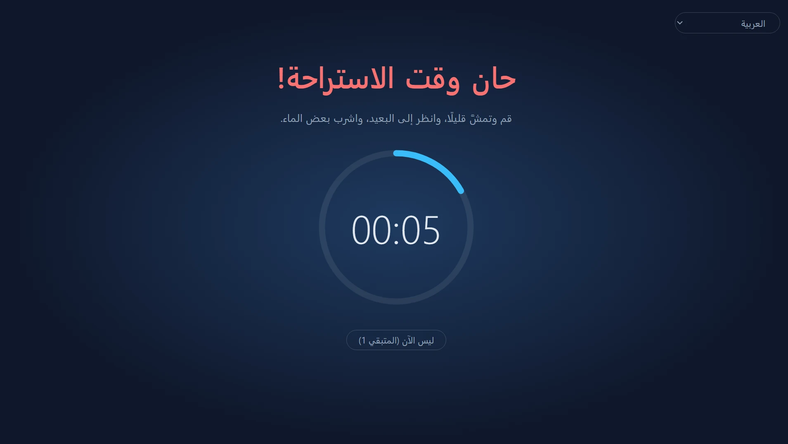
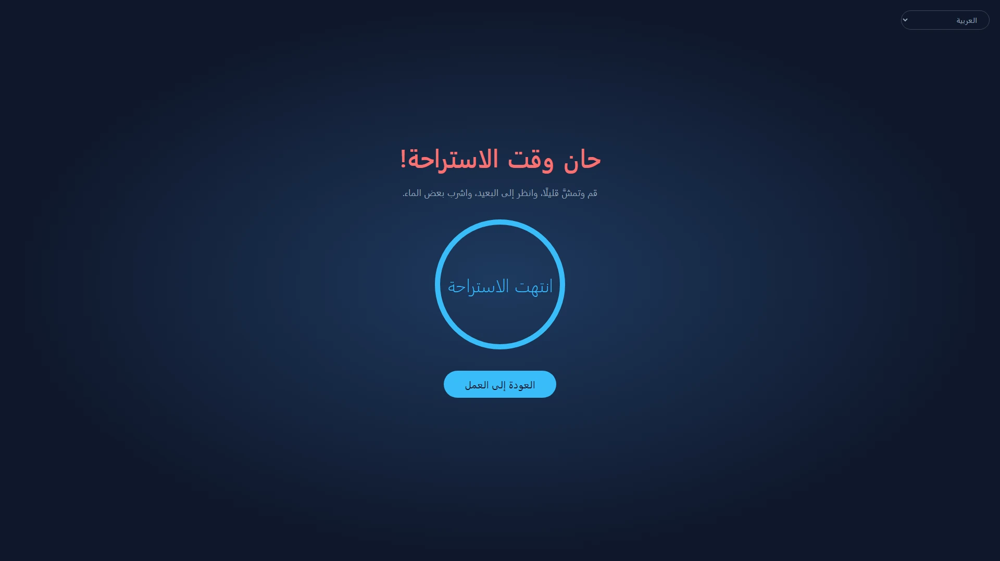
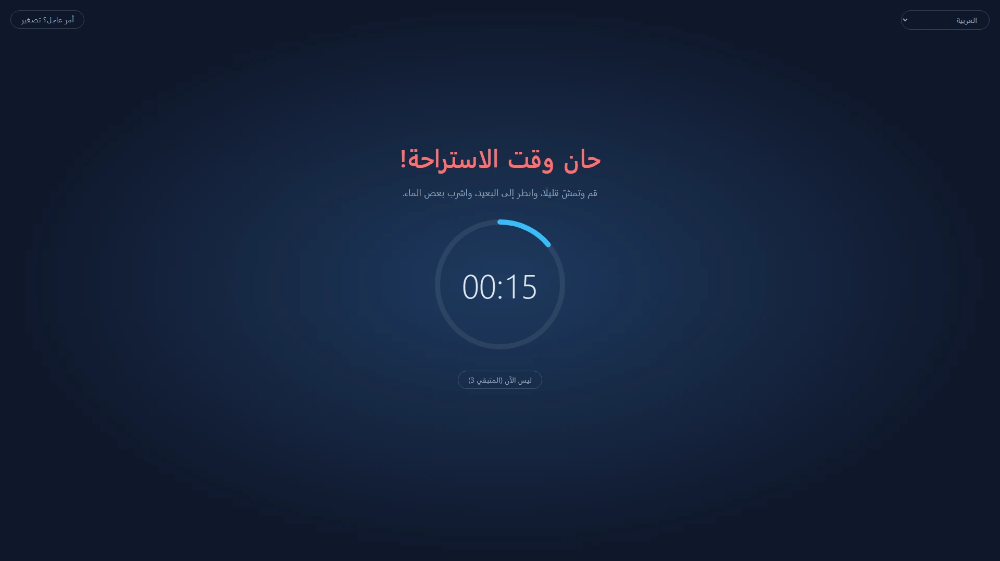
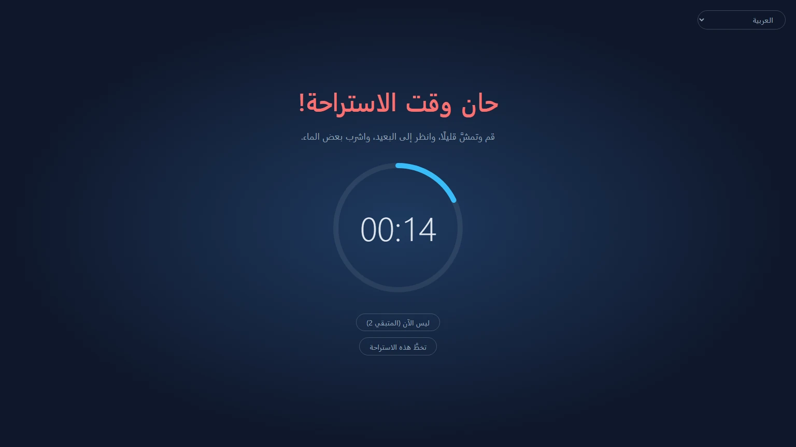
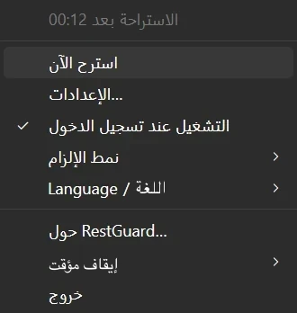

<p align="center">
  
</p>

<h1 align="center">RestGuard</h1>

<p align="center"><strong>مذكّر الاستراحة الذي لا يمكنك تجاهله.</strong></p>

<p align="center">مذكّر استراحة مجاني ومفتوح المصدر لأنظمة Windows وmacOS وLinux، يمكنه أن يذكّرك بالراحة أو يلزمك بها.</p>

<p align="center">
  <a href="https://github.com/HansTanzi/RestGuard/releases/latest"></a>
  <a href="https://github.com/HansTanzi/RestGuard/releases"></a>
  <a href="#التثبيت"></a>
  <a href="#windows"></a>
  <a href="https://apps.microsoft.com/detail/9PJ3SXDPCNN0"></a>
  <a href="#الترخيص"></a>
</p>

<p align="center">
  التثبيت على <a href="#windows"><b>Windows</b></a> · <a href="#macos"><b>macOS</b></a> · <a href="#linux"><b>Linux</b></a> · <a href="https://hanstanzi.github.io/RestGuard/">الموقع</a>
</p>

<p align="center"><a href="README.md">English</a> | <a href="README.zh-CN.md">简体中文</a> | <a href="README.de.md">Deutsch</a> | <a href="README.ja.md">日本語</a> | <a href="README.es.md">Español</a> | <a href="README.pt-BR.md">Português (Brasil)</a> | <a href="README.ko.md">한국어</a> | <a href="README.fr.md">Français</a> | <a href="README.it.md">Italiano</a> | <a href="README.id.md">Bahasa Indonesia</a> | <a href="README.hi.md">हिन्दी</a> | <a href="README.bn.md">বাংলা</a> | العربية</p>

<div dir="rtl">



مذكّر استراحة متعدد المنصات بثلاثة مستويات إلزام مدمجة: يمكنه أن يذكّرك بأخذ استراحة أو يلزمك بأخذها. الإلزام هو ما يميّزه عن غيره من مذكّرات الاستراحة.

- إلزام مرتفع: يفعل كل ما بوسعه لتأخذ الاستراحة.
- إلزام متوسط: يمكنك مواصلة العمل، لكن بإزعاج يكفي لدفعك إلى الراحة.
- إلزام منخفض: مثل مذكّرات الاستراحة الأخرى، يكتفي غالبًا بالتذكير.

مبني باستخدام Rust + Tauri 2 + Svelte. وهو خليفة [ProtectEyes](https://github.com/HansTanzi/ProtectEyes)، وهو تطبيق C#&lrm; لنظام Windows فقط نشرته مفتوح المصدر قبل سنوات.

ثبّته بسطر واحد:

```sh
winget install HansTanzi.RestGuard            # Windows
brew install --cask hanstanzi/tap/restguard   # macOS
```

يغطي قسم [التثبيت](#التثبيت) كلًا من Microsoft Store وAPT وScoop وHomebrew على Linux والتنزيلات المحمولة.

## لماذا RestGuard

معظم مذكّرات الاستراحة سهلة التجاهل: يظهر إشعار فتغلقه، وتتحول «خمس دقائق أخرى فقط» إلى ساعتين. ترتبط الفترات الطويلة أمام الشاشة بإجهاد العين وجفافها وآلام الرقبة والظهر وإصابات الإجهاد المتكرر (RSI). ولا تفيد نصائح مثل قاعدة 20-20-20 أو استراحة قصيرة كل ساعة إلا إذا أخذت الاستراحة فعلًا.

RestGuard لمن يعرفون أن عليهم أن يرتاحوا لكنهم يؤجلون ذلك دائمًا:

- **لا يمكنك إغلاقه بنقرة.** في الإلزام المرتفع، تغطي الطبقة كل الشاشات حتى تنتهي الاستراحة.
- **يعرف متى لا يقاطعك.** التأجيل ووضع الطوارئ واكتشاف الاجتماعات تمنع الاستراحة من إفساد مكالمة أو إضاعة عمل لم تحفظه.
- **أنت تختار مدى صرامته.** اختر الإلزام المرتفع أو المتوسط أو المنخفض، أو أنشئ نمطك الخاص.

## الميزات

### استراحات تحدث فعلًا

- يفرض استراحة 10 دقائق بعد كل 60 دقيقة عمل (يمكن تعديل المدتين)
- شاشات متعددة: تُغطّى كل شاشة
- لا يمكن إغلاق الطبقة أثناء الاستراحة (لا يفعل Alt+F4 شيئًا)، ولا يمكنك الخروج من شريط النظام
- أجّل 5 دقائق، حتى 3 مرات؛ يُعاد ضبط العدد بعد استراحة كاملة
- وضع الطوارئ: هل هناك أمر لا يحتمل الانتظار؟ صغّر الطبقة لحظة لتحفظ عملك بينما يستمر العد التنازلي



### ثلاثة أنماط مدمجة لاحتياجات مختلفة

| | إلزام مرتفع | إلزام متوسط (افتراضي) | إلزام منخفض |
|---|:---:|:---:|:---:|
| الأنسب لـ | انضباط صارم، والتغلب على «خمس دقائق أخرى فقط» | العمل اليومي | تذكير لطيف |
| مرات التأجيل | 1 | 3 | 3 |
| وضع الطوارئ (تصغير الطبقة) | ✗ | ✓ | ✓ |
| اكتشاف تطبيقات الاجتماعات | ✗ | ✓ | ✓ |
| إغلاق / تخطي هذه الاستراحة | ✗ | ✗ | ✓ |
| تغطية الشاشة | 100% | 100% | 80% |
| طبقة قابلة للسحب | ✗ | ✓ | ✓ |





### قابل للتخصيص إلى حد كبير

إذا لم تناسبك الأنماط المدمجة، فاختر **نمط مخصص جديد…** في الإعدادات لتبدأ من أي نمط، وامنحه اسمًا (يمكنك إعادة تسميته أو حذفه لاحقًا)، واضبط كل خيار:

- عدد مرات التأجيل، وهل يُسمح بالخروج، وهل يُسمح بتخطي هذه الاستراحة
- هل وضع الطوارئ متاح، وإلى أي حد تصغر الطبقة
- كم تغطي الطبقة من كل شاشة (10% ~ 100%)، وهل يمكن سحبها داخل شاشتها
- هل تُكتشف تطبيقات الاجتماعات

احتفظ بالعدد الذي تريده من الأنماط المخصصة وبدّل بينها في أي وقت. مدد العمل والاستراحة والتأجيل والخمول مشتركة بين الأنماط. وإذا كنت تفضّل تعديل الملفات يدويًا، فإن [`config.toml`](#الإعداد) يفي بالغرض أيضًا.

### لا يعترض طريقك حين يهم الأمر

- اكتشاف الاجتماعات (Windows وmacOS): ما دام Zoom أو Microsoft Teams أو Webex أو Tencent Meeting في المقدمة (أو يستخدم الميكروفون على Windows)، تنتظر الاستراحة انتهاء الاجتماع؛ ويمكنك أيضًا أثناء الاستراحة النقر على «أنا في اجتماع» ليُذكّرك بعد ساعة
- اكتشاف الخمول: بعد 5 دقائق دون إدخال من لوحة المفاتيح أو الفأرة تُعدّ غائبًا ويتوقف العد التنازلي للعمل؛ والغياب مدة استراحة كاملة يُحسب استراحة كاملة، فلا تُرسل إلى الراحة فور عودتك

### لا تفوّت نهاية الاستراحة أبدًا

- يُشغَّل صوت عند انتهاء الاستراحة: اختر صوتًا مدمجًا أو ملفك الصوتي
- إشعارات الهاتف: تلقَّ إشعارًا على هاتفك (Android وiOS) عبر [ntfy](https://ntfy.sh)، لتعرف متى تعود حتى بعد ابتعادك؛ وعلى Android يمكنه الرنين كمنبّه حتى توقفه
- الساعات الذكية: يُنسخ إشعار الهاتف إلى Apple Watch أو Wear OS أو Galaxy Watch أو ساعة أو سوار مقترن من Xiaomi أو Huawei أو Garmin أو ما شابه، فتكفي نظرة إلى معصمك (راجع [إشعارات الهاتف والساعة الذكية](#إشعارات-الهاتف-والساعة-الذكية))

### صغير وسريع

- مبني باستخدام Rust + Tauri 2 على WebView النظام، دون محرك متصفح مضمّن، لذا لا يكاد يستهلك أي موارد أثناء عمله في الخلفية
- صغير جدًا: لا يتجاوز حجم التنزيل نحو 3–6 ميجابايت، أي أصغر بعشرات المرات من البدائل المبنية على Electron (راجع [المقارنة](#المقارنة))
- محمول: ملف exe واحد على Windows، و`.app` يكفي فك ضغطه وتشغيله على macOS؛ احذفه لإلغاء التثبيت

### والمزيد

- متعدد المنصات: Windows وmacOS وLinux، ويمكن تثبيته وتحديثه عبر Microsoft Store وWinGet وScoop وHomebrew وAPT (راجع [التثبيت](#التثبيت))
- قائمة شريط النظام: الوقت المتبقي، الاستراحة الآن، الإعدادات، التشغيل عند تسجيل الدخول، تبديل نمط الإلزام، الإيقاف المؤقت
- نسخة واحدة قيد التشغيل
- مجاني ومفتوح المصدر بترخيص مزدوج متساهل MIT / Apache-2.0 (راجع [الترخيص](#الترخيص))
- متوفر بالصينية المبسطة والإنجليزية والهندية والإسبانية والعربية والفرنسية والبنغالية والبرتغالية والألمانية واليابانية والإيطالية والكورية والإندونيسية. تتبع لغة الواجهة النظام افتراضيًا (الإنجليزية إذا كانت لغة النظام غير مدعومة)؛ غيّرها في أي وقت من القائمة الفرعية «语言 / Language» في شريط النظام



## المقارنة

| | RestGuard | [Stretchly](https://github.com/hovancik/stretchly) | [Workrave](https://github.com/rcaelers/workrave) | [Safe Eyes](https://github.com/slgobinath/SafeEyes) |
|---|:---:|:---:|:---:|:---:|
| Windows | ✓ | ✓ | ✓ | ✗ |
| macOS | ✓ | ✓ | ✗ | ✗ |
| Linux | ✓ | ✓ | ✓ | ✓ |
| حجم التنزيل | **~3–6 MB** | Windows 163 MB<br>macOS 187 MB<br>Linux 155 MB | Windows 61 MB<br>Linux 64 MB| Linux 0.3 MB |
| الإلزام | 3 مستويات + أنماط مخصصة | وضع صارم تشغيل/إيقاف | يمكنه حظر الإدخال والشاشة | يمكنه تعطيل لوحة المفاتيح |
| يؤخّر الاستراحات أثناء الاجتماعات | يكتشف Zoom وTeams وWebex وTencent Meeting | يتبع «عدم الإزعاج»؛ استثناءات لكل تطبيق | — | — |
| تنبيه الهاتف / الساعة الذكية عند انتهاء الاستراحة | ✓ (ntfy) | — | — | — |
| التقنيات | Rust + Tauri (WebView النظام) | Electron (يتضمن Chromium) | C++&lrm; | Python + GTK |
| الترخيص | MIT / Apache-2.0 | BSD-2-Clause | GPL-3.0 | GPL-3.0 |

— تعني أن الميزة غير مدمجة. أحجام التنزيل مأخوذة من أحدث إصدار على GitHub لكل مشروع (Stretchly 1.22.1 وWorkrave 1.11.5 وSafe Eyes 3.5.1): مثبّت Windows أو ملف exe، وتنزيل macOS، وملف `.deb` لنظام Linux. استنادًا إلى توثيق كل مشروع حتى نوفمبر 2026؛ إذا كان هناك خطأ، يُرجى [فتح issue](https://github.com/HansTanzi/RestGuard/issues).

## التثبيت

### Windows

احصل عليه من [Microsoft Store](https://apps.microsoft.com/detail/9PJ3SXDPCNN0)، ويُحدَّث تلقائيًا.

أو ثبّته باستخدام [WinGet](https://learn.microsoft.com/windows/package-manager/winget/):

```powershell
winget install HansTanzi.RestGuard
```

أو باستخدام [Scoop](https://scoop.sh):

```powershell
scoop bucket add hanstanzi https://github.com/HansTanzi/scoop-bucket
scoop install hanstanzi/restguard
```

أو نزّل `RestGuard_<version>_x64.exe` من [Releases](https://github.com/HansTanzi/RestGuard/releases/latest) وشغّله. إنه ملف exe واحد محمول بلا مثبّت: ضعه في أي مكان واحذفه لإلغاء التثبيت. لا يُحدَّث تلقائيًا؛ نزّل الإصدار الجديد للتحديث.

يتطلب بيئة تشغيل WebView2 (مثبتة مسبقًا على Windows 11).

### macOS

ثبّته باستخدام [Homebrew](https://brew.sh) (إصدار شامل لمعالجات Apple Silicon وIntel):

```sh
brew install --cask hanstanzi/tap/restguard
```

إذا كنت قد أضفت هذا المستودع سابقًا باستخدام tap (`brew tap hanstanzi/restguard https://github.com/HansTanzi/RestGuard`)، فانتقل إلى tap الجديد لتواصل تلقي التحديثات: `brew untap hanstanzi/restguard && brew install --cask hanstanzi/tap/restguard`.

أو نزّل `RestGuard_<version>_universal.zip` من [Releases](https://github.com/HansTanzi/RestGuard/releases/latest)، وفك ضغطه وانقل `RestGuard.app` إلى `/Applications`. لا يُحدَّث تلقائيًا؛ نزّل الإصدار الجديد للتحديث.

يعمل RestGuard من شريط القوائم وليس له أيقونة في Dock. التطبيق غير موثّق لدى Apple؛ ويزيل cask علامة العزل عند التثبيت. إذا نزّلت ملف zip يدويًا، فشغّل `xattr -dr com.apple.quarantine /Applications/RestGuard.app` قبل التشغيل الأول، وإلا فلن يفتحه macOS.

### Linux

على Debian/Ubuntu (x86_64)، أضف [مستودع APT](https://github.com/HansTanzi/apt)، ثم ثبّت وحدّث باستخدام `apt`:

```sh
sudo install -d /etc/apt/keyrings
curl -fsSL https://hanstanzi.github.io/apt/hanstanzi.gpg | sudo tee /etc/apt/keyrings/hanstanzi.gpg > /dev/null
echo "deb [signed-by=/etc/apt/keyrings/hanstanzi.gpg] https://hanstanzi.github.io/apt stable main" | sudo tee /etc/apt/sources.list.d/hanstanzi.list
sudo apt update && sudo apt install rest-guard
```

تصل الإصدارات اللاحقة عبر `sudo apt update && sudo apt upgrade`. يمكنك أيضًا تثبيت `.deb` مباشرة من [Releases](https://github.com/HansTanzi/RestGuard/releases/latest) (`sudo apt install ./RestGuard_*_amd64.deb`)، لكنه لن يُحدَّث حينها.

للتوزيعات الأخرى، نزّل من [Releases](https://github.com/HansTanzi/RestGuard/releases/latest). على Fedora/openSUSE، ثبّت `.rpm`:

```sh
sudo dnf install ./RestGuard_*_x86_64.rpm      # Fedora
sudo zypper install ./RestGuard_*_x86_64.rpm   # openSUSE
```

على Arch، ثبّت `.pkg.tar.zst`:

```sh
sudo pacman -U ./RestGuard_*_x86_64.pkg.tar.zst
```

على أي توزيعة (x86_64، glibc 2.35+&lrm;)، يمكنك أيضًا التثبيت والتحديث باستخدام [Homebrew](https://brew.sh). لا يستطيع Homebrew تثبيت مكتبات النظام، لذا ثبّت أولًا WebKitGTK 4.1 وlibayatana-appindicator باستخدام مدير الحزم في توزيعتك:

```sh
sudo apt install libwebkit2gtk-4.1-0 libayatana-appindicator3-1                 # Debian/Ubuntu
sudo dnf install webkit2gtk4.1 libayatana-appindicator-gtk3                     # Fedora
sudo pacman -S webkit2gtk-4.1 libayatana-appindicator                           # Arch
sudo zypper install libwebkit2gtk-4_1-0 libayatana-appindicator3-1              # openSUSE

brew install --cask hanstanzi/tap/restguard
```

يثبّت هذا الملف التنفيذي `restguard` فقط، دون مدخل في قائمة التطبيقات: شغّل `restguard` مرة واحدة، ثم فعّل «التشغيل عند تسجيل الدخول» من قائمة شريط النظام. تصل الإصدارات اللاحقة عبر `brew upgrade`.

تحتاج الطبقة إلى X11 (راجع [قيود المنصات](#قيود-المنصات)).

### التحقق من التنزيلات

تُبنى ملفات Release بعد v0.1.14 تلقائيًا من الشيفرة المصدرية عبر GitHub Actions وتحمل [شهادة موقّعة لمصدر البناء](https://docs.github.com/actions/security-for-github-actions/using-artifact-attestations) تربط كل ملف بتشغيل سير العمل والإيداع اللذين بنياه. للتحقق من ملف منزَّل باستخدام [GitHub CLI](https://cli.github.com):

```sh
gh attestation verify RestGuard_<version>_x64.exe --repo HansTanzi/RestGuard
```

يتضمن كل Release أيضًا `SHA256SUMS.txt`، للتحقق من التنزيل دون GitHub CLI. ضع الملف المنزَّل في المجلد نفسه مع `SHA256SUMS.txt` وشغّل:

```sh
sha256sum -c SHA256SUMS.txt --ignore-missing          # Linux
shasum -a 256 -c SHA256SUMS.txt --ignore-missing      # macOS
```

على Windows، قارن ناتج `Get-FileHash .\RestGuard_*_x64.exe` بالسطر المطابق في `SHA256SUMS.txt` (حالة الأحرف غير مهمة).

### البناء من المصدر

ثبّت المتطلبات المذكورة في [CONTRIBUTING.md](CONTRIBUTING.md#development-setup) (بالإنجليزية)، ثم ابنِ إصدارًا موسومًا:

```sh
git clone https://github.com/HansTanzi/RestGuard
cd RestGuard
git checkout v<version>
pnpm install --frozen-lockfile
pnpm tauri build --no-bundle
```

الملف التنفيذي هو `src-tauri/target/release/restguard` (و`restguard.exe` على Windows). ابنِ باستخدام `pnpm tauri build`، لا `cargo build`: فبناء Cargo العادي هو بناء تطويري يحمّل الواجهة من `localhost:1420` ويعرض نوافذ فارغة.

## الإعداد

افتح **الإعدادات…** من قائمة شريط النظام لتغيير المدد ومستوى الإلزام وتغطية الطبقة واللغة والتشغيل عند تسجيل الدخول. تُطبَّق التغييرات فورًا (تُقفل الإعدادات أثناء الاستراحة). تغيير مدة العمل يعيد تشغيل العد التنازلي الحالي للعمل.

تُحفظ الإعدادات في `config.toml`، الذي يُنشأ عند التشغيل الأول. يمكنك أيضًا تعديله يدويًا؛ ثم أعد تشغيل التطبيق.

| النظام | المسار |
|---|---|
| Windows | `%APPDATA%\io.github.restguard\config.toml` |
| macOS | `~/Library/Application Support/io.github.restguard/config.toml` |
| Linux | `~/.config/io.github.restguard/config.toml` |

```toml
work_minutes = 60.0      # مدة العمل قبل استراحة إلزامية
rest_minutes = 10.0      # مدة كل استراحة
postpone_minutes = 5.0   # مدة كل تأجيل
idle_minutes = 5.0       # عدم الإدخال هذه المدة يُعدّ غيابًا، 0 = إيقاف
level = "medium"         # "high" أو "medium" أو "low" أو اسم نمط مخصص
sound_prompt = true      # تشغيل صوت عند انتهاء الاستراحة
sound = "beep"           # "beep" أو "chime" أو "rise" أو "file" (يشغّل sound_file)
sound_file = ""          # المسار الكامل لملفك الصوتي، يُستخدم عندما sound = "file"
phone_notify = false     # إرسال إشعار إلى هاتفك عبر ntfy عند انتهاء الاستراحة
ntfy_server = "https://ntfy.sh"  # خادم ntfy، العام أو خادمك
ntfy_topic = ""          # الموضوع الذي تشترك فيه في تطبيق ntfy؛ اجعله صعب التخمين

[[fixed_breaks]]         # استراحة ثابتة؛ "work_end" (نهاية يوم العمل) و"lunch" مدمجتان
name = "work_end"
enabled = false          # تأخير الاستراحات المستحقة قبلها مباشرة
time = "18:00"           # HH:MM بنظام 24 ساعة بالتوقيت المحلي
quiet_minutes = 30.0     # الاستراحات المستحقة قبل time بهذه المدة تنتظر حتى time

[[fixed_breaks]]         # الغداء: تبدأ استراحة مدتها rest_minutes عند time
name = "lunch"
enabled = true
time = "12:00"
quiet_minutes = 30.0
rest_minutes = 30.0      # مدة الاستراحة (الغداء واستراحاتك الثابتة)؛ بعد تجاوز مدة الاستراحة العادية يمكنك متابعة استخدام الحاسوب

[[fixed_breaks]]         # أضف استراحاتك، مثل استراحة شاي، بقسم [[fixed_breaks]] لكل منها
name = "استراحة الشاي"
enabled = true
time = "15:00"
quiet_minutes = 15.0
rest_minutes = 15.0

[[profiles]]             # نمط مخصص؛ أضف قسم [[profiles]] لكل نمط
name = "تركيز"
max_postpones = 1        # الحد الأقصى للتأجيل قبل وجوب استراحة كاملة
urgent_mode = false      # السماح بتصغير الطبقة
meeting_detection = true # تأخير الاستراحات أثناء استخدام Zoom وTeams وغيرهما
force_rest = true        # false = يمكن إغلاق الطبقة
allow_skip = false       # عرض «تخطَّ هذه الاستراحة» حتى عند فرض الاستراحات
overlay_coverage = 1.0   # الجزء المغطّى من كل شاشة، 0.1 ~ 1.0
urgent_scale = 0.5       # مقياس وضع الطوارئ (الطبقة المصغّرة) نسبةً إلى القيمة أعلاه، 0.1 ~ 0.9
movable = false          # السماح بسحب الطبقة داخل شاشتها عندما لا تملأ الشاشة
```

### إشعارات الهاتف والساعة الذكية

1. ثبّت تطبيق ntfy على هاتفك ([Android](https://play.google.com/store/apps/details?id=io.heckel.ntfy), [F-Droid](https://f-droid.org/packages/io.heckel.ntfy/), [iOS](https://apps.apple.com/app/ntfy/id1625396347))
2. في إعدادات RestGuard، فعّل «إرسال إشعار إلى الهاتف عند انتهاء الاستراحة (ntfy)» وأدخل موضوعًا صعب التخمين (أحرف لاتينية وأرقام و`-` و`_` فقط). الخادم الافتراضي هو الخادم العام `https://ntfy.sh`؛ ويمكنك استخدام خادمك
3. اشترك في الخادم والموضوع نفسيهما في تطبيق ntfy، ثم انقر على «إرسال إشعار تجريبي» للتأكد من وصوله

تُرسل الإشعارات بأعلى أولوية. على Android، فعّل «Keep alerting for highest priority» في إعدادات ntfy ليرن كمنبّه حتى توقفه؛ وعلى iOS هو إشعار حساس للوقت يتجاوز وضع التركيز (إذا سمحت لـ ntfy بإرسال إشعارات حساسة للوقت). يمكن لأي شخص يعرف الموضوع الاشتراك فيه على الخادم العام، لذا أبقِه سريًا.

لا حاجة إلى تثبيت أي شيء على الساعة؛ فالنظام ينسخ إشعار الهاتف إليها:

| الساعة | الإعداد |
|---|---|
| Apple Watch | في تطبيق Watch على iPhone، انتقل إلى الإشعارات وفعّل نسخ تنبيهات iPhone («Mirror iPhone alerts») لتطبيق ntfy. لا تصل الإشعارات إلى الساعة إلا عندما يكون iPhone مقفلًا أو شاشته مطفأة |
| Wear OS / Galaxy Watch | تُنسخ افتراضيًا؛ تأكد من أن ntfy غير معطّل في إعدادات إشعارات الساعة |
| Xiaomi وHuawei وGarmin وAmazfit وغيرها | اسمح لـ ntfy في قائمة إشعارات التطبيقات في التطبيق المرافق (Zepp وHuawei Health وGarmin Connect وغيرها) |

ملاحظات:

- تهتز الساعة مرة واحدة؛ ولا تستمر في التنبيه كالهاتف
- يجب أن يكون الهاتف متصلًا وntfy يعمل في الخلفية لتتلقى الساعة الإشعار؛ أما الساعة المستخدمة وحدها دون الهاتف فلن تتلقاه
- مع خادم مستضاف ذاتيًا، يحتاج iOS إلى `upstream-base-url: "https://ntfy.sh"` في إعدادات الخادم لتلقي الإشعارات فورًا (راجع [توثيق ntfy](https://docs.ntfy.sh/config/#ios-instant-notifications))

## قيود المنصات

- **macOS**: لا يمكن حظر إجراءات النظام مثل الإنهاء الإجباري (`Cmd+Option+Esc`)
- **Linux**: يحتاج اكتشاف الخمول إلى GNOME أو سطح مكتب يطبّق `org.freedesktop.ScreenSaver` (مثل KDE Plasma)، إضافة إلى `gdbus`؛ وإلا فيكون معطّلًا
- **Linux**: تُشغَّل الأصوات باستخدام `paplay` أو `pw-play` أو `aplay`، لذا استخدم wav أو ogg أو flac لملفك (mp3 غير مدعوم)
- **Linux Wayland**: لا يسمح هذا البروتوكول للتطبيقات بالبقاء في المقدمة أو بتحديد مواضع نوافذها، لذا قد لا تعمل الطبقة؛ أما X11 فلا مشكلة فيه

## الأسئلة الشائعة

**هل يمكنني الخروج من RestGuard؟**
نعم بين الاستراحات: اختر «خروج» من قائمة شريط النظام. أثناء الاستراحة، أو ما دامت هناك استراحة مؤجلة مستحقة، يكون «خروج» معطّلًا. إذا كان لديك اليوم أمر مهم، كاجتماع مهم، ولا تريد أن يقاطعك RestGuard، فاختر «إيقاف مؤقت» بدلًا من «خروج»: تعود التذكيرات تلقائيًا بعد 30 دقيقة أو ساعة أو ساعتين أو في صباح اليوم التالي، فلا تحتاج إلى تذكّر تشغيل RestGuard من جديد.

**ماذا لو حان وقت الاستراحة أثناء اجتماع؟**
في الإلزام المتوسط والمنخفض، تنتظر الاستراحة ما دام Zoom أو Microsoft Teams أو Webex أو Tencent Meeting في المقدمة (Windows وmacOS؛ وعلى Windows أيضًا أثناء استخدامه الميكروفون). إذا بدأت الاستراحة بالفعل، فانقر على «أنا في اجتماع» ليُذكّرك بعد ساعة. في الإلزام المرتفع، لا تنتظر الاستراحات.

**أنا في منتصف أمر عاجل. هل سأفقد عملي؟**
أجّل الاستراحة 5 دقائق (حتى 3 مرات في الإلزام المتوسط والمنخفض، ومرة واحدة في المرتفع)، أو في المتوسط والمنخفض استخدم وضع الطوارئ لتصغير الطبقة وحفظ عملك بينما يستمر العد التنازلي.

**هل يُحسب وقت الابتعاد عن الحاسوب وقت عمل؟**
لا. بعد 5 دقائق دون إدخال من لوحة المفاتيح أو الفأرة يتوقف العد التنازلي للعمل، والابتعاد مدة استراحة كاملة يُحسب استراحة كاملة.

**يقول macOS إنه لا يمكن فتح التطبيق.**
RestGuard غير موثّق لدى Apple. ثبّته باستخدام Homebrew، أو شغّل `xattr -dr com.apple.quarantine /Applications/RestGuard.app` مرة واحدة (راجع [macOS](#macos)).

**هل يعمل على Wayland؟**
ليس بشكل موثوق: لا يسمح Wayland للتطبيقات بإبقاء نوافذها في المقدمة، لذا استخدم جلسة X11 (راجع [قيود المنصات](#قيود-المنصات)).

**هل يجمع أي بيانات؟**
لا. راجع [الخصوصية](#الخصوصية).

## المساهمة

نرحب ببلاغات الأخطاء والأفكار والترجمات وطلبات السحب. يشرح [CONTRIBUTING.md](CONTRIBUTING.md) (بالإنجليزية) إعداد بيئة التطوير والفحوصات وكيفية تحسين الترجمة؛ وتغييرات كل إصدار موجودة في [CHANGELOG.md](CHANGELOG.md). يُرجى الإبلاغ عن المشكلات الأمنية بشكل خاص كما هو موضح في [SECURITY.md](SECURITY.md).

إذا كان RestGuard يساعدك على الراحة، فنجمة ⭐ تساعد الآخرين على اكتشافه.

[](https://github.com/HansTanzi/RestGuard/graphs/contributors)

[](https://star-history.com/#HansTanzi/RestGuard&Date)

## الخصوصية

لا يجمع RestGuard أي بيانات: لا حسابات ولا تحليلات ولا قياس عن بعد. ولا يتصل بالإنترنت إلا لإرسال إشعار ntfy الاختياري إلى الهاتف. راجع [سياسة الخصوصية](https://hanstanzi.github.io/RestGuard/privacy.html) (بالإنجليزية).

## الترخيص

مرخّص بموجب [MIT](LICENSE-MIT) أو [Apache-2.0](LICENSE-APACHE)، حسب اختيارك.

</div>
