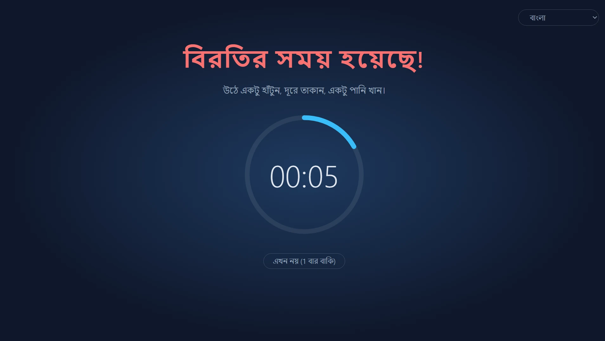
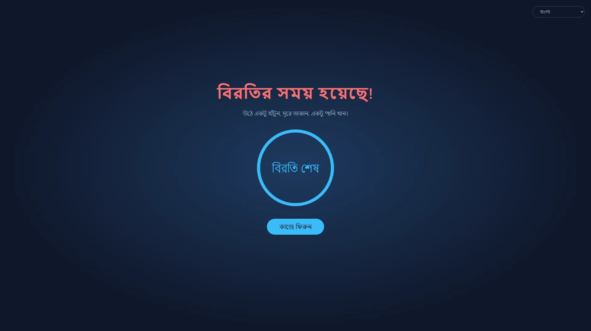
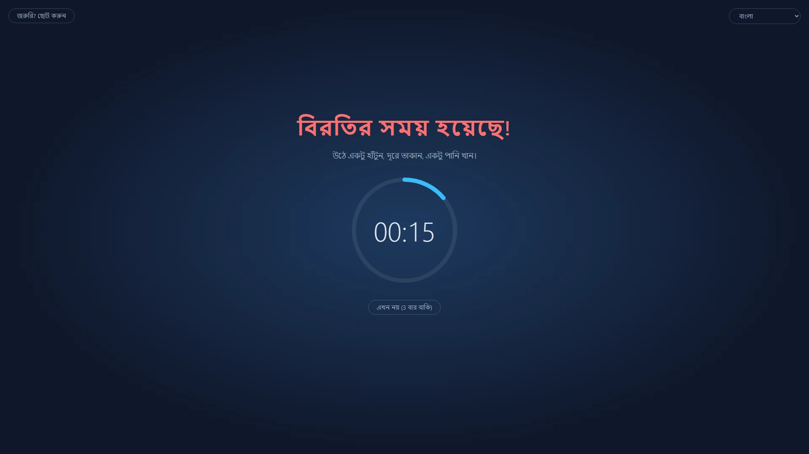
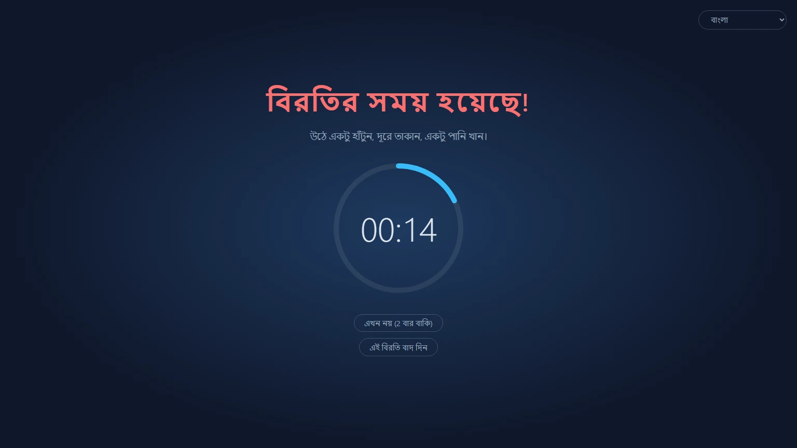
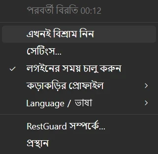

<p align="center">
  
</p>

<h1 align="center">RestGuard</h1>

<p align="center"><strong>এমন বিরতির রিমাইন্ডার, যা আপনি উপেক্ষা করতে পারবেন না।</strong></p>

<p align="center">Windows, macOS ও Linux-এর জন্য বিনামূল্যের ওপেন-সোর্স বিরতির রিমাইন্ডার, যা আপনাকে বিশ্রামের কথা মনে করিয়ে দিতে পারে, অথবা বিশ্রাম নিতে বাধ্য করতে পারে।</p>

<p align="center">
  <a href="https://github.com/HansTanzi/RestGuard/releases/latest"></a>
  <a href="https://github.com/HansTanzi/RestGuard/releases"></a>
  <a href="#ইনস্টল-করুন"></a>
  <a href="#windows"></a>
  <a href="https://apps.microsoft.com/detail/9PJ3SXDPCNN0"></a>
  <a href="#লাইসেন্স"></a>
</p>

<p align="center">
  ইনস্টল করুন: <a href="#windows"><b>Windows</b></a> · <a href="#macos"><b>macOS</b></a> · <a href="#linux"><b>Linux</b></a> · <a href="https://hanstanzi.github.io/RestGuard/">ওয়েবসাইট</a>
</p>

<p align="center"><a href="README.md">English</a> | <a href="README.zh-CN.md">简体中文</a> | <a href="README.de.md">Deutsch</a> | <a href="README.ja.md">日本語</a> | <a href="README.es.md">Español</a> | <a href="README.pt-BR.md">Português (Brasil)</a> | <a href="README.ko.md">한국어</a> | <a href="README.fr.md">Français</a> | <a href="README.it.md">Italiano</a> | <a href="README.id.md">Bahasa Indonesia</a> | <a href="README.hi.md">हिन्दी</a> | বাংলা | <a href="README.ar.md">العربية</a></p>



তিনটি বিল্ট-ইন কড়াকড়ির স্তরসহ ক্রস-প্ল্যাটফর্ম বিরতির রিমাইন্ডার: এটি আপনাকে বিরতির কথা মনে করিয়ে দিতে পারে, অথবা বিরতি নিতে বাধ্য করতে পারে। এই কড়াকড়িই একে অন্যান্য বিরতির রিমাইন্ডার থেকে আলাদা করে।

- উচ্চ কড়াকড়ি: আপনাকে বিরতি নেওয়াতে সবকিছু করে।
- মাঝারি কড়াকড়ি: আপনি কাজ করতে পারবেন, তবে এতটাই অস্বস্তি হবে যে বিশ্রাম নিতে ইচ্ছে করবে।
- নিম্ন কড়াকড়ি: অন্যান্য বিরতির রিমাইন্ডারের মতো, মূলত মনে করিয়ে দেয়।

Rust + Tauri 2 + Svelte দিয়ে তৈরি। এটি [ProtectEyes](https://github.com/HansTanzi/ProtectEyes)-এর উত্তরসূরি, যা শুধু Windows-এর জন্য একটি C# অ্যাপ ছিল এবং আমি বহু বছর আগে ওপেন সোর্স করেছিলাম।

এক লাইনে ইনস্টল করুন:

```sh
winget install HansTanzi.RestGuard            # Windows
brew install --cask hanstanzi/tap/restguard   # macOS
```

Microsoft Store, APT, Scoop, Linux-এ Homebrew ও পোর্টেবল ডাউনলোডের তথ্য [ইনস্টল করুন](#ইনস্টল-করুন) অংশে আছে।

## কেন RestGuard

বেশিরভাগ বিরতির রিমাইন্ডার উপেক্ষা করা সহজ: একটি নোটিফিকেশন আসে, আপনি সরিয়ে দেন, আর “আর পাঁচ মিনিট” হয়ে যায় দুই ঘণ্টা। দীর্ঘ সময় স্ক্রিনের সামনে থাকার সঙ্গে চোখের ক্লান্তি, চোখ শুকিয়ে যাওয়া, ঘাড় ও পিঠের ব্যথা এবং বারবার একই কাজের চাপজনিত আঘাতের (RSI) সম্পর্ক আছে। 20-20-20 নিয়ম বা প্রতি ঘণ্টায় ছোট বিরতির মতো পরামর্শ তখনই কাজে আসে, যখন আপনি সত্যিই বিরতি নেন।

RestGuard তাঁদের জন্য, যাঁরা জানেন বিশ্রাম নেওয়া উচিত কিন্তু বারবার পিছিয়ে দেন:

- **এক ক্লিকে সরিয়ে দেওয়া যায় না।** উচ্চ কড়াকড়িতে বিরতি শেষ না হওয়া পর্যন্ত ওভারলে সব স্ক্রিন ঢেকে রাখে।
- **কখন বিরক্ত করা চলবে না, তা জানে।** বিরতি পিছানো, জরুরি মোড ও মিটিং শনাক্তকরণ নিশ্চিত করে যে বিরতি কোনো কল নষ্ট করবে না বা আপনার অসংরক্ষিত কাজ হারাবে না।
- **কতটা কড়া হবে, তা আপনিই ঠিক করেন।** উচ্চ, মাঝারি বা নিম্ন কড়াকড়ি বেছে নিন, অথবা নিজের প্রোফাইল তৈরি করুন।

## বৈশিষ্ট্য

### যে বিরতি সত্যিই হয়

- প্রতি 60 মিনিট কাজের পরে 10 মিনিটের বিরতি বাধ্যতামূলক করে (দুটি সময়ই বদলানো যায়)
- একাধিক মনিটর: প্রতিটি স্ক্রিন ঢাকা পড়ে
- বিরতির সময় ওভারলে বন্ধ করা যায় না (Alt+F4 কাজ করে না), আর ট্রে থেকে প্রস্থান করা যায় না
- 5 মিনিট পিছিয়ে দিন, 3 বার পর্যন্ত; পূর্ণ বিরতির পরে গণনা রিসেট হয়
- জরুরি মোড: কিছু অপেক্ষা করতে পারছে না? কাজ সংরক্ষণ করতে ওভারলে কিছুক্ষণের জন্য ছোট করুন, কাউন্টডাউন চলতে থাকবে



### বিভিন্ন প্রয়োজনের জন্য তিনটি বিল্ট-ইন প্রোফাইল

| | উচ্চ কড়াকড়ি | মাঝারি কড়াকড়ি (ডিফল্ট) | নিম্ন কড়াকড়ি |
|---|:---:|:---:|:---:|
| যাঁদের জন্য উপযুক্ত | কঠোর শৃঙ্খলা, “আর পাঁচ মিনিট” জয় করতে | প্রতিদিনের কাজ | মৃদু তাগিদ |
| পিছানোর সংখ্যা | 1 | 3 | 3 |
| জরুরি মোড (ওভারলে ছোট করা) | ✗ | ✓ | ✓ |
| মিটিং অ্যাপ শনাক্তকরণ | ✗ | ✓ | ✓ |
| এই বিরতি বন্ধ করা / বাদ দেওয়া | ✗ | ✗ | ✓ |
| স্ক্রিন কভারেজ | 100% | 100% | 80% |
| টেনে সরানো যায় এমন ওভারলে | ✗ | ✓ | ✓ |





### ব্যাপকভাবে কাস্টমাইজযোগ্য

বিল্ট-ইন প্রোফাইল মানানসই না হলে, সেটিংসে **নতুন কাস্টম…** বেছে নিয়ে যেকোনো প্রোফাইল থেকে শুরু করুন, একটি নাম দিন (পরে নাম বদলানো বা মুছে ফেলা যায়) এবং প্রতিটি অপশন ঠিক করুন:

- পিছানোর সংখ্যা, প্রস্থানের অনুমতি, এই বিরতি বাদ দেওয়ার অনুমতি
- জরুরি মোড পাওয়া যাবে কি না, এবং ওভারলে কতটা ছোট হবে
- ওভারলে প্রতিটি স্ক্রিনের কতটা ঢাকবে (10% ~ 100%), এবং নিজের স্ক্রিনের মধ্যে টেনে সরানো যাবে কি না
- মিটিং অ্যাপ শনাক্ত করা হবে কি না

যতগুলো খুশি কাস্টম প্রোফাইল রাখুন এবং যেকোনো সময় বদলান। কাজ, বিরতি, পিছানো ও নিষ্ক্রিয়তার সময় সব প্রোফাইলে একই থাকে। ফাইল হাতে সম্পাদনা করতে চাইলে [`config.toml`](#কনফিগারেশন)-ও কাজ করে।

### দরকারের সময় বাধা দেয় না

- মিটিং শনাক্তকরণ (Windows, macOS): Zoom, Microsoft Teams, Webex বা Tencent Meeting সামনে থাকলে (অথবা Windows-এ মাইক্রোফোন ব্যবহার করলে) বিরতি মিটিং শেষ হওয়া পর্যন্ত অপেক্ষা করে; বিরতির সময় “আমি মিটিংয়ে আছি”-তে ক্লিক করে 1 ঘণ্টা পরে মনে করিয়ে দিতেও বলতে পারেন
- নিষ্ক্রিয়তা শনাক্তকরণ: 5 মিনিট কিবোর্ড বা মাউস ইনপুট না থাকলে আপনাকে অনুপস্থিত ধরা হয় এবং কাজের কাউন্টডাউন থেমে যায়; একটি বিরতির সমান সময় দূরে থাকলে তা পূর্ণ বিরতি হিসেবে গণ্য হয়, তাই ফিরেই আপনাকে বিশ্রামে পাঠানো হয় না

### বিরতির শেষ কখনো মিস করবেন না

- বিরতি শেষ হলে একটি শব্দ বাজে: বিল্ট-ইন শব্দ অথবা নিজের অডিও ফাইল বেছে নিন
- ফোন নোটিফিকেশন: [ntfy](https://ntfy.sh)-এর মাধ্যমে আপনার ফোনে (Android, iOS) পুশ পান, দূরে চলে গেলেও জানবেন কখন ফিরতে হবে; Android-এ আপনি বন্ধ না করা পর্যন্ত এটি অ্যালার্মের মতো বাজতে পারে
- স্মার্টওয়াচ: ফোনের নোটিফিকেশন জোড়া লাগানো Apple Watch, Wear OS, Galaxy Watch অথবা Xiaomi, Huawei, Garmin বা এ রকম ঘড়ি বা ব্যান্ডে মিরর হয়, তাই কবজিতে এক ঝলক দেখাই যথেষ্ট (দেখুন [ফোন ও স্মার্টওয়াচ নোটিফিকেশন](#ফোন-ও-স্মার্টওয়াচ-নোটিফিকেশন))

### ছোট ও দ্রুত

- সিস্টেম WebView-এর ওপর Rust + Tauri 2 দিয়ে তৈরি, কোনো ব্রাউজার ইঞ্জিন সঙ্গে নেই, তাই ব্যাকগ্রাউন্ডে চলার সময় প্রায় কোনো রিসোর্সই ব্যবহার করে না
- খুবই ছোট: ডাউনলোড মাত্র প্রায় 3–6 MB, Electron-ভিত্তিক বিকল্পগুলোর চেয়ে কয়েক ডজন গুণ ছোট (দেখুন [তুলনা](#তুলনা))
- পোর্টেবল: Windows-এ একটি exe, macOS-এ আনজিপ করে চালানোর মতো `.app`; আনইনস্টল করতে মুছে ফেলুন

### আরও অনেক কিছু

- ক্রস-প্ল্যাটফর্ম: Windows, macOS ও Linux, Microsoft Store, WinGet, Scoop, Homebrew ও APT দিয়ে ইনস্টল ও আপডেট করা যায় (দেখুন [ইনস্টল করুন](#ইনস্টল-করুন))
- ট্রে মেনু: বাকি সময়, এখনই বিশ্রাম, সেটিংস, লগইনের সময় চালু, কড়াকড়ির প্রোফাইল বদল, বিরতি দিন
- একক ইনস্ট্যান্স
- অনুমতিমূলক MIT / Apache-2.0 দ্বৈত লাইসেন্সের অধীনে বিনামূল্যে ও ওপেন সোর্স (দেখুন [লাইসেন্স](#লাইসেন্স))
- সরলীকৃত চীনা, ইংরেজি, হিন্দি, স্প্যানিশ, আরবি, ফরাসি, বাংলা, পর্তুগিজ, জার্মান, জাপানি, ইতালীয়, কোরীয় ও ইন্দোনেশীয় ভাষায় পাওয়া যায়। ইন্টারফেসের ভাষা ডিফল্টভাবে সিস্টেম অনুসরণ করে (সিস্টেমের ভাষা সমর্থিত না হলে ইংরেজি); ট্রে মেনুর “语言 / Language” সাবমেনু থেকে যেকোনো সময় বদলান



## তুলনা

| | RestGuard | [Stretchly](https://github.com/hovancik/stretchly) | [Workrave](https://github.com/rcaelers/workrave) | [Safe Eyes](https://github.com/slgobinath/SafeEyes) |
|---|:---:|:---:|:---:|:---:|
| Windows | ✓ | ✓ | ✓ | ✗ |
| macOS | ✓ | ✓ | ✗ | ✗ |
| Linux | ✓ | ✓ | ✓ | ✓ |
| ডাউনলোডের আকার | **~3–6 MB** | Windows 163 MB<br>macOS 187 MB<br>Linux 155 MB | Windows 61 MB<br>Linux 64 MB| Linux 0.3 MB |
| কড়াকড়ি | 3টি স্তর + কাস্টম প্রোফাইল | স্ট্রিক্ট মোড চালু/বন্ধ | ইনপুট ও স্ক্রিন আটকাতে পারে | কিবোর্ড নিষ্ক্রিয় করতে পারে |
| মিটিংয়ের সময় বিরতি আটকে রাখে | Zoom, Teams, Webex, Tencent Meeting শনাক্ত করে | ডু নট ডিস্টার্ব অনুসরণ করে; অ্যাপ অনুযায়ী ব্যতিক্রম | — | — |
| বিরতি শেষে ফোন / স্মার্টওয়াচ অ্যালার্ট | ✓ (ntfy) | — | — | — |
| প্রযুক্তি | Rust + Tauri (সিস্টেম WebView) | Electron (Chromium সহ) | C++ | Python + GTK |
| লাইসেন্স | MIT / Apache-2.0 | BSD-2-Clause | GPL-3.0 | GPL-3.0 |

— মানে বিল্ট-ইন নেই। ডাউনলোডের আকার প্রতিটি প্রকল্পের সর্বশেষ GitHub রিলিজ থেকে নেওয়া (Stretchly 1.22.1, Workrave 1.11.5, Safe Eyes 3.5.1): Windows ইনস্টলার বা exe, macOS ডাউনলোড ও Linux `.deb`। নভেম্বর 2026 অনুযায়ী প্রতিটি প্রকল্পের ডকুমেন্টেশনের ভিত্তিতে; কিছু ভুল থাকলে অনুগ্রহ করে [একটি issue খুলুন](https://github.com/HansTanzi/RestGuard/issues)।

## ইনস্টল করুন

### Windows

[Microsoft Store](https://apps.microsoft.com/detail/9PJ3SXDPCNN0) থেকে নিন; এটি নিজে থেকেই আপডেট হয়।

অথবা [WinGet](https://learn.microsoft.com/windows/package-manager/winget/) দিয়ে ইনস্টল করুন:

```powershell
winget install HansTanzi.RestGuard
```

অথবা [Scoop](https://scoop.sh) দিয়ে:

```powershell
scoop bucket add hanstanzi https://github.com/HansTanzi/scoop-bucket
scoop install hanstanzi/restguard
```

অথবা [Releases](https://github.com/HansTanzi/RestGuard/releases/latest) থেকে `RestGuard_<version>_x64.exe` ডাউনলোড করে চালান। এটি ইনস্টলার ছাড়া একটি পোর্টেবল exe: যেখানে খুশি রাখুন, আনইনস্টল করতে মুছে ফেলুন। এটি নিজে থেকে আপডেট হয় না; আপডেট করতে নতুন সংস্করণ ডাউনলোড করুন।

WebView2 রানটাইম প্রয়োজন (Windows 11-এ আগে থেকেই থাকে)।

### macOS

[Homebrew](https://brew.sh) দিয়ে ইনস্টল করুন (Apple Silicon ও Intel-এর জন্য ইউনিভার্সাল বিল্ড):

```sh
brew install --cask hanstanzi/tap/restguard
```

আগে এই রিপোজিটরি tap করে থাকলে (`brew tap hanstanzi/restguard https://github.com/HansTanzi/RestGuard`), আপডেট পেতে থাকার জন্য নতুন tap-এ যান: `brew untap hanstanzi/restguard && brew install --cask hanstanzi/tap/restguard`।

অথবা [Releases](https://github.com/HansTanzi/RestGuard/releases/latest) থেকে `RestGuard_<version>_universal.zip` ডাউনলোড করে আনজিপ করুন এবং `RestGuard.app` `/Applications`-এ সরিয়ে নিন। এটি নিজে থেকে আপডেট হয় না; আপডেট করতে নতুন সংস্করণ ডাউনলোড করুন।

RestGuard মেনু বারে থাকে এবং এর কোনো Dock আইকন নেই। অ্যাপটি Apple দ্বারা নোটারাইজ করা নয়; cask ইনস্টলের সময় কোয়ারেন্টাইন ফ্ল্যাগ সরিয়ে দেয়। zip হাতে ডাউনলোড করে থাকলে প্রথমবার চালানোর আগে `xattr -dr com.apple.quarantine /Applications/RestGuard.app` চালান, নইলে macOS এটি খুলবে না।

### Linux

Debian/Ubuntu (x86_64)-এ [APT রিপোজিটরি](https://github.com/HansTanzi/apt) যোগ করুন, তারপর `apt` দিয়ে ইনস্টল ও আপডেট করুন:

```sh
sudo install -d /etc/apt/keyrings
curl -fsSL https://hanstanzi.github.io/apt/hanstanzi.gpg | sudo tee /etc/apt/keyrings/hanstanzi.gpg > /dev/null
echo "deb [signed-by=/etc/apt/keyrings/hanstanzi.gpg] https://hanstanzi.github.io/apt stable main" | sudo tee /etc/apt/sources.list.d/hanstanzi.list
sudo apt update && sudo apt install rest-guard
```

পরের সংস্করণগুলো `sudo apt update && sudo apt upgrade` দিয়ে আসে। আপনি [Releases](https://github.com/HansTanzi/RestGuard/releases/latest) থেকে সরাসরি `.deb`-ও ইনস্টল করতে পারেন (`sudo apt install ./RestGuard_*_amd64.deb`), তবে তখন এটি আপডেট হবে না।

অন্যান্য ডিস্ট্রোর জন্য [Releases](https://github.com/HansTanzi/RestGuard/releases/latest) থেকে ডাউনলোড করুন। Fedora/openSUSE-এ `.rpm` ইনস্টল করুন:

```sh
sudo dnf install ./RestGuard_*_x86_64.rpm      # Fedora
sudo zypper install ./RestGuard_*_x86_64.rpm   # openSUSE
```

Arch-এ `.pkg.tar.zst` ইনস্টল করুন:

```sh
sudo pacman -U ./RestGuard_*_x86_64.pkg.tar.zst
```

যেকোনো ডিস্ট্রোতে (x86_64, glibc 2.35+) [Homebrew](https://brew.sh) দিয়েও ইনস্টল ও আপডেট করতে পারেন। Homebrew সিস্টেম লাইব্রেরি ইনস্টল করতে পারে না, তাই আগে আপনার ডিস্ট্রোর প্যাকেজ ম্যানেজার দিয়ে WebKitGTK 4.1 ও libayatana-appindicator ইনস্টল করুন:

```sh
sudo apt install libwebkit2gtk-4.1-0 libayatana-appindicator3-1                 # Debian/Ubuntu
sudo dnf install webkit2gtk4.1 libayatana-appindicator-gtk3                     # Fedora
sudo pacman -S webkit2gtk-4.1 libayatana-appindicator                           # Arch
sudo zypper install libwebkit2gtk-4_1-0 libayatana-appindicator3-1              # openSUSE

brew install --cask hanstanzi/tap/restguard
```

এতে শুধু `restguard` এক্সিকিউটেবল ইনস্টল হয়, অ্যাপ মেনুতে কোনো এন্ট্রি থাকে না: একবার `restguard` চালান, তারপর ট্রে মেনু থেকে “লগইনের সময় চালু করুন” চালু করুন। পরের সংস্করণগুলো `brew upgrade` দিয়ে আসে।

ওভারলের জন্য X11 প্রয়োজন (দেখুন [প্ল্যাটফর্মের সীমাবদ্ধতা](#প্ল্যাটফর্মের-সীমাবদ্ধতা))।

### ডাউনলোড যাচাই করুন

v0.1.14-এর পরের Release ফাইলগুলো GitHub Actions দিয়ে সোর্স কোড থেকে স্বয়ংক্রিয়ভাবে তৈরি এবং স্বাক্ষরিত [বিল্ড প্রোভেন্যান্স অ্যাটেস্টেশন](https://docs.github.com/actions/security-for-github-actions/using-artifact-attestations) বহন করে, যা প্রতিটি ফাইলকে সেটি তৈরি করা ওয়ার্কফ্লো রান ও কমিটের সঙ্গে যুক্ত করে। ডাউনলোড করা ফাইল [GitHub CLI](https://cli.github.com) দিয়ে যাচাই করতে:

```sh
gh attestation verify RestGuard_<version>_x64.exe --repo HansTanzi/RestGuard
```

প্রতিটি Release-এ `SHA256SUMS.txt`-ও থাকে, যাতে GitHub CLI ছাড়াই ডাউনলোড যাচাই করা যায়। ডাউনলোড করা ফাইলটি `SHA256SUMS.txt`-এর একই ডিরেক্টরিতে রেখে চালান:

```sh
sha256sum -c SHA256SUMS.txt --ignore-missing          # Linux
shasum -a 256 -c SHA256SUMS.txt --ignore-missing      # macOS
```

Windows-এ `Get-FileHash .\RestGuard_*_x64.exe`-এর আউটপুট `SHA256SUMS.txt`-এর সংশ্লিষ্ট লাইনের সঙ্গে মিলিয়ে দেখুন (ছোট-বড় হাতের অক্ষরে পার্থক্য নেই)।

### সোর্স থেকে বিল্ড করুন

[CONTRIBUTING.md](CONTRIBUTING.md#development-setup) (ইংরেজিতে)-এ তালিকাভুক্ত পূর্বশর্তগুলো ইনস্টল করুন, তারপর একটি ট্যাগ করা সংস্করণ বিল্ড করুন:

```sh
git clone https://github.com/HansTanzi/RestGuard
cd RestGuard
git checkout v<version>
pnpm install --frozen-lockfile
pnpm tauri build --no-bundle
```

এক্সিকিউটেবলটি হলো `src-tauri/target/release/restguard` (Windows-এ `restguard.exe`)। `pnpm tauri build` দিয়ে বিল্ড করুন, `cargo build` দিয়ে নয়: সাধারণ Cargo বিল্ড একটি ডেভেলপমেন্ট বিল্ড, যা `localhost:1420` থেকে UI লোড করে এবং ফাঁকা উইন্ডো দেখায়।

## কনফিগারেশন

সময়, কড়াকড়ির স্তর, ওভারলে কভারেজ, ভাষা ও লগইনের সময় চালু হওয়া বদলাতে ট্রে মেনু থেকে **সেটিংস…** খুলুন। পরিবর্তন সঙ্গে সঙ্গে কার্যকর হয় (বিরতির সময় সেটিংস লক থাকে)। কাজের সময় বদলালে চলমান কাজের কাউন্টডাউন আবার শুরু হয়।

সেটিংস `config.toml`-এ সংরক্ষিত হয়, যা প্রথমবার চালানোর সময় তৈরি হয়। আপনি এটি হাতেও সম্পাদনা করতে পারেন; তারপর অ্যাপটি রিস্টার্ট করুন।

| OS | পাথ |
|---|---|
| Windows | `%APPDATA%\io.github.restguard\config.toml` |
| macOS | `~/Library/Application Support/io.github.restguard/config.toml` |
| Linux | `~/.config/io.github.restguard/config.toml` |

```toml
work_minutes = 60.0      # বাধ্যতামূলক বিরতির আগে কতক্ষণ কাজ করবেন
rest_minutes = 10.0      # প্রতিটি বিরতি কতক্ষণের
postpone_minutes = 5.0   # প্রতিবার পিছানো কতক্ষণের
idle_minutes = 5.0       # এতক্ষণ ইনপুট না থাকলে অনুপস্থিত ধরা হয়, 0 = বন্ধ
level = "medium"         # "high", "medium", "low" অথবা একটি কাস্টম প্রোফাইলের নাম
sound_prompt = true      # বিরতি শেষ হলে শব্দ বাজান
sound = "beep"           # "beep", "chime", "rise" অথবা "file" (sound_file বাজায়)
sound_file = ""          # আপনার অডিও ফাইলের পুরো পাথ, sound = "file" হলে ব্যবহৃত হয়
phone_notify = false     # বিরতি শেষ হলে ntfy দিয়ে ফোনে নোটিফিকেশন পাঠান
ntfy_server = "https://ntfy.sh"  # ntfy সার্ভার, পাবলিক অথবা আপনার নিজের
ntfy_topic = ""          # ntfy অ্যাপে সাবস্ক্রাইব করার টপিক; অনুমান করা কঠিন রাখুন

[[fixed_breaks]]         # একটি নির্দিষ্ট বিরতি; "work_end" (দিনের শেষ) ও "lunch" বিল্ট-ইন
name = "work_end"
enabled = false          # এর ঠিক আগে পড়া বিরতিগুলো আটকে রাখুন
time = "18:00"           # স্থানীয় সময়ে 24-ঘণ্টার HH:MM
quiet_minutes = 30.0     # time-এর এতক্ষণ আগে পড়া বিরতিগুলো time পর্যন্ত অপেক্ষা করে

[[fixed_breaks]]         # দুপুরের খাবার: time-এ rest_minutes দৈর্ঘ্যের বিরতি শুরু হয়
name = "lunch"
enabled = true
time = "12:00"
quiet_minutes = 30.0
rest_minutes = 30.0      # বিরতি কতক্ষণের (লাঞ্চ ও আপনার নিজের নির্দিষ্ট বিরতি); সাধারণ বিরতির সময় পার হলে কম্পিউটার ব্যবহার চালিয়ে যেতে পারেন

[[fixed_breaks]]         # নিজের বিরতি যোগ করুন, যেমন চায়ের বিরতি, প্রতিটির জন্য একটি [[fixed_breaks]]
name = "চায়ের বিরতি"
enabled = true
time = "15:00"
quiet_minutes = 15.0
rest_minutes = 15.0

[[profiles]]             # একটি কাস্টম প্রোফাইল; প্রতি প্রোফাইলে একটি [[profiles]] যোগ করুন
name = "ফোকাস"
max_postpones = 1        # পূর্ণ বিরতি বাধ্যতামূলক হওয়ার আগে সর্বোচ্চ পিছানোর সংখ্যা
urgent_mode = false      # ওভারলে ছোট করার অনুমতি দিন
meeting_detection = true # Zoom, Teams ইত্যাদি ব্যবহারের সময় বিরতি আটকে রাখুন
force_rest = true        # false = ওভারলে বন্ধ করা যায়
allow_skip = false       # বিরতি বাধ্যতামূলক হলেও “এই বিরতি বাদ দিন” দেখান
overlay_coverage = 1.0   # প্রতিটি স্ক্রিনের ঢাকা অংশ, 0.1 ~ 1.0
urgent_scale = 0.5       # ওপরের মানের তুলনায় জরুরি মোডের (ছোট ওভারলে) অনুপাত, 0.1 ~ 0.9
movable = false          # পূর্ণ স্ক্রিন না হলে নিজের স্ক্রিনের মধ্যে ওভারলে টেনে সরানোর অনুমতি দিন
```

### ফোন ও স্মার্টওয়াচ নোটিফিকেশন

1. আপনার ফোনে ntfy অ্যাপ ইনস্টল করুন ([Android](https://play.google.com/store/apps/details?id=io.heckel.ntfy), [F-Droid](https://f-droid.org/packages/io.heckel.ntfy/), [iOS](https://apps.apple.com/app/ntfy/id1625396347))
2. RestGuard-এর সেটিংসে “বিরতি শেষ হলে ফোনে জানান (ntfy)” চালু করুন এবং অনুমান করা কঠিন এমন একটি টপিক দিন (শুধু ইংরেজি অক্ষর, সংখ্যা, `-` ও `_`)। সার্ভার ডিফল্টভাবে পাবলিক `https://ntfy.sh`; আপনি নিজের সার্ভারও ব্যবহার করতে পারেন
3. ntfy অ্যাপে একই সার্ভার ও টপিকে সাবস্ক্রাইব করুন, তারপর পৌঁছাচ্ছে কি না দেখতে “পরীক্ষামূলক নোটিফিকেশন পাঠান”-এ ক্লিক করুন

নোটিফিকেশন সর্বোচ্চ অগ্রাধিকারে পাঠানো হয়। Android-এ ntfy-এর সেটিংসে “Keep alerting for highest priority” চালু করুন, তাহলে আপনি বন্ধ না করা পর্যন্ত এটি অ্যালার্মের মতো বাজবে; iOS-এ এটি সময়-সংবেদনশীল নোটিফিকেশন, যা Focus ভেদ করে আসে (যদি আপনি ntfy-কে সময়-সংবেদনশীল নোটিফিকেশন পাঠানোর অনুমতি দেন)। পাবলিক সার্ভারে টপিক জানা যে কেউ সাবস্ক্রাইব করতে পারে, তাই এটি গোপন রাখুন।

ঘড়িতে কিছুই ইনস্টল করতে হয় না; সিস্টেম ফোনের নোটিফিকেশন ঘড়িতে মিরর করে:

| ঘড়ি | সেটআপ |
|---|---|
| Apple Watch | iPhone-এর Watch অ্যাপে Notifications-এ গিয়ে ntfy-এর জন্য “Mirror iPhone alerts” চালু করুন। iPhone লক থাকলে বা স্ক্রিন বন্ধ থাকলেই শুধু নোটিফিকেশন ঘড়িতে যায় |
| Wear OS / Galaxy Watch | ডিফল্টভাবে মিরর হয়; ঘড়ির নোটিফিকেশন সেটিংসে ntfy বন্ধ নেই তা নিশ্চিত করুন |
| Xiaomi, Huawei, Garmin, Amazfit ইত্যাদি | সহযোগী অ্যাপের (Zepp, Huawei Health, Garmin Connect ইত্যাদি) অ্যাপ নোটিফিকেশন তালিকায় ntfy-কে অনুমতি দিন |

টীকা:

- ঘড়ি একবার কাঁপে; ফোনের মতো বারবার সতর্ক করে না
- ঘড়িতে নোটিফিকেশন পেতে ফোন অনলাইন থাকা ও ntfy ব্যাকগ্রাউন্ডে চলা জরুরি; ফোন ছাড়া একা ব্যবহৃত ঘড়ি তা পাবে না
- নিজে হোস্ট করা সার্ভারে, তাৎক্ষণিক নোটিফিকেশন পেতে iOS-এর জন্য সার্ভার কনফিগারেশনে `upstream-base-url: "https://ntfy.sh"` প্রয়োজন (দেখুন [ntfy ডকুমেন্টেশন](https://docs.ntfy.sh/config/#ios-instant-notifications))

## প্ল্যাটফর্মের সীমাবদ্ধতা

- **macOS**: Force Quit (`Cmd+Option+Esc`)-এর মতো সিস্টেম-স্তরের কাজ আটকানো যায় না
- **Linux**: নিষ্ক্রিয়তা শনাক্তকরণের জন্য GNOME অথবা `org.freedesktop.ScreenSaver` বাস্তবায়নকারী ডেস্কটপ (যেমন KDE Plasma) এবং `gdbus` প্রয়োজন; নইলে এটি বন্ধ থাকে
- **Linux**: শব্দ `paplay`, `pw-play` বা `aplay` দিয়ে বাজে, তাই নিজের ফাইলের জন্য wav, ogg বা flac ব্যবহার করুন (mp3 সমর্থিত নয়)
- **Linux Wayland**: এই প্রোটোকল অ্যাপগুলোকে নিজেকে সবার ওপরে রাখতে বা নিজের উইন্ডোর অবস্থান ঠিক করতে দেয় না, তাই ওভারলে কাজ নাও করতে পারে; X11 ঠিক আছে

## সাধারণ প্রশ্ন

**আমি কি RestGuard থেকে প্রস্থান করতে পারি?**
দুই বিরতির মাঝে, হ্যাঁ: ট্রে মেনু থেকে “প্রস্থান” বেছে নিন। বিরতির সময়, অথবা পিছিয়ে দেওয়া বিরতি বাকি থাকলে, “প্রস্থান” নিষ্ক্রিয় থাকে। আজ যদি জরুরি কোনো কাজ থাকে, যেমন গুরুত্বপূর্ণ মিটিং, আর RestGuard-এর বাধা না চান, তাহলে “প্রস্থান”-এর বদলে “বিরতি দিন” বেছে নিন: ৩০ মিনিট, ১ বা ২ ঘণ্টা পরে, অথবা পরদিন সকালে রিমাইন্ডার নিজে থেকেই ফিরে আসে, তাই RestGuard আবার চালু করার কথা মনে রাখতে হয় না।

**মিটিংয়ের মধ্যে বিরতি এসে গেলে কী হবে?**
মাঝারি ও নিম্ন কড়াকড়িতে, Zoom, Microsoft Teams, Webex বা Tencent Meeting সামনে থাকলে (Windows, macOS; Windows-এ মাইক্রোফোন ব্যবহারের সময়ও) বিরতি অপেক্ষা করে। বিরতি শুরু হয়ে গেলে “আমি মিটিংয়ে আছি”-তে ক্লিক করুন, 1 ঘণ্টা পরে আবার মনে করিয়ে দেওয়া হবে। উচ্চ কড়াকড়িতে বিরতি অপেক্ষা করে না।

**আমি জরুরি কাজের মধ্যে আছি। আমার কাজ কি হারিয়ে যাবে?**
বিরতি 5 মিনিট পিছিয়ে দিন (মাঝারি ও নিম্নে 3 বার পর্যন্ত, উচ্চে একবার), অথবা মাঝারি ও নিম্নে জরুরি মোডে ওভারলে ছোট করে কাজ সংরক্ষণ করুন, কাউন্টডাউন চলতে থাকবে।

**কম্পিউটার থেকে দূরে থাকার সময় কি কাজ হিসেবে গণ্য হয়?**
না। 5 মিনিট কিবোর্ড বা মাউস ইনপুট না থাকলে কাজের কাউন্টডাউন থেমে যায়, আর একটি বিরতির সমান সময় দূরে থাকলে তা পূর্ণ বিরতি হিসেবে গণ্য হয়।

**macOS বলছে অ্যাপটি খোলা যাবে না।**
RestGuard Apple দ্বারা নোটারাইজ করা নয়। Homebrew দিয়ে ইনস্টল করুন, অথবা একবার `xattr -dr com.apple.quarantine /Applications/RestGuard.app` চালান (দেখুন [macOS](#macos))।

**এটি কি Wayland-এ কাজ করে?**
নির্ভরযোগ্যভাবে নয়: Wayland অ্যাপগুলোকে তাদের উইন্ডো সবার ওপরে রাখতে দেয় না, তাই X11 সেশন ব্যবহার করুন (দেখুন [প্ল্যাটফর্মের সীমাবদ্ধতা](#প্ল্যাটফর্মের-সীমাবদ্ধতা))।

**এটি কি কোনো ডেটা সংগ্রহ করে?**
না। দেখুন [গোপনীয়তা](#গোপনীয়তা)।

## অবদান রাখুন

বাগ রিপোর্ট, ধারণা, অনুবাদ ও পুল রিকোয়েস্ট সবই স্বাগত। [CONTRIBUTING.md](CONTRIBUTING.md) (ইংরেজিতে) ডেভেলপমেন্ট সেটআপ, যাচাই এবং অনুবাদ উন্নত করার উপায় ব্যাখ্যা করে; প্রতিটি সংস্করণের পরিবর্তন [CHANGELOG.md](CHANGELOG.md)-এ আছে। নিরাপত্তা সমস্যা [SECURITY.md](SECURITY.md)-এ বর্ণিত উপায়ে গোপনে জানান।

RestGuard আপনাকে বিশ্রাম নিতে সাহায্য করলে, একটি ⭐ অন্যদের এটি খুঁজে পেতে সাহায্য করে।

[](https://github.com/HansTanzi/RestGuard/graphs/contributors)

[](https://star-history.com/#HansTanzi/RestGuard&Date)

## গোপনীয়তা

RestGuard কোনো ডেটা সংগ্রহ করে না: কোনো অ্যাকাউন্ট, অ্যানালিটিক্স বা টেলিমেট্রি নেই। এটি শুধু ঐচ্ছিক ntfy ফোন নোটিফিকেশন পাঠাতে অনলাইনে যায়। দেখুন [গোপনীয়তা নীতি](https://hanstanzi.github.io/RestGuard/privacy.html) (ইংরেজিতে)।

## লাইসেন্স

আপনার পছন্দ অনুযায়ী [MIT](LICENSE-MIT) অথবা [Apache-2.0](LICENSE-APACHE)-এর অধীনে লাইসেন্সপ্রাপ্ত।
