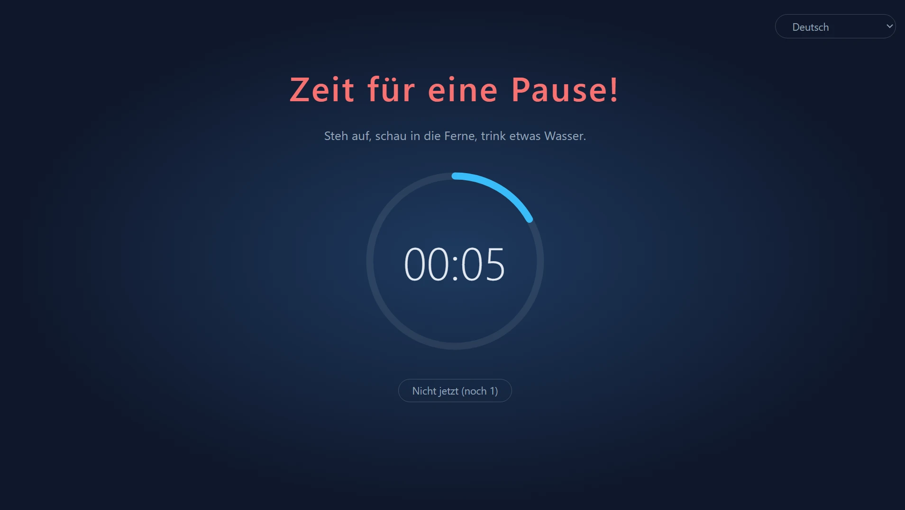
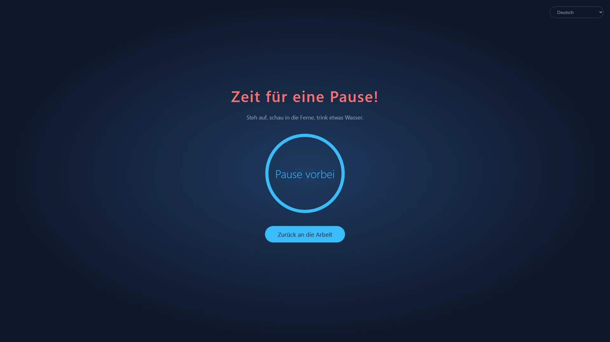
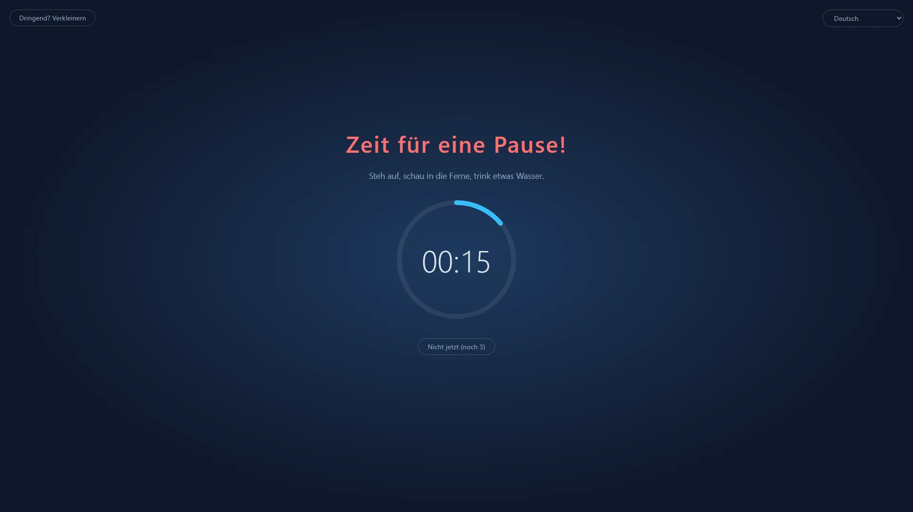
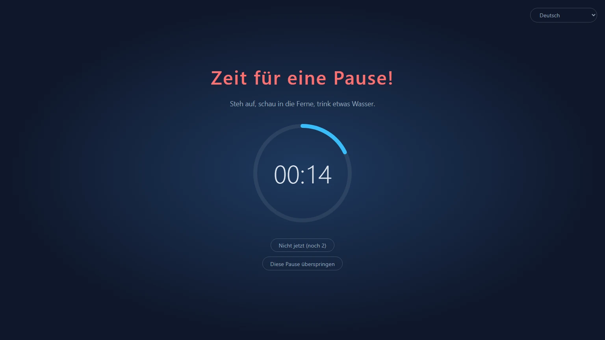
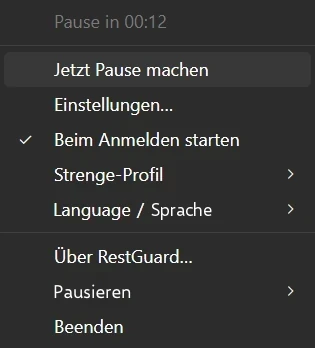

<p align="center">
  
</p>

<h1 align="center">RestGuard</h1>

<p align="center"><strong>Der Pausen-Erinnerer, den du nicht ignorieren kannst.</strong></p>

<p align="center">Ein freier, quelloffener Pausen-Erinnerer für Windows, macOS und Linux, der dich an Pausen erinnert – oder dich dazu bringt, sie zu machen.</p>

<p align="center">
  <a href="https://github.com/HansTanzi/RestGuard/releases/latest"></a>
  <a href="https://github.com/HansTanzi/RestGuard/releases"></a>
  <a href="#installation"></a>
  <a href="#windows"></a>
  <a href="https://apps.microsoft.com/detail/9PJ3SXDPCNN0"></a>
  <a href="#lizenz"></a>
</p>

<p align="center">
  Installieren unter <a href="#windows"><b>Windows</b></a> · <a href="#macos"><b>macOS</b></a> · <a href="#linux"><b>Linux</b></a> · <a href="https://hanstanzi.github.io/RestGuard/">Website</a>
</p>

<p align="center"><a href="README.md">English</a> | <a href="README.zh-CN.md">简体中文</a> | Deutsch | <a href="README.ja.md">日本語</a> | <a href="README.es.md">Español</a> | <a href="README.pt-BR.md">Português (Brasil)</a> | <a href="README.ko.md">한국어</a> | <a href="README.fr.md">Français</a> | <a href="README.it.md">Italiano</a> | <a href="README.id.md">Bahasa Indonesia</a> | <a href="README.hi.md">हिन्दी</a> | <a href="README.bn.md">বাংলা</a> | <a href="README.ar.md">العربية</a></p>



Ein plattformübergreifender Pausen-Erinnerer mit drei eingebauten Strenge-Stufen: Er kann dich an eine Pause erinnern – oder dich dazu bringen, sie wirklich zu machen. Genau diese Durchsetzung unterscheidet ihn von anderen Pausen-Erinnerern.

- Hoch: tut alles, damit du die Pause wirklich machst.
- Mittel: Du kannst weiterarbeiten, aber das Arbeiten wird so unbequem, dass du lieber Pause machst.
- Niedrig: wie andere Pausen-Erinnerer, vor allem eine Erinnerung.

Gebaut mit Rust + Tauri 2 + Svelte. Nachfolger von [ProtectEyes](https://github.com/HansTanzi/ProtectEyes), einer reinen Windows-App in C#, die ich vor vielen Jahren als Open Source veröffentlicht habe.

Installation mit einer Zeile:

```sh
winget install HansTanzi.RestGuard            # Windows
brew install --cask hanstanzi/tap/restguard   # macOS
```

Microsoft Store, APT, Scoop, Homebrew unter Linux und portable Downloads findest du unter [Installation](#installation).

## Warum RestGuard

Die meisten Pausen-Erinnerer lassen sich leicht ignorieren: Eine Benachrichtigung erscheint, du klickst sie weg, und aus „nur noch fünf Minuten“ werden zwei Stunden. Lange Zeit am Bildschirm wird mit überanstrengten und trockenen Augen, Nacken- und Rückenschmerzen sowie Sehnenscheidenentzündung (RSI) in Verbindung gebracht. Ratschläge wie die 20-20-20-Regel oder eine kurze Pause jede Stunde helfen nur, wenn du die Pause auch wirklich machst.

RestGuard ist für alle, die wissen, dass sie Pause machen sollten, es aber immer wieder aufschieben:

- **Einfach wegklicken geht nicht.** In der Stufe Hoch deckt das Overlay jeden Bildschirm ab, bis die Pause vorbei ist.
- **Es weiß, wann es nicht stören darf.** Aufschieben, Dringend-Modus und Meeting-Erkennung sorgen dafür, dass eine Pause weder ein Meeting sprengt noch ungespeicherte Arbeit kostet.
- **Du bestimmst, wie streng es ist.** Wähle Hoch, Mittel oder Niedrig oder lege ein eigenes Profil an.

## Funktionen

### Pausen, die wirklich stattfinden

- Erzwingt nach jeweils 60 Minuten Arbeit eine Pause von 10 Minuten (beide Zeiten einstellbar)
- Mehrere Monitore: Jeder Bildschirm wird abgedeckt
- Das Overlay lässt sich während der Pause nicht schließen (Alt+F4 wirkt nicht), und über das Tray lässt sich die App nicht beenden
- 5 Minuten aufschieben, bis zu 3-mal; der Zähler wird nach einer vollständigen Pause zurückgesetzt
- Dringend-Modus: Etwas kann nicht warten? Verkleinere das Overlay kurz, um deine Arbeit zu speichern – der Countdown läuft weiter



### Drei eingebaute Profile für unterschiedliche Bedürfnisse

| | Hoch | Mittel (Standard) | Niedrig |
|---|:---:|:---:|:---:|
| Geeignet für | Strenge Disziplin, gegen „nur noch fünf Minuten“ | Alltägliche Arbeit | Einen sanften Anstoß |
| Aufschieben | 1 | 3 | 3 |
| Dringend-Modus (Overlay verkleinern) | ✗ | ✓ | ✓ |
| Erkennung von Meeting-Apps | ✗ | ✓ | ✓ |
| Diese Pause schließen / überspringen | ✗ | ✗ | ✓ |
| Bildschirmabdeckung | 100 % | 100 % | 80 % |
| Overlay verschiebbar | ✗ | ✓ | ✓ |





### Umfassend anpassbar

Wenn die eingebauten Profile nicht passen, wähle in den Einstellungen **Neu (benutzerdefiniert)…**, um von einem beliebigen Profil aus zu starten, gib ihm einen Namen (später umbenennbar oder löschbar) und passe jede Option an:

- Anzahl der Aufschübe, ob Beenden erlaubt ist, ob das Überspringen dieser Pause erlaubt ist
- Ob der Dringend-Modus verfügbar ist und wie stark das Overlay verkleinert wird
- Wie viel jedes Bildschirms das Overlay abdeckt (10 % ~ 100 %) und ob es innerhalb seines Bildschirms verschoben werden kann
- Ob Meeting-Apps erkannt werden

Lege beliebig viele eigene Profile an und wechsle jederzeit. Arbeits-, Pausen-, Aufschub- und Leerlaufzeiten gelten für alle Profile gemeinsam. Wer Dateien lieber von Hand bearbeitet, kann auch [`config.toml`](#konfiguration) verwenden.

### Hält sich zurück, wenn es darauf ankommt

- Meeting-Erkennung (Windows, macOS): Solange Zoom, Microsoft Teams, Webex oder Tencent Meeting im Vordergrund ist (oder unter Windows das Mikrofon nutzt), wartet die Pause, bis das Meeting vorbei ist; während einer Pause kannst du außerdem auf „Ich bin in einem …-Meeting“ klicken, um in einer Stunde erneut erinnert zu werden
- Leerlauferkennung: Nach 5 Minuten ohne Tastatur- oder Mauseingabe giltst du als abwesend und der Arbeits-Countdown pausiert; warst du so lange weg wie eine Pause dauert, zählt das als vollständige Pause, sodass du nach der Rückkehr nicht gleich wieder in die Pause geschickt wirst

### Das Pausenende nie verpassen

- Am Ende einer Pause ertönt ein Ton: Wähle einen eingebauten oder deine eigene Audiodatei
- Handy-Benachrichtigungen: Erhalte über [ntfy](https://ntfy.sh) eine Push-Nachricht auf dein Handy (Android, iOS), damit du auch nach dem Weggehen weißt, wann es weitergeht; unter Android kann sie wie ein Wecker klingeln, bis du sie wegwischst
- Smartwatches: Die Handy-Benachrichtigung wird auf eine gekoppelte Apple Watch, Wear OS, Galaxy Watch oder eine Uhr bzw. ein Band von Xiaomi, Huawei, Garmin o. Ä. gespiegelt – ein Blick aufs Handgelenk genügt (siehe [Benachrichtigungen auf Handy und Smartwatch](#benachrichtigungen-auf-handy-und-smartwatch))

### Klein und schnell

- Gebaut mit Rust + Tauri 2 auf der System-WebView, ohne mitgelieferte Browser-Engine – im Hintergrund verbraucht es kaum Ressourcen
- Winzig: Downloads sind nur etwa 3–6 MB groß – ein Bruchteil von Electron-basierten Alternativen (siehe [Im Vergleich](#im-vergleich))
- Portabel: unter Windows eine einzelne exe, unter macOS eine `.app` zum Entpacken und Starten; zum Deinstallieren einfach löschen

### Und mehr

- Plattformübergreifend: Windows, macOS und Linux, installier- und aktualisierbar über den Microsoft Store, WinGet, Scoop, Homebrew und APT (siehe [Installation](#installation))
- Tray-Menü: verbleibende Zeit, jetzt Pause machen, Einstellungen, beim Anmelden starten, Strenge-Profil wechseln, pausieren
- Nur eine Instanz
- Frei und Open Source unter der freizügigen Doppellizenz MIT / Apache-2.0 (siehe [Lizenz](#lizenz))
- Verfügbar auf Vereinfachtem Chinesisch, Englisch, Hindi, Spanisch, Arabisch, Französisch, Bengalisch, Portugiesisch, Deutsch, Japanisch, Italienisch, Koreanisch und Indonesisch. Die Sprache der Oberfläche folgt standardmäßig dem System (Englisch, wenn die Systemsprache nicht unterstützt wird); du kannst sie jederzeit im Untermenü „语言 / Language“ des Tray-Menüs wechseln



## Im Vergleich

| | RestGuard | [Stretchly](https://github.com/hovancik/stretchly) | [Workrave](https://github.com/rcaelers/workrave) | [Safe Eyes](https://github.com/slgobinath/SafeEyes) |
|---|:---:|:---:|:---:|:---:|
| Windows | ✓ | ✓ | ✓ | ✗ |
| macOS | ✓ | ✓ | ✗ | ✗ |
| Linux | ✓ | ✓ | ✓ | ✓ |
| Downloadgröße | **ca. 3–6 MB** | Windows 163 MB<br>macOS 187 MB<br>Linux 155 MB | Windows 61 MB<br>Linux 64 MB| Linux 0,3 MB |
| Durchsetzung | 3 Stufen + eigene Profile | Strikter Modus an/aus | Kann Eingabe und Bildschirm sperren | Kann die Tastatur deaktivieren |
| Hält Pausen während Meetings zurück | Erkennt Zoom, Teams, Webex, Tencent Meeting | Folgt „Nicht stören“; Ausnahmen pro App | — | — |
| Hinweis auf Handy / Smartwatch am Pausenende | ✓ (ntfy) | — | — | — |
| Gebaut mit | Rust + Tauri (System-WebView) | Electron (bringt Chromium mit) | C++ | Python + GTK |
| Lizenz | MIT / Apache-2.0 | BSD-2-Clause | GPL-3.0 | GPL-3.0 |

— bedeutet: nicht eingebaut. Die Downloadgrößen stammen aus dem jeweils neuesten GitHub-Release (Stretchly 1.22.1, Workrave 1.11.5, Safe Eyes 3.5.1): Windows-Installer bzw. exe, macOS-Download und Linux-`.deb`. Stand: Dokumentation der jeweiligen Projekte im November 2026; falls etwas nicht stimmt, [eröffne bitte ein Issue](https://github.com/HansTanzi/RestGuard/issues).

## Installation

### Windows

Im [Microsoft Store](https://apps.microsoft.com/detail/9PJ3SXDPCNN0) erhältlich; aktualisiert sich automatisch.

Oder mit [WinGet](https://learn.microsoft.com/windows/package-manager/winget/):

```powershell
winget install HansTanzi.RestGuard
```

Oder mit [Scoop](https://scoop.sh):

```powershell
scoop bucket add hanstanzi https://github.com/HansTanzi/scoop-bucket
scoop install hanstanzi/restguard
```

Oder lade `RestGuard_<Version>_x64.exe` von den [Releases](https://github.com/HansTanzi/RestGuard/releases/latest) herunter und starte sie. Es ist eine portable Einzeldatei ohne Installer: Lege sie an einen beliebigen Ort und lösche sie zum Deinstallieren. Sie aktualisiert sich nicht selbst; lade für ein Update die neue Version herunter.

Benötigt die WebView2-Laufzeit (unter Windows 11 vorinstalliert).

### macOS

Installation mit [Homebrew](https://brew.sh) (Universal-Build für Apple Silicon und Intel):

```sh
brew install --cask hanstanzi/tap/restguard
```

Falls du dieses Repository früher als Tap hinzugefügt hast (`brew tap hanstanzi/restguard https://github.com/HansTanzi/RestGuard`), wechsle zum neuen Tap, um weiterhin Updates zu erhalten: `brew untap hanstanzi/restguard && brew install --cask hanstanzi/tap/restguard`.

Oder lade `RestGuard_<Version>_universal.zip` von den [Releases](https://github.com/HansTanzi/RestGuard/releases/latest) herunter, entpacke es und verschiebe `RestGuard.app` nach `/Applications`. Die App aktualisiert sich nicht selbst; lade für ein Update die neue Version herunter.

RestGuard sitzt in der Menüleiste und hat kein Dock-Symbol. Die App ist nicht von Apple notarisiert; der Cask entfernt bei der Installation das Quarantäne-Attribut. Wenn du das Zip manuell heruntergeladen hast, führe vor dem ersten Start `xattr -dr com.apple.quarantine /Applications/RestGuard.app` aus, sonst lässt macOS die App nicht starten.

### Linux

Unter Debian/Ubuntu (x86_64) füge das [APT-Repository](https://github.com/HansTanzi/apt) hinzu und installiere bzw. aktualisiere dann mit `apt`:

```sh
sudo install -d /etc/apt/keyrings
curl -fsSL https://hanstanzi.github.io/apt/hanstanzi.gpg | sudo tee /etc/apt/keyrings/hanstanzi.gpg > /dev/null
echo "deb [signed-by=/etc/apt/keyrings/hanstanzi.gpg] https://hanstanzi.github.io/apt stable main" | sudo tee /etc/apt/sources.list.d/hanstanzi.list
sudo apt update && sudo apt install rest-guard
```

Neuere Versionen kommen mit `sudo apt update && sudo apt upgrade`. Du kannst die `.deb` auch direkt von den [Releases](https://github.com/HansTanzi/RestGuard/releases/latest) installieren (`sudo apt install ./RestGuard_*_amd64.deb`), dann wird sie aber nicht aktualisiert.

Für andere Distributionen lade die Datei von den [Releases](https://github.com/HansTanzi/RestGuard/releases/latest) herunter. Unter Fedora/openSUSE installierst du die `.rpm`:

```sh
sudo dnf install ./RestGuard_*_x86_64.rpm      # Fedora
sudo zypper install ./RestGuard_*_x86_64.rpm   # openSUSE
```

Unter Arch installierst du die `.pkg.tar.zst`:

```sh
sudo pacman -U ./RestGuard_*_x86_64.pkg.tar.zst
```

Auf jeder Distribution (x86_64, glibc 2.35+) kannst du auch mit [Homebrew](https://brew.sh) installieren und aktualisieren. Homebrew kann keine Systembibliotheken installieren, installiere daher zuerst WebKitGTK 4.1 und libayatana-appindicator mit dem Paketmanager deiner Distribution:

```sh
sudo apt install libwebkit2gtk-4.1-0 libayatana-appindicator3-1                 # Debian/Ubuntu
sudo dnf install webkit2gtk4.1 libayatana-appindicator-gtk3                     # Fedora
sudo pacman -S webkit2gtk-4.1 libayatana-appindicator                           # Arch
sudo zypper install libwebkit2gtk-4_1-0 libayatana-appindicator3-1              # openSUSE

brew install --cask hanstanzi/tap/restguard
```

Dabei wird nur die ausführbare Datei `restguard` installiert, ohne Eintrag im Anwendungsmenü: Starte `restguard` einmal und aktiviere dann „Beim Anmelden starten“ im Tray-Menü. Neuere Versionen kommen mit `brew upgrade`.

Das Overlay benötigt X11 (siehe [Plattformeinschränkungen](#plattformeinschränkungen)).

### Downloads überprüfen

Release-Dateien nach v0.1.14 werden von GitHub Actions automatisch aus dem Quellcode gebaut und tragen eine signierte [Build-Provenance-Attestierung](https://docs.github.com/actions/security-for-github-actions/using-artifact-attestations), die jede Datei mit dem Workflow-Lauf und dem Commit verknüpft, aus dem sie entstanden ist. So prüfst du eine heruntergeladene Datei mit der [GitHub CLI](https://cli.github.com):

```sh
gh attestation verify RestGuard_<Version>_x64.exe --repo HansTanzi/RestGuard
```

Jedes Release enthält außerdem `SHA256SUMS.txt`, damit du Downloads auch ohne GitHub CLI prüfen kannst. Lege die heruntergeladene Datei in dasselbe Verzeichnis wie `SHA256SUMS.txt` und führe aus:

```sh
sha256sum -c SHA256SUMS.txt --ignore-missing          # Linux
shasum -a 256 -c SHA256SUMS.txt --ignore-missing      # macOS
```

Unter Windows vergleiche die Ausgabe von `Get-FileHash .\RestGuard_*_x64.exe` mit der passenden Zeile in `SHA256SUMS.txt` (Groß-/Kleinschreibung spielt keine Rolle).

### Aus dem Quellcode bauen

Installiere die in [CONTRIBUTING.md](CONTRIBUTING.md#development-setup) genannten Voraussetzungen und baue dann eine getaggte Version:

```sh
git clone https://github.com/HansTanzi/RestGuard
cd RestGuard
git checkout v<Version>
pnpm install --frozen-lockfile
pnpm tauri build --no-bundle
```

Die ausführbare Datei liegt unter `src-tauri/target/release/restguard` (`restguard.exe` unter Windows). Baue mit `pnpm tauri build`, nicht mit `cargo build`: Ein reiner Cargo-Build ist ein Entwicklungs-Build, der die Oberfläche von `localhost:1420` lädt und leere Fenster zeigt.

## Konfiguration

Öffne **Einstellungen…** im Tray-Menü, um Zeiten, Strenge-Stufe, Overlay-Abdeckung, Sprache und den Start beim Anmelden zu ändern. Änderungen gelten sofort (während einer Pause sind die Einstellungen gesperrt). Wenn du die Arbeitszeit änderst, startet der aktuelle Arbeits-Countdown neu.

Die Einstellungen werden in `config.toml` gespeichert, die beim ersten Start angelegt wird. Du kannst sie auch von Hand bearbeiten; starte die App danach neu.

| System | Pfad |
|---|---|
| Windows | `%APPDATA%\io.github.restguard\config.toml` |
| macOS | `~/Library/Application Support/io.github.restguard/config.toml` |
| Linux | `~/.config/io.github.restguard/config.toml` |

```toml
work_minutes = 60.0      # wie lange gearbeitet wird, bevor eine Pause erzwungen wird
rest_minutes = 10.0      # wie lange jede Pause dauert
postpone_minutes = 5.0   # wie lange jeder Aufschub dauert
idle_minutes = 5.0       # so lange ohne Eingabe gilt als abwesend, 0 = aus
level = "medium"         # "high", "medium", "low" oder der Name eines eigenen Profils
sound_prompt = true      # am Ende einer Pause einen Ton abspielen
sound = "beep"           # "beep", "chime", "rise" oder "file" (spielt sound_file ab)
sound_file = ""          # vollständiger Pfad deiner eigenen Audiodatei, verwendet bei sound = "file"
phone_notify = false     # am Ende einer Pause über ntfy eine Benachrichtigung ans Handy senden
ntfy_server = "https://ntfy.sh"  # ntfy-Server, der öffentliche oder dein eigener
ntfy_topic = ""          # Topic, das in der ntfy-App abonniert wird; schwer zu erraten halten

[[fixed_breaks]]         # eine feste Pause; "work_end" (Feierabend) und "lunch" (Mittagspause) sind eingebaut
name = "work_end"
enabled = false          # Pausen, die kurz davor fällig werden, aufschieben
time = "18:00"           # 24-Stunden-Format HH:MM in Ortszeit
quiet_minutes = 30.0     # Pausen, die so lange vor time fällig werden, warten bis time

[[fixed_breaks]]         # Mittagspause: um time beginnt eine Pause von rest_minutes
name = "lunch"
enabled = true
time = "12:00"
quiet_minutes = 30.0
rest_minutes = 30.0      # wie lange die Pause dauert (Mittagspause und eigene feste Pausen); nach der Länge einer normalen Pause können Sie den Computer weiter nutzen

[[fixed_breaks]]         # eigene hinzufügen, z. B. eine Kaffeepause, je ein [[fixed_breaks]]
name = "Kaffeepause"
enabled = true
time = "15:00"
quiet_minutes = 15.0
rest_minutes = 15.0

[[profiles]]             # ein eigenes Profil; ein [[profiles]] pro Profil
name = "Fokus"
max_postpones = 1        # maximale Aufschübe, bevor eine vollständige Pause nötig ist
urgent_mode = false      # Verkleinern des Overlays erlauben
meeting_detection = true # Pausen zurückhalten, solange Zoom, Teams usw. genutzt werden
force_rest = true        # false = das Overlay kann geschlossen werden
allow_skip = false       # „Diese Pause überspringen“ trotzdem anbieten, wenn Pausen erzwungen werden
overlay_coverage = 1.0   # abgedeckter Anteil jedes Bildschirms, 0.1 ~ 1.0
urgent_scale = 0.5       # Skalierung im Dringend-Modus (verkleinertes Overlay) relativ zum obigen Wert, 0.1 ~ 0.9
movable = false          # Verschieben des Overlays innerhalb seines Bildschirms erlauben, wenn es nicht den ganzen Bildschirm füllt
```

### Benachrichtigungen auf Handy und Smartwatch

1. Installiere die ntfy-App auf deinem Handy ([Android](https://play.google.com/store/apps/details?id=io.heckel.ntfy), [F-Droid](https://f-droid.org/packages/io.heckel.ntfy/), [iOS](https://apps.apple.com/app/ntfy/id1625396347))
2. Aktiviere in den Einstellungen von RestGuard „Am Ende der Pause das Handy benachrichtigen (ntfy)“ und gib ein schwer zu erratendes Topic ein (nur Buchstaben, Ziffern, `-` und `_`). Als Server ist der öffentliche `https://ntfy.sh` voreingestellt; du kannst stattdessen deinen eigenen verwenden
3. Abonniere in der ntfy-App denselben Server und dasselbe Topic und klicke dann auf „Testbenachrichtigung senden“, um zu prüfen, ob sie ankommt

Benachrichtigungen werden mit höchster Priorität gesendet. Unter Android aktivierst du in den ntfy-Einstellungen „Keep alerting for highest priority“, damit sie wie ein Wecker klingelt, bis du sie wegwischst; unter iOS ist es eine zeitkritische Mitteilung, die den Fokus durchbricht (wenn du ntfy zeitkritische Mitteilungen erlaubst). Jeder, der das Topic kennt, kann es auf dem öffentlichen Server abonnieren – halte es also geheim.

Auf der Uhr muss nichts installiert werden; das System spiegelt die Handy-Benachrichtigung dorthin:

| Uhr | Einrichtung |
|---|---|
| Apple Watch | Öffne in der Watch-App auf dem iPhone „Mitteilungen“ und aktiviere für ntfy „iPhone-Hinweise spiegeln“. Mitteilungen gehen nur an die Uhr, während das iPhone gesperrt oder der Bildschirm aus ist |
| Wear OS / Galaxy Watch | Standardmäßig gespiegelt; stelle sicher, dass ntfy in den Benachrichtigungseinstellungen der Uhr nicht deaktiviert ist |
| Xiaomi, Huawei, Garmin, Amazfit usw. | Erlaube ntfy in der App-Benachrichtigungsliste der Begleit-App (Zepp, Huawei Health, Garmin Connect usw.) |

Hinweise:

- Die Uhr vibriert einmal; sie alarmiert nicht dauerhaft wie das Handy
- Das Handy muss online sein und ntfy im Hintergrund laufen, damit die Uhr die Benachrichtigung erhält; eine Uhr, die ohne Handy genutzt wird, erhält sie nicht
- Bei einem selbst gehosteten Server benötigt iOS `upstream-base-url: "https://ntfy.sh"` in der Serverkonfiguration, um Benachrichtigungen sofort zu erhalten (siehe [ntfy-Dokumentation](https://docs.ntfy.sh/config/#ios-instant-notifications))

## Plattformeinschränkungen

- **macOS**: Systemaktionen wie „Sofort beenden“ (`Cmd+Option+Esc`) lassen sich nicht blockieren
- **Linux**: Die Leerlauferkennung benötigt GNOME oder einen Desktop, der `org.freedesktop.ScreenSaver` implementiert (z. B. KDE Plasma), sowie `gdbus`; andernfalls ist sie aus
- **Linux**: Töne werden mit `paplay`, `pw-play` oder `aplay` abgespielt; verwende für eigene Dateien daher wav, ogg oder flac (mp3 wird nicht unterstützt)
- **Linux Wayland**: Das Protokoll erlaubt Apps nicht, sich selbst im Vordergrund zu halten oder ihre Fenster selbst zu positionieren, daher funktioniert das Overlay möglicherweise nicht; unter X11 klappt es

## Häufige Fragen

**Kann ich RestGuard beenden?**
Zwischen den Pausen ja: Wähle „Beenden“ im Tray-Menü. Während einer Pause oder solange eine aufgeschobene Pause noch aussteht, ist „Beenden“ deaktiviert. Willst du nur eine Weile Ruhe, wähle stattdessen „Pausieren“: Die Erinnerungen kommen nach 30 Minuten, 1 oder 2 Stunden oder am nächsten Morgen von selbst zurück, du musst also nicht daran denken, RestGuard wieder zu starten.

**Was, wenn eine Pause mitten in ein Meeting fällt?**
In den Stufen Mittel und Niedrig wartet die Pause, solange Zoom, Microsoft Teams, Webex oder Tencent Meeting im Vordergrund ist (Windows, macOS; unter Windows auch, solange es das Mikrofon nutzt). Hat die Pause schon begonnen, klicke auf „Ich bin in einem …-Meeting“, um in einer Stunde erneut erinnert zu werden. In der Stufe Hoch wartet die Pause nicht.

**Ich bin mitten in etwas Dringendem. Verliere ich meine Arbeit?**
Schiebe die Pause um 5 Minuten auf (in Mittel und Niedrig bis zu 3-mal, in Hoch einmal), oder nutze in Mittel und Niedrig den Dringend-Modus, um das Overlay zu verkleinern und deine Arbeit zu speichern, während der Countdown weiterläuft.

**Zählt Zeit, in der ich nicht am Rechner bin, als Arbeitszeit?**
Nein. Nach 5 Minuten ohne Tastatur- oder Mauseingabe pausiert der Arbeits-Countdown, und warst du so lange weg wie eine Pause dauert, zählt das als vollständige Pause.

**macOS sagt, die App lässt sich nicht öffnen.**
RestGuard ist nicht von Apple notarisiert. Installiere es mit Homebrew oder führe einmal `xattr -dr com.apple.quarantine /Applications/RestGuard.app` aus (siehe [macOS](#macos)).

**Funktioniert es unter Wayland?**
Nicht zuverlässig: Wayland erlaubt Apps nicht, ihre Fenster im Vordergrund zu halten, nutze daher eine X11-Sitzung (siehe [Plattformeinschränkungen](#plattformeinschränkungen)).

**Sammelt es Daten?**
Nein. Siehe [Datenschutz](#datenschutz).

## Mitwirken

Fehlerberichte, Ideen, Übersetzungen und Pull Requests sind willkommen. [CONTRIBUTING.md](CONTRIBUTING.md) (auf Englisch) beschreibt die Entwicklungsumgebung, die Prüfungen vor einem PR und wie du eine Übersetzung verbesserst; die Änderungen jeder Version stehen in [CHANGELOG.md](CHANGELOG.md). Sicherheitsprobleme bitte vertraulich melden, wie in [SECURITY.md](SECURITY.md) beschrieben.

Wenn dir RestGuard beim Pausemachen hilft, hilft ein ⭐ anderen, es zu finden.

[](https://github.com/HansTanzi/RestGuard/graphs/contributors)

[](https://star-history.com/#HansTanzi/RestGuard&Date)

## Datenschutz

RestGuard erhebt keine Daten: keine Konten, keine Analyse, keine Telemetrie. Online geht es nur, um die optionale ntfy-Benachrichtigung ans Handy zu senden. Details in der [Datenschutzerklärung](https://hanstanzi.github.io/RestGuard/privacy.html) (auf Englisch).

## Lizenz

Lizenziert nach Wahl unter [MIT](LICENSE-MIT) oder [Apache-2.0](LICENSE-APACHE).
