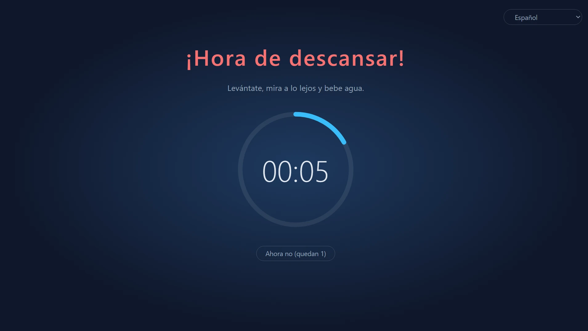
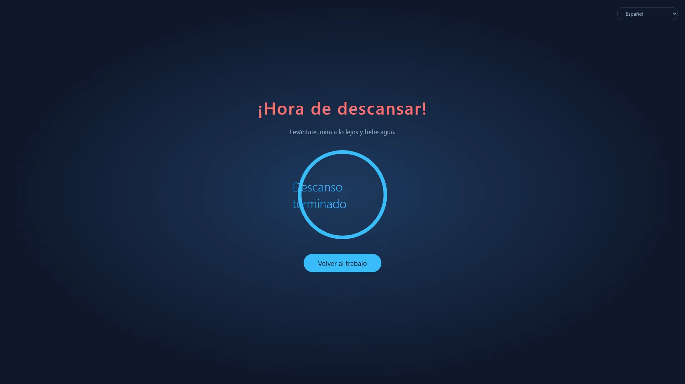
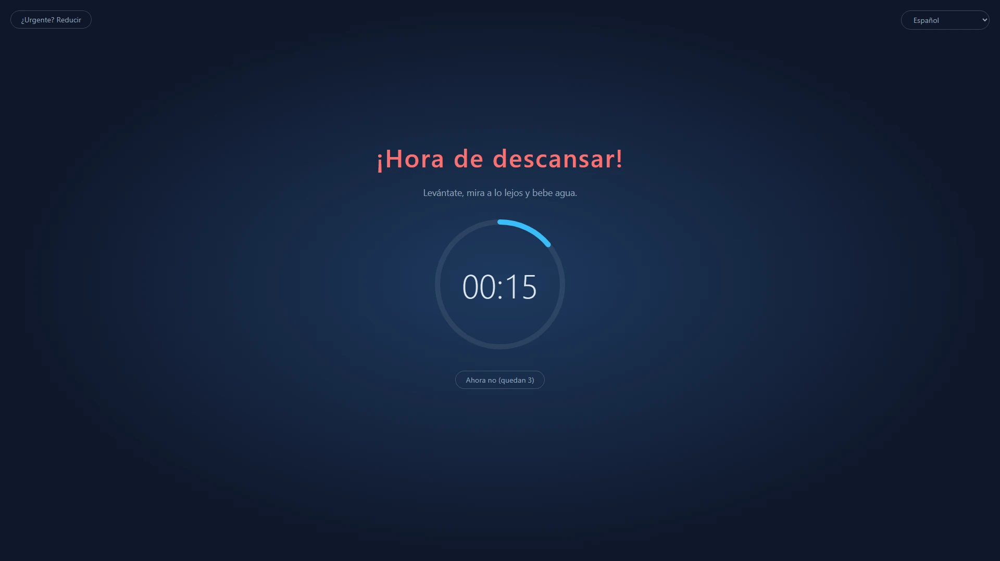
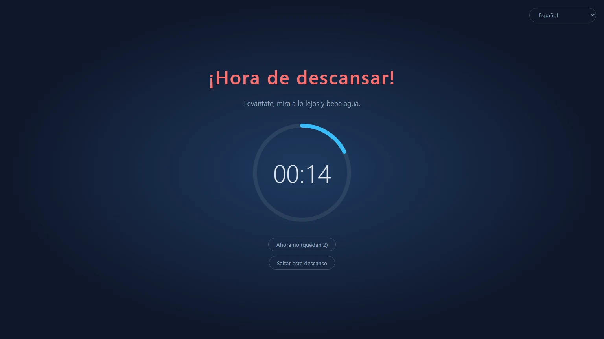
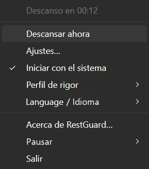

<p align="center">
  
</p>

<h1 align="center">RestGuard</h1>

<p align="center"><strong>El recordatorio de descansos que no puedes ignorar.</strong></p>

<p align="center">Un recordatorio de descansos libre y de código abierto para Windows, macOS y Linux que puede recordarte que descanses, o hacer que descanses.</p>

<p align="center">
  <a href="https://github.com/HansTanzi/RestGuard/releases/latest"></a>
  <a href="https://github.com/HansTanzi/RestGuard/releases"></a>
  <a href="#instalación"></a>
  <a href="#windows"></a>
  <a href="#licencia"></a>
</p>

<p align="center">
  Instalar en <a href="#windows"><b>Windows</b></a> · <a href="#macos"><b>macOS</b></a> · <a href="#linux"><b>Linux</b></a> · <a href="https://hanstanzi.github.io/RestGuard/">Sitio web</a>
</p>

<p align="center"><a href="README.md">English</a> | <a href="README.zh-CN.md">简体中文</a> | <a href="README.de.md">Deutsch</a> | <a href="README.ja.md">日本語</a> | Español | <a href="README.pt-BR.md">Português (Brasil)</a> | <a href="README.ko.md">한국어</a></p>



Un recordatorio de descansos multiplataforma con tres niveles de rigor integrados: puede recordarte que tomes un descanso o hacer que lo tomes. Ese rigor es lo que lo distingue de otros recordatorios de descansos.

- Alto: hace todo lo posible para que descanses de verdad.
- Medio: puedes seguir trabajando, pero trabajar se vuelve tan incómodo que acabas descansando.
- Bajo: como otros recordatorios de descansos, sobre todo te avisa.

Hecho con Rust + Tauri 2 + Svelte. Sucesor de [ProtectEyes](https://github.com/HansTanzi/ProtectEyes), una app en C# solo para Windows que el autor publicó como código abierto hace años.

Instálalo con una sola línea:

```sh
winget install HansTanzi.RestGuard            # Windows
brew install --cask hanstanzi/tap/restguard   # macOS
```

APT, Scoop, Homebrew en Linux y las descargas portátiles están en [Instalación](#instalación).

## Por qué RestGuard

La mayoría de los recordatorios de descansos son fáciles de ignorar: aparece una notificación, la cierras y «cinco minutos más» se convierten en dos horas. Pasar muchas horas frente a una pantalla se asocia con fatiga visual, ojo seco, dolor de cuello y espalda y lesiones por esfuerzo repetitivo (LER). Consejos como la regla 20-20-20 o un descanso breve cada hora solo sirven si de verdad descansas.

RestGuard es para quienes saben que deberían descansar pero siempre lo dejan para luego:

- **No basta con cerrarlo de un clic.** En Alto, la superposición cubre todas las pantallas hasta que termina el descanso.
- **Sabe cuándo no interrumpir.** Los aplazamientos, el modo urgente y la detección de reuniones evitan que un descanso arruine una llamada o te haga perder trabajo sin guardar.
- **Tú decides qué tan estricto es.** Elige Alto, Medio o Bajo, o crea tu propio perfil.

## Funciones

### Descansos que de verdad ocurren

- Impone un descanso de 10 minutos cada 60 minutos de trabajo (ambos tiempos ajustables)
- Varios monitores: cubre todas las pantallas
- La superposición no se puede cerrar durante el descanso (Alt+F4 no hace nada) y no se puede salir desde la bandeja
- Aplaza 5 minutos, hasta 3 veces; el contador se reinicia tras un descanso completo
- Modo urgente: ¿algo no puede esperar? Reduce la superposición un momento para guardar tu trabajo mientras la cuenta atrás sigue



### Tres perfiles integrados para distintas necesidades

| | Alto | Medio (predeterminado) | Bajo |
|---|:---:|:---:|:---:|
| Ideal para | Disciplina estricta, vencer el «solo cinco minutos más» | El trabajo diario | Un empujoncito suave |
| Aplazamientos | 1 | 3 | 3 |
| Modo urgente (reducir la superposición) | ✗ | ✓ | ✓ |
| Detección de apps de reuniones | ✗ | ✓ | ✓ |
| Cerrar / saltar este descanso | ✗ | ✗ | ✓ |
| Cobertura de pantalla | 100 % | 100 % | 80 % |
| Superposición arrastrable | ✗ | ✓ | ✓ |





### Muy personalizable

Si los perfiles integrados no encajan, elige **Nuevo personalizado…** en Ajustes para partir de cualquier perfil, ponle un nombre (puedes renombrarlo o borrarlo después) y ajusta cada opción:

- Número de aplazamientos, si se permite salir, si se permite saltar este descanso
- Si el modo urgente está disponible y cuánto se reduce la superposición
- Cuánto de cada pantalla cubre la superposición (10 % ~ 100 %) y si se puede arrastrar dentro de su pantalla
- Si se detectan apps de reuniones

Crea tantos perfiles personalizados como quieras y cambia entre ellos cuando quieras. Los tiempos de trabajo, descanso, aplazamiento e inactividad se comparten entre perfiles. Si prefieres editar archivos a mano, también puedes usar [`config.toml`](#configuración).

### No estorba cuando importa

- Detección de reuniones (Windows, macOS): mientras Zoom, Microsoft Teams, Webex o Tencent Meeting están en primer plano (o, en Windows, usan el micrófono), el descanso espera a que termine la reunión; durante un descanso también puedes hacer clic en «Estoy en una reunión…» para que te lo recuerde en 15 minutos
- Detección de inactividad: tras 5 minutos sin usar el teclado ni el ratón se considera que no estás y la cuenta atrás del trabajo se pausa; si estuviste fuera tanto como dura un descanso, cuenta como descanso completo, así que no te mandará a descansar nada más volver

### Nunca te pierdas el final del descanso

- Suena un aviso al terminar el descanso: elige uno integrado o tu propio archivo de audio
- Notificaciones en el móvil: recibe un aviso push en tu móvil (Android, iOS) mediante [ntfy](https://ntfy.sh), para saber cuándo volver aunque te hayas alejado; en Android puede sonar como una alarma hasta que la descartes
- Relojes inteligentes: la notificación del móvil se replica en un Apple Watch, Wear OS, Galaxy Watch o un reloj o pulsera de Xiaomi, Huawei, Garmin o similar emparejado, así que basta con mirar la muñeca (consulta [Notificaciones en el móvil y el reloj inteligente](#notificaciones-en-el-móvil-y-el-reloj-inteligente))

### Pequeño y rápido

- Hecho con Rust + Tauri 2 sobre el WebView del sistema, sin motor de navegador incluido, así que apenas consume recursos en segundo plano
- Diminuto: las descargas ocupan solo unos 3–6 MB, decenas de veces menos que las alternativas basadas en Electron (consulta [Comparación](#comparación))
- Portátil: un único exe en Windows y una `.app` que se descomprime y se ejecuta en macOS; bórralo para desinstalarlo

### Y más

- Multiplataforma: Windows, macOS y Linux, instalable y actualizable con WinGet, Scoop, Homebrew y APT (consulta [Instalación](#instalación))
- Menú de la bandeja: tiempo restante, descansar ahora, ajustes, iniciar con el sistema, cambiar el perfil de rigor
- Una sola instancia
- Libre y de código abierto bajo la permisiva licencia dual MIT / Apache-2.0 (consulta [Licencia](#licencia))
- Disponible en chino simplificado, inglés, hindi, español, árabe, francés, bengalí, portugués, alemán, japonés, italiano, coreano e indonesio. El idioma de la interfaz sigue al del sistema por defecto (inglés si el del sistema no está disponible); cámbialo cuando quieras desde el submenú «语言 / Language» de la bandeja



## Comparación

| | RestGuard | [Stretchly](https://github.com/hovancik/stretchly) | [Workrave](https://github.com/rcaelers/workrave) | [Safe Eyes](https://github.com/slgobinath/SafeEyes) |
|---|:---:|:---:|:---:|:---:|
| Windows | ✓ | ✓ | ✓ | ✗ |
| macOS | ✓ | ✓ | ✗ | ✗ |
| Linux | ✓ | ✓ | ✓ | ✓ |
| Tamaño de descarga | **~3–6 MB** | Windows 163 MB<br>macOS 187 MB<br>Linux 155 MB | Windows 61 MB<br>Linux 64 MB| Linux 0,3 MB |
| Rigor | 3 niveles + perfiles personalizados | Modo estricto sí/no | Puede bloquear la entrada y la pantalla | Puede desactivar el teclado |
| Retiene los descansos durante reuniones | Detecta Zoom, Teams, Webex, Tencent Meeting | Sigue No molestar; exclusiones por app | — | — |
| Aviso en el móvil / reloj al terminar el descanso | ✓ (ntfy) | — | — | — |
| Hecho con | Rust + Tauri (WebView del sistema) | Electron (incluye Chromium) | C++ | Python + GTK |
| Licencia | MIT / Apache-2.0 | BSD-2-Clause | GPL-3.0 | GPL-3.0 |

— significa que no viene integrado. Los tamaños de descarga corresponden a la última versión de cada proyecto en GitHub (Stretchly 1.22.1, Workrave 1.11.5, Safe Eyes 3.5.1): el instalador o exe de Windows, la descarga de macOS y el `.deb` de Linux. Basado en la documentación de cada proyecto a noviembre de 2026; si algo no es correcto, [abre un issue](https://github.com/HansTanzi/RestGuard/issues).

## Instalación

### Windows

Instálalo con [WinGet](https://learn.microsoft.com/windows/package-manager/winget/):

```powershell
winget install HansTanzi.RestGuard
```

O con [Scoop](https://scoop.sh):

```powershell
scoop bucket add hanstanzi https://github.com/HansTanzi/scoop-bucket
scoop install hanstanzi/restguard
```

O descarga `RestGuard_<versión>_x64.exe` desde [Releases](https://github.com/HansTanzi/RestGuard/releases/latest) y ejecútalo. Es un único exe portátil sin instalador: ponlo donde quieras y bórralo para desinstalarlo. No se actualiza solo; descarga la nueva versión para actualizar.

Requiere el entorno de ejecución WebView2 (preinstalado en Windows 11).

### macOS

Instálalo con [Homebrew](https://brew.sh) (compilación universal para Apple Silicon e Intel):

```sh
brew install --cask hanstanzi/tap/restguard
```

Si antes añadiste este repositorio como tap (`brew tap hanstanzi/restguard https://github.com/HansTanzi/RestGuard`), cambia al nuevo tap para seguir recibiendo actualizaciones: `brew untap hanstanzi/restguard && brew install --cask hanstanzi/tap/restguard`.

O descarga `RestGuard_<versión>_universal.zip` desde [Releases](https://github.com/HansTanzi/RestGuard/releases/latest), descomprímelo y mueve `RestGuard.app` a `/Applications`. No se actualiza solo; descarga la nueva versión para actualizar.

RestGuard vive en la barra de menús y no tiene icono en el Dock. La app no está notarizada por Apple; el cask elimina el atributo de cuarentena al instalar. Si descargaste el zip a mano, ejecuta `xattr -dr com.apple.quarantine /Applications/RestGuard.app` antes del primer arranque; si no, macOS no la abrirá.

### Linux

En Debian/Ubuntu (x86_64), añade el [repositorio APT](https://github.com/HansTanzi/apt) y después instala y actualiza con `apt`:

```sh
sudo install -d /etc/apt/keyrings
curl -fsSL https://hanstanzi.github.io/apt/hanstanzi.gpg | sudo tee /etc/apt/keyrings/hanstanzi.gpg > /dev/null
echo "deb [signed-by=/etc/apt/keyrings/hanstanzi.gpg] https://hanstanzi.github.io/apt stable main" | sudo tee /etc/apt/sources.list.d/hanstanzi.list
sudo apt update && sudo apt install rest-guard
```

Las versiones nuevas llegan con `sudo apt update && sudo apt upgrade`. También puedes instalar el `.deb` de [Releases](https://github.com/HansTanzi/RestGuard/releases/latest) directamente (`sudo apt install ./RestGuard_*_amd64.deb`), pero entonces no se actualizará.

Para otras distribuciones, descárgalo desde [Releases](https://github.com/HansTanzi/RestGuard/releases/latest). En Fedora/openSUSE, instala el `.rpm`:

```sh
sudo dnf install ./RestGuard_*_x86_64.rpm      # Fedora
sudo zypper install ./RestGuard_*_x86_64.rpm   # openSUSE
```

En Arch, instala el `.pkg.tar.zst`:

```sh
sudo pacman -U ./RestGuard_*_x86_64.pkg.tar.zst
```

En cualquier distribución (x86_64, glibc 2.35+) también puedes instalar y actualizar con [Homebrew](https://brew.sh). Homebrew no puede instalar bibliotecas del sistema, así que instala antes WebKitGTK 4.1 y libayatana-appindicator con el gestor de paquetes de tu distribución:

```sh
sudo apt install libwebkit2gtk-4.1-0 libayatana-appindicator3-1                 # Debian/Ubuntu
sudo dnf install webkit2gtk4.1 libayatana-appindicator-gtk3                     # Fedora
sudo pacman -S webkit2gtk-4.1 libayatana-appindicator                           # Arch
sudo zypper install libwebkit2gtk-4_1-0 libayatana-appindicator3-1              # openSUSE

brew install --cask hanstanzi/tap/restguard
```

Así solo se instala el ejecutable `restguard`, sin entrada en el menú de aplicaciones: ejecuta `restguard` una vez y activa «Iniciar con el sistema» en el menú de la bandeja. Las versiones nuevas llegan con `brew upgrade`.

La superposición necesita X11 (consulta [Limitaciones por plataforma](#limitaciones-por-plataforma)).

### Verificar las descargas

Los archivos publicados después de la v0.1.14 se compilan con GitHub Actions y llevan una [atestación de procedencia de compilación](https://docs.github.com/actions/security-for-github-actions/using-artifact-attestations) firmada que vincula cada archivo con la ejecución del flujo de trabajo y el commit que lo generaron. Para comprobar un archivo descargado con [GitHub CLI](https://cli.github.com):

```sh
gh attestation verify RestGuard_<versión>_x64.exe --repo HansTanzi/RestGuard
```

Cada versión incluye además `SHA256SUMS.txt`, para comprobar las descargas sin GitHub CLI. Pon el archivo descargado en el mismo directorio que `SHA256SUMS.txt` y ejecuta:

```sh
sha256sum -c SHA256SUMS.txt --ignore-missing          # Linux
shasum -a 256 -c SHA256SUMS.txt --ignore-missing      # macOS
```

En Windows, compara la salida de `Get-FileHash .\RestGuard_*_x64.exe` con la línea correspondiente de `SHA256SUMS.txt` (no distingue mayúsculas de minúsculas).

### Compilar desde el código fuente

Instala los requisitos indicados en [CONTRIBUTING.md](CONTRIBUTING.md#development-setup) y compila una versión etiquetada:

```sh
git clone https://github.com/HansTanzi/RestGuard
cd RestGuard
git checkout v<versión>
pnpm install --frozen-lockfile
pnpm tauri build --no-bundle
```

El ejecutable queda en `src-tauri/target/release/restguard` (`restguard.exe` en Windows). Compila con `pnpm tauri build`, no con `cargo build`: una compilación solo con Cargo es de desarrollo, carga la interfaz desde `localhost:1420` y muestra ventanas en blanco.

## Configuración

Abre **Ajustes…** desde el menú de la bandeja para cambiar los tiempos, el nivel de rigor, la cobertura de la superposición, el idioma y el inicio con el sistema. Los cambios se aplican al instante (los ajustes se bloquean durante un descanso). Cambiar el tiempo de trabajo reinicia la cuenta atrás actual.

Los ajustes se guardan en `config.toml`, que se crea en el primer arranque. También puedes editarlo a mano; reinicia la app después.

| Sistema | Ruta |
|---|---|
| Windows | `%APPDATA%\io.github.restguard\config.toml` |
| macOS | `~/Library/Application Support/io.github.restguard/config.toml` |
| Linux | `~/.config/io.github.restguard/config.toml` |

```toml
work_minutes = 60.0      # tiempo de trabajo antes de un descanso obligatorio
rest_minutes = 10.0      # duración de cada descanso
postpone_minutes = 5.0   # duración de cada aplazamiento
idle_minutes = 5.0       # sin actividad durante este tiempo cuenta como ausente; 0 = desactivado
level = "medium"         # "high", "medium", "low" o el nombre de un perfil personalizado
sound_prompt = true      # reproducir un sonido al terminar el descanso
sound = "beep"           # "beep", "chime", "rise" o "file" (reproduce sound_file)
sound_file = ""          # ruta completa de tu propio archivo de audio, usado con sound = "file"
phone_notify = false     # enviar una notificación al móvil por ntfy al terminar el descanso
ntfy_server = "https://ntfy.sh"  # servidor ntfy, el público o el tuyo
ntfy_topic = ""          # tema al que suscribirse en la app ntfy; que sea difícil de adivinar

[[fixed_breaks]]         # un descanso fijo; "work_end" (fin de la jornada) y "lunch" vienen integrados
name = "work_end"
enabled = false          # retrasar los descansos que tocan justo antes
time = "18:00"           # HH:MM en formato de 24 horas, hora local
quiet_minutes = 30.0     # los descansos que tocan este tiempo antes de time esperan hasta time

[[fixed_breaks]]         # almuerzo: a la hora time empieza un descanso de rest_minutes
name = "lunch"
enabled = true
time = "12:00"
quiet_minutes = 30.0
rest_minutes = 30.0      # duración del descanso (almuerzo y tus propios descansos fijos)

[[fixed_breaks]]         # añade los tuyos, p. ej. una pausa para el té, con un [[fixed_breaks]] cada uno
name = "Tea break"
enabled = true
time = "15:00"
quiet_minutes = 15.0
rest_minutes = 15.0

[[profiles]]             # un perfil personalizado; añade un [[profiles]] por perfil
name = "Focus"
max_postpones = 1        # máximo de aplazamientos antes de exigir un descanso completo
urgent_mode = false      # permitir reducir la superposición
meeting_detection = true # retrasar los descansos mientras se usa Zoom, Teams, etc.
force_rest = true        # false = la superposición se puede cerrar
allow_skip = false       # ofrecer «Saltar este descanso» aunque los descansos sean obligatorios
overlay_coverage = 1.0   # fracción de cada pantalla cubierta, 0.1 ~ 1.0
urgent_scale = 0.5       # escala del modo urgente (superposición reducida) respecto a lo anterior, 0.1 ~ 0.9
movable = false          # permitir arrastrar la superposición dentro de su pantalla si no la ocupa entera
```

### Notificaciones en el móvil y el reloj inteligente

1. Instala la app ntfy en tu móvil ([Android](https://play.google.com/store/apps/details?id=io.heckel.ntfy), [F-Droid](https://f-droid.org/packages/io.heckel.ntfy/), [iOS](https://apps.apple.com/app/ntfy/id1625396347))
2. En los Ajustes de RestGuard, activa «Avisar al móvil al terminar el descanso (ntfy)» e introduce un tema difícil de adivinar (solo letras, dígitos, `-` y `_`). El servidor por defecto es el público `https://ntfy.sh`; puedes usar el tuyo
3. Suscríbete al mismo servidor y tema en la app ntfy y haz clic en «Enviar notificación de prueba» para comprobar que llega

Las notificaciones se envían con la máxima prioridad. En Android, activa «Keep alerting for highest priority» en los ajustes de ntfy para que suene como una alarma hasta que la descartes; en iOS es una notificación urgente que atraviesa los modos de concentración (si permites a ntfy enviar notificaciones urgentes). Cualquiera que conozca el tema puede suscribirse en el servidor público, así que mantenlo en privado.

No hace falta instalar nada en el reloj; el sistema le replica la notificación del móvil:

| Reloj | Configuración |
|---|---|
| Apple Watch | En la app Watch del iPhone, ve a Notificaciones y activa «Replicar alertas del iPhone» para ntfy. Las notificaciones llegan al reloj solo mientras el iPhone está bloqueado o con la pantalla apagada |
| Wear OS / Galaxy Watch | Se replican por defecto; comprueba que ntfy no esté desactivado en los ajustes de notificaciones del reloj |
| Xiaomi, Huawei, Garmin, Amazfit, etc. | Permite ntfy en la lista de notificaciones de apps de la app acompañante (Zepp, Huawei Health, Garmin Connect, etc.) |

Notas:

- El reloj vibra una vez; no sigue avisando como el móvil
- El móvil debe estar conectado y con ntfy en segundo plano para que el reloj reciba la notificación; un reloj usado por su cuenta sin el móvil no la recibirá
- Con un servidor propio, iOS necesita `upstream-base-url: "https://ntfy.sh"` en la configuración del servidor para recibir las notificaciones al instante (consulta la [documentación de ntfy](https://docs.ntfy.sh/config/#ios-instant-notifications))

## Limitaciones por plataforma

- **macOS**: las acciones a nivel de sistema como Forzar salida (`Cmd+Option+Esc`) no se pueden bloquear
- **Linux**: la detección de inactividad necesita GNOME o un escritorio que implemente `org.freedesktop.ScreenSaver` (p. ej., KDE Plasma), además de `gdbus`; si no, queda desactivada
- **Linux**: los sonidos se reproducen con `paplay`, `pw-play` o `aplay`, así que usa wav, ogg o flac para tu propio archivo (mp3 no es compatible)
- **Linux Wayland**: el protocolo no permite que las apps se mantengan siempre encima ni que coloquen sus propias ventanas, así que la superposición puede no funcionar; con X11 funciona bien

## Preguntas frecuentes

**¿Puedo cerrar RestGuard?**
Entre descansos, sí: elige «Salir» en el menú de la bandeja. Durante un descanso, o mientras quede pendiente un descanso aplazado, «Salir» está desactivado.

**¿Y si toca un descanso en mitad de una reunión?**
En Medio y Bajo, el descanso espera mientras Zoom, Microsoft Teams, Webex o Tencent Meeting están en primer plano (Windows, macOS; en Windows también mientras usan el micrófono). Si el descanso ya empezó, haz clic en «Estoy en una reunión…» para que te lo recuerde en 15 minutos. En Alto, los descansos no esperan.

**Estoy con algo urgente. ¿Perderé mi trabajo?**
Aplaza el descanso 5 minutos (hasta 3 veces en Medio y Bajo, una vez en Alto), o en Medio y Bajo usa el modo urgente para reducir la superposición y guardar tu trabajo mientras la cuenta atrás sigue.

**¿El tiempo lejos del ordenador cuenta como trabajo?**
No. Tras 5 minutos sin usar el teclado ni el ratón, la cuenta atrás de trabajo se pausa, y estar fuera tanto como dura un descanso cuenta como un descanso completo.

**macOS dice que no se puede abrir la app.**
RestGuard no está notarizado por Apple. Instálalo con Homebrew o ejecuta una vez `xattr -dr com.apple.quarantine /Applications/RestGuard.app` (consulta [macOS](#macos)).

**¿Funciona en Wayland?**
No de forma fiable: Wayland no permite que las apps mantengan sus ventanas encima, así que usa una sesión X11 (consulta [Limitaciones por plataforma](#limitaciones-por-plataforma)).

**¿Recopila datos?**
No. Consulta [Privacidad](#privacidad).

## Contribuir

Los informes de errores, ideas, traducciones y pull requests son bienvenidos. [CONTRIBUTING.md](CONTRIBUTING.md) (en inglés) explica cómo preparar el entorno de desarrollo, las comprobaciones previas a un PR y cómo mejorar una traducción; los cambios de cada versión están en [CHANGELOG.md](CHANGELOG.md). Informa de los problemas de seguridad en privado, como se describe en [SECURITY.md](SECURITY.md).

Si RestGuard te ayuda a descansar, una ⭐ ayuda a que otros lo encuentren.

[](https://github.com/HansTanzi/RestGuard/graphs/contributors)

[](https://star-history.com/#HansTanzi/RestGuard&Date)

## Privacidad

RestGuard no recopila ningún dato: ni cuentas, ni analíticas, ni telemetría. Solo se conecta a internet para enviar la notificación opcional de ntfy al móvil. Consulta la [política de privacidad](https://hanstanzi.github.io/RestGuard/privacy.html) (en inglés).

## Licencia

Disponible, a tu elección, bajo [MIT](LICENSE-MIT) o [Apache-2.0](LICENSE-APACHE).
