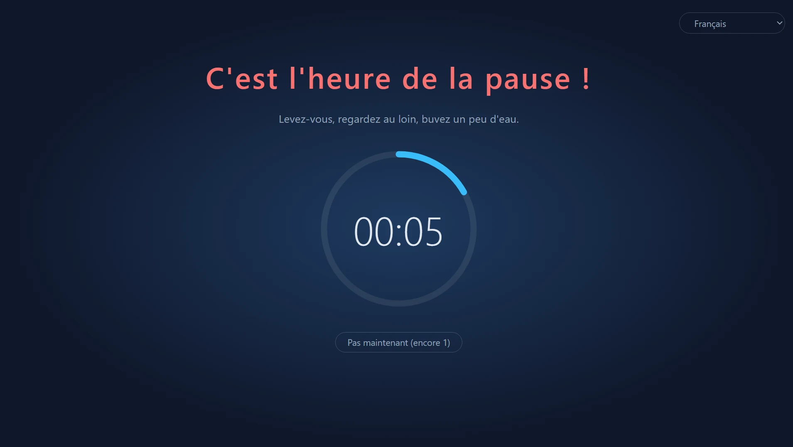
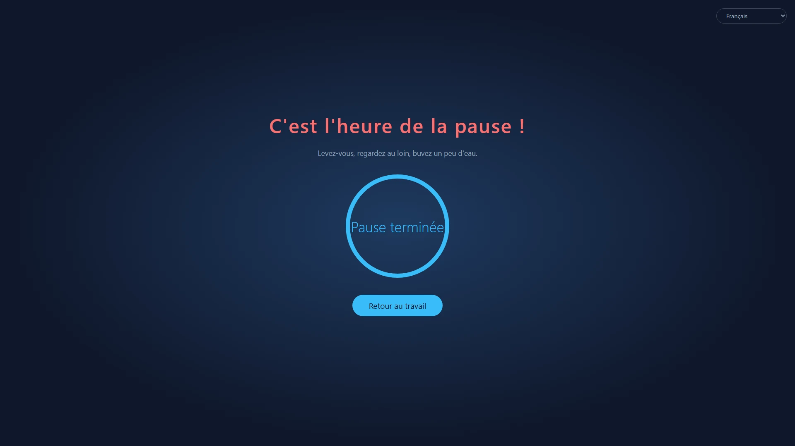
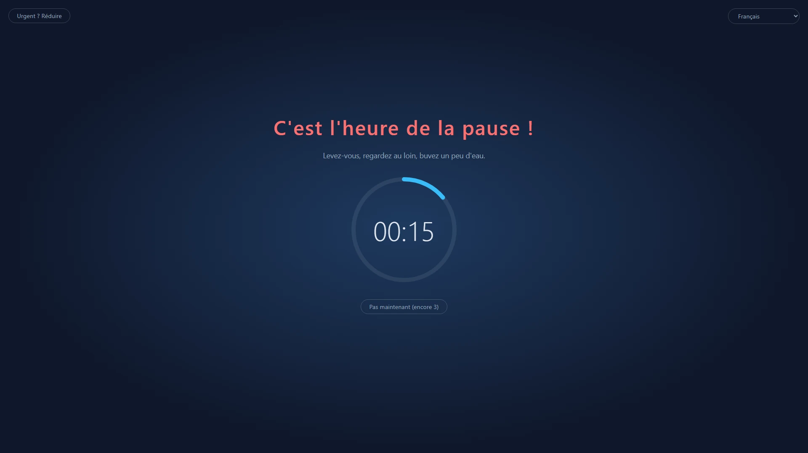
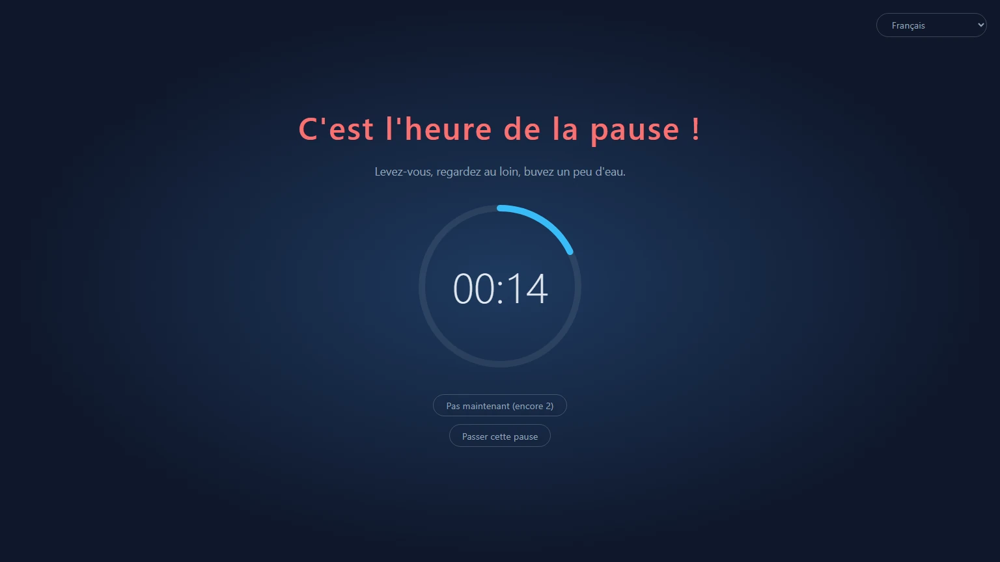
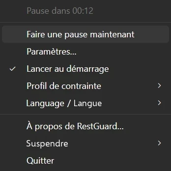

<p align="center">
  
</p>

<h1 align="center">RestGuard</h1>

<p align="center"><strong>Le rappel de pause impossible à ignorer.</strong></p>

<p align="center">Un rappel de pause libre et gratuit pour Windows, macOS et Linux, qui peut vous rappeler de vous reposer, ou vous y obliger.</p>

<p align="center">
  <a href="https://github.com/HansTanzi/RestGuard/releases/latest"></a>
  <a href="https://github.com/HansTanzi/RestGuard/releases"></a>
  <a href="#installation"></a>
  <a href="#windows"></a>
  <a href="#licence"></a>
</p>

<p align="center">
  Installer sur <a href="#windows"><b>Windows</b></a> · <a href="#macos"><b>macOS</b></a> · <a href="#linux"><b>Linux</b></a> · <a href="https://hanstanzi.github.io/RestGuard/">Site web</a>
</p>

<p align="center"><a href="README.md">English</a> | <a href="README.zh-CN.md">简体中文</a> | <a href="README.de.md">Deutsch</a> | <a href="README.ja.md">日本語</a> | <a href="README.es.md">Español</a> | <a href="README.pt-BR.md">Português (Brasil)</a> | <a href="README.ko.md">한국어</a> | Français | <a href="README.it.md">Italiano</a> | <a href="README.id.md">Bahasa Indonesia</a> | <a href="README.hi.md">हिन्दी</a> | <a href="README.bn.md">বাংলা</a> | <a href="README.ar.md">العربية</a></p>



Un rappel de pause multiplateforme avec trois niveaux de contrainte intégrés : il peut vous rappeler de faire une pause, ou vous obliger à la faire. C'est cette contrainte qui le distingue des autres rappels de pause.

- Contrainte élevée : fait tout son possible pour que vous preniez la pause.
- Contrainte moyenne : vous pouvez encore travailler, mais assez inconfortablement pour vous inciter à vous reposer.
- Contrainte faible : comme les autres rappels de pause, il se contente surtout de vous le rappeler.

Réalisé avec Rust + Tauri 2 + Svelte. Successeur de [ProtectEyes](https://github.com/HansTanzi/ProtectEyes), une application C# réservée à Windows que j'ai publiée en open source il y a des années.

Installation en une ligne :

```sh
winget install HansTanzi.RestGuard            # Windows
brew install --cask hanstanzi/tap/restguard   # macOS
```

APT, Scoop, Homebrew sous Linux et les téléchargements portables sont décrits dans [Installation](#installation).

## Pourquoi RestGuard

La plupart des rappels de pause sont faciles à ignorer : une notification apparaît, vous la fermez, et « juste cinq minutes de plus » se transforment en deux heures. Les longues périodes devant un écran sont associées à la fatigue oculaire, à la sécheresse des yeux, aux douleurs de la nuque et du dos et aux troubles musculosquelettiques (TMS). Des conseils comme la règle 20-20-20 ou une courte pause toutes les heures n'aident que si vous faites vraiment la pause.

RestGuard s'adresse à ceux qui savent qu'ils devraient se reposer, mais qui remettent toujours à plus tard :

- **Impossible de le fermer d'un clic.** En contrainte élevée, le voile couvre tous les écrans jusqu'à la fin de la pause.
- **Il sait quand ne pas interrompre.** Les reports, le mode urgence et la détection des réunions évitent qu'une pause ne gâche un appel ou ne vous fasse perdre un travail non enregistré.
- **Vous choisissez le degré de fermeté.** Choisissez une contrainte élevée, moyenne ou faible, ou créez votre propre profil.

## Fonctionnalités

### Des pauses qui ont vraiment lieu

- Impose une pause de 10 minutes après chaque période de 60 minutes de travail (les deux durées sont réglables)
- Multi-écran : chaque écran est couvert
- Le voile ne peut pas être fermé pendant une pause (Alt+F4 n'a aucun effet), et vous ne pouvez pas quitter depuis la zone de notification
- Reportez de 5 minutes, jusqu'à 3 fois ; le compteur est remis à zéro après une pause complète
- Mode urgence : quelque chose ne peut pas attendre ? Réduisez le voile un instant pour enregistrer votre travail pendant que le compte à rebours continue



### Trois profils intégrés pour différents besoins

| | Contrainte élevée | Contrainte moyenne (par défaut) | Contrainte faible |
|---|:---:|:---:|:---:|
| Idéal pour | Discipline stricte, en finir avec « juste cinq minutes de plus » | Le travail au quotidien | Un petit rappel en douceur |
| Reports | 1 | 3 | 3 |
| Mode urgence (réduire le voile) | ✗ | ✓ | ✓ |
| Détection des applis de réunion | ✗ | ✓ | ✓ |
| Fermer / passer cette pause | ✗ | ✗ | ✓ |
| Couverture de l'écran | 100% | 100% | 80% |
| Voile déplaçable | ✗ | ✓ | ✓ |





### Hautement personnalisable

Si les profils intégrés ne conviennent pas, choisissez **Nouveau personnalisé…** dans les paramètres pour partir de n'importe quel profil, donnez-lui un nom (vous pourrez le renommer ou le supprimer plus tard) et réglez chaque option :

- Nombre de reports, autorisation de quitter, autorisation de passer cette pause
- Disponibilité du mode urgence, et taille à laquelle le voile se réduit
- Part de chaque écran couverte par le voile (10 % ~ 100 %), et possibilité de le déplacer sur son écran
- Détection ou non des applis de réunion

Gardez autant de profils personnalisés que vous voulez et changez-en à tout moment. Les durées de travail, de pause, de report et d'inactivité sont communes à tous les profils. Si vous préférez modifier les fichiers à la main, [`config.toml`](#configuration) fonctionne aussi.

### Discret quand il le faut

- Détection des réunions (Windows, macOS) : tant que Zoom, Microsoft Teams, Webex ou Tencent Meeting est au premier plan (ou, sous Windows, utilise le micro), la pause attend la fin de la réunion ; pendant une pause, vous pouvez aussi cliquer sur « Je suis en réunion » pour recevoir un rappel dans 15 minutes
- Détection d'inactivité : après 5 minutes sans clavier ni souris, vous êtes considéré comme absent et le compte à rebours du travail se met en pause ; une absence aussi longue qu'une pause compte comme une pause complète, vous n'êtes donc pas renvoyé en pause juste après votre retour

### Ne manquez jamais la fin d'une pause

- Un son retentit à la fin d'une pause : choisissez un son intégré ou votre propre fichier audio
- Notifications sur téléphone : recevez un push sur votre téléphone (Android, iOS) via [ntfy](https://ntfy.sh), pour savoir quand revenir même après vous être éloigné ; sur Android, il peut sonner comme une alarme jusqu'à ce que vous l'arrêtiez
- Montres connectées : la notification du téléphone est répliquée sur une Apple Watch, une montre Wear OS, une Galaxy Watch ou une montre ou un bracelet Xiaomi, Huawei, Garmin ou similaire appairé, un coup d'œil au poignet suffit (voir [Notifications sur téléphone et montre connectée](#notifications-sur-téléphone-et-montre-connectée))

### Léger et rapide

- Réalisé avec Rust + Tauri 2 sur la WebView du système, sans moteur de navigateur embarqué : il n'utilise presque aucune ressource en arrière-plan
- Minuscule : les téléchargements ne pèsent qu'environ 3–6 Mo, des dizaines de fois moins que les alternatives basées sur Electron (voir [Comparatif](#comparatif))
- Portable : un seul exe sous Windows, une `.app` à décompresser et lancer sous macOS ; supprimez-la pour désinstaller

### Et plus encore

- Multiplateforme : Windows, macOS et Linux, à installer et mettre à jour via WinGet, Scoop, Homebrew et APT (voir [Installation](#installation))
- Menu de la zone de notification : temps restant, pause immédiate, paramètres, lancement au démarrage, changement de profil de contrainte
- Instance unique
- Libre et gratuit sous la double licence permissive MIT / Apache-2.0 (voir [Licence](#licence))
- Disponible en chinois simplifié, anglais, hindi, espagnol, arabe, français, bengali, portugais, allemand, japonais, italien, coréen et indonésien. La langue de l'interface suit le système par défaut (anglais si la langue du système n'est pas prise en charge) ; changez-la à tout moment depuis le sous-menu « 语言 / Language » de la zone de notification



## Comparatif

| | RestGuard | [Stretchly](https://github.com/hovancik/stretchly) | [Workrave](https://github.com/rcaelers/workrave) | [Safe Eyes](https://github.com/slgobinath/SafeEyes) |
|---|:---:|:---:|:---:|:---:|
| Windows | ✓ | ✓ | ✓ | ✗ |
| macOS | ✓ | ✓ | ✗ | ✗ |
| Linux | ✓ | ✓ | ✓ | ✓ |
| Taille du téléchargement | **~3–6 Mo** | Windows 163 Mo<br>macOS 187 Mo<br>Linux 155 Mo | Windows 61 Mo<br>Linux 64 Mo | Linux 0,3 Mo |
| Contrainte | 3 niveaux + profils personnalisés | Mode strict activable | Peut bloquer la saisie et l'écran | Peut désactiver le clavier |
| Retient les pauses pendant les réunions | Détecte Zoom, Teams, Webex, Tencent Meeting | Suit le mode Ne pas déranger ; exclusions par appli | — | — |
| Alerte téléphone / montre à la fin d'une pause | ✓ (ntfy) | — | — | — |
| Technologies | Rust + Tauri (WebView du système) | Electron (embarque Chromium) | C++ | Python + GTK |
| Licence | MIT / Apache-2.0 | BSD-2-Clause | GPL-3.0 | GPL-3.0 |

— signifie non intégré. Les tailles sont celles de la dernière version GitHub de chaque projet (Stretchly 1.22.1, Workrave 1.11.5, Safe Eyes 3.5.1) : l'installateur ou l'exe Windows, le téléchargement macOS et le `.deb` Linux. Basé sur la documentation de chaque projet en novembre 2026 ; si quelque chose est inexact, merci d'[ouvrir une issue](https://github.com/HansTanzi/RestGuard/issues).

## Installation

### Windows

Installez avec [WinGet](https://learn.microsoft.com/windows/package-manager/winget/) :

```powershell
winget install HansTanzi.RestGuard
```

Ou avec [Scoop](https://scoop.sh) :

```powershell
scoop bucket add hanstanzi https://github.com/HansTanzi/scoop-bucket
scoop install hanstanzi/restguard
```

Ou téléchargez `RestGuard_<version>_x64.exe` depuis [Releases](https://github.com/HansTanzi/RestGuard/releases/latest) et lancez-le. C'est un seul exe portable, sans installateur : placez-le où vous voulez et supprimez-le pour désinstaller. Il ne se met pas à jour tout seul ; téléchargez la nouvelle version pour mettre à jour.

Nécessite le runtime WebView2 (préinstallé sur Windows 11).

### macOS

Installez avec [Homebrew](https://brew.sh) (version universelle pour Apple Silicon et Intel) :

```sh
brew install --cask hanstanzi/tap/restguard
```

Si vous aviez déjà ajouté ce dépôt comme tap (`brew tap hanstanzi/restguard https://github.com/HansTanzi/RestGuard`), passez au nouveau tap pour continuer à recevoir les mises à jour : `brew untap hanstanzi/restguard && brew install --cask hanstanzi/tap/restguard`.

Ou téléchargez `RestGuard_<version>_universal.zip` depuis [Releases](https://github.com/HansTanzi/RestGuard/releases/latest), décompressez-le et déplacez `RestGuard.app` dans `/Applications`. Il ne se met pas à jour tout seul ; téléchargez la nouvelle version pour mettre à jour.

RestGuard se trouve dans la barre des menus et n'a pas d'icône dans le Dock. L'application n'est pas notariée par Apple ; le cask retire l'attribut de quarantaine à l'installation. Si vous avez téléchargé le zip à la main, exécutez `xattr -dr com.apple.quarantine /Applications/RestGuard.app` avant le premier lancement, sinon macOS refusera de l'ouvrir.

### Linux

Sur Debian/Ubuntu (x86_64), ajoutez le [dépôt APT](https://github.com/HansTanzi/apt), puis installez et mettez à jour avec `apt` :

```sh
sudo install -d /etc/apt/keyrings
curl -fsSL https://hanstanzi.github.io/apt/hanstanzi.gpg | sudo tee /etc/apt/keyrings/hanstanzi.gpg > /dev/null
echo "deb [signed-by=/etc/apt/keyrings/hanstanzi.gpg] https://hanstanzi.github.io/apt stable main" | sudo tee /etc/apt/sources.list.d/hanstanzi.list
sudo apt update && sudo apt install rest-guard
```

Les nouvelles versions arrivent avec `sudo apt update && sudo apt upgrade`. Vous pouvez aussi installer directement le `.deb` depuis [Releases](https://github.com/HansTanzi/RestGuard/releases/latest) (`sudo apt install ./RestGuard_*_amd64.deb`), mais il ne sera alors pas mis à jour.

Pour les autres distributions, téléchargez depuis [Releases](https://github.com/HansTanzi/RestGuard/releases/latest). Sur Fedora/openSUSE, installez le `.rpm` :

```sh
sudo dnf install ./RestGuard_*_x86_64.rpm      # Fedora
sudo zypper install ./RestGuard_*_x86_64.rpm   # openSUSE
```

Sur Arch, installez le `.pkg.tar.zst` :

```sh
sudo pacman -U ./RestGuard_*_x86_64.pkg.tar.zst
```

Sur toute distribution (x86_64, glibc 2.35+), vous pouvez aussi installer et mettre à jour avec [Homebrew](https://brew.sh). Homebrew ne peut pas installer les bibliothèques système ; installez donc d'abord WebKitGTK 4.1 et libayatana-appindicator avec le gestionnaire de paquets de votre distribution :

```sh
sudo apt install libwebkit2gtk-4.1-0 libayatana-appindicator3-1                 # Debian/Ubuntu
sudo dnf install webkit2gtk4.1 libayatana-appindicator-gtk3                     # Fedora
sudo pacman -S webkit2gtk-4.1 libayatana-appindicator                           # Arch
sudo zypper install libwebkit2gtk-4_1-0 libayatana-appindicator3-1              # openSUSE

brew install --cask hanstanzi/tap/restguard
```

Cela installe uniquement l'exécutable `restguard`, sans entrée dans le menu des applications : lancez `restguard` une fois, puis activez « Lancer au démarrage » dans le menu de la zone de notification. Les nouvelles versions arrivent avec `brew upgrade`.

Le voile nécessite X11 (voir [Limitations par plateforme](#limitations-par-plateforme)).

### Vérifier les téléchargements

Les fichiers des Releases postérieures à v0.1.14 sont compilés par GitHub Actions et portent une [attestation signée de provenance](https://docs.github.com/actions/security-for-github-actions/using-artifact-attestations) qui relie chaque fichier à l'exécution du workflow et au commit qui l'ont produit. Pour vérifier un fichier téléchargé avec la [GitHub CLI](https://cli.github.com) :

```sh
gh attestation verify RestGuard_<version>_x64.exe --repo HansTanzi/RestGuard
```

Chaque Release inclut aussi `SHA256SUMS.txt`, pour vérifier un téléchargement sans la GitHub CLI. Placez le fichier téléchargé dans le même dossier que `SHA256SUMS.txt` et exécutez :

```sh
sha256sum -c SHA256SUMS.txt --ignore-missing          # Linux
shasum -a 256 -c SHA256SUMS.txt --ignore-missing      # macOS
```

Sous Windows, comparez le résultat de `Get-FileHash .\RestGuard_*_x64.exe` à la ligne correspondante de `SHA256SUMS.txt` (la casse n'a pas d'importance).

### Compiler depuis les sources

Installez les prérequis indiqués dans [CONTRIBUTING.md](CONTRIBUTING.md#development-setup) (en anglais), puis compilez une version taguée :

```sh
git clone https://github.com/HansTanzi/RestGuard
cd RestGuard
git checkout v<version>
pnpm install --frozen-lockfile
pnpm tauri build --no-bundle
```

L'exécutable est `src-tauri/target/release/restguard` (`restguard.exe` sous Windows). Compilez avec `pnpm tauri build`, pas `cargo build` : une simple compilation Cargo est une compilation de développement qui charge l'interface depuis `localhost:1420` et affiche des fenêtres vides.

## Configuration

Ouvrez **Paramètres…** depuis le menu de la zone de notification pour modifier les durées, le niveau de contrainte, la couverture du voile, la langue et le lancement au démarrage. Les changements s'appliquent immédiatement (les paramètres sont verrouillés pendant une pause). Modifier la durée de travail relance le compte à rebours du travail en cours.

Les paramètres sont enregistrés dans `config.toml`, créé au premier lancement. Vous pouvez aussi le modifier à la main ; redémarrez ensuite l'application.

| Système | Chemin |
|---|---|
| Windows | `%APPDATA%\io.github.restguard\config.toml` |
| macOS | `~/Library/Application Support/io.github.restguard/config.toml` |
| Linux | `~/.config/io.github.restguard/config.toml` |

```toml
work_minutes = 60.0      # durée de travail avant une pause imposée
rest_minutes = 10.0      # durée de chaque pause
postpone_minutes = 5.0   # durée de chaque report
idle_minutes = 5.0       # sans saisie pendant cette durée, vous êtes considéré comme absent ; 0 = désactivé
level = "medium"         # "high", "medium", "low" ou le nom d'un profil personnalisé
sound_prompt = true      # jouer un son à la fin d'une pause
sound = "beep"           # "beep", "chime", "rise" ou "file" (joue sound_file)
sound_file = ""          # chemin complet de votre fichier audio, utilisé quand sound = "file"
phone_notify = false     # envoyer une notification sur votre téléphone via ntfy à la fin d'une pause
ntfy_server = "https://ntfy.sh"  # serveur ntfy, le public ou le vôtre
ntfy_topic = ""          # sujet à suivre dans l'appli ntfy ; choisissez-le difficile à deviner

[[fixed_breaks]]         # une pause fixe ; "work_end" (fin de journée) et "lunch" sont intégrées
name = "work_end"
enabled = false          # retenir les pauses qui tombent juste avant
time = "18:00"           # format 24 h HH:MM en heure locale
quiet_minutes = 30.0     # les pauses dues dans ce délai avant time attendent time

[[fixed_breaks]]         # déjeuner : une pause de rest_minutes commence à time
name = "lunch"
enabled = true
time = "12:00"
quiet_minutes = 30.0
rest_minutes = 30.0      # durée de la pause (déjeuner et vos pauses fixes) ; au-delà d'une pause normale, vous pouvez continuer à utiliser l'ordinateur

[[fixed_breaks]]         # ajoutez les vôtres, par ex. une pause thé, avec un [[fixed_breaks]] chacune
name = "Pause thé"
enabled = true
time = "15:00"
quiet_minutes = 15.0
rest_minutes = 15.0

[[profiles]]             # un profil personnalisé ; ajoutez un [[profiles]] par profil
name = "Concentration"
max_postpones = 1        # nombre maximal de reports avant qu'une pause complète soit obligatoire
urgent_mode = false      # autoriser la réduction du voile
meeting_detection = true # retenir les pauses pendant l'utilisation de Zoom, Teams, etc.
force_rest = true        # false = le voile peut être fermé
allow_skip = false       # proposer quand même « Passer cette pause » lorsque les pauses sont imposées
overlay_coverage = 1.0   # part de chaque écran couverte, 0.1 ~ 1.0
urgent_scale = 0.5       # échelle du mode urgence (voile réduit) par rapport à la valeur ci-dessus, 0.1 ~ 0.9
movable = false          # autoriser le déplacement du voile sur son écran lorsqu'il n'est pas en plein écran
```

### Notifications sur téléphone et montre connectée

1. Installez l'appli ntfy sur votre téléphone ([Android](https://play.google.com/store/apps/details?id=io.heckel.ntfy), [F-Droid](https://f-droid.org/packages/io.heckel.ntfy/), [iOS](https://apps.apple.com/app/ntfy/id1625396347))
2. Dans les paramètres de RestGuard, activez « Prévenir mon téléphone à la fin de la pause (ntfy) » et saisissez un sujet difficile à deviner (uniquement des lettres, des chiffres, `-` et `_`). Le serveur par défaut est le serveur public `https://ntfy.sh` ; vous pouvez utiliser le vôtre
3. Abonnez-vous au même serveur et au même sujet dans l'appli ntfy, puis cliquez sur « Envoyer une notification de test » pour vérifier qu'elle arrive

Les notifications sont envoyées avec la priorité la plus élevée. Sur Android, activez « Keep alerting for highest priority » dans les réglages de ntfy pour qu'elle sonne comme une alarme jusqu'à ce que vous l'arrêtiez ; sur iOS, c'est une notification urgente qui passe outre les modes de concentration (si vous autorisez ntfy à envoyer des notifications urgentes). Quiconque connaît le sujet peut s'y abonner sur le serveur public, gardez-le donc privé.

Rien à installer sur la montre, le système y réplique la notification du téléphone :

| Montre | Configuration |
|---|---|
| Apple Watch | Dans l'app Watch de votre iPhone, ouvrez Notifications et activez la recopie des alertes de l'iPhone (« Mirror iPhone alerts ») pour ntfy. Les notifications n'arrivent sur la montre que lorsque l'iPhone est verrouillé ou que son écran est éteint |
| Wear OS / Galaxy Watch | Répliquées par défaut ; vérifiez que ntfy n'est pas désactivé dans les réglages de notification de la montre |
| Xiaomi, Huawei, Garmin, Amazfit, etc. | Autorisez ntfy dans la liste des notifications de l'appli compagnon (Zepp, Huawei Health, Garmin Connect, etc.) |

Remarques :

- La montre vibre une fois ; elle ne continue pas à alerter comme le téléphone
- Le téléphone doit être en ligne avec ntfy en arrière-plan pour que la montre reçoive la notification ; une montre utilisée seule, sans le téléphone, ne la recevra pas
- Avec un serveur auto-hébergé, iOS a besoin de `upstream-base-url: "https://ntfy.sh"` dans la configuration du serveur pour recevoir les notifications instantanément (voir la [documentation ntfy](https://docs.ntfy.sh/config/#ios-instant-notifications))

## Limitations par plateforme

- **macOS** : les actions système comme Forcer à quitter (`Cmd+Option+Esc`) ne peuvent pas être bloquées
- **Linux** : la détection d'inactivité nécessite GNOME ou un bureau implémentant `org.freedesktop.ScreenSaver` (par ex. KDE Plasma), ainsi que `gdbus` ; sinon elle est désactivée
- **Linux** : les sons sont joués avec `paplay`, `pw-play` ou `aplay`, utilisez donc du wav, ogg ou flac pour votre fichier (mp3 n'est pas pris en charge)
- **Linux Wayland** : le protocole ne permet pas aux applications de rester au premier plan ni de positionner leurs fenêtres, le voile peut donc ne pas fonctionner ; X11 ne pose aucun problème

## FAQ

**Puis-je quitter RestGuard ?**
Entre deux pauses, oui : choisissez « Quitter » dans le menu de la zone de notification. Pendant une pause, ou tant qu'une pause reportée reste due, « Quitter » est désactivé.

**Et si une pause arrive pendant une réunion ?**
En contrainte moyenne et faible, la pause attend tant que Zoom, Microsoft Teams, Webex ou Tencent Meeting est au premier plan (Windows, macOS ; sous Windows, aussi tant qu'il utilise le micro). Si une pause a déjà commencé, cliquez sur « Je suis en réunion » pour recevoir un rappel dans 15 minutes. En contrainte élevée, les pauses n'attendent pas.

**Je suis en plein travail urgent. Vais-je perdre mon travail ?**
Reportez la pause de 5 minutes (jusqu'à 3 fois en contrainte moyenne et faible, une fois en contrainte élevée), ou, en contrainte moyenne et faible, utilisez le mode urgence pour réduire le voile et enregistrer votre travail pendant que le compte à rebours continue.

**Le temps passé loin de l'ordinateur compte-t-il comme du travail ?**
Non. Après 5 minutes sans clavier ni souris, le compte à rebours du travail se met en pause, et une absence aussi longue qu'une pause compte comme une pause complète.

**macOS indique que l'application ne peut pas être ouverte.**
RestGuard n'est pas notarié par Apple. Installez-le avec Homebrew, ou exécutez une fois `xattr -dr com.apple.quarantine /Applications/RestGuard.app` (voir [macOS](#macos)).

**Est-ce que ça fonctionne sous Wayland ?**
Pas de façon fiable : Wayland ne permet pas aux applications de garder leurs fenêtres au premier plan, utilisez donc une session X11 (voir [Limitations par plateforme](#limitations-par-plateforme)).

**Collecte-t-il des données ?**
Non. Voir [Confidentialité](#confidentialité).

## Contribuer

Les rapports de bugs, idées, traductions et pull requests sont les bienvenus. [CONTRIBUTING.md](CONTRIBUTING.md) (en anglais) décrit la mise en place de l'environnement de développement, les vérifications et comment améliorer une traduction ; les changements de chaque version sont dans [CHANGELOG.md](CHANGELOG.md). Signalez les problèmes de sécurité en privé comme indiqué dans [SECURITY.md](SECURITY.md).

Si RestGuard vous aide à vous reposer, une ⭐ aide d'autres personnes à le découvrir.

[](https://github.com/HansTanzi/RestGuard/graphs/contributors)

[](https://star-history.com/#HansTanzi/RestGuard&Date)

## Confidentialité

RestGuard ne collecte aucune donnée : pas de compte, d'analyse ni de télémétrie. Il ne se connecte à Internet que pour envoyer la notification ntfy facultative sur téléphone. Voir la [politique de confidentialité](https://hanstanzi.github.io/RestGuard/privacy.html) (en anglais).

## Licence

Sous licence [MIT](LICENSE-MIT) ou [Apache-2.0](LICENSE-APACHE), à votre choix.
