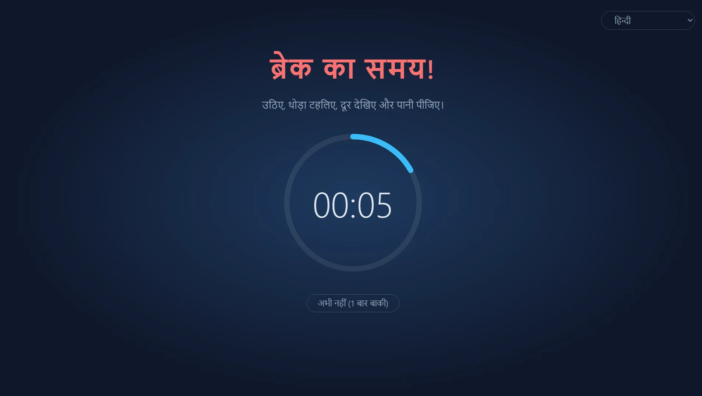
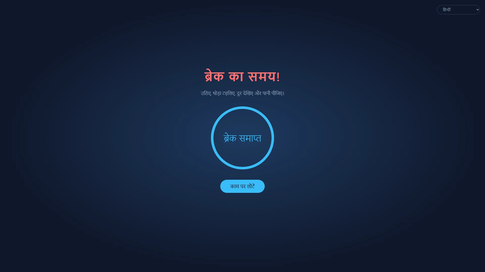
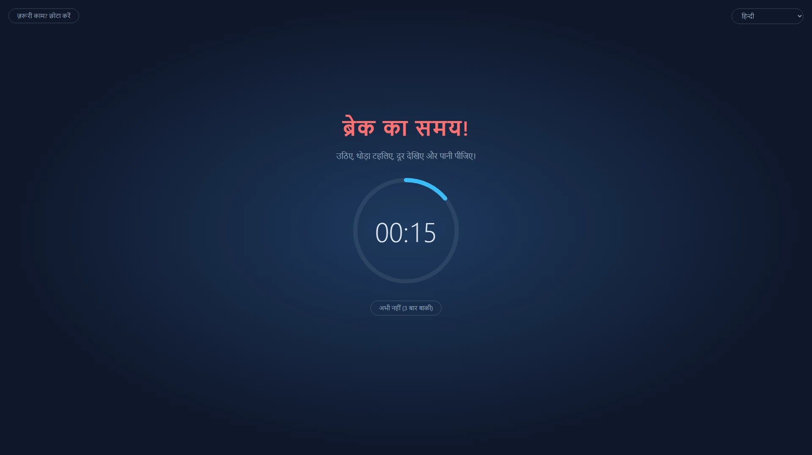
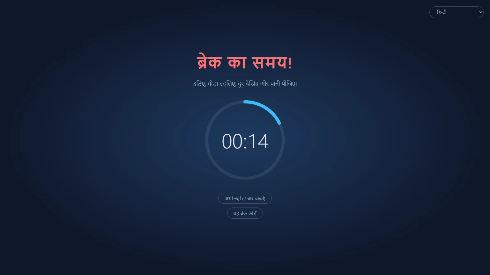
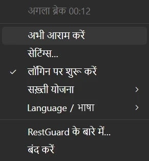

<p align="center">
  
</p>

<h1 align="center">RestGuard</h1>

<p align="center"><strong>ऐसा ब्रेक रिमाइंडर जिसे आप अनदेखा नहीं कर सकते।</strong></p>

<p align="center">Windows, macOS और Linux के लिए मुफ़्त, ओपन-सोर्स ब्रेक रिमाइंडर, जो आपको आराम की याद दिला सकता है या आराम करने पर मजबूर कर सकता है।</p>

<p align="center">
  <a href="https://github.com/HansTanzi/RestGuard/releases/latest"></a>
  <a href="https://github.com/HansTanzi/RestGuard/releases"></a>
  <a href="#इंस्टॉल-करें"></a>
  <a href="#windows"></a>
  <a href="#लाइसेंस"></a>
</p>

<p align="center">
  इंस्टॉल करें: <a href="#windows"><b>Windows</b></a> · <a href="#macos"><b>macOS</b></a> · <a href="#linux"><b>Linux</b></a> · <a href="https://hanstanzi.github.io/RestGuard/">वेबसाइट</a>
</p>

<p align="center"><a href="README.md">English</a> | <a href="README.zh-CN.md">简体中文</a> | <a href="README.de.md">Deutsch</a> | <a href="README.ja.md">日本語</a> | <a href="README.es.md">Español</a> | <a href="README.pt-BR.md">Português (Brasil)</a> | <a href="README.ko.md">한국어</a> | <a href="README.fr.md">Français</a> | <a href="README.it.md">Italiano</a> | <a href="README.id.md">Bahasa Indonesia</a> | हिन्दी | <a href="README.bn.md">বাংলা</a> | <a href="README.ar.md">العربية</a></p>



तीन अंतर्निहित सख़्ती स्तरों वाला क्रॉस-प्लेटफ़ॉर्म ब्रेक रिमाइंडर: यह आपको ब्रेक की याद दिला सकता है या ब्रेक लेने पर मजबूर कर सकता है। यही सख़्ती इसे दूसरे ब्रेक रिमाइंडर से अलग बनाती है।

- उच्च सख़्ती: आपसे ब्रेक लिवाने के लिए हर संभव कोशिश करता है।
- मध्यम सख़्ती: आप काम कर सकते हैं, लेकिन इतनी असुविधा के साथ कि आराम करने का मन बन जाए।
- निम्न सख़्ती: दूसरे ब्रेक रिमाइंडर की तरह, मुख्य रूप से याद दिलाता है।

Rust + Tauri 2 + Svelte से बना। यह [ProtectEyes](https://github.com/HansTanzi/ProtectEyes) का उत्तराधिकारी है, जो केवल Windows के लिए C# ऐप था और जिसे मैंने वर्षों पहले ओपन सोर्स किया था।

एक पंक्ति में इंस्टॉल करें:

```sh
winget install HansTanzi.RestGuard            # Windows
brew install --cask hanstanzi/tap/restguard   # macOS
```

APT, Scoop, Linux पर Homebrew और पोर्टेबल डाउनलोड की जानकारी [इंस्टॉल करें](#इंस्टॉल-करें) में है।

## RestGuard क्यों

ज़्यादातर ब्रेक रिमाइंडर को अनदेखा करना आसान होता है: सूचना आती है, आप उसे हटा देते हैं, और “बस पाँच मिनट और” दो घंटे बन जाते हैं। लंबे समय तक स्क्रीन के सामने रहने का संबंध आँखों पर ज़ोर, आँखों के सूखेपन, गर्दन और पीठ के दर्द और बार-बार के तनाव से होने वाली चोट (RSI) से है। 20-20-20 नियम या हर घंटे छोटा ब्रेक लेने जैसी सलाह तभी काम आती है जब आप सच में ब्रेक लें।

RestGuard उन लोगों के लिए है जो जानते हैं कि आराम करना चाहिए, फिर भी उसे टालते रहते हैं:

- **इसे एक क्लिक में हटाया नहीं जा सकता।** उच्च सख़्ती पर ओवरले ब्रेक खत्म होने तक हर स्क्रीन को ढके रहता है।
- **इसे पता है कि कब बाधा नहीं डालनी है।** ब्रेक टालना, आपात मोड और मीटिंग पहचान यह सुनिश्चित करते हैं कि ब्रेक न तो कॉल बिगाड़े, न ही आपका बिना सहेजा काम खोए।
- **सख़्ती आप तय करते हैं।** उच्च, मध्यम या निम्न सख़्ती चुनें, या अपनी खुद की योजना बनाएँ।

## सुविधाएँ

### ऐसे ब्रेक जो सच में होते हैं

- हर 60 मिनट के काम के बाद 10 मिनट का ब्रेक अनिवार्य करता है (दोनों अवधियाँ बदली जा सकती हैं)
- मल्टी-मॉनिटर: हर स्क्रीन ढकी जाती है
- ब्रेक के दौरान ओवरले बंद नहीं किया जा सकता (Alt+F4 का कोई असर नहीं होता), और ट्रे से ऐप बंद नहीं किया जा सकता
- 5 मिनट के लिए टालें, 3 बार तक; पूरा ब्रेक लेने के बाद गिनती रीसेट हो जाती है
- आपात मोड: कोई काम रुक नहीं सकता? काम सहेजने के लिए ओवरले को थोड़ी देर छोटा करें, उलटी गिनती चलती रहती है



### अलग-अलग ज़रूरतों के लिए तीन अंतर्निहित योजनाएँ

| | उच्च सख़्ती | मध्यम सख़्ती (डिफ़ॉल्ट) | निम्न सख़्ती |
|---|:---:|:---:|:---:|
| किसके लिए | कड़ा अनुशासन, “बस पाँच मिनट और” से छुटकारा | रोज़मर्रा का काम | हल्की याद दिलाने के लिए |
| टालने की संख्या | 1 | 3 | 3 |
| आपात मोड (ओवरले छोटा करें) | ✗ | ✓ | ✓ |
| मीटिंग ऐप पहचान | ✗ | ✓ | ✓ |
| यह ब्रेक बंद करें / छोड़ें | ✗ | ✗ | ✓ |
| स्क्रीन कवरेज | 100% | 100% | 80% |
| खींचने योग्य ओवरले | ✗ | ✓ | ✓ |





### बहुत ज़्यादा अनुकूलन योग्य

अगर अंतर्निहित योजनाएँ ठीक न बैठें, तो सेटिंग्स में **नई कस्टम योजना…** चुनें, किसी भी योजना से शुरू करें, उसे नाम दें (बाद में नाम बदल या हटा सकते हैं) और हर विकल्प सेट करें:

- टालने की संख्या, ऐप बंद करने की अनुमति, यह ब्रेक छोड़ने की अनुमति
- आपात मोड उपलब्ध है या नहीं, और ओवरले कितना छोटा होता है
- ओवरले हर स्क्रीन का कितना हिस्सा ढकता है (10% ~ 100%), और क्या उसे अपनी स्क्रीन के भीतर खींचा जा सकता है
- मीटिंग ऐप पहचानने हैं या नहीं

जितनी चाहें उतनी कस्टम योजनाएँ रखें और कभी भी बदलें। काम, ब्रेक, टालने और निष्क्रियता की अवधियाँ सभी योजनाओं में समान रहती हैं। अगर आप फ़ाइलें हाथ से संपादित करना पसंद करते हैं, तो [`config.toml`](#कॉन्फ़िगरेशन) भी काम करता है।

### ज़रूरी समय पर बीच में नहीं आता

- मीटिंग पहचान (Windows, macOS): जब Zoom, Microsoft Teams, Webex या Tencent Meeting सामने चल रहा हो (या Windows पर माइक्रोफ़ोन का उपयोग कर रहा हो), ब्रेक मीटिंग खत्म होने तक इंतज़ार करता है; ब्रेक के दौरान आप “मैं मीटिंग में हूँ” पर क्लिक करके 15 मिनट बाद याद दिलवा सकते हैं
- निष्क्रियता पहचान: 5 मिनट तक कीबोर्ड या माउस इनपुट न होने पर आपको दूर माना जाता है और काम की उलटी गिनती रुक जाती है; एक ब्रेक जितनी देर दूर रहना पूरा ब्रेक माना जाता है, इसलिए लौटते ही आपको आराम पर नहीं भेजा जाता

### ब्रेक का अंत कभी न चूकें

- ब्रेक खत्म होने पर आवाज़ बजती है: कोई अंतर्निहित आवाज़ या अपनी ऑडियो फ़ाइल चुनें
- फ़ोन सूचनाएँ: [ntfy](https://ntfy.sh) के ज़रिए अपने फ़ोन (Android, iOS) पर पुश पाएँ, ताकि कहीं चले जाने पर भी पता रहे कि कब लौटना है; Android पर यह बंद करने तक अलार्म की तरह बज सकता है
- स्मार्टवॉच: फ़ोन की सूचना जोड़ी गई Apple Watch, Wear OS, Galaxy Watch या Xiaomi, Huawei, Garmin जैसी घड़ी या बैंड पर भी दिखती है, इसलिए कलाई पर एक नज़र काफ़ी है (देखें [फ़ोन और स्मार्टवॉच सूचनाएँ](#फ़ोन-और-स्मार्टवॉच-सूचनाएँ))

### छोटा और तेज़

- सिस्टम WebView पर Rust + Tauri 2 से बना, बिना किसी साथ में बंडल किए ब्राउज़र इंजन के, इसलिए बैकग्राउंड में चलते समय लगभग कोई संसाधन इस्तेमाल नहीं करता
- बहुत छोटा: डाउनलोड सिर्फ़ करीब 3–6 MB का है, Electron पर बने विकल्पों से दर्जनों गुना छोटा (देखें [तुलना](#तुलना))
- पोर्टेबल: Windows पर एक exe, macOS पर अनज़िप करके चलने वाला `.app`; अनइंस्टॉल करने के लिए उसे हटा दें

### और भी बहुत कुछ

- क्रॉस-प्लेटफ़ॉर्म: Windows, macOS और Linux, जिसे WinGet, Scoop, Homebrew और APT से इंस्टॉल और अपडेट किया जा सकता है (देखें [इंस्टॉल करें](#इंस्टॉल-करें))
- ट्रे मेनू: बचा हुआ समय, अभी आराम करें, सेटिंग्स, लॉगिन पर शुरू करें, सख़्ती योजना बदलें
- सिंगल इंस्टेंस
- अनुमेय MIT / Apache-2.0 दोहरे लाइसेंस के तहत मुफ़्त और ओपन सोर्स (देखें [लाइसेंस](#लाइसेंस))
- सरलीकृत चीनी, अंग्रेज़ी, हिन्दी, स्पेनिश, अरबी, फ़्रेंच, बांग्ला, पुर्तगाली, जर्मन, जापानी, इतालवी, कोरियाई और इंडोनेशियाई में उपलब्ध। इंटरफ़ेस की भाषा डिफ़ॉल्ट रूप से सिस्टम का अनुसरण करती है (सिस्टम की भाषा समर्थित न होने पर अंग्रेज़ी); ट्रे मेनू के “语言 / Language” उपमेनू से इसे कभी भी बदलें



## तुलना

| | RestGuard | [Stretchly](https://github.com/hovancik/stretchly) | [Workrave](https://github.com/rcaelers/workrave) | [Safe Eyes](https://github.com/slgobinath/SafeEyes) |
|---|:---:|:---:|:---:|:---:|
| Windows | ✓ | ✓ | ✓ | ✗ |
| macOS | ✓ | ✓ | ✗ | ✗ |
| Linux | ✓ | ✓ | ✓ | ✓ |
| डाउनलोड आकार | **~3–6 MB** | Windows 163 MB<br>macOS 187 MB<br>Linux 155 MB | Windows 61 MB<br>Linux 64 MB| Linux 0.3 MB |
| सख़्ती | 3 स्तर + कस्टम योजनाएँ | स्ट्रिक्ट मोड चालू/बंद | इनपुट और स्क्रीन रोक सकता है | कीबोर्ड बंद कर सकता है |
| मीटिंग के दौरान ब्रेक रोकता है | Zoom, Teams, Webex, Tencent Meeting पहचानता है | डू नॉट डिस्टर्ब का पालन; हर ऐप के लिए अपवाद | — | — |
| ब्रेक खत्म होने पर फ़ोन / स्मार्टवॉच अलर्ट | ✓ (ntfy) | — | — | — |
| तकनीक | Rust + Tauri (सिस्टम WebView) | Electron (Chromium साथ में) | C++ | Python + GTK |
| लाइसेंस | MIT / Apache-2.0 | BSD-2-Clause | GPL-3.0 | GPL-3.0 |

— का मतलब है कि यह सुविधा अंतर्निहित नहीं है। डाउनलोड आकार हर प्रोजेक्ट की नवीनतम GitHub रिलीज़ (Stretchly 1.22.1, Workrave 1.11.5, Safe Eyes 3.5.1) के हैं: Windows इंस्टॉलर या exe, macOS डाउनलोड और Linux `.deb`। यह नवंबर 2026 तक के हर प्रोजेक्ट के दस्तावेज़ों पर आधारित है; अगर कुछ गलत है, तो कृपया [issue खोलें](https://github.com/HansTanzi/RestGuard/issues)।

## इंस्टॉल करें

### Windows

[WinGet](https://learn.microsoft.com/windows/package-manager/winget/) से इंस्टॉल करें:

```powershell
winget install HansTanzi.RestGuard
```

या [Scoop](https://scoop.sh) से:

```powershell
scoop bucket add hanstanzi https://github.com/HansTanzi/scoop-bucket
scoop install hanstanzi/restguard
```

या [Releases](https://github.com/HansTanzi/RestGuard/releases/latest) से `RestGuard_<version>_x64.exe` डाउनलोड करके चलाएँ। यह बिना इंस्टॉलर का एक पोर्टेबल exe है: इसे कहीं भी रखें और अनइंस्टॉल करने के लिए हटा दें। यह अपने आप अपडेट नहीं होता; अपडेट करने के लिए नया संस्करण डाउनलोड करें।

WebView2 रनटाइम ज़रूरी है (Windows 11 में पहले से मौजूद)।

### macOS

[Homebrew](https://brew.sh) से इंस्टॉल करें (Apple Silicon और Intel के लिए यूनिवर्सल बिल्ड):

```sh
brew install --cask hanstanzi/tap/restguard
```

अगर आपने पहले यह रिपॉज़िटरी tap की थी (`brew tap hanstanzi/restguard https://github.com/HansTanzi/RestGuard`), तो अपडेट पाते रहने के लिए नए tap पर जाएँ: `brew untap hanstanzi/restguard && brew install --cask hanstanzi/tap/restguard`।

या [Releases](https://github.com/HansTanzi/RestGuard/releases/latest) से `RestGuard_<version>_universal.zip` डाउनलोड करें, अनज़िप करें और `RestGuard.app` को `/Applications` में ले जाएँ। यह अपने आप अपडेट नहीं होता; अपडेट करने के लिए नया संस्करण डाउनलोड करें।

RestGuard मेनू बार में रहता है और इसका Dock आइकन नहीं है। ऐप Apple से नोटराइज़ नहीं है; cask इंस्टॉल के समय क्वारंटीन फ़्लैग हटा देता है। अगर आपने zip हाथ से डाउनलोड किया है, तो पहली बार चलाने से पहले `xattr -dr com.apple.quarantine /Applications/RestGuard.app` चलाएँ, वरना macOS इसे नहीं खोलेगा।

### Linux

Debian/Ubuntu (x86_64) पर [APT रिपॉज़िटरी](https://github.com/HansTanzi/apt) जोड़ें, फिर `apt` से इंस्टॉल और अपडेट करें:

```sh
sudo install -d /etc/apt/keyrings
curl -fsSL https://hanstanzi.github.io/apt/hanstanzi.gpg | sudo tee /etc/apt/keyrings/hanstanzi.gpg > /dev/null
echo "deb [signed-by=/etc/apt/keyrings/hanstanzi.gpg] https://hanstanzi.github.io/apt stable main" | sudo tee /etc/apt/sources.list.d/hanstanzi.list
sudo apt update && sudo apt install rest-guard
```

नए संस्करण `sudo apt update && sudo apt upgrade` से मिलते हैं। आप [Releases](https://github.com/HansTanzi/RestGuard/releases/latest) से `.deb` सीधे भी इंस्टॉल कर सकते हैं (`sudo apt install ./RestGuard_*_amd64.deb`), लेकिन तब वह अपडेट नहीं होगा।

अन्य डिस्ट्रो के लिए [Releases](https://github.com/HansTanzi/RestGuard/releases/latest) से डाउनलोड करें। Fedora/openSUSE पर `.rpm` इंस्टॉल करें:

```sh
sudo dnf install ./RestGuard_*_x86_64.rpm      # Fedora
sudo zypper install ./RestGuard_*_x86_64.rpm   # openSUSE
```

Arch पर `.pkg.tar.zst` इंस्टॉल करें:

```sh
sudo pacman -U ./RestGuard_*_x86_64.pkg.tar.zst
```

किसी भी डिस्ट्रो (x86_64, glibc 2.35+) पर आप [Homebrew](https://brew.sh) से भी इंस्टॉल और अपडेट कर सकते हैं। Homebrew सिस्टम लाइब्रेरी इंस्टॉल नहीं कर सकता, इसलिए पहले अपने डिस्ट्रो के पैकेज मैनेजर से WebKitGTK 4.1 और libayatana-appindicator इंस्टॉल करें:

```sh
sudo apt install libwebkit2gtk-4.1-0 libayatana-appindicator3-1                 # Debian/Ubuntu
sudo dnf install webkit2gtk4.1 libayatana-appindicator-gtk3                     # Fedora
sudo pacman -S webkit2gtk-4.1 libayatana-appindicator                           # Arch
sudo zypper install libwebkit2gtk-4_1-0 libayatana-appindicator3-1              # openSUSE

brew install --cask hanstanzi/tap/restguard
```

इससे केवल `restguard` एक्ज़ीक्यूटेबल इंस्टॉल होता है, ऐप मेनू में कोई प्रविष्टि नहीं बनती: `restguard` एक बार चलाएँ, फिर ट्रे मेनू से “लॉगिन पर शुरू करें” चालू करें। नए संस्करण `brew upgrade` से मिलते हैं।

ओवरले के लिए X11 ज़रूरी है (देखें [प्लेटफ़ॉर्म की सीमाएँ](#प्लेटफ़ॉर्म-की-सीमाएँ))।

### डाउनलोड सत्यापित करें

v0.1.14 के बाद की Release फ़ाइलें GitHub Actions से बनती हैं और उनके साथ हस्ताक्षरित [बिल्ड प्रोवेनेंस अटेस्टेशन](https://docs.github.com/actions/security-for-github-actions/using-artifact-attestations) होता है, जो हर फ़ाइल को उसे बनाने वाले वर्कफ़्लो रन और कमिट से जोड़ता है। डाउनलोड की गई फ़ाइल को [GitHub CLI](https://cli.github.com) से जाँचने के लिए:

```sh
gh attestation verify RestGuard_<version>_x64.exe --repo HansTanzi/RestGuard
```

हर Release में `SHA256SUMS.txt` भी होती है, ताकि GitHub CLI के बिना डाउनलोड जाँचा जा सके। डाउनलोड की गई फ़ाइल को `SHA256SUMS.txt` वाली डायरेक्टरी में रखें और चलाएँ:

```sh
sha256sum -c SHA256SUMS.txt --ignore-missing          # Linux
shasum -a 256 -c SHA256SUMS.txt --ignore-missing      # macOS
```

Windows पर `Get-FileHash .\RestGuard_*_x64.exe` के आउटपुट की तुलना `SHA256SUMS.txt` की संबंधित पंक्ति से करें (छोटे-बड़े अक्षरों से फ़र्क नहीं पड़ता)।

### सोर्स से बिल्ड करें

[CONTRIBUTING.md](CONTRIBUTING.md#development-setup) (अंग्रेज़ी में) में दी गई पूर्व-आवश्यकताएँ इंस्टॉल करें, फिर टैग किया गया संस्करण बिल्ड करें:

```sh
git clone https://github.com/HansTanzi/RestGuard
cd RestGuard
git checkout v<version>
pnpm install --frozen-lockfile
pnpm tauri build --no-bundle
```

एक्ज़ीक्यूटेबल `src-tauri/target/release/restguard` है (Windows पर `restguard.exe`)। `pnpm tauri build` से बिल्ड करें, `cargo build` से नहीं: साधारण Cargo बिल्ड एक डेवलपमेंट बिल्ड है जो UI को `localhost:1420` से लोड करता है और खाली विंडो दिखाता है।

## कॉन्फ़िगरेशन

अवधियाँ, सख़्ती का स्तर, ओवरले कवरेज, भाषा और लॉगिन पर शुरू होना बदलने के लिए ट्रे मेनू से **सेटिंग्स…** खोलें। बदलाव तुरंत लागू होते हैं (ब्रेक के दौरान सेटिंग्स लॉक रहती हैं)। काम की अवधि बदलने से मौजूदा काम की उलटी गिनती फिर से शुरू होती है।

सेटिंग्स `config.toml` में सहेजी जाती हैं, जो पहली बार चलाने पर बनती है। आप इसे हाथ से भी संपादित कर सकते हैं; उसके बाद ऐप फिर से शुरू करें।

| OS | पथ |
|---|---|
| Windows | `%APPDATA%\io.github.restguard\config.toml` |
| macOS | `~/Library/Application Support/io.github.restguard/config.toml` |
| Linux | `~/.config/io.github.restguard/config.toml` |

```toml
work_minutes = 60.0      # अनिवार्य ब्रेक से पहले कितनी देर काम करना है
rest_minutes = 10.0      # हर ब्रेक कितनी देर का है
postpone_minutes = 5.0   # हर बार टालना कितनी देर का है
idle_minutes = 5.0       # इतनी देर इनपुट न होने पर दूर माना जाता है, 0 = बंद
level = "medium"         # "high", "medium", "low" या किसी कस्टम योजना का नाम
sound_prompt = true      # ब्रेक खत्म होने पर आवाज़ बजाएँ
sound = "beep"           # "beep", "chime", "rise" या "file" (sound_file बजाता है)
sound_file = ""          # आपकी ऑडियो फ़ाइल का पूरा पथ, sound = "file" होने पर उपयोग होता है
phone_notify = false     # ब्रेक खत्म होने पर ntfy से फ़ोन पर सूचना भेजें
ntfy_server = "https://ntfy.sh"  # ntfy सर्वर, सार्वजनिक या आपका अपना
ntfy_topic = ""          # ntfy ऐप में सब्सक्राइब करने का टॉपिक; इसे ऐसा रखें कि अंदाज़ा लगाना मुश्किल हो

[[fixed_breaks]]         # एक तय ब्रेक; "work_end" (दिन का अंत) और "lunch" अंतर्निहित हैं
name = "work_end"
enabled = false          # इससे ठीक पहले आने वाले ब्रेक रोकें
time = "18:00"           # स्थानीय समय में 24-घंटे का HH:MM
quiet_minutes = 30.0     # time से इतनी देर पहले आने वाले ब्रेक time तक इंतज़ार करते हैं

[[fixed_breaks]]         # दोपहर का भोजन: time पर rest_minutes का ब्रेक शुरू होता है
name = "lunch"
enabled = true
time = "12:00"
quiet_minutes = 30.0
rest_minutes = 30.0      # ब्रेक कितनी देर का है (लंच और आपके अपने तय ब्रेक); सामान्य ब्रेक की अवधि के बाद आप कंप्यूटर का उपयोग जारी रख सकते हैं

[[fixed_breaks]]         # अपने ब्रेक जोड़ें, जैसे चाय का ब्रेक, हर एक के लिए एक [[fixed_breaks]]
name = "चाय का ब्रेक"
enabled = true
time = "15:00"
quiet_minutes = 15.0
rest_minutes = 15.0

[[profiles]]             # एक कस्टम योजना; हर योजना के लिए एक [[profiles]] जोड़ें
name = "फ़ोकस"
max_postpones = 1        # पूरा ब्रेक ज़रूरी होने से पहले अधिकतम टालने की संख्या
urgent_mode = false      # ओवरले छोटा करने की अनुमति दें
meeting_detection = true # Zoom, Teams आदि के उपयोग के दौरान ब्रेक रोकें
force_rest = true        # false = ओवरले बंद किया जा सकता है
allow_skip = false       # ब्रेक अनिवार्य होने पर भी “यह ब्रेक छोड़ें” दिखाएँ
overlay_coverage = 1.0   # हर स्क्रीन का ढका हुआ हिस्सा, 0.1 ~ 1.0
urgent_scale = 0.5       # ऊपर के मान की तुलना में आपात मोड (छोटे ओवरले) का अनुपात, 0.1 ~ 0.9
movable = false          # पूरी स्क्रीन पर न होने पर ओवरले को अपनी स्क्रीन के भीतर खींचने की अनुमति दें
```

### फ़ोन और स्मार्टवॉच सूचनाएँ

1. अपने फ़ोन पर ntfy ऐप इंस्टॉल करें ([Android](https://play.google.com/store/apps/details?id=io.heckel.ntfy), [F-Droid](https://f-droid.org/packages/io.heckel.ntfy/), [iOS](https://apps.apple.com/app/ntfy/id1625396347))
2. RestGuard की सेटिंग्स में “ब्रेक खत्म होने पर फ़ोन पर सूचना भेजें (ntfy)” चालू करें और ऐसा टॉपिक डालें जिसका अंदाज़ा लगाना मुश्किल हो (केवल अंग्रेज़ी अक्षर, अंक, `-` और `_`)। सर्वर डिफ़ॉल्ट रूप से सार्वजनिक `https://ntfy.sh` है; आप अपना सर्वर भी इस्तेमाल कर सकते हैं
3. ntfy ऐप में उसी सर्वर और टॉपिक को सब्सक्राइब करें, फिर जाँचने के लिए “परीक्षण सूचना भेजें” पर क्लिक करें

सूचनाएँ सबसे ऊँची प्राथमिकता से भेजी जाती हैं। Android पर ntfy की सेटिंग्स में “Keep alerting for highest priority” चालू करें, ताकि बंद करने तक यह अलार्म की तरह बजे; iOS पर यह समय-संवेदनशील सूचना है जो फ़ोकस को पार कर जाती है (अगर आप ntfy को समय-संवेदनशील सूचनाएँ भेजने देते हैं)। सार्वजनिक सर्वर पर टॉपिक जानने वाला कोई भी व्यक्ति सब्सक्राइब कर सकता है, इसलिए उसे निजी रखें।

घड़ी पर कुछ इंस्टॉल नहीं करना पड़ता; सिस्टम फ़ोन की सूचना घड़ी पर दिखा देता है:

| घड़ी | सेटअप |
|---|---|
| Apple Watch | iPhone के Watch ऐप में Notifications खोलें और ntfy के लिए “Mirror iPhone alerts” चालू करें। सूचनाएँ घड़ी पर तभी जाती हैं जब iPhone लॉक हो या उसकी स्क्रीन बंद हो |
| Wear OS / Galaxy Watch | डिफ़ॉल्ट रूप से दिखती हैं; यह पक्का करें कि घड़ी की सूचना सेटिंग्स में ntfy बंद न हो |
| Xiaomi, Huawei, Garmin, Amazfit आदि | साथी ऐप (Zepp, Huawei Health, Garmin Connect आदि) की ऐप सूचना सूची में ntfy को अनुमति दें |

टिप्पणियाँ:

- घड़ी एक बार वाइब्रेट करती है; यह फ़ोन की तरह अलर्ट करती नहीं रहती
- घड़ी को सूचना मिलने के लिए फ़ोन का ऑनलाइन होना और ntfy का बैकग्राउंड में चलना ज़रूरी है; फ़ोन के बिना अकेले इस्तेमाल की जा रही घड़ी को सूचना नहीं मिलेगी
- अपने होस्ट किए सर्वर के साथ, iOS को तुरंत सूचनाएँ पाने के लिए सर्वर कॉन्फ़िगरेशन में `upstream-base-url: "https://ntfy.sh"` चाहिए (देखें [ntfy दस्तावेज़](https://docs.ntfy.sh/config/#ios-instant-notifications))

## प्लेटफ़ॉर्म की सीमाएँ

- **macOS**: Force Quit (`Cmd+Option+Esc`) जैसी सिस्टम-स्तर की क्रियाएँ रोकी नहीं जा सकतीं
- **Linux**: निष्क्रियता पहचान के लिए GNOME या `org.freedesktop.ScreenSaver` लागू करने वाला डेस्कटॉप (जैसे KDE Plasma) और `gdbus` चाहिए; वरना यह बंद रहती है
- **Linux**: आवाज़ें `paplay`, `pw-play` या `aplay` से बजती हैं, इसलिए अपनी फ़ाइल के लिए wav, ogg या flac इस्तेमाल करें (mp3 समर्थित नहीं है)
- **Linux Wayland**: यह प्रोटोकॉल ऐप्स को खुद को सबसे ऊपर रखने या अपनी विंडो की जगह तय करने नहीं देता, इसलिए ओवरले शायद काम न करे; X11 ठीक है

## अक्सर पूछे जाने वाले सवाल

**क्या मैं RestGuard बंद कर सकता हूँ?**
दो ब्रेक के बीच, हाँ: ट्रे मेनू में “बंद करें” चुनें। ब्रेक के दौरान, या जब तक टाला गया ब्रेक बाकी है, “बंद करें” अक्षम रहता है।

**अगर मीटिंग के दौरान ब्रेक आ जाए तो?**
मध्यम और निम्न सख़्ती पर, जब तक Zoom, Microsoft Teams, Webex या Tencent Meeting सामने चल रहा हो (Windows, macOS; Windows पर माइक्रोफ़ोन के उपयोग के दौरान भी), ब्रेक इंतज़ार करता है। अगर ब्रेक शुरू हो चुका है, तो “मैं मीटिंग में हूँ” पर क्लिक करें और 15 मिनट बाद फिर याद दिलाया जाएगा। उच्च सख़्ती पर ब्रेक इंतज़ार नहीं करते।

**मैं किसी ज़रूरी काम के बीच में हूँ। क्या मेरा काम खो जाएगा?**
ब्रेक को 5 मिनट टालें (मध्यम और निम्न पर 3 बार तक, उच्च पर एक बार), या मध्यम और निम्न पर आपात मोड से ओवरले छोटा करके काम सहेजें, जबकि उलटी गिनती चलती रहती है।

**क्या कंप्यूटर से दूर रहने का समय काम में गिना जाता है?**
नहीं। 5 मिनट तक कीबोर्ड या माउस इनपुट न होने पर काम की उलटी गिनती रुक जाती है, और एक ब्रेक जितनी देर दूर रहना पूरा ब्रेक माना जाता है।

**macOS कहता है कि ऐप नहीं खोला जा सकता।**
RestGuard Apple से नोटराइज़ नहीं है। इसे Homebrew से इंस्टॉल करें, या एक बार `xattr -dr com.apple.quarantine /Applications/RestGuard.app` चलाएँ (देखें [macOS](#macos))।

**क्या यह Wayland पर काम करता है?**
भरोसेमंद रूप से नहीं: Wayland ऐप्स को अपनी विंडो सबसे ऊपर रखने नहीं देता, इसलिए X11 सेशन का उपयोग करें (देखें [प्लेटफ़ॉर्म की सीमाएँ](#प्लेटफ़ॉर्म-की-सीमाएँ))।

**क्या यह कोई डेटा इकट्ठा करता है?**
नहीं। देखें [गोपनीयता](#गोपनीयता)।

## योगदान दें

बग रिपोर्ट, सुझाव, अनुवाद और पुल रिक्वेस्ट सभी का स्वागत है। [CONTRIBUTING.md](CONTRIBUTING.md) (अंग्रेज़ी में) में डेवलपमेंट सेटअप, जाँच और अनुवाद सुधारने का तरीका है; हर संस्करण के बदलाव [CHANGELOG.md](CHANGELOG.md) में हैं। सुरक्षा समस्याएँ [SECURITY.md](SECURITY.md) में बताए अनुसार निजी रूप से रिपोर्ट करें।

अगर RestGuard आपको आराम करने में मदद करता है, तो एक ⭐ दूसरों को इसे खोजने में मदद करता है।

[](https://github.com/HansTanzi/RestGuard/graphs/contributors)

[](https://star-history.com/#HansTanzi/RestGuard&Date)

## गोपनीयता

RestGuard कोई डेटा इकट्ठा नहीं करता: कोई खाता, एनालिटिक्स या टेलीमेट्री नहीं है। यह केवल वैकल्पिक ntfy फ़ोन सूचना भेजने के लिए ऑनलाइन जाता है। देखें [गोपनीयता नीति](https://hanstanzi.github.io/RestGuard/privacy.html) (अंग्रेज़ी में)।

## लाइसेंस

आपकी पसंद के अनुसार [MIT](LICENSE-MIT) या [Apache-2.0](LICENSE-APACHE) के तहत लाइसेंस प्राप्त।
