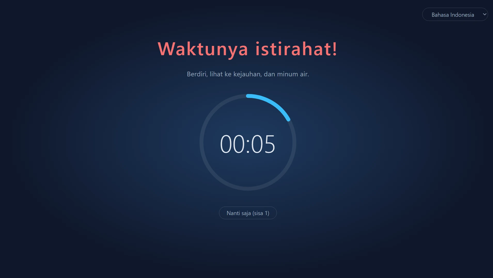
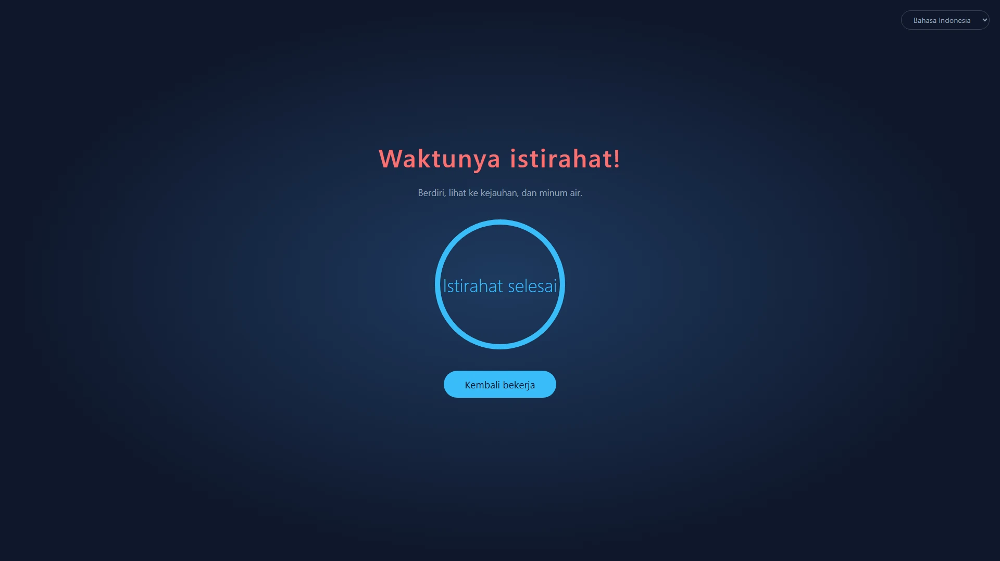
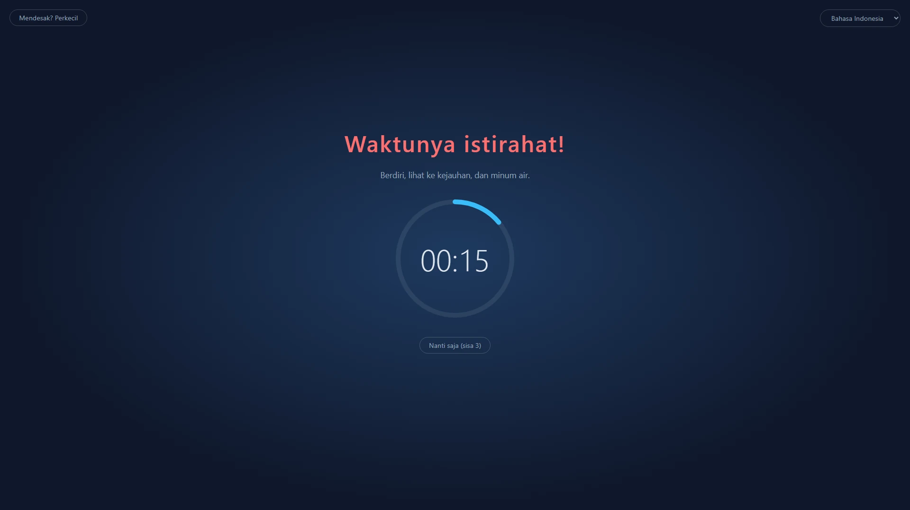
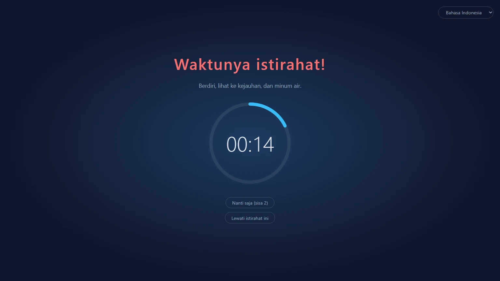
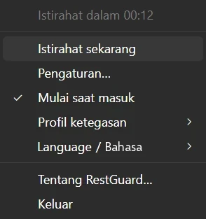

<p align="center">
  
</p>

<h1 align="center">RestGuard</h1>

<p align="center"><strong>Pengingat istirahat yang tidak bisa Anda abaikan.</strong></p>

<p align="center">Pengingat istirahat gratis dan sumber terbuka untuk Windows, macOS, dan Linux yang bisa mengingatkan Anda untuk beristirahat, atau memaksa Anda melakukannya.</p>

<p align="center">
  <a href="https://github.com/HansTanzi/RestGuard/releases/latest"></a>
  <a href="https://github.com/HansTanzi/RestGuard/releases"></a>
  <a href="#instalasi"></a>
  <a href="#windows"></a>
  <a href="https://apps.microsoft.com/detail/9PJ3SXDPCNN0"></a>
  <a href="#lisensi"></a>
</p>

<p align="center">
  Pasang di <a href="#windows"><b>Windows</b></a> · <a href="#macos"><b>macOS</b></a> · <a href="#linux"><b>Linux</b></a> · <a href="https://hanstanzi.github.io/RestGuard/">Situs web</a>
</p>

<p align="center"><a href="README.md">English</a> | <a href="README.zh-CN.md">简体中文</a> | <a href="README.de.md">Deutsch</a> | <a href="README.ja.md">日本語</a> | <a href="README.es.md">Español</a> | <a href="README.pt-BR.md">Português (Brasil)</a> | <a href="README.ko.md">한국어</a> | <a href="README.fr.md">Français</a> | <a href="README.it.md">Italiano</a> | Bahasa Indonesia | <a href="README.hi.md">हिन्दी</a> | <a href="README.bn.md">বাংলা</a> | <a href="README.ar.md">العربية</a></p>



Pengingat istirahat lintas platform dengan tiga tingkat ketegasan bawaan: bisa mengingatkan Anda untuk beristirahat, atau memaksa Anda melakukannya. Ketegasan inilah yang membedakannya dari pengingat istirahat lain.

- Ketegasan tinggi: melakukan segala cara agar Anda benar-benar beristirahat.
- Ketegasan sedang: Anda masih bisa bekerja, tetapi cukup tidak nyaman sehingga mendorong Anda untuk beristirahat.
- Ketegasan rendah: seperti pengingat istirahat lain, terutama hanya mengingatkan.

Dibuat dengan Rust + Tauri 2 + Svelte. Penerus [ProtectEyes](https://github.com/HansTanzi/ProtectEyes), aplikasi C# khusus Windows yang saya jadikan sumber terbuka bertahun-tahun lalu.

Pasang dengan satu baris:

```sh
winget install HansTanzi.RestGuard            # Windows
brew install --cask hanstanzi/tap/restguard   # macOS
```

Microsoft Store, APT, Scoop, Homebrew di Linux, dan unduhan portabel dibahas di [Instalasi](#instalasi).

## Mengapa RestGuard

Sebagian besar pengingat istirahat mudah diabaikan: notifikasi muncul, Anda menutupnya, dan “lima menit lagi” berubah menjadi dua jam. Terlalu lama di depan layar dikaitkan dengan mata lelah, mata kering, nyeri leher dan punggung, serta cedera regangan berulang (RSI). Saran seperti aturan 20-20-20 atau istirahat singkat setiap jam hanya berguna jika Anda benar-benar beristirahat.

RestGuard cocok untuk orang yang tahu harus beristirahat tetapi terus menundanya:

- **Tidak bisa ditutup begitu saja.** Pada Ketegasan tinggi, lapisan menutupi semua layar sampai istirahat selesai.
- **Tahu kapan tidak boleh mengganggu.** Penundaan, mode darurat, dan deteksi rapat mencegah istirahat merusak panggilan atau membuat Anda kehilangan pekerjaan yang belum disimpan.
- **Anda yang menentukan seberapa tegas.** Pilih Ketegasan tinggi, sedang, atau rendah, atau buat profil Anda sendiri.

## Fitur

### Istirahat yang benar-benar terjadi

- Memaksa istirahat 10 menit setelah setiap 60 menit kerja (kedua durasi bisa diubah)
- Multi-monitor: setiap layar tertutup
- Lapisan tidak bisa ditutup saat istirahat (Alt+F4 tidak berpengaruh), dan Anda tidak bisa keluar dari baki sistem
- Tunda 5 menit, hingga 3 kali; hitungan direset setelah istirahat penuh
- Mode darurat: ada yang tidak bisa menunggu? Perkecil lapisan sebentar untuk menyimpan pekerjaan sementara hitung mundur tetap berjalan



### Tiga profil bawaan untuk kebutuhan berbeda

| | Ketegasan tinggi | Ketegasan sedang (bawaan) | Ketegasan rendah |
|---|:---:|:---:|:---:|
| Cocok untuk | Disiplin ketat, mengalahkan “lima menit lagi” | Pekerjaan sehari-hari | Dorongan lembut |
| Penundaan | 1 | 3 | 3 |
| Mode darurat (perkecil lapisan) | ✗ | ✓ | ✓ |
| Deteksi aplikasi rapat | ✗ | ✓ | ✓ |
| Tutup / lewati istirahat ini | ✗ | ✗ | ✓ |
| Cakupan layar | 100% | 100% | 80% |
| Lapisan bisa diseret | ✗ | ✓ | ✓ |





### Sangat bisa disesuaikan

Jika profil bawaan tidak cocok, pilih **Kustom baru…** di Pengaturan untuk memulai dari profil mana pun, beri nama (bisa diganti atau dihapus nanti), lalu atur setiap opsi:

- Jumlah penundaan, boleh keluar atau tidak, boleh melewati istirahat ini atau tidak
- Apakah mode darurat tersedia, dan seberapa kecil lapisan mengecil
- Seberapa besar bagian layar yang ditutupi lapisan (10% ~ 100%), dan apakah bisa diseret di dalam layarnya
- Apakah aplikasi rapat dideteksi

Simpan profil kustom sebanyak yang Anda mau dan ganti kapan saja. Durasi kerja, istirahat, penundaan, dan menganggur berlaku untuk semua profil. Jika lebih suka mengedit berkas secara manual, [`config.toml`](#konfigurasi) juga bisa dipakai.

### Tidak mengganggu saat penting

- Deteksi rapat (Windows, macOS): selama Zoom, Microsoft Teams, Webex, atau Tencent Meeting berada di latar depan (atau, di Windows, memakai mikrofon), istirahat menunggu sampai rapat selesai; saat istirahat Anda juga bisa mengklik “Saya sedang rapat” agar diingatkan 1 jam lagi
- Deteksi menganggur: setelah 5 menit tanpa input keyboard atau mouse, Anda dianggap pergi dan hitung mundur kerja dijeda; pergi selama satu masa istirahat dihitung sebagai istirahat penuh, jadi Anda tidak disuruh beristirahat tepat setelah kembali

### Jangan lewatkan akhir istirahat

- Suara berbunyi saat istirahat selesai: pilih suara bawaan atau berkas audio Anda sendiri
- Notifikasi ponsel: terima push di ponsel (Android, iOS) melalui [ntfy](https://ntfy.sh), sehingga Anda tahu kapan harus kembali meski sudah menjauh; di Android bisa berbunyi seperti alarm sampai Anda mematikannya
- Jam tangan pintar: notifikasi ponsel dicerminkan ke Apple Watch, Wear OS, Galaxy Watch, atau jam tangan atau gelang Xiaomi, Huawei, Garmin, dan sejenisnya yang tersambung, jadi cukup melirik pergelangan tangan (lihat [Notifikasi ponsel dan jam tangan pintar](#notifikasi-ponsel-dan-jam-tangan-pintar))

### Kecil dan cepat

- Dibuat dengan Rust + Tauri 2 di atas WebView sistem, tanpa mesin peramban bawaan, sehingga nyaris tidak memakai sumber daya saat berjalan di latar belakang
- Mungil: unduhan hanya sekitar 3–6 MB, puluhan kali lebih kecil daripada alternatif berbasis Electron (lihat [Perbandingan](#perbandingan))
- Portabel: satu exe di Windows, `.app` yang tinggal diekstrak dan dijalankan di macOS; hapus untuk mencopot

### Dan lainnya

- Lintas platform: Windows, macOS, dan Linux, bisa dipasang dan diperbarui melalui Microsoft Store, WinGet, Scoop, Homebrew, dan APT (lihat [Instalasi](#instalasi))
- Menu baki sistem: sisa waktu, istirahat sekarang, pengaturan, mulai saat masuk, ganti profil ketegasan, jeda
- Satu instans
- Gratis dan sumber terbuka di bawah lisensi ganda permisif MIT / Apache-2.0 (lihat [Lisensi](#lisensi))
- Tersedia dalam bahasa Tionghoa Sederhana, Inggris, Hindi, Spanyol, Arab, Prancis, Bengali, Portugis, Jerman, Jepang, Italia, Korea, dan Indonesia. Bahasa antarmuka mengikuti sistem secara bawaan (bahasa Inggris jika bahasa sistem tidak didukung); ganti kapan saja dari submenu “语言 / Language” di baki sistem



## Perbandingan

| | RestGuard | [Stretchly](https://github.com/hovancik/stretchly) | [Workrave](https://github.com/rcaelers/workrave) | [Safe Eyes](https://github.com/slgobinath/SafeEyes) |
|---|:---:|:---:|:---:|:---:|
| Windows | ✓ | ✓ | ✓ | ✗ |
| macOS | ✓ | ✓ | ✗ | ✗ |
| Linux | ✓ | ✓ | ✓ | ✓ |
| Ukuran unduhan | **~3–6 MB** | Windows 163 MB<br>macOS 187 MB<br>Linux 155 MB | Windows 61 MB<br>Linux 64 MB| Linux 0.3 MB |
| Ketegasan | 3 tingkat + profil kustom | Mode ketat aktif/nonaktif | Bisa memblokir input dan layar | Bisa menonaktifkan keyboard |
| Menahan istirahat saat rapat | Mendeteksi Zoom, Teams, Webex, Tencent Meeting | Mengikuti Jangan Ganggu; pengecualian per aplikasi | — | — |
| Peringatan ponsel / jam tangan pintar saat istirahat selesai | ✓ (ntfy) | — | — | — |
| Dibuat dengan | Rust + Tauri (WebView sistem) | Electron (menyertakan Chromium) | C++ | Python + GTK |
| Lisensi | MIT / Apache-2.0 | BSD-2-Clause | GPL-3.0 | GPL-3.0 |

— berarti tidak tersedia bawaan. Ukuran unduhan berasal dari rilis GitHub terbaru setiap proyek (Stretchly 1.22.1, Workrave 1.11.5, Safe Eyes 3.5.1): penginstal atau exe Windows, unduhan macOS, dan `.deb` Linux. Berdasarkan dokumentasi setiap proyek per November 2026; jika ada yang salah, silakan [buka issue](https://github.com/HansTanzi/RestGuard/issues).

## Instalasi

### Windows

Dapatkan dari [Microsoft Store](https://apps.microsoft.com/detail/9PJ3SXDPCNN0); pembaruan berjalan otomatis.

Atau pasang dengan [WinGet](https://learn.microsoft.com/windows/package-manager/winget/):

```powershell
winget install HansTanzi.RestGuard
```

Atau dengan [Scoop](https://scoop.sh):

```powershell
scoop bucket add hanstanzi https://github.com/HansTanzi/scoop-bucket
scoop install hanstanzi/restguard
```

Atau unduh `RestGuard_<version>_x64.exe` dari [Releases](https://github.com/HansTanzi/RestGuard/releases/latest) lalu jalankan. Ini satu exe portabel tanpa penginstal: letakkan di mana saja dan hapus untuk mencopot. Aplikasi tidak diperbarui otomatis; unduh versi baru untuk memperbarui.

Memerlukan runtime WebView2 (sudah terpasang di Windows 11).

### macOS

Pasang dengan [Homebrew](https://brew.sh) (build universal untuk Apple Silicon dan Intel):

```sh
brew install --cask hanstanzi/tap/restguard
```

Jika sebelumnya Anda menambahkan repositori ini sebagai tap (`brew tap hanstanzi/restguard https://github.com/HansTanzi/RestGuard`), beralihlah ke tap baru agar tetap menerima pembaruan: `brew untap hanstanzi/restguard && brew install --cask hanstanzi/tap/restguard`.

Atau unduh `RestGuard_<version>_universal.zip` dari [Releases](https://github.com/HansTanzi/RestGuard/releases/latest), ekstrak, lalu pindahkan `RestGuard.app` ke `/Applications`. Aplikasi tidak diperbarui otomatis; unduh versi baru untuk memperbarui.

RestGuard berada di bilah menu dan tidak punya ikon Dock. Aplikasi ini tidak dinotarisasi oleh Apple; cask menghapus tanda karantina saat pemasangan. Jika Anda mengunduh zip secara manual, jalankan `xattr -dr com.apple.quarantine /Applications/RestGuard.app` sebelum peluncuran pertama, jika tidak macOS tidak akan membukanya.

### Linux

Di Debian/Ubuntu (x86_64), tambahkan [repositori APT](https://github.com/HansTanzi/apt), lalu pasang dan perbarui dengan `apt`:

```sh
sudo install -d /etc/apt/keyrings
curl -fsSL https://hanstanzi.github.io/apt/hanstanzi.gpg | sudo tee /etc/apt/keyrings/hanstanzi.gpg > /dev/null
echo "deb [signed-by=/etc/apt/keyrings/hanstanzi.gpg] https://hanstanzi.github.io/apt stable main" | sudo tee /etc/apt/sources.list.d/hanstanzi.list
sudo apt update && sudo apt install rest-guard
```

Versi berikutnya datang lewat `sudo apt update && sudo apt upgrade`. Anda juga bisa memasang `.deb` langsung dari [Releases](https://github.com/HansTanzi/RestGuard/releases/latest) (`sudo apt install ./RestGuard_*_amd64.deb`), tetapi aplikasi tidak akan diperbarui.

Untuk distro lain, unduh dari [Releases](https://github.com/HansTanzi/RestGuard/releases/latest). Di Fedora/openSUSE, pasang `.rpm`:

```sh
sudo dnf install ./RestGuard_*_x86_64.rpm      # Fedora
sudo zypper install ./RestGuard_*_x86_64.rpm   # openSUSE
```

Di Arch, pasang `.pkg.tar.zst`:

```sh
sudo pacman -U ./RestGuard_*_x86_64.pkg.tar.zst
```

Di distro apa pun (x86_64, glibc 2.35+), Anda juga bisa memasang dan memperbarui dengan [Homebrew](https://brew.sh). Homebrew tidak bisa memasang pustaka sistem, jadi pasang dulu WebKitGTK 4.1 dan libayatana-appindicator dengan pengelola paket distro Anda:

```sh
sudo apt install libwebkit2gtk-4.1-0 libayatana-appindicator3-1                 # Debian/Ubuntu
sudo dnf install webkit2gtk4.1 libayatana-appindicator-gtk3                     # Fedora
sudo pacman -S webkit2gtk-4.1 libayatana-appindicator                           # Arch
sudo zypper install libwebkit2gtk-4_1-0 libayatana-appindicator3-1              # openSUSE

brew install --cask hanstanzi/tap/restguard
```

Ini hanya memasang berkas eksekusi `restguard`, tanpa entri menu aplikasi: jalankan `restguard` sekali, lalu aktifkan “Mulai saat masuk” dari menu baki sistem. Versi berikutnya datang lewat `brew upgrade`.

Lapisan memerlukan X11 (lihat [Keterbatasan platform](#keterbatasan-platform)).

### Verifikasi unduhan

Berkas Release setelah v0.1.14 dibuat otomatis dari kode sumber oleh GitHub Actions dan membawa [atestasi asal build](https://docs.github.com/actions/security-for-github-actions/using-artifact-attestations) yang ditandatangani, yang menautkan setiap berkas ke proses workflow dan commit yang membuatnya. Untuk memeriksa berkas yang diunduh dengan [GitHub CLI](https://cli.github.com):

```sh
gh attestation verify RestGuard_<version>_x64.exe --repo HansTanzi/RestGuard
```

Setiap Release juga menyertakan `SHA256SUMS.txt`, untuk memeriksa unduhan tanpa GitHub CLI. Letakkan berkas yang diunduh di direktori yang sama dengan `SHA256SUMS.txt` lalu jalankan:

```sh
sha256sum -c SHA256SUMS.txt --ignore-missing          # Linux
shasum -a 256 -c SHA256SUMS.txt --ignore-missing      # macOS
```

Di Windows, bandingkan keluaran `Get-FileHash .\RestGuard_*_x64.exe` dengan baris yang sesuai di `SHA256SUMS.txt` (huruf besar/kecil tidak berpengaruh).

### Build dari sumber

Pasang prasyarat yang tercantum di [CONTRIBUTING.md](CONTRIBUTING.md#development-setup) (dalam bahasa Inggris), lalu build versi yang bertag:

```sh
git clone https://github.com/HansTanzi/RestGuard
cd RestGuard
git checkout v<version>
pnpm install --frozen-lockfile
pnpm tauri build --no-bundle
```

Berkas eksekusinya adalah `src-tauri/target/release/restguard` (`restguard.exe` di Windows). Build dengan `pnpm tauri build`, bukan `cargo build`: build Cargo biasa adalah build pengembangan yang memuat UI dari `localhost:1420` dan menampilkan jendela kosong.

## Konfigurasi

Buka **Pengaturan…** dari menu baki sistem untuk mengubah durasi, tingkat ketegasan, cakupan lapisan, bahasa, dan mulai saat masuk. Perubahan langsung berlaku (pengaturan terkunci saat istirahat). Mengubah durasi kerja akan memulai ulang hitung mundur kerja saat ini.

Pengaturan disimpan di `config.toml`, yang dibuat saat pertama kali dijalankan. Anda juga bisa mengeditnya secara manual; mulai ulang aplikasi setelahnya.

| Sistem | Jalur |
|---|---|
| Windows | `%APPDATA%\io.github.restguard\config.toml` |
| macOS | `~/Library/Application Support/io.github.restguard/config.toml` |
| Linux | `~/.config/io.github.restguard/config.toml` |

```toml
work_minutes = 60.0      # lama bekerja sebelum istirahat paksa
rest_minutes = 10.0      # lama setiap istirahat
postpone_minutes = 5.0   # lama setiap penundaan
idle_minutes = 5.0       # tanpa input selama ini dianggap pergi, 0 = nonaktif
level = "medium"         # "high", "medium", "low", atau nama profil kustom
sound_prompt = true      # putar suara saat istirahat selesai
sound = "beep"           # "beep", "chime", "rise", atau "file" (memutar sound_file)
sound_file = ""          # jalur lengkap berkas audio Anda, dipakai saat sound = "file"
phone_notify = false     # kirim notifikasi ke ponsel melalui ntfy saat istirahat selesai
ntfy_server = "https://ntfy.sh"  # server ntfy, yang publik atau milik Anda
ntfy_topic = ""          # topik yang diikuti di aplikasi ntfy; buat agar sulit ditebak

[[fixed_breaks]]         # istirahat tetap; "work_end" (akhir hari kerja) dan "lunch" sudah bawaan
name = "work_end"
enabled = false          # tahan istirahat yang jatuh tempo tepat sebelumnya
time = "18:00"           # format 24 jam HH:MM dalam waktu setempat
quiet_minutes = 30.0     # istirahat yang jatuh tempo selama ini sebelum time menunggu sampai time

[[fixed_breaks]]         # makan siang: istirahat selama rest_minutes dimulai pada time
name = "lunch"
enabled = true
time = "12:00"
quiet_minutes = 30.0
rest_minutes = 30.0      # lama istirahat (makan siang dan istirahat tetap Anda); setelah melewati lama istirahat biasa Anda bisa lanjut memakai komputer

[[fixed_breaks]]         # tambahkan milik Anda, misalnya istirahat teh, dengan satu [[fixed_breaks]] untuk masing-masing
name = "Istirahat teh"
enabled = true
time = "15:00"
quiet_minutes = 15.0
rest_minutes = 15.0

[[profiles]]             # profil kustom; tambahkan satu [[profiles]] per profil
name = "Fokus"
max_postpones = 1        # penundaan maksimum sebelum istirahat penuh diwajibkan
urgent_mode = false      # izinkan memperkecil lapisan
meeting_detection = true # tahan istirahat selama Zoom, Teams, dll. digunakan
force_rest = true        # false = lapisan bisa ditutup
allow_skip = false       # tetap tawarkan “Lewati istirahat ini” saat istirahat dipaksakan
overlay_coverage = 1.0   # bagian tiap layar yang ditutupi, 0.1 ~ 1.0
urgent_scale = 0.5       # skala mode darurat (lapisan diperkecil) relatif terhadap nilai di atas, 0.1 ~ 0.9
movable = false          # izinkan menyeret lapisan di dalam layarnya saat tidak layar penuh
```

### Notifikasi ponsel dan jam tangan pintar

1. Pasang aplikasi ntfy di ponsel Anda ([Android](https://play.google.com/store/apps/details?id=io.heckel.ntfy), [F-Droid](https://f-droid.org/packages/io.heckel.ntfy/), [iOS](https://apps.apple.com/app/ntfy/id1625396347))
2. Di Pengaturan RestGuard, aktifkan “Beri tahu ponsel saat istirahat selesai (ntfy)” dan masukkan topik yang sulit ditebak (hanya huruf, angka, `-`, dan `_`). Server bawaan adalah server publik `https://ntfy.sh`; Anda bisa memakai server sendiri
3. Berlangganan server dan topik yang sama di aplikasi ntfy, lalu klik “Kirim notifikasi uji” untuk memastikan notifikasinya sampai

Notifikasi dikirim dengan prioritas tertinggi. Di Android, aktifkan “Keep alerting for highest priority” di pengaturan ntfy agar berbunyi seperti alarm sampai Anda mematikannya; di iOS notifikasi ini bersifat sensitif waktu sehingga menembus Fokus (jika Anda mengizinkan ntfy mengirim notifikasi sensitif waktu). Siapa pun yang tahu topiknya bisa berlangganan di server publik, jadi rahasiakan.

Tidak ada yang perlu dipasang di jam tangan; sistem mencerminkan notifikasi ponsel ke jam tangan:

| Jam tangan | Penyiapan |
|---|---|
| Apple Watch | Di aplikasi Watch pada iPhone, buka Notifikasi dan aktifkan pencerminan peringatan iPhone (“Mirror iPhone alerts”) untuk ntfy. Notifikasi masuk ke jam tangan hanya saat iPhone terkunci atau layarnya mati |
| Wear OS / Galaxy Watch | Dicerminkan secara bawaan; pastikan ntfy tidak dimatikan di pengaturan notifikasi jam tangan |
| Xiaomi, Huawei, Garmin, Amazfit, dll. | Izinkan ntfy di daftar notifikasi aplikasi pendamping (Zepp, Huawei Health, Garmin Connect, dll.) |

Catatan:

- Jam tangan bergetar sekali; tidak terus memperingatkan seperti ponsel
- Ponsel harus daring dengan ntfy berjalan di latar belakang agar jam tangan menerima notifikasi; jam tangan yang dipakai sendiri tanpa ponsel tidak akan menerimanya
- Dengan server sendiri, iOS memerlukan `upstream-base-url: "https://ntfy.sh"` di konfigurasi server agar menerima notifikasi seketika (lihat [dokumentasi ntfy](https://docs.ntfy.sh/config/#ios-instant-notifications))

## Keterbatasan platform

- **macOS**: tindakan tingkat sistem seperti Paksa Keluar (`Cmd+Option+Esc`) tidak bisa diblokir
- **Linux**: deteksi menganggur memerlukan GNOME atau desktop yang mengimplementasikan `org.freedesktop.ScreenSaver` (misalnya KDE Plasma), serta `gdbus`; jika tidak, fitur ini nonaktif
- **Linux**: suara diputar dengan `paplay`, `pw-play`, atau `aplay`, jadi gunakan wav, ogg, atau flac untuk berkas Anda (mp3 tidak didukung)
- **Linux Wayland**: protokolnya tidak mengizinkan aplikasi tetap di atas atau mengatur posisi jendelanya sendiri, sehingga lapisan mungkin tidak berfungsi; X11 tidak bermasalah

## FAQ

**Bisakah saya keluar dari RestGuard?**
Di antara istirahat, bisa: pilih “Keluar” di menu baki sistem. Saat istirahat, atau selama istirahat yang ditunda masih terutang, “Keluar” dinonaktifkan. Jika hari ini ada urusan penting, seperti rapat penting, dan Anda tidak ingin diganggu RestGuard, pilih “Jeda” alih-alih “Keluar”: pengingat kembali dengan sendirinya setelah 30 menit, 1 atau 2 jam, atau besok pagi, jadi Anda tidak perlu ingat membuka RestGuard lagi.

**Bagaimana jika waktu istirahat tiba saat rapat?**
Pada Ketegasan sedang dan rendah, istirahat menunggu selama Zoom, Microsoft Teams, Webex, atau Tencent Meeting berada di latar depan (Windows, macOS; di Windows juga saat memakai mikrofon). Jika istirahat sudah dimulai, klik “Saya sedang rapat” agar diingatkan 1 jam lagi. Pada Ketegasan tinggi, istirahat tidak menunggu.

**Saya sedang mengerjakan hal mendesak. Apakah pekerjaan saya akan hilang?**
Tunda istirahat 5 menit (hingga 3 kali pada Ketegasan sedang dan rendah, sekali pada Ketegasan tinggi), atau pada Ketegasan sedang dan rendah gunakan mode darurat untuk memperkecil lapisan dan menyimpan pekerjaan sementara hitung mundur tetap berjalan.

**Apakah waktu jauh dari komputer dihitung sebagai kerja?**
Tidak. Setelah 5 menit tanpa input keyboard atau mouse, hitung mundur kerja dijeda, dan pergi selama satu masa istirahat dihitung sebagai istirahat penuh.

**macOS mengatakan aplikasi tidak bisa dibuka.**
RestGuard tidak dinotarisasi oleh Apple. Pasang dengan Homebrew, atau jalankan `xattr -dr com.apple.quarantine /Applications/RestGuard.app` satu kali (lihat [macOS](#macos)).

**Apakah berfungsi di Wayland?**
Tidak andal: Wayland tidak mengizinkan aplikasi menjaga jendelanya tetap di atas, jadi gunakan sesi X11 (lihat [Keterbatasan platform](#keterbatasan-platform)).

**Apakah mengumpulkan data?**
Tidak. Lihat [Privasi](#privasi).

## Berkontribusi

Laporan bug, ide, terjemahan, dan pull request semuanya diterima. [CONTRIBUTING.md](CONTRIBUTING.md) (dalam bahasa Inggris) membahas penyiapan pengembangan, pemeriksaan, dan cara memperbaiki terjemahan; perubahan tiap versi ada di [CHANGELOG.md](CHANGELOG.md). Laporkan masalah keamanan secara pribadi seperti dijelaskan di [SECURITY.md](SECURITY.md).

Jika RestGuard membantu Anda beristirahat, sebuah ⭐ membantu orang lain menemukannya.

[](https://github.com/HansTanzi/RestGuard/graphs/contributors)

[](https://star-history.com/#HansTanzi/RestGuard&Date)

## Privasi

RestGuard tidak mengumpulkan data: tanpa akun, analitik, atau telemetri. Aplikasi hanya terhubung ke internet untuk mengirim notifikasi ntfy opsional ke ponsel. Lihat [kebijakan privasi](https://hanstanzi.github.io/RestGuard/privacy.html) (dalam bahasa Inggris).

## Lisensi

Berlisensi [MIT](LICENSE-MIT) atau [Apache-2.0](LICENSE-APACHE), sesuai pilihan Anda.
