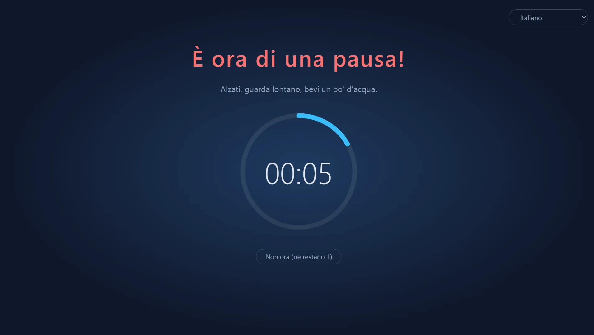
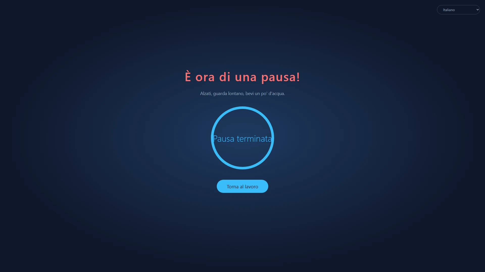
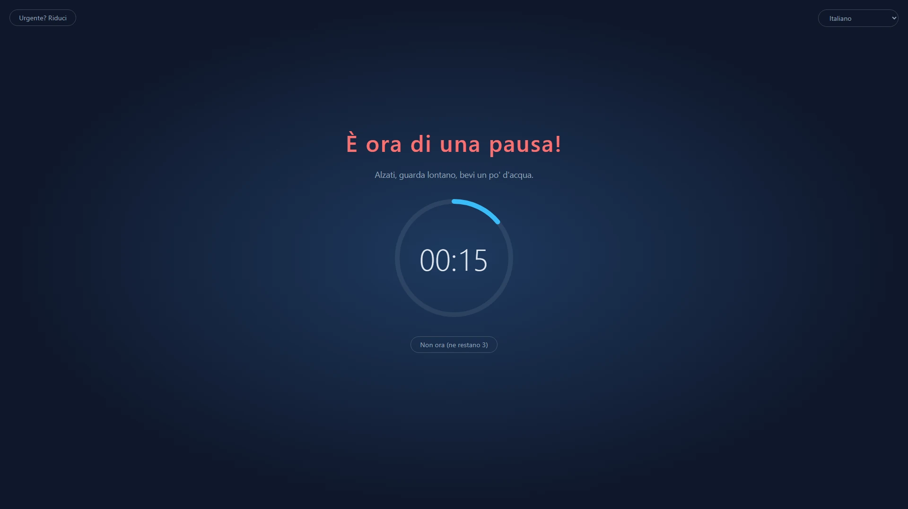
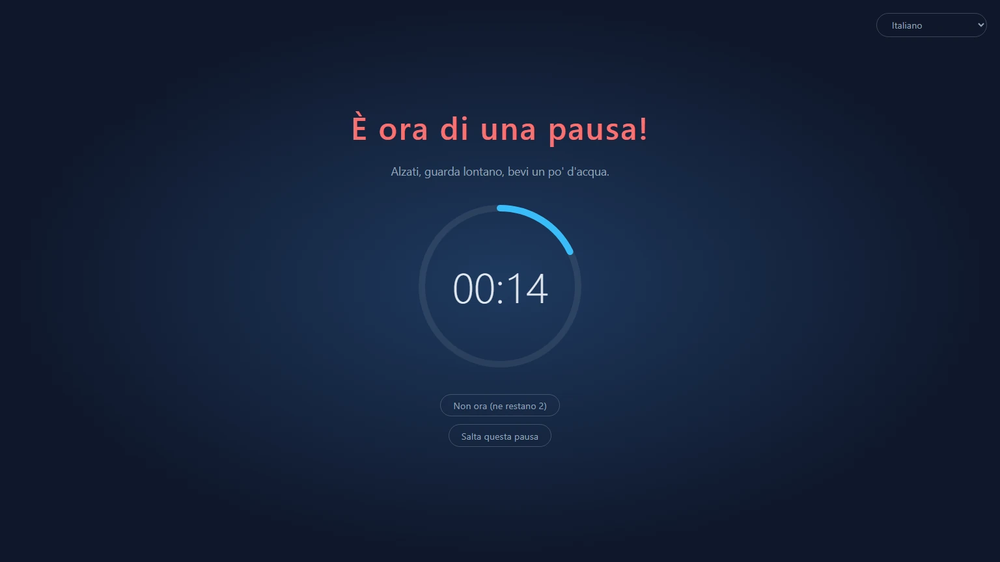
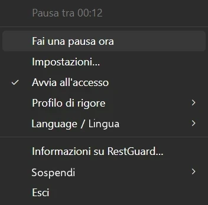

<p align="center">
  
</p>

<h1 align="center">RestGuard</h1>

<p align="center"><strong>Il promemoria per le pause che non puoi ignorare.</strong></p>

<p align="center">Un promemoria per le pause gratuito e open source per Windows, macOS e Linux, che può ricordarti di riposare o costringerti a farlo.</p>

<p align="center">
  <a href="https://github.com/HansTanzi/RestGuard/releases/latest"></a>
  <a href="https://github.com/HansTanzi/RestGuard/releases"></a>
  <a href="#installazione"></a>
  <a href="#windows"></a>
  <a href="https://apps.microsoft.com/detail/9PJ3SXDPCNN0"></a>
  <a href="#licenza"></a>
</p>

<p align="center">
  Installa su <a href="#windows"><b>Windows</b></a> · <a href="#macos"><b>macOS</b></a> · <a href="#linux"><b>Linux</b></a> · <a href="https://hanstanzi.github.io/RestGuard/">Sito web</a>
</p>

<p align="center"><a href="README.md">English</a> | <a href="README.zh-CN.md">简体中文</a> | <a href="README.de.md">Deutsch</a> | <a href="README.ja.md">日本語</a> | <a href="README.es.md">Español</a> | <a href="README.pt-BR.md">Português (Brasil)</a> | <a href="README.ko.md">한국어</a> | <a href="README.fr.md">Français</a> | Italiano | <a href="README.id.md">Bahasa Indonesia</a> | <a href="README.hi.md">हिन्दी</a> | <a href="README.bn.md">বাংলা</a> | <a href="README.ar.md">العربية</a></p>



Un promemoria per le pause multipiattaforma con tre livelli di rigore integrati: può ricordarti di fare una pausa o costringerti a farla. È il rigore a distinguerlo dagli altri promemoria per le pause.

- Rigore alto: fa tutto il possibile perché tu faccia la pausa.
- Rigore medio: puoi ancora lavorare, ma in modo abbastanza scomodo da spingerti a riposare.
- Rigore basso: come gli altri promemoria per le pause, più che altro te lo ricorda.

Realizzato con Rust + Tauri 2 + Svelte. Successore di [ProtectEyes](https://github.com/HansTanzi/ProtectEyes), un'app C# solo per Windows che ho reso open source anni fa.

Installa con una sola riga:

```sh
winget install HansTanzi.RestGuard            # Windows
brew install --cask hanstanzi/tap/restguard   # macOS
```

Microsoft Store, APT, Scoop, Homebrew su Linux e i download portatili sono descritti in [Installazione](#installazione).

## Perché RestGuard

La maggior parte dei promemoria per le pause è facile da ignorare: appare una notifica, la chiudi e “ancora cinque minuti” diventano due ore. Le lunghe sessioni davanti allo schermo sono associate ad affaticamento degli occhi, secchezza oculare, dolori a collo e schiena e lesioni da sforzo ripetuto (RSI). Consigli come la regola 20-20-20 o una breve pausa ogni ora aiutano solo se la pausa la fai davvero.

RestGuard è per chi sa di dover riposare ma continua a rimandare:

- **Non basta un clic per chiuderlo.** Con Rigore alto, la sovrapposizione copre tutti gli schermi fino alla fine della pausa.
- **Sa quando non interrompere.** I rinvii, la modalità urgente e il rilevamento delle riunioni evitano che una pausa rovini una chiamata o ti faccia perdere il lavoro non salvato.
- **Scegli tu quanto è severo.** Scegli Rigore alto, medio o basso, oppure crea un profilo tutto tuo.

## Funzionalità

### Pause che avvengono davvero

- Impone una pausa di 10 minuti ogni 60 minuti di lavoro (entrambe le durate sono regolabili)
- Più monitor: ogni schermo viene coperto
- La sovrapposizione non può essere chiusa durante una pausa (Alt+F4 non ha effetto) e non puoi uscire dall'area di notifica
- Rinvia di 5 minuti, fino a 3 volte; il conteggio si azzera dopo una pausa completa
- Modalità urgente: qualcosa non può aspettare? Riduci per un momento la sovrapposizione per salvare il lavoro mentre il conto alla rovescia continua



### Tre profili integrati per esigenze diverse

| | Rigore alto | Rigore medio (predefinito) | Rigore basso |
|---|:---:|:---:|:---:|
| Ideale per | Disciplina rigida, per sconfiggere “ancora cinque minuti” | Il lavoro di tutti i giorni | Una spinta gentile |
| Rinvii | 1 | 3 | 3 |
| Modalità urgente (riduci la sovrapposizione) | ✗ | ✓ | ✓ |
| Rilevamento app per riunioni | ✗ | ✓ | ✓ |
| Chiudi / salta questa pausa | ✗ | ✗ | ✓ |
| Copertura dello schermo | 100% | 100% | 80% |
| Sovrapposizione trascinabile | ✗ | ✓ | ✓ |





### Altamente personalizzabile

Se i profili integrati non fanno per te, scegli **Nuovo personalizzato…** nelle impostazioni per partire da un profilo qualsiasi, dagli un nome (potrai rinominarlo o eliminarlo in seguito) e regola ogni opzione:

- Numero di rinvii, se è consentito uscire, se è consentito saltare questa pausa
- Se la modalità urgente è disponibile e quanto si riduce la sovrapposizione
- Quanta parte di ogni schermo copre la sovrapposizione (10% ~ 100%) e se può essere trascinata nel suo schermo
- Se rilevare le app per riunioni

Tieni tutti i profili personalizzati che vuoi e cambiali quando vuoi. Le durate di lavoro, pausa, rinvio e inattività sono condivise tra i profili. Se preferisci modificare i file a mano, funziona anche [`config.toml`](#configurazione).

### Non ti intralcia quando conta

- Rilevamento delle riunioni (Windows, macOS): mentre Zoom, Microsoft Teams, Webex o Tencent Meeting è in primo piano (o, su Windows, usa il microfono), la pausa aspetta la fine della riunione; durante una pausa puoi anche fare clic su “Sono in una riunione” per ricevere un promemoria tra un'ora
- Rilevamento dell'inattività: dopo 5 minuti senza tastiera o mouse sei considerato assente e il conto alla rovescia del lavoro si ferma; un'assenza lunga quanto una pausa conta come pausa completa, così non vieni mandato a riposare appena torni

### Non perderti mai la fine di una pausa

- Alla fine di una pausa viene riprodotto un suono: scegline uno integrato o un tuo file audio
- Notifiche sul telefono: ricevi un push sul telefono (Android, iOS) tramite [ntfy](https://ntfy.sh), così sai quando tornare anche se ti sei allontanato; su Android può suonare come una sveglia finché non la spegni
- Smartwatch: la notifica del telefono viene replicata su un Apple Watch, un orologio Wear OS, un Galaxy Watch o un orologio o braccialetto Xiaomi, Huawei, Garmin o simile abbinato, quindi basta uno sguardo al polso (vedi [Notifiche su telefono e smartwatch](#notifiche-su-telefono-e-smartwatch))

### Leggero e veloce

- Realizzato con Rust + Tauri 2 sulla WebView di sistema, senza motore di browser incluso, quindi in background non usa quasi nessuna risorsa
- Minuscolo: i download pesano solo circa 3–6 MB, decine di volte meno delle alternative basate su Electron (vedi [Il confronto](#il-confronto))
- Portatile: un singolo exe su Windows, una `.app` da estrarre e avviare su macOS; eliminala per disinstallare

### E altro ancora

- Multipiattaforma: Windows, macOS e Linux, da installare e aggiornare tramite Microsoft Store, WinGet, Scoop, Homebrew e APT (vedi [Installazione](#installazione))
- Menu dell'area di notifica: tempo rimanente, pausa immediata, impostazioni, avvio all'accesso, cambio del profilo di rigore, sospensione
- Istanza singola
- Gratuito e open source con la permissiva doppia licenza MIT / Apache-2.0 (vedi [Licenza](#licenza))
- Disponibile in cinese semplificato, inglese, hindi, spagnolo, arabo, francese, bengalese, portoghese, tedesco, giapponese, italiano, coreano e indonesiano. La lingua dell'interfaccia segue il sistema per impostazione predefinita (inglese se la lingua di sistema non è supportata); cambiala quando vuoi dal sottomenu “语言 / Language” dell'area di notifica



## Il confronto

| | RestGuard | [Stretchly](https://github.com/hovancik/stretchly) | [Workrave](https://github.com/rcaelers/workrave) | [Safe Eyes](https://github.com/slgobinath/SafeEyes) |
|---|:---:|:---:|:---:|:---:|
| Windows | ✓ | ✓ | ✓ | ✗ |
| macOS | ✓ | ✓ | ✗ | ✗ |
| Linux | ✓ | ✓ | ✓ | ✓ |
| Dimensione del download | **~3–6 MB** | Windows 163 MB<br>macOS 187 MB<br>Linux 155 MB | Windows 61 MB<br>Linux 64 MB| Linux 0.3 MB |
| Rigore | 3 livelli + profili personalizzati | Modalità rigorosa on/off | Può bloccare input e schermo | Può disattivare la tastiera |
| Trattiene le pause durante le riunioni | Rileva Zoom, Teams, Webex, Tencent Meeting | Segue Non disturbare; esclusioni per app | — | — |
| Avviso su telefono / smartwatch a fine pausa | ✓ (ntfy) | — | — | — |
| Realizzato con | Rust + Tauri (WebView di sistema) | Electron (include Chromium) | C++ | Python + GTK |
| Licenza | MIT / Apache-2.0 | BSD-2-Clause | GPL-3.0 | GPL-3.0 |

— significa non integrato. Le dimensioni sono quelle dell'ultima release GitHub di ogni progetto (Stretchly 1.22.1, Workrave 1.11.5, Safe Eyes 3.5.1): l'installer o exe per Windows, il download per macOS e il `.deb` per Linux. Basato sulla documentazione di ogni progetto a novembre 2026; se qualcosa è sbagliato, [apri una issue](https://github.com/HansTanzi/RestGuard/issues).

## Installazione

### Windows

Disponibile su [Microsoft Store](https://apps.microsoft.com/detail/9PJ3SXDPCNN0), con aggiornamenti automatici.

Oppure installa con [WinGet](https://learn.microsoft.com/windows/package-manager/winget/):

```powershell
winget install HansTanzi.RestGuard
```

Oppure con [Scoop](https://scoop.sh):

```powershell
scoop bucket add hanstanzi https://github.com/HansTanzi/scoop-bucket
scoop install hanstanzi/restguard
```

Oppure scarica `RestGuard_<version>_x64.exe` da [Releases](https://github.com/HansTanzi/RestGuard/releases/latest) ed eseguilo. È un singolo exe portatile senza installer: mettilo dove vuoi ed eliminalo per disinstallare. Non si aggiorna da solo; scarica la nuova versione per aggiornare.

Richiede il runtime WebView2 (preinstallato su Windows 11).

### macOS

Installa con [Homebrew](https://brew.sh) (versione universale per Apple Silicon e Intel):

```sh
brew install --cask hanstanzi/tap/restguard
```

Se in passato avevi aggiunto questo repository come tap (`brew tap hanstanzi/restguard https://github.com/HansTanzi/RestGuard`), passa al nuovo tap per continuare a ricevere gli aggiornamenti: `brew untap hanstanzi/restguard && brew install --cask hanstanzi/tap/restguard`.

Oppure scarica `RestGuard_<version>_universal.zip` da [Releases](https://github.com/HansTanzi/RestGuard/releases/latest), estrailo e sposta `RestGuard.app` in `/Applications`. Non si aggiorna da solo; scarica la nuova versione per aggiornare.

RestGuard vive nella barra dei menu e non ha un'icona nel Dock. L'app non è autenticata da Apple; il cask rimuove l'attributo di quarantena durante l'installazione. Se hai scaricato lo zip a mano, esegui `xattr -dr com.apple.quarantine /Applications/RestGuard.app` prima del primo avvio, altrimenti macOS non lo aprirà.

### Linux

Su Debian/Ubuntu (x86_64), aggiungi il [repository APT](https://github.com/HansTanzi/apt), poi installa e aggiorna con `apt`:

```sh
sudo install -d /etc/apt/keyrings
curl -fsSL https://hanstanzi.github.io/apt/hanstanzi.gpg | sudo tee /etc/apt/keyrings/hanstanzi.gpg > /dev/null
echo "deb [signed-by=/etc/apt/keyrings/hanstanzi.gpg] https://hanstanzi.github.io/apt stable main" | sudo tee /etc/apt/sources.list.d/hanstanzi.list
sudo apt update && sudo apt install rest-guard
```

Le nuove versioni arrivano con `sudo apt update && sudo apt upgrade`. Puoi anche installare direttamente il `.deb` da [Releases](https://github.com/HansTanzi/RestGuard/releases/latest) (`sudo apt install ./RestGuard_*_amd64.deb`), ma in quel caso non si aggiornerà.

Per le altre distribuzioni, scarica da [Releases](https://github.com/HansTanzi/RestGuard/releases/latest). Su Fedora/openSUSE, installa il `.rpm`:

```sh
sudo dnf install ./RestGuard_*_x86_64.rpm      # Fedora
sudo zypper install ./RestGuard_*_x86_64.rpm   # openSUSE
```

Su Arch, installa il `.pkg.tar.zst`:

```sh
sudo pacman -U ./RestGuard_*_x86_64.pkg.tar.zst
```

Su qualsiasi distribuzione (x86_64, glibc 2.35+) puoi anche installare e aggiornare con [Homebrew](https://brew.sh). Homebrew non può installare librerie di sistema, quindi installa prima WebKitGTK 4.1 e libayatana-appindicator con il gestore di pacchetti della tua distribuzione:

```sh
sudo apt install libwebkit2gtk-4.1-0 libayatana-appindicator3-1                 # Debian/Ubuntu
sudo dnf install webkit2gtk4.1 libayatana-appindicator-gtk3                     # Fedora
sudo pacman -S webkit2gtk-4.1 libayatana-appindicator                           # Arch
sudo zypper install libwebkit2gtk-4_1-0 libayatana-appindicator3-1              # openSUSE

brew install --cask hanstanzi/tap/restguard
```

Viene installato solo l'eseguibile `restguard`, senza voce nel menu delle applicazioni: esegui `restguard` una volta, poi attiva “Avvia all'accesso” dal menu dell'area di notifica. Le nuove versioni arrivano con `brew upgrade`.

La sovrapposizione richiede X11 (vedi [Limitazioni delle piattaforme](#limitazioni-delle-piattaforme)).

### Verifica i download

I file delle Release successive a v0.1.14 sono compilati automaticamente dal codice sorgente da GitHub Actions e hanno un'[attestazione firmata della provenienza](https://docs.github.com/actions/security-for-github-actions/using-artifact-attestations) che collega ogni file all'esecuzione del workflow e al commit che lo hanno prodotto. Per controllare un file scaricato con la [GitHub CLI](https://cli.github.com):

```sh
gh attestation verify RestGuard_<version>_x64.exe --repo HansTanzi/RestGuard
```

Ogni Release include anche `SHA256SUMS.txt`, per controllare un download senza la GitHub CLI. Metti il file scaricato nella stessa cartella di `SHA256SUMS.txt` ed esegui:

```sh
sha256sum -c SHA256SUMS.txt --ignore-missing          # Linux
shasum -a 256 -c SHA256SUMS.txt --ignore-missing      # macOS
```

Su Windows, confronta l'output di `Get-FileHash .\RestGuard_*_x64.exe` con la riga corrispondente in `SHA256SUMS.txt` (maiuscole e minuscole non contano).

### Compila dai sorgenti

Installa i prerequisiti elencati in [CONTRIBUTING.md](CONTRIBUTING.md#development-setup) (in inglese), poi compila una versione con tag:

```sh
git clone https://github.com/HansTanzi/RestGuard
cd RestGuard
git checkout v<version>
pnpm install --frozen-lockfile
pnpm tauri build --no-bundle
```

L'eseguibile è `src-tauri/target/release/restguard` (`restguard.exe` su Windows). Compila con `pnpm tauri build`, non con `cargo build`: una semplice build Cargo è una build di sviluppo che carica l'interfaccia da `localhost:1420` e mostra finestre vuote.

## Configurazione

Apri **Impostazioni…** dal menu dell'area di notifica per cambiare durate, livello di rigore, copertura della sovrapposizione, lingua e avvio all'accesso. Le modifiche si applicano subito (durante una pausa le impostazioni sono bloccate). Cambiare la durata del lavoro fa ripartire il conto alla rovescia in corso.

Le impostazioni sono salvate in `config.toml`, creato al primo avvio. Puoi anche modificarlo a mano; riavvia poi l'app.

| Sistema | Percorso |
|---|---|
| Windows | `%APPDATA%\io.github.restguard\config.toml` |
| macOS | `~/Library/Application Support/io.github.restguard/config.toml` |
| Linux | `~/.config/io.github.restguard/config.toml` |

```toml
work_minutes = 60.0      # quanto lavorare prima di una pausa forzata
rest_minutes = 10.0      # quanto dura ogni pausa
postpone_minutes = 5.0   # quanto dura ogni rinvio
idle_minutes = 5.0       # senza input per questo tempo sei considerato assente, 0 = disattivato
level = "medium"         # "high", "medium", "low" o il nome di un profilo personalizzato
sound_prompt = true      # riproduci un suono alla fine di una pausa
sound = "beep"           # "beep", "chime", "rise" o "file" (riproduce sound_file)
sound_file = ""          # percorso completo del tuo file audio, usato quando sound = "file"
phone_notify = false     # invia una notifica al telefono tramite ntfy alla fine di una pausa
ntfy_server = "https://ntfy.sh"  # server ntfy, quello pubblico o il tuo
ntfy_topic = ""          # argomento da seguire nell'app ntfy; deve essere difficile da indovinare

[[fixed_breaks]]         # una pausa fissa; "work_end" (fine della giornata) e "lunch" sono integrate
name = "work_end"
enabled = false          # trattieni le pause che scadono poco prima
time = "18:00"           # formato 24 ore HH:MM nell'ora locale
quiet_minutes = 30.0     # le pause in scadenza entro questo tempo prima di time aspettano time

[[fixed_breaks]]         # pranzo: a time inizia una pausa di rest_minutes
name = "lunch"
enabled = true
time = "12:00"
quiet_minutes = 30.0
rest_minutes = 30.0      # quanto dura la pausa (pranzo e le tue pause fisse); superata la durata di una pausa normale puoi continuare a usare il computer

[[fixed_breaks]]         # aggiungi le tue, ad es. una pausa tè, con un [[fixed_breaks]] ciascuna
name = "Pausa tè"
enabled = true
time = "15:00"
quiet_minutes = 15.0
rest_minutes = 15.0

[[profiles]]             # un profilo personalizzato; aggiungi un [[profiles]] per ogni profilo
name = "Concentrazione"
max_postpones = 1        # rinvii massimi prima che sia obbligatoria una pausa completa
urgent_mode = false      # consenti di ridurre la sovrapposizione
meeting_detection = true # trattieni le pause mentre Zoom, Teams ecc. sono in uso
force_rest = true        # false = la sovrapposizione può essere chiusa
allow_skip = false       # offri comunque “Salta questa pausa” quando le pause sono forzate
overlay_coverage = 1.0   # frazione di ogni schermo coperta, 0.1 ~ 1.0
urgent_scale = 0.5       # scala della modalità urgente (sovrapposizione ridotta) rispetto al valore sopra, 0.1 ~ 0.9
movable = false          # consenti di trascinare la sovrapposizione nel suo schermo quando non è a schermo intero
```

### Notifiche su telefono e smartwatch

1. Installa l'app ntfy sul telefono ([Android](https://play.google.com/store/apps/details?id=io.heckel.ntfy), [F-Droid](https://f-droid.org/packages/io.heckel.ntfy/), [iOS](https://apps.apple.com/app/ntfy/id1625396347))
2. Nelle impostazioni di RestGuard, attiva “Avvisa il telefono alla fine della pausa (ntfy)” e inserisci un argomento difficile da indovinare (solo lettere, numeri, `-` e `_`). Il server predefinito è quello pubblico `https://ntfy.sh`; puoi usare il tuo
3. Iscriviti allo stesso server e argomento nell'app ntfy, poi fai clic su “Invia notifica di prova” per controllare che arrivi

Le notifiche vengono inviate con la priorità più alta. Su Android, attiva “Keep alerting for highest priority” nelle impostazioni di ntfy perché suoni come una sveglia finché non la spegni; su iOS è una notifica con urgenza che supera le modalità Full Immersion (se consenti a ntfy di inviare notifiche con urgenza). Chiunque conosca l'argomento può iscriversi sul server pubblico, quindi tienilo privato.

Sull'orologio non serve installare nulla, il sistema vi replica la notifica del telefono:

| Orologio | Configurazione |
|---|---|
| Apple Watch | Nell'app Watch dell'iPhone, vai su Notifiche e attiva la replica degli avvisi dell'iPhone (“Mirror iPhone alerts”) per ntfy. Le notifiche arrivano all'orologio solo quando l'iPhone è bloccato o ha lo schermo spento |
| Wear OS / Galaxy Watch | Replicate per impostazione predefinita; assicurati che ntfy non sia disattivato nelle impostazioni di notifica dell'orologio |
| Xiaomi, Huawei, Garmin, Amazfit, ecc. | Consenti ntfy nell'elenco delle notifiche dell'app companion (Zepp, Huawei Health, Garmin Connect, ecc.) |

Note:

- L'orologio vibra una volta; non continua ad avvisare come il telefono
- Perché l'orologio riceva la notifica, il telefono deve essere online con ntfy in background; un orologio usato da solo senza il telefono non la riceve
- Con un server self-hosted, iOS ha bisogno di `upstream-base-url: "https://ntfy.sh"` nella configurazione del server per ricevere le notifiche all'istante (vedi la [documentazione di ntfy](https://docs.ntfy.sh/config/#ios-instant-notifications))

## Limitazioni delle piattaforme

- **macOS**: le azioni di sistema come Uscita forzata (`Cmd+Option+Esc`) non possono essere bloccate
- **Linux**: il rilevamento dell'inattività richiede GNOME o un desktop che implementi `org.freedesktop.ScreenSaver` (ad es. KDE Plasma), oltre a `gdbus`; altrimenti è disattivato
- **Linux**: i suoni vengono riprodotti con `paplay`, `pw-play` o `aplay`, quindi usa wav, ogg o flac per il tuo file (mp3 non è supportato)
- **Linux Wayland**: il protocollo non permette alle app di restare in primo piano o posizionare le proprie finestre, quindi la sovrapposizione potrebbe non funzionare; con X11 non ci sono problemi

## FAQ

**Posso uscire da RestGuard?**
Tra una pausa e l'altra sì: scegli “Esci” nel menu dell'area di notifica. Durante una pausa, o finché una pausa rinviata è ancora dovuta, “Esci” è disattivato. Se oggi hai un impegno importante, come una riunione decisiva, e non vuoi che RestGuard ti interrompa, scegli “Sospendi” invece di “Esci”: i promemoria tornano da soli dopo 30 minuti, 1 o 2 ore, o la mattina dopo, così non devi ricordarti di riavviare RestGuard.

**E se arriva una pausa durante una riunione?**
Con Rigore medio e basso, la pausa aspetta mentre Zoom, Microsoft Teams, Webex o Tencent Meeting è in primo piano (Windows, macOS; su Windows anche mentre usa il microfono). Se la pausa è già iniziata, fai clic su “Sono in una riunione” per ricevere un promemoria tra un'ora. Con Rigore alto le pause non aspettano.

**Sto facendo una cosa urgente. Perderò il lavoro?**
Rinvia la pausa di 5 minuti (fino a 3 volte con Rigore medio e basso, una volta con Rigore alto), oppure, con Rigore medio e basso, usa la modalità urgente per ridurre la sovrapposizione e salvare il lavoro mentre il conto alla rovescia continua.

**Il tempo lontano dal computer conta come lavoro?**
No. Dopo 5 minuti senza tastiera o mouse il conto alla rovescia del lavoro si ferma, e un'assenza lunga quanto una pausa conta come pausa completa.

**macOS dice che l'app non può essere aperta.**
RestGuard non è autenticato da Apple. Installalo con Homebrew, oppure esegui una volta `xattr -dr com.apple.quarantine /Applications/RestGuard.app` (vedi [macOS](#macos)).

**Funziona su Wayland?**
Non in modo affidabile: Wayland non permette alle app di tenere le finestre in primo piano, quindi usa una sessione X11 (vedi [Limitazioni delle piattaforme](#limitazioni-delle-piattaforme)).

**Raccoglie dati?**
No. Vedi [Privacy](#privacy).

## Contribuire

Segnalazioni di bug, idee, traduzioni e pull request sono tutte benvenute. [CONTRIBUTING.md](CONTRIBUTING.md) (in inglese) spiega come preparare l'ambiente di sviluppo, i controlli da eseguire e come migliorare una traduzione; le modifiche di ogni versione sono in [CHANGELOG.md](CHANGELOG.md). Segnala i problemi di sicurezza in privato come descritto in [SECURITY.md](SECURITY.md).

Se RestGuard ti aiuta a riposare, una ⭐ aiuta altri a scoprirlo.

[](https://github.com/HansTanzi/RestGuard/graphs/contributors)

[](https://star-history.com/#HansTanzi/RestGuard&Date)

## Privacy

RestGuard non raccoglie dati: niente account, analisi o telemetria. Va online solo per inviare la notifica ntfy facoltativa al telefono. Vedi l'[informativa sulla privacy](https://hanstanzi.github.io/RestGuard/privacy.html) (in inglese).

## Licenza

Distribuito con licenza [MIT](LICENSE-MIT) o [Apache-2.0](LICENSE-APACHE), a tua scelta.
