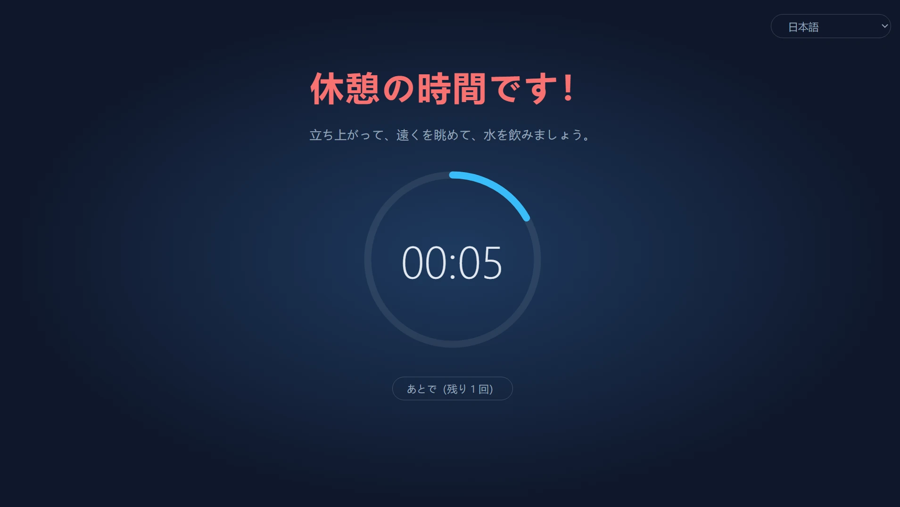
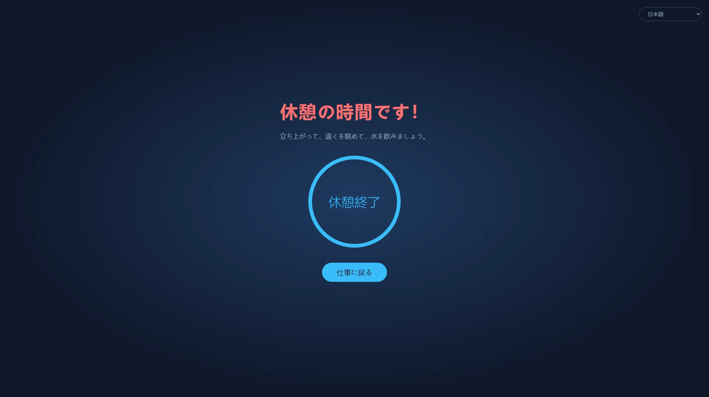
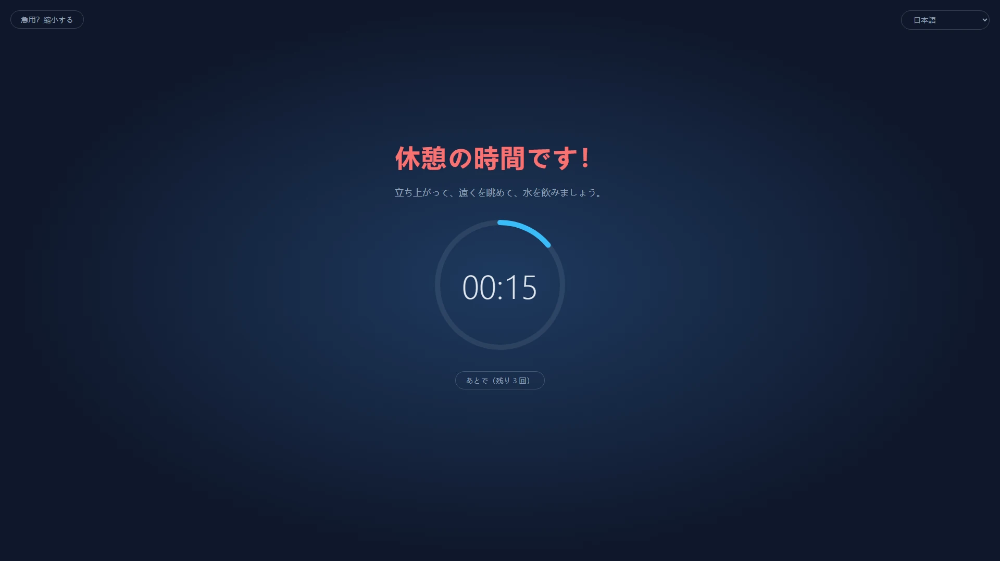
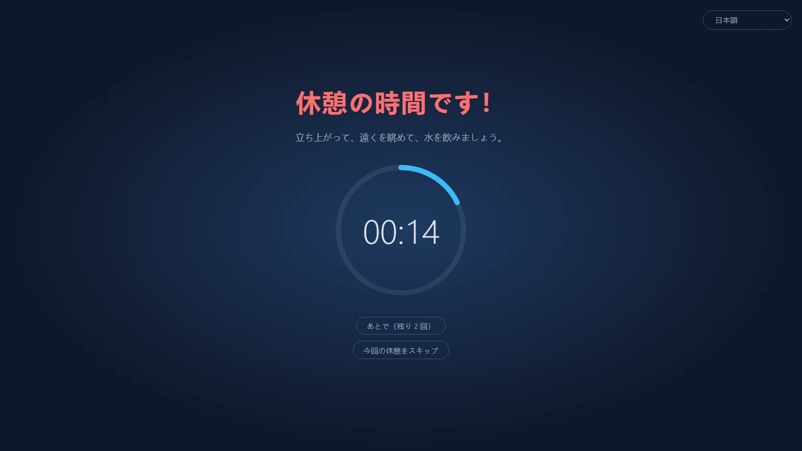
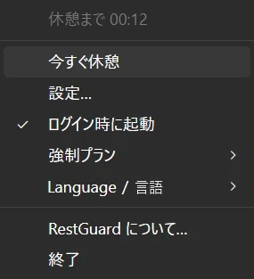

<p align="center">
  
</p>

<h1 align="center">RestGuard</h1>

<p align="center"><strong>無視できない休憩リマインダー。</strong></p>

<p align="center">Windows・macOS・Linux 対応の無料オープンソース休憩リマインダー。休憩を促すことも、休憩させることもできます。</p>

<p align="center">
  <a href="https://github.com/HansTanzi/RestGuard/releases/latest"></a>
  <a href="https://github.com/HansTanzi/RestGuard/releases"></a>
  <a href="#インストール"></a>
  <a href="#windows"></a>
  <a href="#ライセンス"></a>
</p>

<p align="center">
  インストール： <a href="#windows"><b>Windows</b></a> · <a href="#macos"><b>macOS</b></a> · <a href="#linux"><b>Linux</b></a> · <a href="https://hanstanzi.github.io/RestGuard/">ウェブサイト</a>
</p>

<p align="center"><a href="README.md">English</a> | <a href="README.zh-CN.md">简体中文</a> | <a href="README.de.md">Deutsch</a> | 日本語 | <a href="README.es.md">Español</a> | <a href="README.pt-BR.md">Português (Brasil)</a> | <a href="README.ko.md">한국어</a></p>



3 段階の強制レベルを内蔵したクロスプラットフォームの休憩リマインダーです。休憩を促すだけでなく、実際に休憩させることもできます。この「強制力」こそが、ほかの休憩リマインダーとの一番の違いです。

- 高：あらゆる手段で休憩させます。
- 中：作業は続けられますが、作業しづらくして休憩へと誘導します。
- 低：ほかの休憩リマインダーと同じく、主にお知らせだけです。

Rust + Tauri 2 + Svelte 製。作者が以前オープンソースで公開した Windows 専用の C# アプリ [ProtectEyes](https://github.com/HansTanzi/ProtectEyes) の後継です。

1 行でインストール：

```sh
winget install HansTanzi.RestGuard            # Windows
brew install --cask hanstanzi/tap/restguard   # macOS
```

APT、Scoop、Linux での Homebrew、ポータブル版のダウンロードは[インストール](#インストール)を参照してください。

## RestGuard を選ぶ理由

ほとんどの休憩リマインダーは簡単に無視できます。通知が出ても閉じてしまい、「あと 5 分だけ」が 2 時間になります。長時間の画面作業は、眼精疲労、ドライアイ、首や腰の痛み、反復性ストレス障害（RSI）との関連が指摘されています。20-20-20 ルールや「1 時間ごとに短い休憩」といったアドバイスも、実際に休憩しなければ意味がありません。

RestGuard は、休むべきだとわかっていてもつい先延ばしにしてしまう人のためのアプリです：

- **クリックひとつでは閉じられません。** 「高」では、休憩が終わるまでオーバーレイがすべての画面を覆います。
- **邪魔をしてはいけないときをわかっています。** 延期、緊急モード、会議の検出により、休憩が会議を台無しにしたり、保存前の作業を失わせたりすることはありません。
- **どこまで厳しくするかはあなた次第。** 高・中・低から選ぶことも、独自のプランを作ることもできます。

## 機能

### 休憩を確実に取らせる

- 60 分作業するごとに 10 分の休憩を強制（どちらの時間も変更可能）
- マルチモニター対応：すべての画面を覆います
- 休憩中はオーバーレイを閉じられず（Alt+F4 も効きません）、トレイから終了することもできません
- 5 分の延期を最大 3 回まで。きちんと休憩すると回数はリセットされます
- 緊急モード：どうしても手が離せないときは、オーバーレイを一時的に縮小して作業を保存できます（カウントダウンは止まりません）



### 用途に合わせた 3 つの内蔵プラン

| | 高 | 中（デフォルト） | 低 |
|---|:---:|:---:|:---:|
| 向いている人 | 厳しく自分を律したい、「あと 5 分だけ」を断ち切りたい | 普段の仕事 | 軽く声をかけてほしい |
| 延期回数 | 1 | 3 | 3 |
| 緊急モード（オーバーレイ縮小） | ✗ | ✓ | ✓ |
| 会議アプリの検出 | ✗ | ✓ | ✓ |
| 今回の休憩を閉じる／スキップ | ✗ | ✗ | ✓ |
| 画面の覆う割合 | 100% | 100% | 80% |
| オーバーレイのドラッグ | ✗ | ✓ | ✓ |





### 細かくカスタマイズ可能

内蔵プランが合わないときは、設定で **新しいカスタム…** を選び、任意のプランをもとに名前を付けて（あとで名前の変更や削除も可能）各項目を調整できます：

- 延期回数、終了を許可するか、今回の休憩のスキップを許可するか
- 緊急モードを使えるか、オーバーレイをどこまで縮小するか
- 各画面をオーバーレイが覆う割合（10% ~ 100%）、画面内でドラッグできるか
- 会議アプリを検出するか

カスタムプランはいくつでも作成でき、いつでも切り替えられます。作業・休憩・延期・アイドルの時間はすべてのプランで共通です。ファイルを直接編集したい場合は [`config.toml`](#設定) も使えます。

### 大事なときは邪魔をしない

- 会議の検出（Windows、macOS）：Zoom、Microsoft Teams、Webex、Tencent Meeting が前面にある間（Windows ではマイクを使用している間も）、休憩は会議が終わるまで待ちます。休憩中に「〇〇 で会議中です」をクリックすると 15 分後に再通知されます
- アイドル検出：キーボードやマウスの入力が 5 分間ないと離席中とみなし、作業のカウントダウンを一時停止します。休憩時間と同じだけ離れていれば休憩したことになるため、戻ってすぐに休憩させられることはありません

### 休憩の終わりを見逃さない

- 休憩が終わるとサウンドが鳴ります：内蔵の音か、好きな音声ファイルを選べます
- スマホ通知：[ntfy](https://ntfy.sh) 経由でスマホ（Android、iOS）にプッシュ通知が届くので、席を離れていても戻るタイミングがわかります。Android では止めるまでアラームのように鳴らし続けることもできます
- スマートウォッチ：スマホの通知はペアリング済みの Apple Watch、Wear OS、Galaxy Watch、Xiaomi・Huawei・Garmin などのウォッチやバンドにも転送されるので、手首を見るだけで済みます（[スマートフォンとスマートウォッチへの通知](#スマートフォンとスマートウォッチへの通知)を参照）

### 小さくて軽い

- Rust + Tauri 2 で OS 標準の WebView を使い、ブラウザエンジンを同梱しないため、バックグラウンドでもリソースをほとんど使いません
- 小さい：ダウンロードはわずか 3〜6 MB ほどで、Electron 製の同種アプリの数十分の一です（[ほかのアプリとの比較](#ほかのアプリとの比較)を参照）
- ポータブル：Windows は exe ひとつ、macOS は解凍してすぐ使える `.app`。削除すればアンインストール完了です

### その他

- クロスプラットフォーム：Windows、macOS、Linux に対応し、WinGet、Scoop、Homebrew、APT でインストール・アップデートできます（[インストール](#インストール)を参照）
- トレイメニュー：残り時間、今すぐ休憩、設定、ログイン時に起動、強制プランの切り替え
- 単一インスタンス
- 寛容な MIT / Apache-2.0 デュアルライセンスの無料オープンソース（[ライセンス](#ライセンス)を参照）
- 簡体字中国語、英語、ヒンディー語、スペイン語、アラビア語、フランス語、ベンガル語、ポルトガル語、ドイツ語、日本語、イタリア語、韓国語、インドネシア語に対応。表示言語はデフォルトでシステムに従い（未対応の言語なら英語）、トレイメニューの「语言 / Language」からいつでも切り替えられます



## ほかのアプリとの比較

| | RestGuard | [Stretchly](https://github.com/hovancik/stretchly) | [Workrave](https://github.com/rcaelers/workrave) | [Safe Eyes](https://github.com/slgobinath/SafeEyes) |
|---|:---:|:---:|:---:|:---:|
| Windows | ✓ | ✓ | ✓ | ✗ |
| macOS | ✓ | ✓ | ✗ | ✗ |
| Linux | ✓ | ✓ | ✓ | ✓ |
| ダウンロードサイズ | **約 3〜6 MB** | Windows 163 MB<br>macOS 187 MB<br>Linux 155 MB | Windows 61 MB<br>Linux 64 MB| Linux 0.3 MB |
| 強制力 | 3 段階 + カスタムプラン | 厳格モードのオン／オフ | 入力と画面をブロック可能 | キーボードを無効化可能 |
| 会議中は休憩を待つ | Zoom、Teams、Webex、Tencent Meeting を検出 | おやすみモードに従う、アプリごとの除外 | — | — |
| 休憩終了をスマホ／スマートウォッチに通知 | ✓（ntfy） | — | — | — |
| 技術 | Rust + Tauri（システム WebView） | Electron（Chromium を同梱） | C++ | Python + GTK |
| ライセンス | MIT / Apache-2.0 | BSD-2-Clause | GPL-3.0 | GPL-3.0 |

— は組み込み機能がないことを示します。ダウンロードサイズは各プロジェクトの最新 GitHub リリース（Stretchly 1.22.1、Workrave 1.11.5、Safe Eyes 3.5.1）のもので、Windows のインストーラーまたは exe、macOS のダウンロード、Linux の `.deb` です。2026 年 11 月時点の各プロジェクトのドキュメントに基づいています。誤りがあれば [Issue を作成](https://github.com/HansTanzi/RestGuard/issues)してください。

## インストール

### Windows

[WinGet](https://learn.microsoft.com/windows/package-manager/winget/) でインストール：

```powershell
winget install HansTanzi.RestGuard
```

または [Scoop](https://scoop.sh) で：

```powershell
scoop bucket add hanstanzi https://github.com/HansTanzi/scoop-bucket
scoop install hanstanzi/restguard
```

または [Releases](https://github.com/HansTanzi/RestGuard/releases/latest) から `RestGuard_<バージョン>_x64.exe` をダウンロードして実行します。インストーラーのないポータブルな単一 exe なので、好きな場所に置き、削除すればアンインストールできます。自動アップデートはしないため、更新するときは新しいバージョンをダウンロードしてください。

WebView2 ランタイムが必要です（Windows 11 にはプリインストール済み）。

### macOS

[Homebrew](https://brew.sh) でインストール（Apple Silicon と Intel のユニバーサルビルド）：

```sh
brew install --cask hanstanzi/tap/restguard
```

以前このリポジトリを tap として追加していた場合（`brew tap hanstanzi/restguard https://github.com/HansTanzi/RestGuard`）は、アップデートを受け取り続けるために新しい tap へ切り替えてください：`brew untap hanstanzi/restguard && brew install --cask hanstanzi/tap/restguard`。

または [Releases](https://github.com/HansTanzi/RestGuard/releases/latest) から `RestGuard_<バージョン>_universal.zip` をダウンロードして解凍し、`RestGuard.app` を `/Applications` に移動します。自動アップデートはしないため、更新するときは新しいバージョンをダウンロードしてください。

RestGuard はメニューバーに常駐し、Dock アイコンはありません。アプリは Apple の公証を受けていないため、cask はインストール時に検疫属性を削除します。zip を手動でダウンロードした場合は、初回起動前に `xattr -dr com.apple.quarantine /Applications/RestGuard.app` を実行してください。実行しないと macOS がアプリを開けません。

### Linux

Debian/Ubuntu（x86_64）では、[APT リポジトリ](https://github.com/HansTanzi/apt)を追加してから `apt` でインストール・アップデートします：

```sh
sudo install -d /etc/apt/keyrings
curl -fsSL https://hanstanzi.github.io/apt/hanstanzi.gpg | sudo tee /etc/apt/keyrings/hanstanzi.gpg > /dev/null
echo "deb [signed-by=/etc/apt/keyrings/hanstanzi.gpg] https://hanstanzi.github.io/apt stable main" | sudo tee /etc/apt/sources.list.d/hanstanzi.list
sudo apt update && sudo apt install rest-guard
```

新しいバージョンは `sudo apt update && sudo apt upgrade` で入ります。[Releases](https://github.com/HansTanzi/RestGuard/releases/latest) の `.deb` を直接インストールすることもできますが（`sudo apt install ./RestGuard_*_amd64.deb`）、その場合はアップデートされません。

ほかのディストリビューションでは [Releases](https://github.com/HansTanzi/RestGuard/releases/latest) からダウンロードします。Fedora/openSUSE では `.rpm` をインストール：

```sh
sudo dnf install ./RestGuard_*_x86_64.rpm      # Fedora
sudo zypper install ./RestGuard_*_x86_64.rpm   # openSUSE
```

Arch では `.pkg.tar.zst` をインストール：

```sh
sudo pacman -U ./RestGuard_*_x86_64.pkg.tar.zst
```

どのディストリビューションでも（x86_64、glibc 2.35 以上）、[Homebrew](https://brew.sh) でインストール・アップデートできます。Homebrew はシステムライブラリをインストールできないため、先にディストリビューションのパッケージマネージャーで WebKitGTK 4.1 と libayatana-appindicator をインストールしてください：

```sh
sudo apt install libwebkit2gtk-4.1-0 libayatana-appindicator3-1                 # Debian/Ubuntu
sudo dnf install webkit2gtk4.1 libayatana-appindicator-gtk3                     # Fedora
sudo pacman -S webkit2gtk-4.1 libayatana-appindicator                           # Arch
sudo zypper install libwebkit2gtk-4_1-0 libayatana-appindicator3-1              # openSUSE

brew install --cask hanstanzi/tap/restguard
```

この方法では `restguard` 実行ファイルだけがインストールされ、アプリメニューには登録されません。一度 `restguard` を実行し、トレイメニューで「ログイン時に起動」をオンにしてください。新しいバージョンは `brew upgrade` で入ります。

オーバーレイには X11 が必要です（[プラットフォームの制限](#プラットフォームの制限)を参照）。

### ダウンロードの検証

v0.1.14 より後のリリースファイルは GitHub Actions でビルドされ、各ファイルとそれをビルドしたワークフロー実行・コミットを結び付ける署名付きの[ビルド来歴証明（build provenance attestation）](https://docs.github.com/actions/security-for-github-actions/using-artifact-attestations)が付いています。[GitHub CLI](https://cli.github.com) でダウンロードしたファイルを検証するには：

```sh
gh attestation verify RestGuard_<バージョン>_x64.exe --repo HansTanzi/RestGuard
```

各リリースには `SHA256SUMS.txt` も含まれているので、GitHub CLI なしでも検証できます。ダウンロードしたファイルを `SHA256SUMS.txt` と同じディレクトリに置いて実行します：

```sh
sha256sum -c SHA256SUMS.txt --ignore-missing          # Linux
shasum -a 256 -c SHA256SUMS.txt --ignore-missing      # macOS
```

Windows では `Get-FileHash .\RestGuard_*_x64.exe` の出力を `SHA256SUMS.txt` の該当行と比較してください（大文字・小文字は区別しません）。

### ソースからビルド

[CONTRIBUTING.md](CONTRIBUTING.md#development-setup) に記載の依存関係をインストールしてから、タグ付きのバージョンをビルドします：

```sh
git clone https://github.com/HansTanzi/RestGuard
cd RestGuard
git checkout v<バージョン>
pnpm install --frozen-lockfile
pnpm tauri build --no-bundle
```

実行ファイルは `src-tauri/target/release/restguard`（Windows では `restguard.exe`）です。`cargo build` ではなく `pnpm tauri build` でビルドしてください。Cargo 単体のビルドは開発ビルドになり、UI を `localhost:1420` から読み込むため空白のウィンドウが表示されます。

## 設定

トレイメニューの **設定…** から、時間、強制レベル、オーバーレイの覆う割合、言語、ログイン時の起動を変更できます。変更はすぐに反映されます（休憩中は設定がロックされます）。作業時間を変更すると、現在の作業カウントダウンは最初からやり直しになります。

設定は初回起動時に作成される `config.toml` に保存されます。直接編集することもできますが、その後アプリを再起動してください。

| OS | パス |
|---|---|
| Windows | `%APPDATA%\io.github.restguard\config.toml` |
| macOS | `~/Library/Application Support/io.github.restguard/config.toml` |
| Linux | `~/.config/io.github.restguard/config.toml` |

```toml
work_minutes = 60.0      # 強制休憩までの作業時間
rest_minutes = 10.0      # 1 回の休憩時間
postpone_minutes = 5.0   # 1 回の延期時間
idle_minutes = 5.0       # この時間入力がなければ離席とみなす。0 = オフ
level = "medium"         # "high"、"medium"、"low"、またはカスタムプラン名
sound_prompt = true      # 休憩終了時にサウンドを鳴らす
sound = "beep"           # "beep"、"chime"、"rise"、または "file"（sound_file を再生）
sound_file = ""          # 自分の音声ファイルのフルパス。sound = "file" のときに使用
phone_notify = false     # 休憩終了時に ntfy でスマホへ通知する
ntfy_server = "https://ntfy.sh"  # ntfy サーバー。公開サーバーか自前のサーバー
ntfy_topic = ""          # ntfy アプリで購読するトピック。推測されにくいものに

[[fixed_breaks]]         # 固定の休憩。"work_end"（終業）と "lunch" は内蔵
name = "work_end"
enabled = false          # 終業直前に来る休憩を見送る
time = "18:00"           # 現地時間の 24 時間制 HH:MM
quiet_minutes = 30.0     # time のこの時間前以降に来る休憩は time まで待つ

[[fixed_breaks]]         # 昼休み：time に rest_minutes の休憩が始まる
name = "lunch"
enabled = true
time = "12:00"
quiet_minutes = 30.0
rest_minutes = 30.0      # 休憩の長さ（昼休みと自分で追加した固定休憩）

[[fixed_breaks]]         # 自分で追加する場合（例：ティーブレイク）、1 つにつき [[fixed_breaks]] を 1 つ
name = "Tea break"
enabled = true
time = "15:00"
quiet_minutes = 15.0
rest_minutes = 15.0

[[profiles]]             # カスタムプラン。1 つにつき [[profiles]] を 1 つ
name = "Focus"
max_postpones = 1        # 完全に休憩するまでの最大延期回数
urgent_mode = false      # オーバーレイの縮小を許可
meeting_detection = true # Zoom、Teams などの使用中は休憩を待たせる
force_rest = true        # false = オーバーレイを閉じられる
allow_skip = false       # 休憩を強制していても「今回の休憩をスキップ」を表示
overlay_coverage = 1.0   # 各画面を覆う割合 0.1 ~ 1.0
urgent_scale = 0.5       # 緊急モード（縮小時）の上記に対する倍率 0.1 ~ 0.9
movable = false          # 全画面でないとき、同じ画面内でオーバーレイをドラッグ可能にする
```

### スマートフォンとスマートウォッチへの通知

1. スマホに ntfy アプリをインストールします（[Android](https://play.google.com/store/apps/details?id=io.heckel.ntfy)、[F-Droid](https://f-droid.org/packages/io.heckel.ntfy/)、[iOS](https://apps.apple.com/app/ntfy/id1625396347)）
2. RestGuard の設定で「休憩が終わったらスマホに通知（ntfy）」をオンにし、推測されにくいトピック（英字・数字・`-`・`_` のみ）を入力します。サーバーはデフォルトで公開の `https://ntfy.sh` ですが、自前のサーバーも使えます
3. ntfy アプリで同じサーバーとトピックを購読し、「テスト通知を送信」をクリックして届くことを確認します

通知は最高優先度で送信されます。Android では ntfy の設定で「最高優先度の通知を鳴らし続ける」（Keep alerting for highest priority）をオンにすると、止めるまでアラームのように鳴り続けます。iOS では集中モードを突破する「タイムセンシティブ通知」になります（ntfy にタイムセンシティブ通知を許可している場合）。公開サーバーではトピックを知っている人なら誰でも購読できるので、トピックは他人に教えないでください。

ウォッチには何もインストールする必要はなく、システムがスマホの通知を転送します：

| ウォッチ | 設定 |
|---|---|
| Apple Watch | iPhone の Watch アプリで「通知」を開き、ntfy の「iPhone からの通知を反映」をオンにします。iPhone がロック中または画面オフのときだけウォッチに届きます |
| Wear OS / Galaxy Watch | デフォルトで転送されます。ウォッチの通知設定で ntfy がオフになっていないか確認してください |
| Xiaomi、Huawei、Garmin、Amazfit など | 連携アプリ（Zepp、Huawei Health、Garmin Connect など）のアプリ通知一覧で ntfy を許可します |

注意：

- ウォッチは一度振動するだけで、スマホのように鳴り続けることはありません
- ウォッチに通知が届くには、スマホがオンラインで ntfy がバックグラウンドで動作している必要があります。スマホなしで単独で使っているウォッチには届きません
- 自前のサーバーを使う場合、iOS で即時に通知を受け取るにはサーバー設定に `upstream-base-url: "https://ntfy.sh"` が必要です（[ntfy のドキュメント](https://docs.ntfy.sh/config/#ios-instant-notifications)を参照）

## プラットフォームの制限

- **macOS**：強制終了（`Cmd+Option+Esc`）などのシステムレベルの操作はブロックできません
- **Linux**：アイドル検出には GNOME か `org.freedesktop.ScreenSaver` を実装したデスクトップ（KDE Plasma など）と `gdbus` が必要です。ない場合はオフになります
- **Linux**：サウンドは `paplay`、`pw-play`、`aplay` で再生するため、自分のファイルには wav、ogg、flac を使ってください（mp3 は非対応）
- **Linux Wayland**：プロトコル上、アプリが自分のウィンドウを最前面に保ったり位置を指定したりできないため、オーバーレイが正しく動かないことがあります。X11 なら問題ありません

## よくある質問

**RestGuard を終了できますか？**
休憩と休憩の間なら、トレイメニューの「終了」で終了できます。休憩中や、延期した休憩がまだ残っている間は「終了」は使えません。

**会議中に休憩の時間になったら？**
「中」と「低」では、Zoom、Microsoft Teams、Webex、Tencent Meeting が前面にある間（Windows、macOS。Windows ではマイクを使用している間も）休憩は待ちます。すでに休憩が始まっている場合は「… で会議中です」をクリックすると、15 分後に再通知されます。「高」では休憩は待ちません。

**急ぎの作業中です。作業内容は失われますか？**
休憩を 5 分延期できます（「中」と「低」は 3 回まで、「高」は 1 回）。「中」と「低」では緊急モードでオーバーレイを縮小し、カウントダウンを続けたまま作業を保存することもできます。

**パソコンから離れている時間も作業時間に含まれますか？**
いいえ。キーボードやマウスの操作が 5 分間ないと作業のカウントダウンが止まり、休憩と同じ時間離れていれば休憩 1 回分として扱われます。

**macOS でアプリを開けないと表示されます。**
RestGuard は Apple の公証を受けていません。Homebrew でインストールするか、一度だけ `xattr -dr com.apple.quarantine /Applications/RestGuard.app` を実行してください（[macOS](#macos) を参照）。

**Wayland で動きますか？**
確実ではありません。Wayland はアプリが自分のウィンドウを最前面に保つことを許可しないため、X11 セッションを使ってください（[プラットフォームの制限](#プラットフォームの制限)を参照）。

**データを収集しますか？**
いいえ。[プライバシー](#プライバシー)を参照してください。

## コントリビュート

バグ報告、アイデア、翻訳、プルリクエストを歓迎します。開発環境の構築、PR 前のチェック、翻訳の改善方法は [CONTRIBUTING.md](CONTRIBUTING.md)（英語）に、各バージョンの変更点は [CHANGELOG.md](CHANGELOG.md) にあります。セキュリティ上の問題は [SECURITY.md](SECURITY.md) に従って非公開で報告してください。

RestGuard が休憩の習慣づくりに役立ったら、⭐ を付けてもらえると、ほかの人にも見つけてもらいやすくなります。

[](https://github.com/HansTanzi/RestGuard/graphs/contributors)

[](https://star-history.com/#HansTanzi/RestGuard&Date)

## プライバシー

RestGuard はデータを一切収集しません。アカウント、アクセス解析、テレメトリはありません。インターネットに接続するのは、任意の ntfy スマホ通知を送るときだけです。詳しくは[プライバシーポリシー](https://hanstanzi.github.io/RestGuard/privacy.html)（英語）をご覧ください。

## ライセンス

[MIT](LICENSE-MIT) または [Apache-2.0](LICENSE-APACHE) のいずれかを選んで利用できます。
