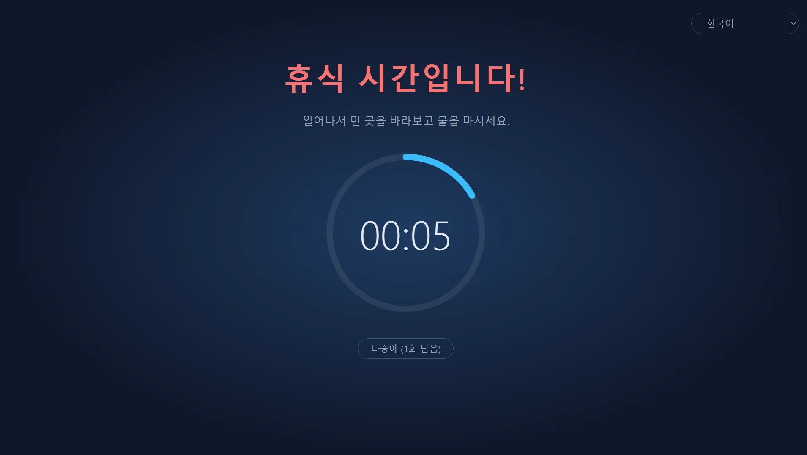
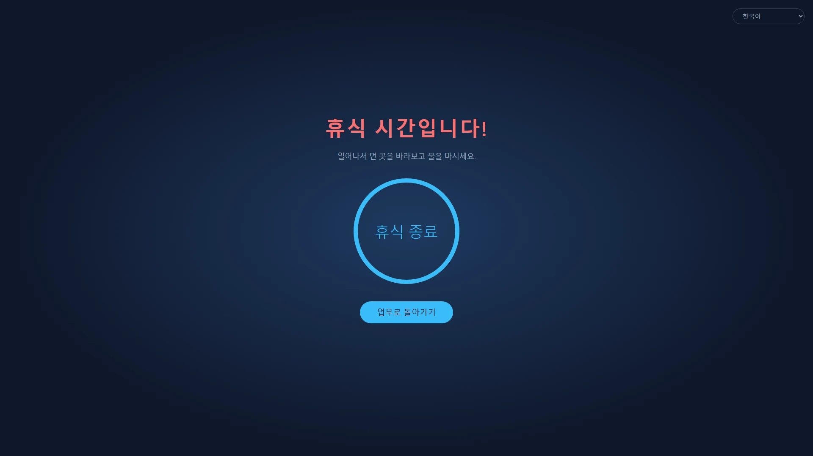
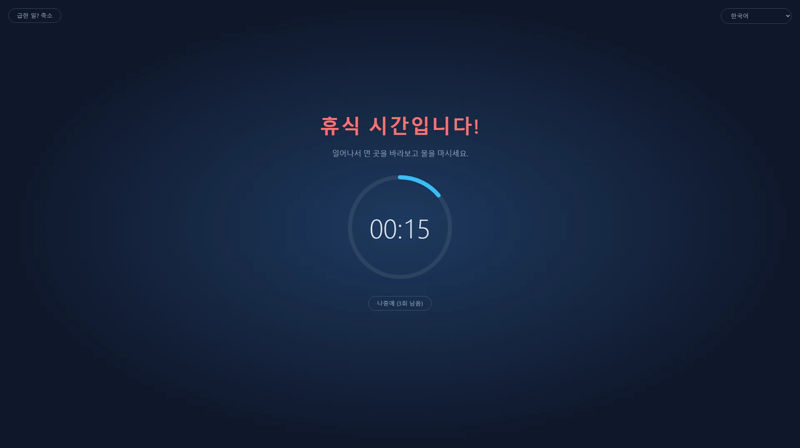
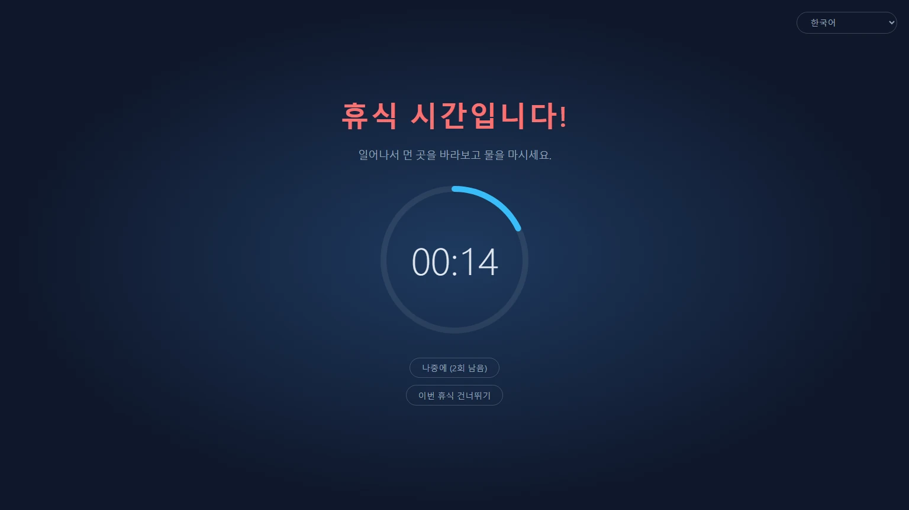
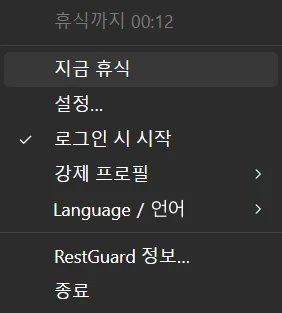

<p align="center">
  
</p>

<h1 align="center">RestGuard</h1>

<p align="center"><strong>무시할 수 없는 휴식 알리미.</strong></p>

<p align="center">Windows, macOS, Linux용 무료 오픈 소스 휴식 알리미로, 휴식을 알려 줄 수도 있고 쉬게 만들 수도 있습니다.</p>

<p align="center">
  <a href="https://github.com/HansTanzi/RestGuard/releases/latest"></a>
  <a href="https://github.com/HansTanzi/RestGuard/releases"></a>
  <a href="#설치"></a>
  <a href="#windows"></a>
  <a href="#라이선스"></a>
</p>

<p align="center">
  설치: <a href="#windows"><b>Windows</b></a> · <a href="#macos"><b>macOS</b></a> · <a href="#linux"><b>Linux</b></a> · <a href="https://hanstanzi.github.io/RestGuard/">웹사이트</a>
</p>

<p align="center"><a href="README.md">English</a> | <a href="README.zh-CN.md">简体中文</a> | <a href="README.de.md">Deutsch</a> | <a href="README.ja.md">日本語</a> | <a href="README.es.md">Español</a> | <a href="README.pt-BR.md">Português (Brasil)</a> | 한국어</p>



세 가지 강제 수준이 내장된 크로스 플랫폼 휴식 알리미입니다. 휴식을 알려 주기만 할 수도 있고, 실제로 쉬게 만들 수도 있습니다. 이 강제력이 다른 휴식 알리미와 가장 다른 점입니다.

- 높음: 휴식을 하도록 할 수 있는 모든 것을 합니다.
- 보통: 일은 계속할 수 있지만, 불편하게 만들어 자연스럽게 쉬도록 유도합니다.
- 낮음: 다른 휴식 알리미처럼 주로 알려 주기만 합니다.

Rust + Tauri 2 + Svelte로 만들었습니다. 제작자가 예전에 오픈 소스로 공개한 Windows 전용 C# 앱 [ProtectEyes](https://github.com/HansTanzi/ProtectEyes)의 후속작입니다.

한 줄로 설치:

```sh
winget install HansTanzi.RestGuard            # Windows
brew install --cask hanstanzi/tap/restguard   # macOS
```

APT, Scoop, Linux용 Homebrew, 포터블 다운로드는 [설치](#설치)를 참고하세요.

## 왜 RestGuard인가

대부분의 휴식 알리미는 쉽게 무시할 수 있습니다. 알림이 뜨면 닫아 버리고, "5분만 더"가 두 시간이 됩니다. 오랜 시간 화면을 보는 것은 눈의 피로, 안구 건조, 목과 허리 통증, 반복성 긴장 장애(RSI)와 관련이 있습니다. 20-20-20 규칙이나 한 시간마다 잠깐 쉬라는 조언도 실제로 쉬어야 의미가 있습니다.

RestGuard는 쉬어야 한다는 걸 알면서도 자꾸 미루는 사람을 위한 앱입니다.

- **클릭 한 번으로 닫을 수 없습니다.** 높음에서는 휴식이 끝날 때까지 오버레이가 모든 화면을 덮습니다.
- **방해하면 안 되는 때를 압니다.** 미루기, 긴급 모드, 회의 감지 덕분에 휴식이 통화를 망치거나 저장하지 않은 작업을 날리지 않습니다.
- **얼마나 엄격할지는 직접 정합니다.** 높음, 보통, 낮음 중에서 고르거나 나만의 프로필을 만드세요.

## 기능

### 진짜로 쉬게 만드는 휴식

- 60분 일할 때마다 10분 휴식을 강제합니다(두 시간 모두 조절 가능)
- 다중 모니터: 모든 화면을 덮습니다
- 휴식 중에는 오버레이를 닫을 수 없고(Alt+F4도 통하지 않음), 트레이에서 종료할 수도 없습니다
- 5분씩 최대 3번까지 미룰 수 있으며, 휴식을 끝까지 마치면 횟수가 초기화됩니다
- 긴급 모드: 급한 일이 있나요? 잠시 오버레이를 줄여 작업을 저장할 수 있습니다. 카운트다운은 계속 진행됩니다



### 상황에 맞는 세 가지 기본 프로필

| | 높음 | 보통(기본값) | 낮음 |
|---|:---:|:---:|:---:|
| 이런 분께 | 엄격한 자기 관리, "5분만 더"를 끊고 싶을 때 | 일상 업무 | 가볍게 알려 주기만 원할 때 |
| 미루기 횟수 | 1 | 3 | 3 |
| 긴급 모드(오버레이 축소) | ✗ | ✓ | ✓ |
| 회의 앱 감지 | ✗ | ✓ | ✓ |
| 이번 휴식 닫기/건너뛰기 | ✗ | ✗ | ✓ |
| 화면 덮는 비율 | 100% | 100% | 80% |
| 오버레이 드래그 | ✗ | ✓ | ✓ |





### 세세한 사용자 지정

기본 프로필이 맞지 않으면 설정에서 **새 사용자 지정…** 항목을 선택해 아무 프로필에서 시작하고, 이름을 붙인 뒤(나중에 이름 변경이나 삭제 가능) 각 옵션을 조정하세요:

- 미루기 횟수, 종료 허용 여부, 이번 휴식 건너뛰기 허용 여부
- 긴급 모드 사용 여부와 오버레이를 얼마나 줄일지
- 오버레이가 각 화면을 덮는 비율(10% ~ 100%)과 해당 화면 안에서 드래그할 수 있는지
- 회의 앱 감지 여부

사용자 지정 프로필은 원하는 만큼 만들고 언제든 바꿀 수 있습니다. 작업, 휴식, 미루기, 자리 비움 시간은 모든 프로필이 공유합니다. 파일을 직접 편집하는 쪽이 편하다면 [`config.toml`](#설정)도 쓸 수 있습니다.

### 중요한 순간에는 방해하지 않음

- 회의 감지(Windows, macOS): Zoom, Microsoft Teams, Webex, Tencent Meeting이 앞에 떠 있는 동안(Windows에서는 마이크를 사용하는 동안에도) 휴식은 회의가 끝날 때까지 기다립니다. 휴식 중에 "… 회의 중이에요"를 클릭하면 15분 후에 다시 알려 줍니다
- 자리 비움 감지: 키보드나 마우스 입력이 5분 동안 없으면 자리를 비운 것으로 보고 작업 카운트다운을 멈춥니다. 휴식 시간만큼 자리를 비웠다면 휴식을 마친 것으로 치기 때문에, 돌아오자마자 휴식하라고 하지 않습니다

### 휴식이 끝나는 순간을 놓치지 않음

- 휴식이 끝나면 소리가 납니다: 기본 소리나 원하는 오디오 파일을 고르세요
- 휴대폰 알림: [ntfy](https://ntfy.sh)를 통해 휴대폰(Android, iOS)으로 푸시 알림을 받아, 자리를 떠나 있어도 돌아갈 때를 알 수 있습니다. Android에서는 끌 때까지 알람처럼 울리게 할 수 있습니다
- 스마트워치: 휴대폰 알림이 페어링된 Apple Watch, Wear OS, Galaxy Watch, 샤오미·화웨이·가민 등의 시계나 밴드로 전달되므로 손목만 보면 됩니다([휴대폰과 스마트워치 알림](#휴대폰과-스마트워치-알림) 참고)

### 작고 가벼움

- Rust + Tauri 2로 시스템 WebView를 사용하고 브라우저 엔진을 포함하지 않아, 백그라운드에서 자원을 거의 쓰지 않습니다
- 아주 작음: 다운로드 크기가 3~6MB 정도로, Electron 기반 대안보다 수십 배 작습니다([다른 앱과 비교](#다른-앱과-비교) 참고)
- 포터블: Windows는 exe 파일 하나, macOS는 압축을 풀면 바로 실행되는 `.app`. 지우면 제거 끝입니다

### 그 밖에

- 크로스 플랫폼: Windows, macOS, Linux를 지원하며 WinGet, Scoop, Homebrew, APT로 설치와 업데이트가 가능합니다([설치](#설치) 참고)
- 트레이 메뉴: 남은 시간, 지금 휴식, 설정, 로그인 시 시작, 강제 프로필 전환
- 단일 인스턴스
- 관대한 MIT / Apache-2.0 이중 라이선스의 무료 오픈 소스([라이선스](#라이선스) 참고)
- 중국어 간체, 영어, 힌디어, 스페인어, 아랍어, 프랑스어, 벵골어, 포르투갈어, 독일어, 일본어, 이탈리아어, 한국어, 인도네시아어를 지원합니다. 화면 언어는 기본적으로 시스템을 따르며(지원하지 않는 언어면 영어), 트레이 메뉴의 "语言 / Language" 하위 메뉴에서 언제든 바꿀 수 있습니다



## 다른 앱과 비교

| | RestGuard | [Stretchly](https://github.com/hovancik/stretchly) | [Workrave](https://github.com/rcaelers/workrave) | [Safe Eyes](https://github.com/slgobinath/SafeEyes) |
|---|:---:|:---:|:---:|:---:|
| Windows | ✓ | ✓ | ✓ | ✗ |
| macOS | ✓ | ✓ | ✗ | ✗ |
| Linux | ✓ | ✓ | ✓ | ✓ |
| 다운로드 크기 | **약 3~6MB** | Windows 163MB<br>macOS 187MB<br>Linux 155MB | Windows 61MB<br>Linux 64MB| Linux 0.3MB |
| 강제력 | 3단계 + 사용자 지정 프로필 | 엄격 모드 켜기/끄기 | 입력과 화면 차단 가능 | 키보드 비활성화 가능 |
| 회의 중 휴식 보류 | Zoom, Teams, Webex, Tencent Meeting 감지 | 방해 금지 모드 따름, 앱별 제외 | — | — |
| 휴식 종료 시 휴대폰 / 스마트워치 알림 | ✓ (ntfy) | — | — | — |
| 기술 | Rust + Tauri(시스템 WebView) | Electron(Chromium 포함) | C++ | Python + GTK |
| 라이선스 | MIT / Apache-2.0 | BSD-2-Clause | GPL-3.0 | GPL-3.0 |

—는 기본 제공되지 않음을 뜻합니다. 다운로드 크기는 각 프로젝트의 최신 GitHub 릴리스(Stretchly 1.22.1, Workrave 1.11.5, Safe Eyes 3.5.1) 기준이며, Windows 설치 파일 또는 exe, macOS 다운로드, Linux `.deb`입니다. 2026년 11월 기준 각 프로젝트의 문서를 바탕으로 했습니다. 잘못된 부분이 있으면 [이슈를 열어 주세요](https://github.com/HansTanzi/RestGuard/issues).

## 설치

### Windows

[WinGet](https://learn.microsoft.com/windows/package-manager/winget/)으로 설치:

```powershell
winget install HansTanzi.RestGuard
```

또는 [Scoop](https://scoop.sh)으로:

```powershell
scoop bucket add hanstanzi https://github.com/HansTanzi/scoop-bucket
scoop install hanstanzi/restguard
```

또는 [Releases](https://github.com/HansTanzi/RestGuard/releases/latest)에서 `RestGuard_<버전>_x64.exe`를 내려받아 실행하세요. 설치 프로그램이 없는 포터블 단일 exe라서 원하는 곳에 두면 되고, 지우면 제거됩니다. 자동으로 업데이트되지 않으니 새 버전을 내려받아 업데이트하세요.

WebView2 런타임이 필요합니다(Windows 11에는 기본 설치됨).

### macOS

[Homebrew](https://brew.sh)로 설치(Apple Silicon과 Intel용 유니버설 빌드):

```sh
brew install --cask hanstanzi/tap/restguard
```

예전에 이 저장소를 tap으로 추가했다면(`brew tap hanstanzi/restguard https://github.com/HansTanzi/RestGuard`), 계속 업데이트를 받으려면 새 tap으로 바꾸세요: `brew untap hanstanzi/restguard && brew install --cask hanstanzi/tap/restguard`.

또는 [Releases](https://github.com/HansTanzi/RestGuard/releases/latest)에서 `RestGuard_<버전>_universal.zip`을 내려받아 압축을 풀고 `RestGuard.app`을 `/Applications`로 옮기세요. 자동으로 업데이트되지 않으니 새 버전을 내려받아 업데이트하세요.

RestGuard는 메뉴 막대에 있으며 Dock 아이콘은 없습니다. 이 앱은 Apple 공증을 받지 않았으며, cask는 설치할 때 격리 속성을 제거합니다. zip을 직접 내려받았다면 처음 실행하기 전에 `xattr -dr com.apple.quarantine /Applications/RestGuard.app`을 실행하세요. 그렇지 않으면 macOS가 앱을 열지 않습니다.

### Linux

Debian/Ubuntu(x86_64)에서는 [APT 저장소](https://github.com/HansTanzi/apt)를 추가한 뒤 `apt`로 설치하고 업데이트하세요:

```sh
sudo install -d /etc/apt/keyrings
curl -fsSL https://hanstanzi.github.io/apt/hanstanzi.gpg | sudo tee /etc/apt/keyrings/hanstanzi.gpg > /dev/null
echo "deb [signed-by=/etc/apt/keyrings/hanstanzi.gpg] https://hanstanzi.github.io/apt stable main" | sudo tee /etc/apt/sources.list.d/hanstanzi.list
sudo apt update && sudo apt install rest-guard
```

새 버전은 `sudo apt update && sudo apt upgrade`로 받습니다. [Releases](https://github.com/HansTanzi/RestGuard/releases/latest)의 `.deb`를 직접 설치할 수도 있지만(`sudo apt install ./RestGuard_*_amd64.deb`), 그러면 업데이트되지 않습니다.

다른 배포판은 [Releases](https://github.com/HansTanzi/RestGuard/releases/latest)에서 내려받으세요. Fedora/openSUSE에서는 `.rpm`을 설치합니다:

```sh
sudo dnf install ./RestGuard_*_x86_64.rpm      # Fedora
sudo zypper install ./RestGuard_*_x86_64.rpm   # openSUSE
```

Arch에서는 `.pkg.tar.zst`를 설치합니다:

```sh
sudo pacman -U ./RestGuard_*_x86_64.pkg.tar.zst
```

어떤 배포판(x86_64, glibc 2.35 이상)에서든 [Homebrew](https://brew.sh)로 설치하고 업데이트할 수도 있습니다. Homebrew는 시스템 라이브러리를 설치하지 못하므로, 먼저 배포판의 패키지 관리자로 WebKitGTK 4.1과 libayatana-appindicator를 설치하세요:

```sh
sudo apt install libwebkit2gtk-4.1-0 libayatana-appindicator3-1                 # Debian/Ubuntu
sudo dnf install webkit2gtk4.1 libayatana-appindicator-gtk3                     # Fedora
sudo pacman -S webkit2gtk-4.1 libayatana-appindicator                           # Arch
sudo zypper install libwebkit2gtk-4_1-0 libayatana-appindicator3-1              # openSUSE

brew install --cask hanstanzi/tap/restguard
```

이 방법은 `restguard` 실행 파일만 설치하고 앱 메뉴 항목은 만들지 않습니다. `restguard`를 한 번 실행한 뒤 트레이 메뉴에서 "로그인 시 시작"을 켜세요. 새 버전은 `brew upgrade`로 받습니다.

오버레이는 X11이 필요합니다([플랫폼별 제한](#플랫폼별-제한) 참고).

### 다운로드 검증

v0.1.14 이후의 릴리스 파일은 GitHub Actions로 빌드되며, 각 파일을 빌드한 워크플로 실행 및 커밋과 연결하는 서명된 [빌드 출처 증명(build provenance attestation)](https://docs.github.com/actions/security-for-github-actions/using-artifact-attestations)이 붙어 있습니다. [GitHub CLI](https://cli.github.com)로 내려받은 파일을 확인하려면:

```sh
gh attestation verify RestGuard_<버전>_x64.exe --repo HansTanzi/RestGuard
```

각 릴리스에는 `SHA256SUMS.txt`도 들어 있어 GitHub CLI 없이도 확인할 수 있습니다. 내려받은 파일을 `SHA256SUMS.txt`와 같은 디렉터리에 두고 실행하세요:

```sh
sha256sum -c SHA256SUMS.txt --ignore-missing          # Linux
shasum -a 256 -c SHA256SUMS.txt --ignore-missing      # macOS
```

Windows에서는 `Get-FileHash .\RestGuard_*_x64.exe`의 출력을 `SHA256SUMS.txt`의 해당 줄과 비교하세요(대소문자는 구분하지 않음).

### 소스에서 빌드

[CONTRIBUTING.md](CONTRIBUTING.md#development-setup)에 나온 필수 요소를 설치한 뒤, 태그가 붙은 버전을 빌드하세요:

```sh
git clone https://github.com/HansTanzi/RestGuard
cd RestGuard
git checkout v<버전>
pnpm install --frozen-lockfile
pnpm tauri build --no-bundle
```

실행 파일은 `src-tauri/target/release/restguard`(Windows에서는 `restguard.exe`)입니다. `cargo build`가 아니라 `pnpm tauri build`로 빌드하세요. Cargo만으로 빌드하면 개발 빌드가 되어 UI를 `localhost:1420`에서 불러오므로 빈 창이 표시됩니다.

## 설정

트레이 메뉴의 **설정…** 창에서 시간, 강제 수준, 오버레이 덮는 비율, 언어, 로그인 시 시작을 바꿀 수 있습니다. 변경 사항은 바로 적용됩니다(휴식 중에는 설정이 잠깁니다). 작업 시간을 바꾸면 현재 작업 카운트다운이 처음부터 다시 시작됩니다.

설정은 처음 실행할 때 만들어지는 `config.toml`에 저장됩니다. 직접 편집해도 되며, 편집한 뒤에는 앱을 다시 시작하세요.

| OS | 경로 |
|---|---|
| Windows | `%APPDATA%\io.github.restguard\config.toml` |
| macOS | `~/Library/Application Support/io.github.restguard/config.toml` |
| Linux | `~/.config/io.github.restguard/config.toml` |

```toml
work_minutes = 60.0      # 강제 휴식 전까지 일하는 시간
rest_minutes = 10.0      # 한 번의 휴식 시간
postpone_minutes = 5.0   # 한 번 미룰 때의 시간
idle_minutes = 5.0       # 이 시간 동안 입력이 없으면 자리 비움, 0 = 끔
level = "medium"         # "high", "medium", "low" 또는 사용자 지정 프로필 이름
sound_prompt = true      # 휴식이 끝나면 소리 재생
sound = "beep"           # "beep", "chime", "rise" 또는 "file"(sound_file 재생)
sound_file = ""          # 직접 고른 오디오 파일의 전체 경로, sound = "file"일 때 사용
phone_notify = false     # 휴식이 끝나면 ntfy로 휴대폰에 알림
ntfy_server = "https://ntfy.sh"  # ntfy 서버, 공개 서버나 직접 운영하는 서버
ntfy_topic = ""          # ntfy 앱에서 구독할 토픽, 추측하기 어렵게

[[fixed_breaks]]         # 고정 휴식, "work_end"(퇴근)와 "lunch"는 기본 제공
name = "work_end"
enabled = false          # 바로 직전에 오는 휴식은 보류
time = "18:00"           # 현지 시간 기준 24시간제 HH:MM
quiet_minutes = 30.0     # time 전 이 시간 안에 오는 휴식은 time까지 기다림

[[fixed_breaks]]         # 점심: time에 rest_minutes만큼 휴식 시작
name = "lunch"
enabled = true
time = "12:00"
quiet_minutes = 30.0
rest_minutes = 30.0      # 휴식 시간(점심과 직접 추가한 고정 휴식). 일반 휴식 시간이 지나면 컴퓨터를 계속 사용할 수 있음

[[fixed_breaks]]         # 직접 추가(예: 티타임)하려면 하나당 [[fixed_breaks]] 하나
name = "Tea break"
enabled = true
time = "15:00"
quiet_minutes = 15.0
rest_minutes = 15.0

[[profiles]]             # 사용자 지정 프로필, 하나당 [[profiles]] 하나
name = "Focus"
max_postpones = 1        # 휴식을 끝까지 해야 하기 전까지 최대 미루기 횟수
urgent_mode = false      # 오버레이 축소 허용
meeting_detection = true # Zoom, Teams 등을 쓰는 동안 휴식 보류
force_rest = true        # false = 오버레이를 닫을 수 있음
allow_skip = false       # 휴식을 강제해도 "이번 휴식 건너뛰기" 제공
overlay_coverage = 1.0   # 각 화면을 덮는 비율, 0.1 ~ 1.0
urgent_scale = 0.5       # 긴급 모드(축소된 오버레이)에서 위 값에 곱하는 비율, 0.1 ~ 0.9
movable = false          # 전체 화면이 아닐 때 오버레이를 해당 화면 안에서 드래그 허용
```

### 휴대폰과 스마트워치 알림

1. 휴대폰에 ntfy 앱을 설치하세요([Android](https://play.google.com/store/apps/details?id=io.heckel.ntfy), [F-Droid](https://f-droid.org/packages/io.heckel.ntfy/), [iOS](https://apps.apple.com/app/ntfy/id1625396347))
2. RestGuard 설정에서 "휴식이 끝나면 휴대폰으로 알림(ntfy)"을 켜고, 추측하기 어려운 토픽(영문자, 숫자, `-`, `_`만)을 입력하세요. 서버는 기본적으로 공개 서버 `https://ntfy.sh`이며, 직접 운영하는 서버를 써도 됩니다
3. ntfy 앱에서 같은 서버와 토픽을 구독한 뒤 "테스트 알림 보내기"를 클릭해 알림이 오는지 확인하세요

알림은 가장 높은 우선순위로 보내집니다. Android에서는 ntfy 설정에서 "Keep alerting for highest priority"를 켜면 끌 때까지 알람처럼 울립니다. iOS에서는 집중 모드를 뚫는 '시간 민감한 알림'으로 표시됩니다(ntfy에 시간 민감한 알림을 허용한 경우). 공개 서버에서는 토픽을 아는 사람 누구나 구독할 수 있으니 토픽은 비밀로 하세요.

시계에는 아무것도 설치할 필요가 없으며, 시스템이 휴대폰 알림을 시계로 전달합니다:

| 시계 | 설정 |
|---|---|
| Apple Watch | iPhone의 Watch 앱에서 알림으로 가서 ntfy의 "iPhone 알림 미러링"을 켜세요. iPhone이 잠겨 있거나 화면이 꺼져 있을 때만 시계로 알림이 갑니다 |
| Wear OS / Galaxy Watch | 기본으로 전달됩니다. 시계의 알림 설정에서 ntfy가 꺼져 있지 않은지 확인하세요 |
| 샤오미, 화웨이, 가민, Amazfit 등 | 연동 앱(Zepp, Huawei Health, Garmin Connect 등)의 앱 알림 목록에서 ntfy를 허용하세요 |

참고:

- 시계는 한 번만 진동하며, 휴대폰처럼 계속 울리지 않습니다
- 시계가 알림을 받으려면 휴대폰이 온라인이고 ntfy가 백그라운드에서 실행 중이어야 합니다. 휴대폰 없이 단독으로 쓰는 시계에는 오지 않습니다
- 직접 운영하는 서버를 쓰면, iOS에서 알림을 즉시 받으려면 서버 설정에 `upstream-base-url: "https://ntfy.sh"`가 필요합니다([ntfy 문서](https://docs.ntfy.sh/config/#ios-instant-notifications) 참고)

## 플랫폼별 제한

- **macOS**: 강제 종료(`Cmd+Option+Esc`) 같은 시스템 수준 동작은 막을 수 없습니다
- **Linux**: 자리 비움 감지에는 GNOME이나 `org.freedesktop.ScreenSaver`를 구현한 데스크톱(예: KDE Plasma)과 `gdbus`가 필요합니다. 없으면 꺼집니다
- **Linux**: 소리는 `paplay`, `pw-play`, `aplay`로 재생하므로 직접 고른 파일은 wav, ogg, flac을 쓰세요(mp3는 지원하지 않음)
- **Linux Wayland**: 프로토콜상 앱이 창을 항상 위에 두거나 직접 위치를 정할 수 없어 오버레이가 제대로 동작하지 않을 수 있습니다. X11에서는 문제없습니다

## 자주 묻는 질문

**RestGuard를 종료할 수 있나요?**
휴식과 휴식 사이에는 가능합니다. 트레이 메뉴에서 "종료"를 선택하세요. 휴식 중이거나 미룬 휴식이 아직 남아 있는 동안에는 "종료"가 비활성화됩니다.

**회의 중에 휴식 시간이 되면요?**
보통과 낮음에서는 Zoom, Microsoft Teams, Webex, Tencent Meeting이 앞에 떠 있는 동안(Windows, macOS. Windows에서는 마이크를 사용하는 동안에도) 휴식이 기다립니다. 이미 휴식이 시작됐다면 "… 회의 중이에요"를 클릭해 15분 후에 다시 알림을 받으세요. 높음에서는 휴식이 기다리지 않습니다.

**급한 일을 하는 중이에요. 작업을 잃게 되나요?**
휴식을 5분 미룰 수 있습니다(보통과 낮음은 최대 3번, 높음은 1번). 보통과 낮음에서는 긴급 모드로 오버레이를 줄여, 카운트다운이 계속되는 동안 작업을 저장할 수도 있습니다.

**컴퓨터를 떠나 있는 시간도 작업 시간으로 계산되나요?**
아니요. 키보드나 마우스 입력이 5분 동안 없으면 작업 카운트다운이 멈추고, 휴식 시간만큼 자리를 비웠다면 휴식을 한 번 한 것으로 칩니다.

**macOS에서 앱을 열 수 없다고 나와요.**
RestGuard는 Apple 공증을 받지 않았습니다. Homebrew로 설치하거나 `xattr -dr com.apple.quarantine /Applications/RestGuard.app`을 한 번 실행하세요([macOS](#macos) 참고).

**Wayland에서 작동하나요?**
안정적이지 않습니다. Wayland는 앱이 자기 창을 맨 위에 유지하도록 허용하지 않으므로 X11 세션을 사용하세요([플랫폼별 제한](#플랫폼별-제한) 참고).

**데이터를 수집하나요?**
아니요. [개인정보](#개인정보)를 참고하세요.

## 기여하기

버그 신고, 아이디어, 번역, 풀 리퀘스트 모두 환영합니다. 개발 환경 설정, PR 전 확인 사항, 번역 개선 방법은 [CONTRIBUTING.md](CONTRIBUTING.md)(영어)에, 버전별 변경 사항은 [CHANGELOG.md](CHANGELOG.md)에 있습니다. 보안 문제는 [SECURITY.md](SECURITY.md)에 설명된 대로 비공개로 알려 주세요.

RestGuard가 쉬는 습관에 도움이 됐다면 ⭐를 눌러 주세요. 다른 사람들이 찾는 데 도움이 됩니다.

[](https://github.com/HansTanzi/RestGuard/graphs/contributors)

[](https://star-history.com/#HansTanzi/RestGuard&Date)

## 개인정보

RestGuard는 어떤 데이터도 수집하지 않습니다. 계정, 분석, 원격 측정이 없습니다. 인터넷에 연결하는 것은 선택 기능인 ntfy 휴대폰 알림을 보낼 때뿐입니다. 자세한 내용은 [개인정보 처리방침](https://hanstanzi.github.io/RestGuard/privacy.html)(영어)을 참고하세요.

## 라이선스

[MIT](LICENSE-MIT) 또는 [Apache-2.0](LICENSE-APACHE) 중 원하는 것을 선택해 사용할 수 있습니다.
