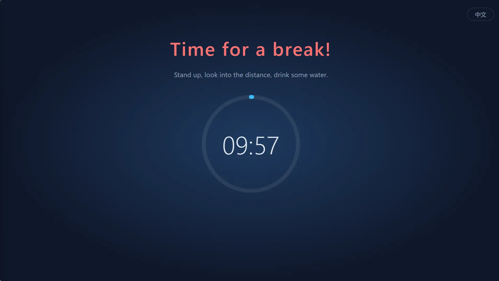

# RestGuard

English | [简体中文](README.zh-CN.md)

A cross-platform break reminder that actually makes you rest: after each work session, a full-screen overlay forces you to take a break, and it can't be closed until the countdown ends.

Built with Rust + Tauri 2 + Svelte. Successor to the Windows-only C# app [ProtectEyes](./ProtectEyes).



## Features

- Forces a 10-minute break after every 60 minutes of work (configurable)
- Multi-monitor: every screen is covered
- The overlay can't be closed during a break (Alt+F4 does nothing), and you can't quit from the tray
- Postpone for 5 minutes, up to 3 times; the count resets after a full break
- Enforcement levels: **High** (no postpones, no urgent shrink, no meeting-app detection), **Medium** (default, as described here) and **Low** (no forced break, the overlay can be closed); you can also create your own named profiles
- Idle detection: after 5 minutes without keyboard or mouse input you count as away and the work countdown pauses; being away as long as a break counts as a full break, so you aren't sent to rest right after coming back
- Tray menu: time remaining, rest now, settings, start at login
- Single instance
- Available in Simplified Chinese, English, Hindi, Spanish, Arabic, French, Bengali, Portuguese, German, Japanese, Italian, Korean and Indonesian. The UI language follows the system by default (English if the system language isn't supported); switch it any time from the tray menu's "语言 / Language" submenu

## Install

### Windows

Install with [WinGet](https://learn.microsoft.com/windows/package-manager/winget/):

```powershell
winget install HansTanzi.RestGuard
```

Or with [Scoop](https://scoop.sh):

```powershell
scoop bucket add hanstanzi https://github.com/HansTanzi/scoop-bucket
scoop install hanstanzi/restguard
```

Requires the WebView2 runtime (preinstalled on Windows 11).

### macOS

Install with [Homebrew](https://brew.sh) (universal build for Apple Silicon and Intel):

```sh
brew install --cask hanstanzi/tap/restguard
```

If you tapped this repository before (`brew tap hanstanzi/restguard https://github.com/HansTanzi/RestGuard`), switch to the new tap to keep getting updates: `brew untap hanstanzi/restguard && brew install --cask hanstanzi/tap/restguard`.

RestGuard lives in the menu bar and has no Dock icon. The app isn't notarized by Apple; the cask removes the quarantine flag on install. If you download the zip from Releases by hand, run `xattr -dr com.apple.quarantine /Applications/RestGuard.app` before first launch.

### Linux

On Debian/Ubuntu (x86_64), add the [APT repository](https://github.com/HansTanzi/apt), then install and update with `apt`:

```sh
sudo install -d /etc/apt/keyrings
curl -fsSL https://hanstanzi.github.io/apt/hanstanzi.gpg | sudo tee /etc/apt/keyrings/hanstanzi.gpg > /dev/null
echo "deb [signed-by=/etc/apt/keyrings/hanstanzi.gpg] https://hanstanzi.github.io/apt stable main" | sudo tee /etc/apt/sources.list.d/hanstanzi.list
sudo apt update && sudo apt install rest-guard
```

Later versions arrive with `sudo apt update && sudo apt upgrade`. You can also install the `.deb` from [Releases](https://github.com/HansTanzi/RestGuard/releases/latest) directly (`sudo apt install ./RestGuard_*_amd64.deb`), but then it won't update.

For other distros, download from [Releases](https://github.com/HansTanzi/RestGuard/releases/latest). On Fedora/openSUSE, install the `.rpm`:

```sh
sudo dnf install ./RestGuard_*_x86_64.rpm      # Fedora
sudo zypper install ./RestGuard_*_x86_64.rpm   # openSUSE
```

On Arch, install the `.pkg.tar.zst`:

```sh
sudo pacman -U ./RestGuard_*_x86_64.pkg.tar.zst
```

The overlay needs X11 (see [Platform limitations](#platform-limitations)).

## Configuration

Open **Settings…** from the tray menu to change durations, the enforcement level, overlay coverage, language and start-at-login. Changes apply immediately (settings are locked during a break). Changing the work duration restarts the current work countdown.

Settings are stored in `config.toml`, created on first run. You can also edit it by hand; restart the app afterwards.

| OS | Path |
|---|---|
| Windows | `%APPDATA%\io.github.restguard\config.toml` |
| macOS | `~/Library/Application Support/io.github.restguard/config.toml` |
| Linux | `~/.config/io.github.restguard/config.toml` |

```toml
work_minutes = 60.0      # how long to work before a forced break
rest_minutes = 10.0      # how long each break lasts
postpone_minutes = 5.0   # how long each postpone lasts
idle_minutes = 5.0       # no input for this long counts as away, 0 = off
level = "medium"         # "high", "medium", "low", or the name of a custom profile

[[profiles]]             # a custom profile; add one [[profiles]] per profile
name = "Focus"
max_postpones = 1        # max postpones before a full break is required
urgent_mode = false      # allow shrinking the overlay
meeting_detection = true # hold breaks while Zoom, Teams etc. are in use
force_rest = true        # false = the overlay can be closed
overlay_coverage = 1.0   # fraction of each screen covered, 0.1 ~ 1.0
urgent_scale = 0.5       # urgent mode (shrunk overlay) scale relative to the above, 0.1 ~ 0.9
```

## Platform limitations

- **macOS**: system-level actions such as Force Quit (`Cmd+Option+Esc`) can't be blocked
- **Linux**: idle detection needs GNOME or a desktop implementing `org.freedesktop.ScreenSaver` (e.g. KDE Plasma), plus `gdbus`; otherwise it's off
- **Linux Wayland**: the protocol doesn't let apps keep themselves on top or position their own windows, so the overlay may not work; X11 is fine

## Development

Requires [Rust](https://rustup.rs), Node.js, pnpm, and [Tauri's system dependencies](https://tauri.app/start/prerequisites/).

```sh
pnpm install
pnpm tauri dev      # run in development
pnpm tauri build    # build installers
cd src-tauri && cargo test
```

Dev builds read `config.dev.toml` and `language.dev` (same directory as `config.toml`), so you can use short durations or switch languages without touching the installed app. Press `Esc` on the overlay to end a break immediately. Quit the installed RestGuard first, otherwise the single-instance check makes the dev build exit right away.

To release, run `pnpm release <version>` (e.g. `pnpm release 0.2.0`) on a clean `dev` branch. It bumps the version in `package.json`, `tauri.conf.json`, `Cargo.toml` and `Cargo.lock`, commits, and pushes a `v<version>` tag. GitHub Actions then builds the exe, a universal macOS `.app`, and the Linux `.deb`, `.rpm` and Arch `.pkg.tar.zst` (repackaged from the `.deb` with `src-tauri/arch/PKGBUILD`), creates the Release, and pushes the updated `bucket/restguard.json` to [HansTanzi/scoop-bucket](https://github.com/HansTanzi/scoop-bucket) and `Casks/restguard.rb` to [HansTanzi/homebrew-tap](https://github.com/HansTanzi/homebrew-tap). This needs the repository secrets `SCOOP_BUCKET_DEPLOY_KEY` and `HOMEBREW_TAP_DEPLOY_KEY`: the private halves of deploy keys with write access on those repos. For stable versions it also triggers [HansTanzi/apt](https://github.com/HansTanzi/apt) to rebuild the APT repository from the latest releases; this needs an `APT_DISPATCH_TOKEN` repository secret (a fine-grained PAT limited to that repo with only Actions read and write). The signing key and setup are described in that repo. For stable versions it also opens a PR to [microsoft/winget-pkgs](https://github.com/microsoft/winget-pkgs) via [winget-releaser](https://github.com/vedantmgoyal9/winget-releaser); this needs a `WINGET_TOKEN` repository secret (a classic PAT with `public_repo` scope) and a fork of `winget-pkgs` under the token owner's account. The very first WinGet version must be submitted by hand, e.g. `komac new HansTanzi.RestGuard --version <version> --urls <exe release URL>` with [Komac](https://github.com/russellbanks/Komac) (pick the `portable` installer type and add `Microsoft.EdgeWebView2Runtime` as a package dependency).

### Microsoft Store

The Store build is an MSIX package; the Store signs it, so no code-signing certificate is needed. Run `pnpm msix` to build `src-tauri/target/msix/RestGuard_<version>_x64.msix` locally (needs the Windows SDK); the release workflow also builds it for stable versions and attaches it to the workflow run as the `msix` artifact. Upload it to a new submission in [Partner Center](https://partner.microsoft.com/dashboard).

One-time setup: reserve the app name in Partner Center, then copy `Package/Identity/Name`, `Package/Identity/Publisher` and `Package/Properties/PublisherDisplayName` from the app's **Product identity** page into `src-tauri/msix/AppxManifest.xml`. The package declares the restricted `runFullTrust` capability (required for desktop apps), so the submission asks for a justification, e.g. "Desktop app built with Tauri; needs full trust to show always-on-top break overlays on every screen".

Inside the package, start-at-login uses the manifest's `StartupTask` instead of the registry, since registry writes are virtualized there. To try the package without the Store, enable Developer Mode and run `Add-AppxPackage -Register src-tauri/target/msix/layout/AppxManifest.xml`.

For debugging, set `work_minutes` to `0.1` (6 seconds) to trigger a break quickly.

## License

Licensed under either of [MIT](LICENSE-MIT) or [Apache-2.0](LICENSE-APACHE), at your option.
