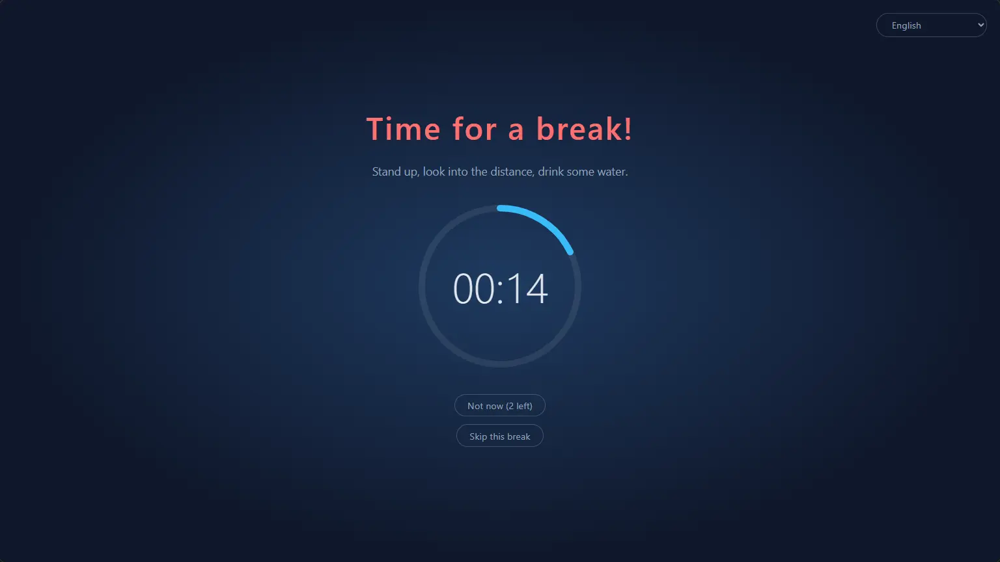
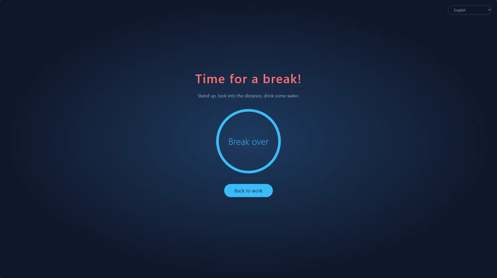
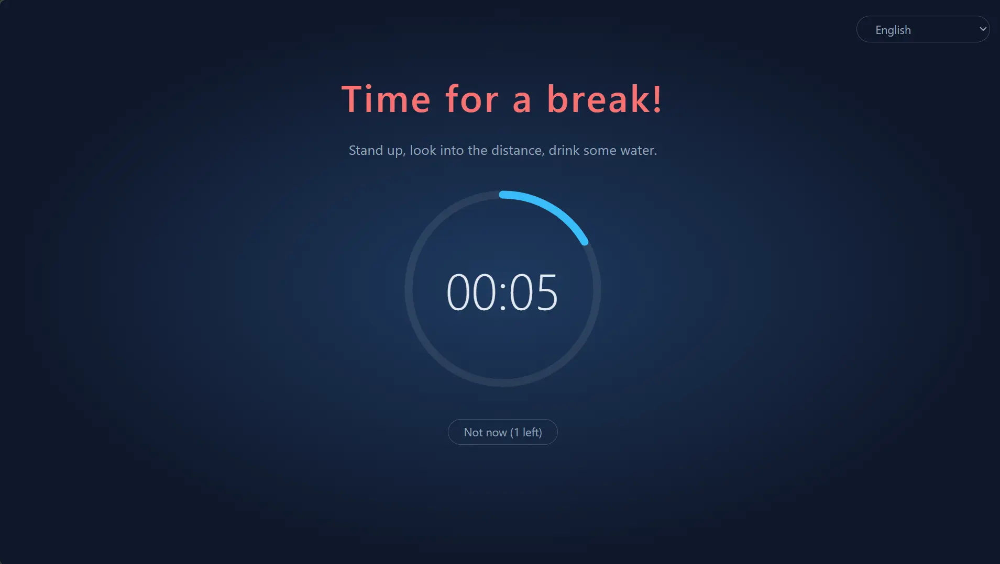
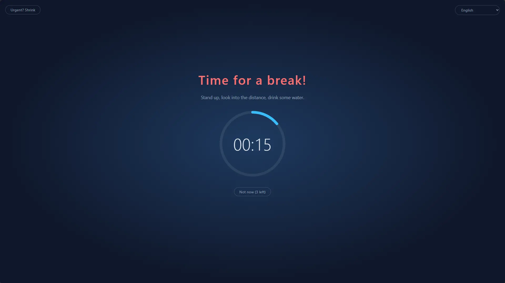
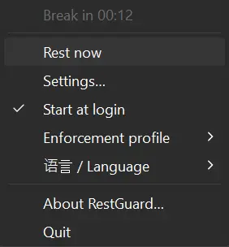

# RestGuard

English | [简体中文](README.zh-CN.md) | [Deutsch](README.de.md)

A cross-platform break reminder with three built-in enforcement levels: it can remind you to take a break, or make you take one. Enforcement is what sets it apart from other break reminders.

- High: does everything it can to make you take the break.
- Medium: you can still work, but it makes working uncomfortable enough to nudge you into resting.
- Low: like other break reminders, it mainly reminds you.

Built with Rust + Tauri 2 + Svelte. Successor to the Windows-only C# app [ProtectEyes](./ProtectEyes).



## Features

### Breaks that actually happen

- Forces a 10-minute break after every 60 minutes of work (both durations adjustable)
- Multi-monitor: every screen is covered
- The overlay can't be closed during a break (Alt+F4 does nothing), and you can't quit from the tray
- Postpone for 5 minutes, up to 3 times; the count resets after a full break
- Urgent mode: something can't wait? Shrink the overlay for a moment to save your work while the countdown keeps running



### Three built-in profiles for different needs

| | High | Medium (default) | Low |
|---|:---:|:---:|:---:|
| Best for | Strict discipline, beating "just five more minutes" | Everyday work | A gentle nudge |
| Postpones | 1 | 3 | 3 |
| Urgent mode (shrink overlay) | ✗ | ✓ | ✓ |
| Meeting-app detection | ✗ | ✓ | ✓ |
| Close / skip this break | ✗ | ✗ | ✓ |
| Screen coverage | 100% | 100% | 80% |
| Draggable overlay | ✗ | ✓ | ✓ |






### Highly customizable

When the built-ins don't fit, choose **New custom…** in Settings to start from any profile, give it a name (rename or delete it later), and tune each option:

- Number of postpones, whether exiting is allowed, whether skipping this break is allowed
- Whether urgent mode is available, and how small the overlay shrinks
- How much of each screen the overlay covers (10% ~ 100%), and whether it can be dragged within its screen
- Whether to detect meeting apps

Keep as many custom profiles as you like and switch any time. Work, break, postpone and idle durations are shared across profiles. If you prefer editing files by hand, [`config.toml`](#configuration) works too.

### Stays out of the way when it matters

- Meeting detection (Windows, macOS): while Zoom, Microsoft Teams, Webex or Tencent Meeting is in the foreground (or, on Windows, using the microphone), the break waits until the meeting is over; during a break you can also click "I'm in a meeting" to be reminded in 15 minutes
- Idle detection: after 5 minutes without keyboard or mouse input you count as away and the work countdown pauses; being away as long as a break counts as a full break, so you aren't sent to rest right after coming back

### Never miss the end of a break

- A sound plays when a break ends: pick a built-in one or your own audio file
- Phone notifications: get a push on your phone (Android, iOS) via [ntfy](https://ntfy.sh), so you know when to come back even after walking away; on Android it can ring like an alarm until you dismiss it
- Smartwatches: the phone notification is mirrored to a paired Apple Watch, Wear OS, Galaxy Watch, or a Xiaomi, Huawei, Garmin or similar watch or band, so a glance at your wrist is enough (see [Phone and smartwatch notifications](#phone-and-smartwatch-notifications))

### Small and fast

- Built with Rust + Tauri 2 on the system WebView, with no bundled browser engine, so it barely uses any resources while running in the background
- Tiny: downloads are just 2.5 ~ 4.6 MB (Windows 4.6 MB, macOS 4.0 MB, Linux 2.5 MB)
- Portable: a single exe on Windows, an unzip-and-run `.app` on macOS; delete it to uninstall

### And more

- Cross-platform: Windows, macOS and Linux, installable and updatable through WinGet, Scoop, Homebrew and APT (see [Install](#install))
- Tray menu: time remaining, rest now, settings, start at login, switch enforcement profile
- Single instance
- Free and open source under the permissive MIT / Apache-2.0 dual license (see [License](#license))
- Available in Simplified Chinese, English, Hindi, Spanish, Arabic, French, Bengali, Portuguese, German, Japanese, Italian, Korean and Indonesian. The UI language follows the system by default (English if the system language isn't supported); switch it any time from the tray menu's "语言 / Language" submenu



## Install

### Windows

Install with [WinGet](https://learn.microsoft.com/windows/package-manager/winget/):

```powershell
winget install HansTanzi.RestGuard
```

Or with [Scoop](https://scoop.sh):

```powershell
scoop bucket add hanstanzi https://github.com/HansTanzi/scoop-bucket
scoop install hanstanzi/restguard
```

Or download `RestGuard_<version>_x64.exe` from [Releases](https://github.com/HansTanzi/RestGuard/releases/latest) and run it. It's a portable single exe with no installer: put it anywhere you like and delete it to uninstall. It won't update on its own; download the new version to update.

Requires the WebView2 runtime (preinstalled on Windows 11).

### macOS

Install with [Homebrew](https://brew.sh) (universal build for Apple Silicon and Intel):

```sh
brew install --cask hanstanzi/tap/restguard
```

If you tapped this repository before (`brew tap hanstanzi/restguard https://github.com/HansTanzi/RestGuard`), switch to the new tap to keep getting updates: `brew untap hanstanzi/restguard && brew install --cask hanstanzi/tap/restguard`.

Or download `RestGuard_<version>_universal.zip` from [Releases](https://github.com/HansTanzi/RestGuard/releases/latest), unzip it and move `RestGuard.app` to `/Applications`. It won't update on its own; download the new version to update.

RestGuard lives in the menu bar and has no Dock icon. The app isn't notarized by Apple; the cask removes the quarantine flag on install. If you downloaded the zip by hand, run `xattr -dr com.apple.quarantine /Applications/RestGuard.app` before first launch, otherwise macOS won't open it.

### Linux

On Debian/Ubuntu (x86_64), add the [APT repository](https://github.com/HansTanzi/apt), then install and update with `apt`:

```sh
sudo install -d /etc/apt/keyrings
curl -fsSL https://hanstanzi.github.io/apt/hanstanzi.gpg | sudo tee /etc/apt/keyrings/hanstanzi.gpg > /dev/null
echo "deb [signed-by=/etc/apt/keyrings/hanstanzi.gpg] https://hanstanzi.github.io/apt stable main" | sudo tee /etc/apt/sources.list.d/hanstanzi.list
sudo apt update && sudo apt install rest-guard
```

Later versions arrive with `sudo apt update && sudo apt upgrade`. You can also install the `.deb` from [Releases](https://github.com/HansTanzi/RestGuard/releases/latest) directly (`sudo apt install ./RestGuard_*_amd64.deb`), but then it won't update.

For other distros, download from [Releases](https://github.com/HansTanzi/RestGuard/releases/latest). On Fedora/openSUSE, install the `.rpm`:

```sh
sudo dnf install ./RestGuard_*_x86_64.rpm      # Fedora
sudo zypper install ./RestGuard_*_x86_64.rpm   # openSUSE
```

On Arch, install the `.pkg.tar.zst`:

```sh
sudo pacman -U ./RestGuard_*_x86_64.pkg.tar.zst
```

On any distro (x86_64, glibc 2.35+), you can also install and update with [Homebrew](https://brew.sh). Homebrew can't install system libraries, so install WebKitGTK 4.1 and libayatana-appindicator with your distro's package manager first:

```sh
sudo apt install libwebkit2gtk-4.1-0 libayatana-appindicator3-1                 # Debian/Ubuntu
sudo dnf install webkit2gtk4.1 libayatana-appindicator-gtk3                     # Fedora
sudo pacman -S webkit2gtk-4.1 libayatana-appindicator                           # Arch
sudo zypper install libwebkit2gtk-4_1-0 libayatana-appindicator3-1              # openSUSE

brew install --cask hanstanzi/tap/restguard
```

This installs only the `restguard` executable, with no app menu entry: run `restguard` once, then turn on "Start at login" from the tray menu. Later versions arrive with `brew upgrade`.

The overlay needs X11 (see [Platform limitations](#platform-limitations)).

### Verify downloads

Release files after v0.1.14 are built by GitHub Actions and carry a signed [build provenance attestation](https://docs.github.com/actions/security-for-github-actions/using-artifact-attestations) linking each file to the workflow run and commit that built it. To check a downloaded file with the [GitHub CLI](https://cli.github.com):

```sh
gh attestation verify RestGuard_<version>_x64.exe --repo HansTanzi/RestGuard
```

Each Release also includes `SHA256SUMS.txt`, for checking a download without the GitHub CLI. Put the downloaded file in the same directory as `SHA256SUMS.txt` and run:

```sh
sha256sum -c SHA256SUMS.txt --ignore-missing          # Linux
shasum -a 256 -c SHA256SUMS.txt --ignore-missing      # macOS
```

On Windows, compare the output of `Get-FileHash .\RestGuard_*_x64.exe` with the matching line in `SHA256SUMS.txt` (case doesn't matter).

### Build from source

Install the prerequisites listed under [Development](#development), then build a tagged version:

```sh
git clone https://github.com/HansTanzi/RestGuard
cd RestGuard
git checkout v<version>
pnpm install --frozen-lockfile
pnpm tauri build --no-bundle
```

The executable is `src-tauri/target/release/restguard` (`restguard.exe` on Windows). Build with `pnpm tauri build`, not `cargo build`: a plain Cargo build is a dev build that loads the UI from `localhost:1420` and shows blank windows.

## Configuration

Open **Settings…** from the tray menu to change durations, the enforcement level, overlay coverage, language and start-at-login. Changes apply immediately (settings are locked during a break). Changing the work duration restarts the current work countdown.

Settings are stored in `config.toml`, created on first run. You can also edit it by hand; restart the app afterwards.

| OS | Path |
|---|---|
| Windows | `%APPDATA%\io.github.restguard\config.toml` |
| macOS | `~/Library/Application Support/io.github.restguard/config.toml` |
| Linux | `~/.config/io.github.restguard/config.toml` |

```toml
work_minutes = 60.0      # how long to work before a forced break
rest_minutes = 10.0      # how long each break lasts
postpone_minutes = 5.0   # how long each postpone lasts
idle_minutes = 5.0       # no input for this long counts as away, 0 = off
work_end_enabled = false # hold off breaks that fall due just before the end of the working day
work_end = "18:00"       # end of the working day, 24-hour HH:MM in local time
work_end_skip_minutes = 30.0  # breaks due this long before work_end wait until work_end
level = "medium"         # "high", "medium", "low", or the name of a custom profile
sound_prompt = true      # play a sound when a break ends
sound = "beep"           # "beep", "chime", "rise" or "file" (plays sound_file)
sound_file = ""          # full path of your own audio file, used when sound = "file"
phone_notify = false     # push a notification to your phone via ntfy when a break ends
ntfy_server = "https://ntfy.sh"  # ntfy server, the public one or your own
ntfy_topic = ""          # topic to subscribe to in the ntfy app; keep it hard to guess

[[profiles]]             # a custom profile; add one [[profiles]] per profile
name = "Focus"
max_postpones = 1        # max postpones before a full break is required
urgent_mode = false      # allow shrinking the overlay
meeting_detection = true # hold breaks while Zoom, Teams etc. are in use
force_rest = true        # false = the overlay can be closed
allow_skip = false       # still offer "Skip this break" when breaks are forced
overlay_coverage = 1.0   # fraction of each screen covered, 0.1 ~ 1.0
urgent_scale = 0.5       # urgent mode (shrunk overlay) scale relative to the above, 0.1 ~ 0.9
movable = false          # allow dragging the overlay within its own screen when it isn't full screen
```

### Phone and smartwatch notifications

1. Install the ntfy app on your phone ([Android](https://play.google.com/store/apps/details?id=io.heckel.ntfy), [F-Droid](https://f-droid.org/packages/io.heckel.ntfy/), [iOS](https://apps.apple.com/app/ntfy/id1625396347))
2. In RestGuard's Settings, turn on "Notify my phone when a break ends (ntfy)" and enter a hard-to-guess topic (letters, digits, `-` and `_` only). The server defaults to the public `https://ntfy.sh`; you can use your own instead
3. Subscribe to the same server and topic in the ntfy app, then click "Send test notification" to check that it arrives

Notifications are sent at the highest priority. On Android, turn on "Keep alerting for highest priority" in ntfy's settings to have it ring like an alarm until you dismiss it; on iOS it's a time-sensitive notification that breaks through Focus (if you allow ntfy to send time-sensitive notifications). Anyone who knows the topic can subscribe on the public server, so keep it private.

Nothing needs to be installed on the watch; the system mirrors the phone notification to it:

| Watch | Setup |
|---|---|
| Apple Watch | In the Watch app on your iPhone, go to Notifications and turn on "Mirror iPhone alerts" for ntfy. Notifications go to the watch only while the iPhone is locked or its screen is off |
| Wear OS / Galaxy Watch | Mirrored by default; make sure ntfy isn't turned off in the watch's notification settings |
| Xiaomi, Huawei, Garmin, Amazfit, etc. | Allow ntfy in the app notification list of the companion app (Zepp, Huawei Health, Garmin Connect, etc.) |

Notes:

- The watch vibrates once; it doesn't keep alerting like the phone does
- The phone must be online with ntfy running in the background for the watch to get the notification; a watch used on its own without the phone won't
- With a self-hosted server, iOS needs `upstream-base-url: "https://ntfy.sh"` in the server config to receive notifications instantly (see the [ntfy docs](https://docs.ntfy.sh/config/#ios-instant-notifications))

## Platform limitations

- **macOS**: system-level actions such as Force Quit (`Cmd+Option+Esc`) can't be blocked
- **Linux**: idle detection needs GNOME or a desktop implementing `org.freedesktop.ScreenSaver` (e.g. KDE Plasma), plus `gdbus`; otherwise it's off
- **Linux**: sounds are played with `paplay`, `pw-play` or `aplay`, so use wav, ogg or flac for your own file (mp3 isn't supported)
- **Linux Wayland**: the protocol doesn't let apps keep themselves on top or position their own windows, so the overlay may not work; X11 is fine

## Development

Requires [Rust](https://rustup.rs), Node.js, pnpm, and [Tauri's system dependencies](https://tauri.app/start/prerequisites/).

```sh
pnpm install
pnpm tauri dev      # run in development
pnpm tauri build    # build installers
cd src-tauri && cargo test
```

Dev builds read `config.dev.toml` and `language.dev` (same directory as `config.toml`), so you can use short durations or switch languages without touching the installed app. Press `Esc` on the overlay to end a break immediately. Quit the installed RestGuard first, otherwise the single-instance check makes the dev build exit right away.

To release, run `pnpm release <version>` (e.g. `pnpm release 0.2.0`) on a clean `dev` branch. It bumps the version in `package.json`, `tauri.conf.json`, `Cargo.toml` and `Cargo.lock`, commits, and pushes a `v<version>` tag. GitHub Actions then builds the exe, a universal macOS `.app`, and the Linux `.deb`, `.rpm` and Arch `.pkg.tar.zst` (repackaged from the `.deb` with `src-tauri/arch/PKGBUILD`), creates the Release, and pushes the updated `bucket/restguard.json` to [HansTanzi/scoop-bucket](https://github.com/HansTanzi/scoop-bucket) and `Casks/restguard.rb` (the macOS `.app`, and on Linux the executable from the Arch package) to [HansTanzi/homebrew-tap](https://github.com/HansTanzi/homebrew-tap). This needs the repository secrets `SCOOP_BUCKET_DEPLOY_KEY` and `HOMEBREW_TAP_DEPLOY_KEY`: the private halves of deploy keys with write access on those repos. For stable versions it also triggers [HansTanzi/apt](https://github.com/HansTanzi/apt) to rebuild the APT repository from the latest releases; this needs an `APT_DISPATCH_TOKEN` repository secret (a fine-grained PAT limited to that repo with only Actions read and write). The signing key and setup are described in that repo. For stable versions it also opens a PR to [microsoft/winget-pkgs](https://github.com/microsoft/winget-pkgs) via [winget-releaser](https://github.com/vedantmgoyal9/winget-releaser); this needs a `WINGET_TOKEN` repository secret (a classic PAT with `public_repo` scope) and a fork of `winget-pkgs` under the token owner's account. The very first WinGet version must be submitted by hand, e.g. `komac new HansTanzi.RestGuard --version <version> --urls <exe release URL>` with [Komac](https://github.com/russellbanks/Komac) (pick the `portable` installer type and add `Microsoft.EdgeWebView2Runtime` as a package dependency).

### Microsoft Store

The Store build is an MSIX package; the Store signs it, so no code-signing certificate is needed. Run `pnpm msix` to build `src-tauri/target/msix/RestGuard_<version>_x64.msix` locally (needs the Windows SDK); the release workflow also builds it for stable versions and attaches it to the workflow run as the `msix` artifact. Upload it to a new submission in [Partner Center](https://partner.microsoft.com/dashboard).

One-time setup: reserve the app name in Partner Center, then copy `Package/Identity/Name`, `Package/Identity/Publisher` and `Package/Properties/PublisherDisplayName` from the app's **Product identity** page into `src-tauri/msix/AppxManifest.xml`. The package declares the restricted `runFullTrust` capability (required for desktop apps), so the submission asks for a justification, e.g. "Desktop app built with Tauri; needs full trust to show always-on-top break overlays on every screen".

Inside the package, start-at-login uses the manifest's `StartupTask` instead of the registry, since registry writes are virtualized there. To try the package without the Store, enable Developer Mode and run `Add-AppxPackage -Register src-tauri/target/msix/layout/AppxManifest.xml`.

For debugging, set `work_minutes` to `0.1` (6 seconds) to trigger a break quickly.

## Privacy

RestGuard collects no data: no accounts, analytics or telemetry. It only goes online to send the optional ntfy phone notification. See the [privacy policy](https://hanstanzi.github.io/RestGuard/privacy.html).

## License

Licensed under either of [MIT](LICENSE-MIT) or [Apache-2.0](LICENSE-APACHE), at your option.
