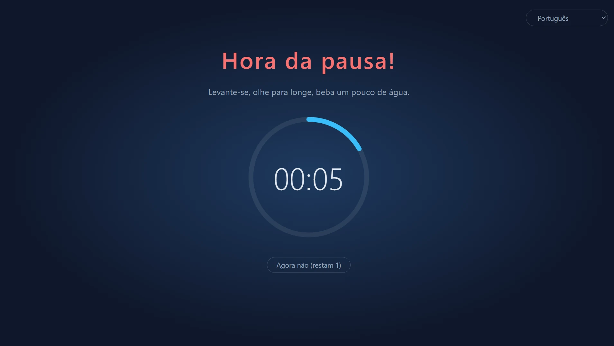
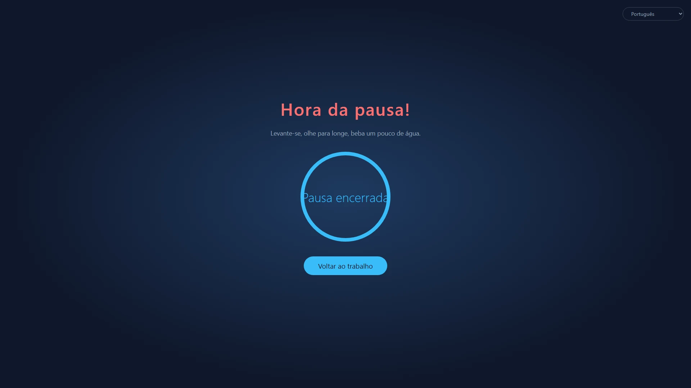
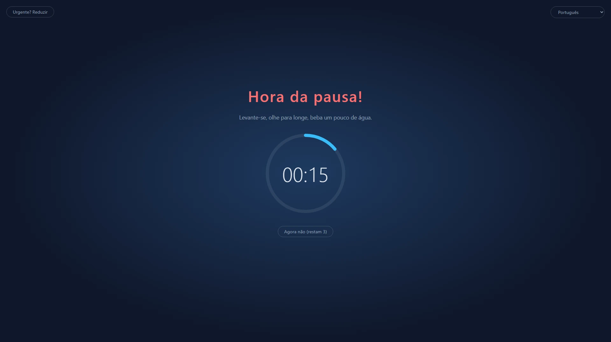
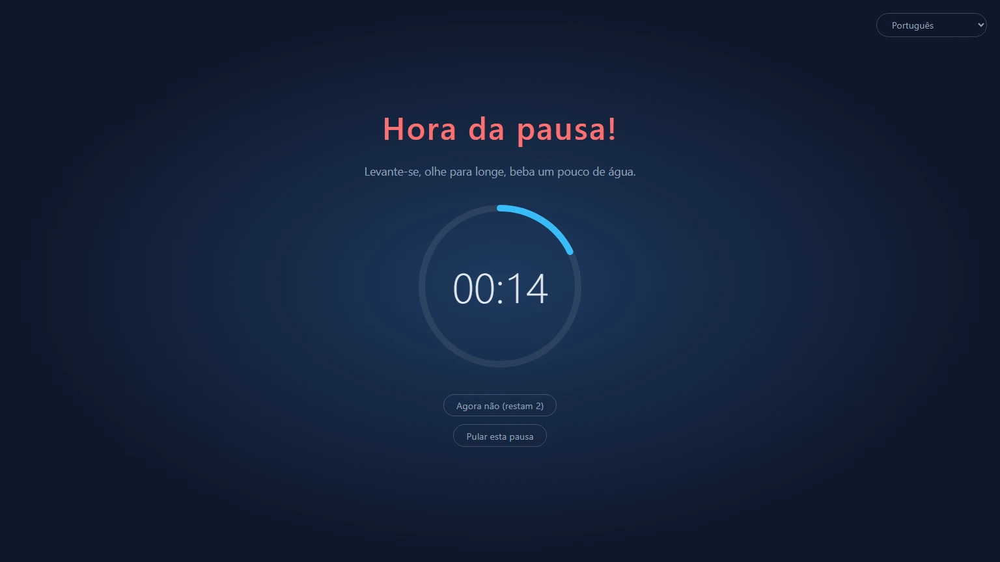
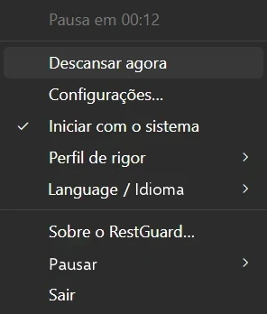

<p align="center">
  
</p>

<h1 align="center">RestGuard</h1>

<p align="center"><strong>O lembrete de pausas que você não consegue ignorar.</strong></p>

<p align="center">Um lembrete de pausas gratuito e de código aberto para Windows, macOS e Linux que pode lembrar você de descansar, ou fazer você descansar.</p>

<p align="center">
  <a href="https://github.com/HansTanzi/RestGuard/releases/latest"></a>
  <a href="https://github.com/HansTanzi/RestGuard/releases"></a>
  <a href="#instalação"></a>
  <a href="#windows"></a>
  <a href="#licença"></a>
</p>

<p align="center">
  Instalar no <a href="#windows"><b>Windows</b></a> · <a href="#macos"><b>macOS</b></a> · <a href="#linux"><b>Linux</b></a> · <a href="https://hanstanzi.github.io/RestGuard/">Site</a>
</p>

<p align="center"><a href="README.md">English</a> | <a href="README.zh-CN.md">简体中文</a> | <a href="README.de.md">Deutsch</a> | <a href="README.ja.md">日本語</a> | <a href="README.es.md">Español</a> | Português (Brasil) | <a href="README.ko.md">한국어</a> | <a href="README.fr.md">Français</a> | <a href="README.it.md">Italiano</a> | <a href="README.id.md">Bahasa Indonesia</a> | <a href="README.hi.md">हिन्दी</a> | <a href="README.bn.md">বাংলা</a> | <a href="README.ar.md">العربية</a></p>



Um lembrete de pausas multiplataforma com três níveis de rigor embutidos: ele pode lembrar você de fazer uma pausa ou fazer você fazê-la. Esse rigor é o que o diferencia de outros lembretes de pausa.

- Alto: faz de tudo para você realmente fazer a pausa.
- Médio: você ainda pode trabalhar, mas trabalhar fica tão desconfortável que você acaba descansando.
- Baixo: como outros lembretes de pausa, principalmente avisa.

Feito com Rust + Tauri 2 + Svelte. Sucessor do [ProtectEyes](https://github.com/HansTanzi/ProtectEyes), um app em C# só para Windows que o autor publicou como código aberto anos atrás.

Instale com uma linha:

```sh
winget install HansTanzi.RestGuard            # Windows
brew install --cask hanstanzi/tap/restguard   # macOS
```

APT, Scoop, Homebrew no Linux e os downloads portáteis estão em [Instalação](#instalação).

## Por que o RestGuard

A maioria dos lembretes de pausa é fácil de ignorar: aparece uma notificação, você fecha, e "só mais cinco minutos" vira duas horas. Longos períodos diante da tela estão associados a cansaço visual, olho seco, dores no pescoço e nas costas e lesão por esforço repetitivo (LER). Conselhos como a regra 20-20-20 ou uma pausa curta a cada hora só ajudam se você realmente fizer a pausa.

O RestGuard é para quem sabe que deveria descansar, mas vive adiando:

- **Não dá para simplesmente fechar com um clique.** No Alto, a sobreposição cobre todas as telas até a pausa acabar.
- **Ele sabe quando não interromper.** Adiamentos, modo urgente e detecção de reuniões evitam que uma pausa atrapalhe uma chamada ou faça você perder trabalho não salvo.
- **Você escolhe o quão rigoroso ele é.** Escolha Alto, Médio ou Baixo, ou crie seu próprio perfil.

## Recursos

### Pausas que realmente acontecem

- Impõe uma pausa de 10 minutos a cada 60 minutos de trabalho (os dois tempos são ajustáveis)
- Vários monitores: todas as telas são cobertas
- A sobreposição não pode ser fechada durante a pausa (Alt+F4 não faz nada) e não dá para sair pela bandeja
- Adie por 5 minutos, até 3 vezes; a contagem é zerada após uma pausa completa
- Modo urgente: algo não pode esperar? Reduza a sobreposição por um momento para salvar seu trabalho enquanto a contagem regressiva continua



### Três perfis embutidos para necessidades diferentes

| | Alto | Médio (padrão) | Baixo |
|---|:---:|:---:|:---:|
| Ideal para | Disciplina rígida, vencer o "só mais cinco minutos" | O trabalho do dia a dia | Um empurrãozinho gentil |
| Adiamentos | 1 | 3 | 3 |
| Modo urgente (reduzir a sobreposição) | ✗ | ✓ | ✓ |
| Detecção de apps de reunião | ✗ | ✓ | ✓ |
| Fechar / pular esta pausa | ✗ | ✗ | ✓ |
| Cobertura da tela | 100% | 100% | 80% |
| Sobreposição arrastável | ✗ | ✓ | ✓ |





### Altamente personalizável

Se os perfis embutidos não servirem, escolha **Novo personalizado…** nas Configurações para partir de qualquer perfil, dê um nome a ele (dá para renomear ou excluir depois) e ajuste cada opção:

- Número de adiamentos, se é permitido sair, se é permitido pular esta pausa
- Se o modo urgente está disponível e quanto a sobreposição encolhe
- Quanto de cada tela a sobreposição cobre (10% ~ 100%) e se ela pode ser arrastada dentro da própria tela
- Se apps de reunião são detectados

Crie quantos perfis personalizados quiser e troque a qualquer momento. Os tempos de trabalho, pausa, adiamento e inatividade são compartilhados entre os perfis. Se preferir editar arquivos à mão, o [`config.toml`](#configuração) também funciona.

### Não atrapalha quando importa

- Detecção de reuniões (Windows, macOS): enquanto Zoom, Microsoft Teams, Webex ou Tencent Meeting estiverem em primeiro plano (ou, no Windows, usando o microfone), a pausa espera a reunião acabar; durante uma pausa, você também pode clicar em "Estou em uma reunião…" para ser lembrado em 15 minutos
- Detecção de inatividade: depois de 5 minutos sem usar teclado ou mouse, você é considerado ausente e a contagem do trabalho pausa; ficar fora pelo tempo de uma pausa conta como pausa completa, então você não é mandado descansar logo ao voltar

### Nunca perca o fim da pausa

- Um som toca quando a pausa termina: escolha um embutido ou seu próprio arquivo de áudio
- Notificações no celular: receba um push no celular (Android, iOS) via [ntfy](https://ntfy.sh), para saber quando voltar mesmo depois de se afastar; no Android ele pode tocar como um alarme até você dispensar
- Smartwatches: a notificação do celular é espelhada para um Apple Watch, Wear OS, Galaxy Watch ou um relógio ou pulseira Xiaomi, Huawei, Garmin ou similar pareado, então basta olhar para o pulso (veja [Notificações no celular e no smartwatch](#notificações-no-celular-e-no-smartwatch))

### Pequeno e rápido

- Feito com Rust + Tauri 2 sobre o WebView do sistema, sem motor de navegador embutido, então quase não usa recursos em segundo plano
- Minúsculo: os downloads têm só uns 3–6 MB, dezenas de vezes menos que alternativas baseadas em Electron (veja [Comparação](#comparação))
- Portátil: um único exe no Windows e um `.app` para descompactar e rodar no macOS; apague para desinstalar

### E mais

- Multiplataforma: Windows, macOS e Linux, instalável e atualizável via WinGet, Scoop, Homebrew e APT (veja [Instalação](#instalação))
- Menu da bandeja: tempo restante, descansar agora, configurações, iniciar com o sistema, trocar o perfil de rigor
- Instância única
- Livre e de código aberto sob a licença dupla permissiva MIT / Apache-2.0 (veja [Licença](#licença))
- Disponível em chinês simplificado, inglês, hindi, espanhol, árabe, francês, bengali, português, alemão, japonês, italiano, coreano e indonésio. O idioma da interface segue o do sistema por padrão (inglês se o idioma do sistema não for suportado); troque quando quiser no submenu "语言 / Language" da bandeja



## Comparação

| | RestGuard | [Stretchly](https://github.com/hovancik/stretchly) | [Workrave](https://github.com/rcaelers/workrave) | [Safe Eyes](https://github.com/slgobinath/SafeEyes) |
|---|:---:|:---:|:---:|:---:|
| Windows | ✓ | ✓ | ✓ | ✗ |
| macOS | ✓ | ✓ | ✗ | ✗ |
| Linux | ✓ | ✓ | ✓ | ✓ |
| Tamanho do download | **~3–6 MB** | Windows 163 MB<br>macOS 187 MB<br>Linux 155 MB | Windows 61 MB<br>Linux 64 MB| Linux 0,3 MB |
| Rigor | 3 níveis + perfis personalizados | Modo estrito liga/desliga | Pode bloquear entrada e tela | Pode desativar o teclado |
| Segura as pausas durante reuniões | Detecta Zoom, Teams, Webex, Tencent Meeting | Segue o Não perturbe; exclusões por app | — | — |
| Aviso no celular / relógio quando a pausa acaba | ✓ (ntfy) | — | — | — |
| Feito com | Rust + Tauri (WebView do sistema) | Electron (inclui o Chromium) | C++ | Python + GTK |
| Licença | MIT / Apache-2.0 | BSD-2-Clause | GPL-3.0 | GPL-3.0 |

— significa que não é nativo. Os tamanhos de download são da versão mais recente de cada projeto no GitHub (Stretchly 1.22.1, Workrave 1.11.5, Safe Eyes 3.5.1): o instalador ou exe do Windows, o download do macOS e o `.deb` do Linux. Com base na documentação de cada projeto em novembro de 2026; se algo estiver errado, [abra uma issue](https://github.com/HansTanzi/RestGuard/issues).

## Instalação

### Windows

Instale com o [WinGet](https://learn.microsoft.com/windows/package-manager/winget/):

```powershell
winget install HansTanzi.RestGuard
```

Ou com o [Scoop](https://scoop.sh):

```powershell
scoop bucket add hanstanzi https://github.com/HansTanzi/scoop-bucket
scoop install hanstanzi/restguard
```

Ou baixe `RestGuard_<versão>_x64.exe` em [Releases](https://github.com/HansTanzi/RestGuard/releases/latest) e execute. É um único exe portátil sem instalador: coloque onde quiser e apague para desinstalar. Ele não se atualiza sozinho; baixe a nova versão para atualizar.

Requer o runtime WebView2 (já vem no Windows 11).

### macOS

Instale com o [Homebrew](https://brew.sh) (build universal para Apple Silicon e Intel):

```sh
brew install --cask hanstanzi/tap/restguard
```

Se você adicionou este repositório como tap antes (`brew tap hanstanzi/restguard https://github.com/HansTanzi/RestGuard`), mude para o novo tap para continuar recebendo atualizações: `brew untap hanstanzi/restguard && brew install --cask hanstanzi/tap/restguard`.

Ou baixe `RestGuard_<versão>_universal.zip` em [Releases](https://github.com/HansTanzi/RestGuard/releases/latest), descompacte e mova `RestGuard.app` para `/Applications`. Ele não se atualiza sozinho; baixe a nova versão para atualizar.

O RestGuard fica na barra de menus e não tem ícone no Dock. O app não é notarizado pela Apple; o cask remove o atributo de quarentena na instalação. Se você baixou o zip manualmente, rode `xattr -dr com.apple.quarantine /Applications/RestGuard.app` antes de abrir pela primeira vez; caso contrário, o macOS não vai abri-lo.

### Linux

No Debian/Ubuntu (x86_64), adicione o [repositório APT](https://github.com/HansTanzi/apt) e depois instale e atualize com `apt`:

```sh
sudo install -d /etc/apt/keyrings
curl -fsSL https://hanstanzi.github.io/apt/hanstanzi.gpg | sudo tee /etc/apt/keyrings/hanstanzi.gpg > /dev/null
echo "deb [signed-by=/etc/apt/keyrings/hanstanzi.gpg] https://hanstanzi.github.io/apt stable main" | sudo tee /etc/apt/sources.list.d/hanstanzi.list
sudo apt update && sudo apt install rest-guard
```

Versões novas chegam com `sudo apt update && sudo apt upgrade`. Você também pode instalar o `.deb` de [Releases](https://github.com/HansTanzi/RestGuard/releases/latest) diretamente (`sudo apt install ./RestGuard_*_amd64.deb`), mas aí ele não será atualizado.

Para outras distribuições, baixe em [Releases](https://github.com/HansTanzi/RestGuard/releases/latest). No Fedora/openSUSE, instale o `.rpm`:

```sh
sudo dnf install ./RestGuard_*_x86_64.rpm      # Fedora
sudo zypper install ./RestGuard_*_x86_64.rpm   # openSUSE
```

No Arch, instale o `.pkg.tar.zst`:

```sh
sudo pacman -U ./RestGuard_*_x86_64.pkg.tar.zst
```

Em qualquer distribuição (x86_64, glibc 2.35+), você também pode instalar e atualizar com o [Homebrew](https://brew.sh). O Homebrew não instala bibliotecas do sistema, então instale antes o WebKitGTK 4.1 e o libayatana-appindicator com o gerenciador de pacotes da sua distribuição:

```sh
sudo apt install libwebkit2gtk-4.1-0 libayatana-appindicator3-1                 # Debian/Ubuntu
sudo dnf install webkit2gtk4.1 libayatana-appindicator-gtk3                     # Fedora
sudo pacman -S webkit2gtk-4.1 libayatana-appindicator                           # Arch
sudo zypper install libwebkit2gtk-4_1-0 libayatana-appindicator3-1              # openSUSE

brew install --cask hanstanzi/tap/restguard
```

Isso instala só o executável `restguard`, sem entrada no menu de aplicativos: rode `restguard` uma vez e depois ative "Iniciar com o sistema" no menu da bandeja. Versões novas chegam com `brew upgrade`.

A sobreposição precisa de X11 (veja [Limitações por plataforma](#limitações-por-plataforma)).

### Verificar os downloads

Os arquivos publicados depois da v0.1.14 são compilados pelo GitHub Actions e trazem uma [atestação de procedência de build](https://docs.github.com/actions/security-for-github-actions/using-artifact-attestations) assinada, que liga cada arquivo à execução do workflow e ao commit que o gerou. Para verificar um arquivo baixado com o [GitHub CLI](https://cli.github.com):

```sh
gh attestation verify RestGuard_<versão>_x64.exe --repo HansTanzi/RestGuard
```

Cada versão também inclui `SHA256SUMS.txt`, para verificar os downloads sem o GitHub CLI. Coloque o arquivo baixado no mesmo diretório que `SHA256SUMS.txt` e rode:

```sh
sha256sum -c SHA256SUMS.txt --ignore-missing          # Linux
shasum -a 256 -c SHA256SUMS.txt --ignore-missing      # macOS
```

No Windows, compare a saída de `Get-FileHash .\RestGuard_*_x64.exe` com a linha correspondente em `SHA256SUMS.txt` (maiúsculas e minúsculas não importam).

### Compilar a partir do código-fonte

Instale os pré-requisitos listados em [CONTRIBUTING.md](CONTRIBUTING.md#development-setup) e compile uma versão com tag:

```sh
git clone https://github.com/HansTanzi/RestGuard
cd RestGuard
git checkout v<versão>
pnpm install --frozen-lockfile
pnpm tauri build --no-bundle
```

O executável fica em `src-tauri/target/release/restguard` (`restguard.exe` no Windows). Compile com `pnpm tauri build`, não com `cargo build`: um build só com Cargo é de desenvolvimento, carrega a interface de `localhost:1420` e mostra janelas em branco.

## Configuração

Abra **Configurações…** no menu da bandeja para mudar os tempos, o nível de rigor, a cobertura da sobreposição, o idioma e o início com o sistema. As mudanças valem na hora (as configurações ficam bloqueadas durante uma pausa). Mudar o tempo de trabalho reinicia a contagem regressiva atual.

As configurações ficam em `config.toml`, criado na primeira execução. Você também pode editá-lo à mão; reinicie o app depois.

| Sistema | Caminho |
|---|---|
| Windows | `%APPDATA%\io.github.restguard\config.toml` |
| macOS | `~/Library/Application Support/io.github.restguard/config.toml` |
| Linux | `~/.config/io.github.restguard/config.toml` |

```toml
work_minutes = 60.0      # tempo de trabalho antes de uma pausa obrigatória
rest_minutes = 10.0      # duração de cada pausa
postpone_minutes = 5.0   # duração de cada adiamento
idle_minutes = 5.0       # sem uso por este tempo conta como ausente; 0 = desligado
level = "medium"         # "high", "medium", "low" ou o nome de um perfil personalizado
sound_prompt = true      # tocar um som quando a pausa termina
sound = "beep"           # "beep", "chime", "rise" ou "file" (toca sound_file)
sound_file = ""          # caminho completo do seu arquivo de áudio, usado quando sound = "file"
phone_notify = false     # enviar uma notificação ao celular via ntfy quando a pausa termina
ntfy_server = "https://ntfy.sh"  # servidor ntfy, o público ou o seu
ntfy_topic = ""          # tópico a assinar no app ntfy; escolha algo difícil de adivinhar

[[fixed_breaks]]         # uma pausa fixa; "work_end" (fim do expediente) e "lunch" já vêm embutidas
name = "work_end"
enabled = false          # segurar as pausas que caem logo antes
time = "18:00"           # HH:MM no formato 24 horas, horário local
quiet_minutes = 30.0     # pausas que caem até este tempo antes de time esperam até time

[[fixed_breaks]]         # almoço: uma pausa de rest_minutes começa em time
name = "lunch"
enabled = true
time = "12:00"
quiet_minutes = 30.0
rest_minutes = 30.0      # duração da pausa (almoço e suas próprias pausas fixas); passada a duração de uma pausa normal, você pode continuar usando o computador

[[fixed_breaks]]         # adicione as suas, p. ex. uma pausa para o café, com um [[fixed_breaks]] cada
name = "Tea break"
enabled = true
time = "15:00"
quiet_minutes = 15.0
rest_minutes = 15.0

[[profiles]]             # um perfil personalizado; adicione um [[profiles]] por perfil
name = "Focus"
max_postpones = 1        # máximo de adiamentos antes de exigir uma pausa completa
urgent_mode = false      # permitir reduzir a sobreposição
meeting_detection = true # segurar as pausas enquanto Zoom, Teams etc. estão em uso
force_rest = true        # false = a sobreposição pode ser fechada
allow_skip = false       # oferecer "Pular esta pausa" mesmo com pausas obrigatórias
overlay_coverage = 1.0   # fração de cada tela coberta, 0.1 ~ 1.0
urgent_scale = 0.5       # escala do modo urgente (sobreposição reduzida) em relação ao valor acima, 0.1 ~ 0.9
movable = false          # permitir arrastar a sobreposição dentro da tela quando não a ocupa toda
```

### Notificações no celular e no smartwatch

1. Instale o app ntfy no celular ([Android](https://play.google.com/store/apps/details?id=io.heckel.ntfy), [F-Droid](https://f-droid.org/packages/io.heckel.ntfy/), [iOS](https://apps.apple.com/app/ntfy/id1625396347))
2. Nas Configurações do RestGuard, ative "Avisar o celular ao fim da pausa (ntfy)" e digite um tópico difícil de adivinhar (só letras, números, `-` e `_`). O servidor padrão é o público `https://ntfy.sh`; você pode usar o seu
3. Assine o mesmo servidor e tópico no app ntfy e clique em "Enviar notificação de teste" para confirmar que chega

As notificações são enviadas com prioridade máxima. No Android, ative "Keep alerting for highest priority" nas configurações do ntfy para que toque como um alarme até você dispensar; no iOS é uma notificação sensível ao tempo, que passa pelos modos de Foco (se você permitir que o ntfy envie notificações sensíveis ao tempo). Qualquer pessoa que souber o tópico pode assiná-lo no servidor público, então mantenha-o em segredo.

Não é preciso instalar nada no relógio; o sistema espelha a notificação do celular para ele:

| Relógio | Configuração |
|---|---|
| Apple Watch | No app Watch do iPhone, vá em Notificações e ative "Espelhar alertas do iPhone" para o ntfy. As notificações só vão para o relógio enquanto o iPhone está bloqueado ou com a tela apagada |
| Wear OS / Galaxy Watch | Espelhado por padrão; confira se o ntfy não está desativado nas configurações de notificação do relógio |
| Xiaomi, Huawei, Garmin, Amazfit etc. | Permita o ntfy na lista de notificações de apps do app companheiro (Zepp, Huawei Health, Garmin Connect etc.) |

Observações:

- O relógio vibra uma vez; ele não continua alertando como o celular
- O celular precisa estar online com o ntfy rodando em segundo plano para o relógio receber a notificação; um relógio usado sozinho, sem o celular, não recebe
- Com um servidor próprio, o iOS precisa de `upstream-base-url: "https://ntfy.sh"` na configuração do servidor para receber as notificações na hora (veja a [documentação do ntfy](https://docs.ntfy.sh/config/#ios-instant-notifications))

## Limitações por plataforma

- **macOS**: ações do sistema como Forçar Encerrar (`Cmd+Option+Esc`) não podem ser bloqueadas
- **Linux**: a detecção de inatividade precisa do GNOME ou de um ambiente que implemente `org.freedesktop.ScreenSaver` (p. ex., KDE Plasma), além do `gdbus`; caso contrário, fica desligada
- **Linux**: os sons são tocados com `paplay`, `pw-play` ou `aplay`, então use wav, ogg ou flac no seu próprio arquivo (mp3 não é suportado)
- **Linux Wayland**: o protocolo não deixa os apps ficarem sempre por cima nem posicionarem as próprias janelas, então a sobreposição pode não funcionar; no X11 funciona bem

## Perguntas frequentes

**Posso fechar o RestGuard?**
Entre as pausas, sim: escolha "Sair" no menu da bandeja. Durante uma pausa, ou enquanto ainda houver uma pausa adiada pendente, "Sair" fica desativado.

**E se uma pausa chegar no meio de uma reunião?**
No Médio e no Baixo, a pausa espera enquanto Zoom, Microsoft Teams, Webex ou Tencent Meeting estiverem em primeiro plano (Windows, macOS; no Windows também enquanto usam o microfone). Se a pausa já começou, clique em "Estou em uma reunião…" para ser lembrado em 15 minutos. No Alto, as pausas não esperam.

**Estou no meio de algo urgente. Vou perder meu trabalho?**
Adie a pausa em 5 minutos (até 3 vezes no Médio e no Baixo, uma vez no Alto), ou no Médio e no Baixo use o modo urgente para reduzir a sobreposição e salvar seu trabalho enquanto a contagem regressiva continua.

**O tempo longe do computador conta como trabalho?**
Não. Depois de 5 minutos sem teclado ou mouse, a contagem regressiva de trabalho pausa, e ficar fora pelo tempo de uma pausa conta como uma pausa completa.

**O macOS diz que o app não pode ser aberto.**
O RestGuard não é notarizado pela Apple. Instale com o Homebrew ou rode uma vez `xattr -dr com.apple.quarantine /Applications/RestGuard.app` (veja [macOS](#macos)).

**Funciona no Wayland?**
Não de forma confiável: o Wayland não deixa os apps manterem suas janelas no topo, então use uma sessão X11 (veja [Limitações por plataforma](#limitações-por-plataforma)).

**Ele coleta dados?**
Não. Veja [Privacidade](#privacidade).

## Contribuir

Relatos de bugs, ideias, traduções e pull requests são bem-vindos. O [CONTRIBUTING.md](CONTRIBUTING.md) (em inglês) explica como montar o ambiente de desenvolvimento, as verificações antes de um PR e como melhorar uma tradução; as mudanças de cada versão estão no [CHANGELOG.md](CHANGELOG.md). Relate problemas de segurança em particular, como descrito no [SECURITY.md](SECURITY.md).

Se o RestGuard ajuda você a descansar, uma ⭐ ajuda outras pessoas a encontrá-lo.

[](https://github.com/HansTanzi/RestGuard/graphs/contributors)

[](https://star-history.com/#HansTanzi/RestGuard&Date)

## Privacidade

O RestGuard não coleta nenhum dado: nada de contas, análises ou telemetria. Ele só se conecta à internet para enviar a notificação opcional do ntfy ao celular. Veja a [política de privacidade](https://hanstanzi.github.io/RestGuard/privacy.html) (em inglês).

## Licença

Licenciado, à sua escolha, sob [MIT](LICENSE-MIT) ou [Apache-2.0](LICENSE-APACHE).
