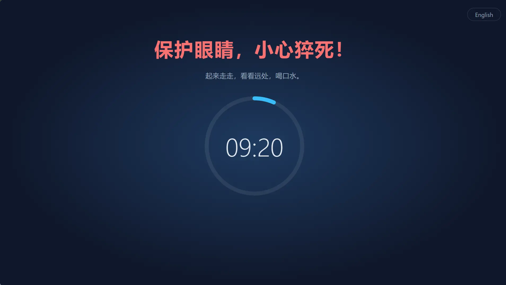

# RestGuard

[English](README.md) | 简体中文

跨平台的强制休息提醒工具：每工作一段时间，全屏遮罩强制你休息，倒计时结束前关不掉。

> 前身是 Windows 专用的 C# 版 [ProtectEyes](./ProtectEyes)。



## 功能

- 每工作 60 分钟，强制休息 10 分钟（可配置）
- 多显示器：每块屏幕都会被遮挡
- 休息期间无法关闭遮罩（Alt+F4 无效），也无法从托盘退出
- 可推迟 5 分钟，最多 3 次；完整休息一次后次数重置
- 强制等级：**高**（不能推迟，没有紧急模式，不检测会议软件）、**中**（默认，即本节描述的行为）、**低**（不强制休息，只弹出可以关掉的窗口）；也可以新建自己的命名方案
- 空闲检测：5 分钟没有键盘鼠标操作就算离开电脑，工作倒计时暂停；离开满一次休息的时长就当已经休息过，回来不会立刻被叫去休息
- 托盘菜单：查看剩余时间、提前休息、设置、开机自启
- 单实例运行
- 支持简体中文、英语、印地语、西班牙语、阿拉伯语、法语、孟加拉语、葡萄牙语、德语、日语、意大利语、韩语和印尼语。界面语言默认跟随系统（系统语言不在支持列表中时显示英文），也可以随时在托盘菜单的「语言 / Language」中切换

## 安装

### Windows

可通过 [WinGet](https://learn.microsoft.com/windows/package-manager/winget/) 安装：

```powershell
winget install HansTanzi.RestGuard
```

或通过 [Scoop](https://scoop.sh) 安装：

```powershell
scoop bucket add hanstanzi https://github.com/HansTanzi/scoop-bucket
scoop install hanstanzi/restguard
```

依赖 WebView2 运行时（Windows 11 自带）。

### macOS

可通过 [Homebrew](https://brew.sh) 安装（通用版，支持 Apple Silicon 和 Intel）：

```sh
brew install --cask hanstanzi/tap/restguard
```

如果之前 tap 过本仓库（`brew tap hanstanzi/restguard https://github.com/HansTanzi/RestGuard`），需要换到新的 tap 才能继续收到更新：`brew untap hanstanzi/restguard && brew install --cask hanstanzi/tap/restguard`。

RestGuard 只显示在菜单栏，不占 Dock。应用未经 Apple 公证，cask 安装时会自动去掉隔离属性；如果手动从 Release 下载，首次打开前需运行 `xattr -dr com.apple.quarantine /Applications/RestGuard.app`。

### Linux

Debian/Ubuntu（x86_64）添加 [APT 源](https://github.com/HansTanzi/apt)后用 `apt` 安装和更新：

```sh
sudo install -d /etc/apt/keyrings
curl -fsSL https://hanstanzi.github.io/apt/hanstanzi.gpg | sudo tee /etc/apt/keyrings/hanstanzi.gpg > /dev/null
echo "deb [signed-by=/etc/apt/keyrings/hanstanzi.gpg] https://hanstanzi.github.io/apt stable main" | sudo tee /etc/apt/sources.list.d/hanstanzi.list
sudo apt update && sudo apt install rest-guard
```

之后用 `sudo apt update && sudo apt upgrade` 即可更新。也可以直接安装 [Releases](https://github.com/HansTanzi/RestGuard/releases/latest) 中的 `.deb`（`sudo apt install ./RestGuard_*_amd64.deb`），但不会自动更新。

其他发行版从 [Releases](https://github.com/HansTanzi/RestGuard/releases/latest) 下载。Fedora/openSUSE 安装 `.rpm`：

```sh
sudo dnf install ./RestGuard_*_x86_64.rpm      # Fedora
sudo zypper install ./RestGuard_*_x86_64.rpm   # openSUSE
```

Arch 安装 `.pkg.tar.zst`：

```sh
sudo pacman -U ./RestGuard_*_x86_64.pkg.tar.zst
```

遮罩需要 X11（见[平台限制](#平台限制)）。

## 配置

在托盘菜单中打开「设置…」，可以修改工作/休息时长、强制等级、遮罩覆盖比例、语言和开机自启，保存后立即生效（休息期间不能修改）。修改工作时长会让当前的工作倒计时按新时长重新开始。

设置保存在首次运行时生成的 `config.toml` 中（注释语言跟随系统），也可以手动编辑，编辑后需重启生效：

| 系统 | 路径 |
|---|---|
| Windows | `%APPDATA%\io.github.restguard\config.toml` |
| macOS | `~/Library/Application Support/io.github.restguard/config.toml` |
| Linux | `~/.config/io.github.restguard/config.toml` |

```toml
work_minutes = 60.0      # 连续工作多久后强制休息
rest_minutes = 10.0      # 每次休息多久
postpone_minutes = 5.0   # 每次推迟多久
overlay_coverage = 1.0   # 遮罩覆盖屏幕的比例 0.1 ~ 1.0
urgent_scale = 0.5       # 紧急模式（缩小遮罩）时相对上面比例的缩放因子 0.1 ~ 0.9
idle_minutes = 5.0       # 无操作超过这么久算离开电脑，0 表示关闭
level = "medium"         # 强制等级："high"、"medium"、"low"，或某个自定义方案的名字

[[profiles]]             # 自定义方案，每个方案一个 [[profiles]]
name = "专注"
max_postpones = 1        # 完整休息前最多推迟几次
urgent_mode = false      # 允许缩小遮罩（紧急模式）
meeting_detection = true # Zoom、Teams 等会议软件使用中时暂缓休息
force_rest = true        # false 表示只弹出可以关掉的窗口
```

## 平台限制

- **macOS**：强制退出（`Cmd+Option+Esc`）等系统级操作无法拦截
- **Linux**：空闲检测需要 GNOME 或实现了 `org.freedesktop.ScreenSaver` 的桌面（如 KDE Plasma），以及 `gdbus`；否则不生效
- **Linux Wayland**：协议不允许应用自行置顶和定位窗口，遮罩可能失效；X11 正常

## 开发

需要 [Rust](https://rustup.rs)、Node.js、pnpm，以及 [Tauri 的系统依赖](https://tauri.app/start/prerequisites/)。

```sh
pnpm install
pnpm tauri dev      # 开发运行
pnpm tauri build    # 打包安装包
cd src-tauri && cargo test
```

开发构建读取同目录下的 `config.dev.toml` 和 `language.dev`，可以放心改短时长、切换语言，不影响已安装的正式版；遮罩上按 `Esc` 可直接结束休息。调试前请先退出已安装的 RestGuard，否则单实例检查会让开发版直接退出。

发布：在干净的 `dev` 分支上运行 `pnpm release <版本号>`（如 `pnpm release 0.2.0`），脚本会同步修改 `package.json`、`tauri.conf.json`、`Cargo.toml`、`Cargo.lock` 中的版本号，提交并推送 `v<版本号>` 标签。之后 GitHub Actions 会构建 exe、macOS 通用版 `.app`，以及 Linux 的 `.deb`、`.rpm` 和 Arch 的 `.pkg.tar.zst`（用 `src-tauri/arch/PKGBUILD` 由 `.deb` 重新打包）、创建 Release，并把更新后的 `bucket/restguard.json` 推送到 [HansTanzi/scoop-bucket](https://github.com/HansTanzi/scoop-bucket)、`Casks/restguard.rb` 推送到 [HansTanzi/homebrew-tap](https://github.com/HansTanzi/homebrew-tap)。需要配置仓库 secret `SCOOP_BUCKET_DEPLOY_KEY` 和 `HOMEBREW_TAP_DEPLOY_KEY`：分别是这两个仓库中有写权限的 deploy key 的私钥。正式版还会触发 [HansTanzi/apt](https://github.com/HansTanzi/apt) 从各应用的最新 Release 重新生成 APT 源，需要配置仓库 secret `APT_DISPATCH_TOKEN`（仅限该仓库、只有 Actions 读写权限的 fine-grained PAT）。签名密钥和配置方法见该仓库。正式版（不含 `-` 的版本号）还会通过 [winget-releaser](https://github.com/vedantmgoyal9/winget-releaser) 向 [microsoft/winget-pkgs](https://github.com/microsoft/winget-pkgs) 提交 PR，需要配置仓库 secret `WINGET_TOKEN`（具有 `public_repo` 权限的 classic PAT），且 token 所属账号下已 fork `winget-pkgs`。WinGet 的首个版本需手动提交，例如用 [Komac](https://github.com/russellbanks/Komac) 运行 `komac new HansTanzi.RestGuard --version <版本号> --urls <Release 中 exe 的下载地址>`（安装类型选 `portable`，并添加依赖 `Microsoft.EdgeWebView2Runtime`）。

### 微软商店

商店版是 MSIX 包，由商店负责签名，不需要代码签名证书。运行 `pnpm msix` 可在本地生成 `src-tauri/target/msix/RestGuard_<version>_x64.msix`（需要 Windows SDK）；发布工作流也会为正式版本构建它，作为本次运行的 `msix` 构建产物（artifact）。在[合作伙伴中心](https://partner.microsoft.com/dashboard)新建提交并上传即可。

首次准备：在合作伙伴中心保留应用名称，然后把应用“产品标识”（Product identity）页面上的 `Package/Identity/Name`、`Package/Identity/Publisher` 和 `Package/Properties/PublisherDisplayName` 填入 `src-tauri/msix/AppxManifest.xml`。包声明了受限功能 `runFullTrust`（桌面应用必需），提交时需要填写理由，例如“基于 Tauri 的桌面应用，需要完全信任权限在所有屏幕上显示置顶的休息遮罩”。

包内的开机自启使用清单中的 `StartupTask`，而不是注册表（包内的注册表写入会被虚拟化）。想不经商店试用该包，可开启开发者模式后运行 `Add-AppxPackage -Register src-tauri/target/msix/layout/AppxManifest.xml`。

调试时可以把 `work_minutes` 设为 `0.1`（6 秒），快速触发休息。

## 许可证

可任选 [MIT](LICENSE-MIT) 或 [Apache-2.0](LICENSE-APACHE) 许可证。
