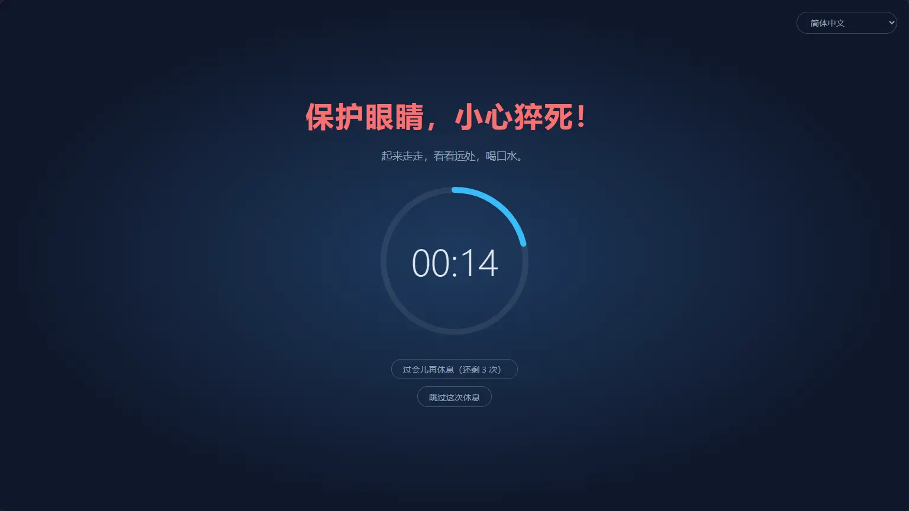
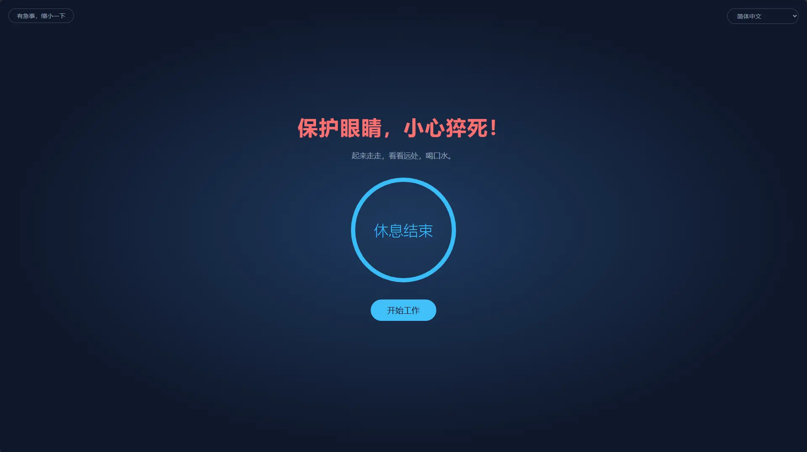
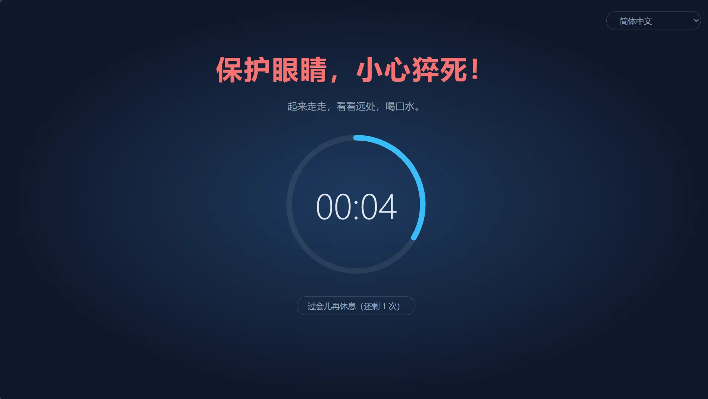
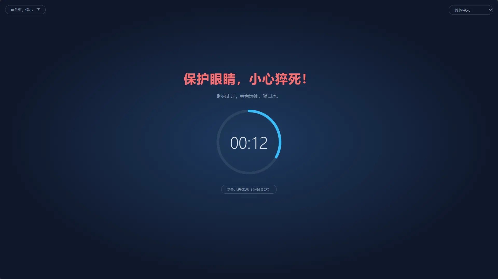
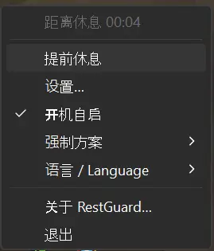

# RestGuard

[English](README.md) | 简体中文 | [Deutsch](README.de.md)

跨平台的休息提醒工具：特色是内置三种不同的强制等级，既可提醒你休息，也可强制你休息。相比同类软件，强制模式是最大特色。

- 高强制模式下：会尽可能强迫你休息。
- 中等强制模式下：依然可以办公，但是会尽可能降低办公体验，从而半强制你休息。
- 低强制模式下：和其他的休息提醒软件一样，主要是提醒。

> 前身是 Windows 专用的 C# 版 [ProtectEyes](./ProtectEyes)。



## 功能

### 真正的强制休息

- 每工作 60 分钟，强制休息 10 分钟（时长均可调整）
- 多显示器：每块屏幕都会被遮挡
- 休息期间无法关闭遮罩（Alt+F4 无效），也无法从托盘退出
- 可推迟 5 分钟，最多 3 次；完整休息一次后次数重置
- 紧急模式：遇到急事可以把遮罩临时缩小，保存手头的工作，倒计时照常进行



### 内置三档方案，适配不同场景

| | 高等强制 | 中等强制（默认） | 低等强制 |
|---|:---:|:---:|:---:|
| 适合 | 自律要求高、容易“再干五分钟” | 日常办公 | 只想要一个温和的提醒 |
| 推迟次数 | 1 | 3 | 3 |
| 紧急模式（缩小遮罩） | ✗ | ✓ | ✓ |
| 检测会议软件 | ✗ | ✓ | ✓ |
| 允许关闭 / 跳过本次休息 | ✗ | ✗ | ✓ |
| 遮罩覆盖屏幕 | 100% | 100% | 80% |
| 遮罩可拖动 | ✗ | ✓ | ✓ |

高等强制模式



中等强制模式



低等强制模式


### 高度自定义

内置方案不够用时，可以在设置面板中以任意方案为模板「新建自定义…」，起个名字（支持重命名、删除），然后逐项调整：

- 推迟次数、是否允许退出、是否允许跳过本次休息
- 是否允许紧急模式，以及缩小后的比例
- 遮罩覆盖屏幕的比例（10% ~ 100%）、能否在同一屏幕内拖动
- 是否检测会议软件

可以保存多个自定义方案，随时切换。工作、休息、推迟和空闲判定的时长对所有方案通用。喜欢手动改配置的话，也可以直接编辑 [`config.toml`](#配置)。

### 不打扰正事

- 会议检测（Windows、macOS）：Zoom、Microsoft Teams、Webex、腾讯会议在前台（Windows 上还包括正在使用麦克风）时暂缓休息，会后再开始；休息时也可以点「我在开会」，15 分钟后再提醒
- 空闲检测：5 分钟没有键盘鼠标操作就算离开电脑，工作倒计时暂停；离开满一次休息的时长就当已经休息过，回来不会立刻被叫去休息

### 离开电脑也不会错过

- 休息结束时播放提示音，可选内置音效或自己的音频文件
- 手机通知：通过 [ntfy](https://ntfy.sh) 推送到手机（Android、iOS），走开休息也能及时知道该回来了；Android 上可以设成像闹钟一样一直响到点掉
- 智能手表：手机收到的通知会同步到配对的 Apple Watch、Wear OS、Galaxy Watch 以及小米、华为、Garmin 等手表手环，抬手就能看到（设置方法见[手机和智能手表通知](#手机和智能手表通知)）

### 小巧轻快

- 基于 Rust + Tauri 2 构建，使用系统自带的 WebView，不捆绑浏览器内核，常驻后台几乎不占资源
- 体积小：下载仅 2.5 ~ 4.6 MB（Windows 4.6 MB、macOS 4.0 MB、Linux 2.5 MB）
- 绿色免安装：Windows 版是单个 exe，macOS 版是解压即用的 `.app`，删掉即卸载

### 其他

- 跨平台：Windows、macOS、Linux，支持 WinGet、Scoop、Homebrew、APT 等主流包管理器一键安装和更新（见[安装](#安装)）
- 托盘菜单：查看剩余时间、提前休息、设置、开机自启、切换强制方案
- 单实例运行
- 开源免费，采用宽松的 MIT / Apache-2.0 双许可证（见[许可证](#许可证)）
- 支持简体中文、英语、印地语、西班牙语、阿拉伯语、法语、孟加拉语、葡萄牙语、德语、日语、意大利语、韩语和印尼语。界面语言默认跟随系统（系统语言不在支持列表中时显示英文），也可以随时在托盘菜单的「语言 / Language」中切换



## 安装

### Windows

可通过 [WinGet](https://learn.microsoft.com/windows/package-manager/winget/) 安装：

```powershell
winget install HansTanzi.RestGuard
```

或通过 [Scoop](https://scoop.sh) 安装：

```powershell
scoop bucket add hanstanzi https://github.com/HansTanzi/scoop-bucket
scoop install hanstanzi/restguard
```

也可以从 [Releases](https://github.com/HansTanzi/RestGuard/releases/latest) 下载 `RestGuard_<版本>_x64.exe` 直接运行。它是免安装的单个 exe：放在任意位置即可，删除即卸载。不会自动更新，更新时下载新版本替换即可。

依赖 WebView2 运行时（Windows 11 自带）。

### macOS

可通过 [Homebrew](https://brew.sh) 安装（通用版，支持 Apple Silicon 和 Intel）：

```sh
brew install --cask hanstanzi/tap/restguard
```

如果之前 tap 过本仓库（`brew tap hanstanzi/restguard https://github.com/HansTanzi/RestGuard`），需要换到新的 tap 才能继续收到更新：`brew untap hanstanzi/restguard && brew install --cask hanstanzi/tap/restguard`。

也可以从 [Releases](https://github.com/HansTanzi/RestGuard/releases/latest) 下载 `RestGuard_<版本>_universal.zip`，解压后把 `RestGuard.app` 移到 `/Applications`。不会自动更新，更新时下载新版本替换即可。

RestGuard 只显示在菜单栏，不占 Dock。应用未经 Apple 公证，cask 安装时会自动去掉隔离属性；如果是手动下载的 zip，首次打开前需运行 `xattr -dr com.apple.quarantine /Applications/RestGuard.app`，否则 macOS 会拒绝打开。

### Linux

Debian/Ubuntu（x86_64）添加 [APT 源](https://github.com/HansTanzi/apt)后用 `apt` 安装和更新：

```sh
sudo install -d /etc/apt/keyrings
curl -fsSL https://hanstanzi.github.io/apt/hanstanzi.gpg | sudo tee /etc/apt/keyrings/hanstanzi.gpg > /dev/null
echo "deb [signed-by=/etc/apt/keyrings/hanstanzi.gpg] https://hanstanzi.github.io/apt stable main" | sudo tee /etc/apt/sources.list.d/hanstanzi.list
sudo apt update && sudo apt install rest-guard
```

之后用 `sudo apt update && sudo apt upgrade` 即可更新。也可以直接安装 [Releases](https://github.com/HansTanzi/RestGuard/releases/latest) 中的 `.deb`（`sudo apt install ./RestGuard_*_amd64.deb`），但不会自动更新。

其他发行版从 [Releases](https://github.com/HansTanzi/RestGuard/releases/latest) 下载。Fedora/openSUSE 安装 `.rpm`：

```sh
sudo dnf install ./RestGuard_*_x86_64.rpm      # Fedora
sudo zypper install ./RestGuard_*_x86_64.rpm   # openSUSE
```

Arch 安装 `.pkg.tar.zst`：

```sh
sudo pacman -U ./RestGuard_*_x86_64.pkg.tar.zst
```

任意发行版（x86_64，glibc 2.35 及以上）也可以通过 [Homebrew](https://brew.sh) 安装和更新。Homebrew 不能安装系统库，需先用发行版的包管理器装好 WebKitGTK 4.1 和 libayatana-appindicator：

```sh
sudo apt install libwebkit2gtk-4.1-0 libayatana-appindicator3-1                 # Debian/Ubuntu
sudo dnf install webkit2gtk4.1 libayatana-appindicator-gtk3                     # Fedora
sudo pacman -S webkit2gtk-4.1 libayatana-appindicator                           # Arch
sudo zypper install libwebkit2gtk-4_1-0 libayatana-appindicator3-1              # openSUSE

brew install --cask hanstanzi/tap/restguard
```

这种方式只安装 `restguard` 可执行文件，不会在应用菜单中添加图标：运行一次 `restguard`，再在托盘菜单中打开「开机自启」即可。之后用 `brew upgrade` 更新。

遮罩需要 X11（见[平台限制](#平台限制)）。

### 校验下载文件

v0.1.14 之后的 Release 文件由 GitHub Actions 构建，并附带签名的[构建来源证明](https://docs.github.com/actions/security-for-github-actions/using-artifact-attestations)，把每个文件和构建它的 workflow 运行及 commit 对应起来。用 [GitHub CLI](https://cli.github.com) 校验下载的文件：

```sh
gh attestation verify RestGuard_<版本号>_x64.exe --repo HansTanzi/RestGuard
```

每个 Release 还附带 `SHA256SUMS.txt`，不装 GitHub CLI 也能校验。把下载的文件放到和 `SHA256SUMS.txt` 同一目录后运行：

```sh
sha256sum -c SHA256SUMS.txt --ignore-missing          # Linux
shasum -a 256 -c SHA256SUMS.txt --ignore-missing      # macOS
```

Windows 上用 `Get-FileHash .\RestGuard_*_x64.exe`，将输出与 `SHA256SUMS.txt` 中对应的那一行比对（不区分大小写）。

### 从源码构建

先安装[开发](#开发)一节列出的依赖，再构建某个已发布的版本：

```sh
git clone https://github.com/HansTanzi/RestGuard
cd RestGuard
git checkout v<版本号>
pnpm install --frozen-lockfile
pnpm tauri build --no-bundle
```

可执行文件是 `src-tauri/target/release/restguard`（Windows 上是 `restguard.exe`）。请用 `pnpm tauri build` 构建，不要直接 `cargo build`：单独用 Cargo 构建出的是开发版，会从 `localhost:1420` 加载界面，窗口一片空白。

## 配置

在托盘菜单中打开「设置…」，可以修改工作/休息时长、强制等级、遮罩覆盖比例、语言和开机自启，保存后立即生效（休息期间不能修改）。修改工作时长会让当前的工作倒计时按新时长重新开始。

设置保存在首次运行时生成的 `config.toml` 中（注释语言跟随系统），也可以手动编辑，编辑后需重启生效：

| 系统 | 路径 |
|---|---|
| Windows | `%APPDATA%\io.github.restguard\config.toml` |
| macOS | `~/Library/Application Support/io.github.restguard/config.toml` |
| Linux | `~/.config/io.github.restguard/config.toml` |

```toml
work_minutes = 60.0      # 连续工作多久后强制休息
rest_minutes = 10.0      # 每次休息多久
postpone_minutes = 5.0   # 每次推迟多久
idle_minutes = 5.0       # 无操作超过这么久算离开电脑，0 表示关闭
level = "medium"         # 强制等级："high"、"medium"、"low"，或某个自定义方案的名字
sound_prompt = true      # 休息结束时播放提示音
sound = "beep"           # "beep"（滴滴）、"chime"（叮咚）、"rise"（上扬三音）或 "file"（播放 sound_file）
sound_file = ""          # 自选音频文件的完整路径，sound = "file" 时使用
phone_notify = false     # 休息结束时通过 ntfy 推送到手机
ntfy_server = "https://ntfy.sh"  # ntfy 服务器，公共服务器或自建的
ntfy_topic = ""          # 在 ntfy 应用里订阅的主题，请取一个不易猜到的名字

[[profiles]]             # 自定义方案，每个方案一个 [[profiles]]
name = "专注"
max_postpones = 1        # 完整休息前最多推迟几次
urgent_mode = false      # 允许缩小遮罩（紧急模式）
meeting_detection = true # Zoom、Teams 等会议软件使用中时暂缓休息
force_rest = true        # false 表示遮罩可以关掉
allow_skip = false       # 强制休息时仍在遮罩上提供“跳过这次休息”
overlay_coverage = 1.0   # 遮罩覆盖屏幕的比例 0.1 ~ 1.0
urgent_scale = 0.5       # 紧急模式（缩小遮罩）时相对上面比例的缩放因子 0.1 ~ 0.9
movable = false          # 遮罩未占满屏幕时允许在本屏幕内拖动（不能拖到其他屏幕）
```

### 手机和智能手表通知

1. 在手机上安装 ntfy 应用（[Android](https://play.google.com/store/apps/details?id=io.heckel.ntfy)、[F-Droid](https://f-droid.org/packages/io.heckel.ntfy/)、[iOS](https://apps.apple.com/app/ntfy/id1625396347)）
2. 在 RestGuard 的设置面板中打开「休息结束时推送到手机（ntfy）」，填一个不易猜到的主题（只能用字母、数字、`-` 和 `_`）。服务器默认是公共的 `https://ntfy.sh`，也可以填自建的
3. 在 ntfy 应用里订阅同一个服务器和主题，然后点「发送测试通知」确认能收到

通知以最高优先级发送。Android 上在 ntfy 设置里打开「Keep alerting for highest priority」，会像闹钟一样一直响到点掉；iOS 上是时效性通知，专注模式下也能弹出（需允许 ntfy 发送时效性通知）。公共服务器上知道主题的人都能订阅，请不要公开。

手表不需要额外安装，手机收到的通知会由系统同步过去：

| 手表 | 设置 |
|---|---|
| Apple Watch | 在 iPhone 的「Watch」App →「通知」中为 ntfy 打开「镜像 iPhone 提醒」。只有 iPhone 锁屏或黑屏时通知才会转到手表 |
| Wear OS / Galaxy Watch | 默认同步，确认 ntfy 没有在手表的通知设置中被关闭 |
| 小米、华为、Garmin、Amazfit 等 | 在配套 App（Zepp、华为运动健康、Garmin Connect 等）的应用通知列表中允许 ntfy |

注意：

- 手表上只会震动一次，不会像手机那样持续提醒
- 手机必须在线且 ntfy 在后台运行，手表才能收到；脱离手机单独使用的手表收不到
- 使用自建服务器时，iOS 需要在服务器配置中设置 `upstream-base-url: "https://ntfy.sh"` 才能即时收到推送（见 [ntfy 文档](https://docs.ntfy.sh/config/#ios-instant-notifications)）

## 平台限制

- **macOS**：强制退出（`Cmd+Option+Esc`）等系统级操作无法拦截
- **Linux**：空闲检测需要 GNOME 或实现了 `org.freedesktop.ScreenSaver` 的桌面（如 KDE Plasma），以及 `gdbus`；否则不生效
- **Linux**：提示音用 `paplay`、`pw-play` 或 `aplay` 播放，自选文件请用 wav、ogg 或 flac（不支持 mp3）
- **Linux Wayland**：协议不允许应用自行置顶和定位窗口，遮罩可能失效；X11 正常

## 开发

需要 [Rust](https://rustup.rs)、Node.js、pnpm，以及 [Tauri 的系统依赖](https://tauri.app/start/prerequisites/)。

```sh
pnpm install
pnpm tauri dev      # 开发运行
pnpm tauri build    # 打包安装包
cd src-tauri && cargo test
```

开发构建读取同目录下的 `config.dev.toml` 和 `language.dev`，可以放心改短时长、切换语言，不影响已安装的正式版；遮罩上按 `Esc` 可直接结束休息。调试前请先退出已安装的 RestGuard，否则单实例检查会让开发版直接退出。

发布：在干净的 `dev` 分支上运行 `pnpm release <版本号>`（如 `pnpm release 0.2.0`），脚本会同步修改 `package.json`、`tauri.conf.json`、`Cargo.toml`、`Cargo.lock` 中的版本号，提交并推送 `v<版本号>` 标签。之后 GitHub Actions 会构建 exe、macOS 通用版 `.app`，以及 Linux 的 `.deb`、`.rpm` 和 Arch 的 `.pkg.tar.zst`（用 `src-tauri/arch/PKGBUILD` 由 `.deb` 重新打包）、创建 Release，并把更新后的 `bucket/restguard.json` 推送到 [HansTanzi/scoop-bucket](https://github.com/HansTanzi/scoop-bucket)、`Casks/restguard.rb`（macOS 上安装 `.app`，Linux 上安装 Arch 包中的可执行文件）推送到 [HansTanzi/homebrew-tap](https://github.com/HansTanzi/homebrew-tap)。需要配置仓库 secret `SCOOP_BUCKET_DEPLOY_KEY` 和 `HOMEBREW_TAP_DEPLOY_KEY`：分别是这两个仓库中有写权限的 deploy key 的私钥。正式版还会触发 [HansTanzi/apt](https://github.com/HansTanzi/apt) 从各应用的最新 Release 重新生成 APT 源，需要配置仓库 secret `APT_DISPATCH_TOKEN`（仅限该仓库、只有 Actions 读写权限的 fine-grained PAT）。签名密钥和配置方法见该仓库。正式版（不含 `-` 的版本号）还会通过 [winget-releaser](https://github.com/vedantmgoyal9/winget-releaser) 向 [microsoft/winget-pkgs](https://github.com/microsoft/winget-pkgs) 提交 PR，需要配置仓库 secret `WINGET_TOKEN`（具有 `public_repo` 权限的 classic PAT），且 token 所属账号下已 fork `winget-pkgs`。WinGet 的首个版本需手动提交，例如用 [Komac](https://github.com/russellbanks/Komac) 运行 `komac new HansTanzi.RestGuard --version <版本号> --urls <Release 中 exe 的下载地址>`（安装类型选 `portable`，并添加依赖 `Microsoft.EdgeWebView2Runtime`）。

### 微软商店

商店版是 MSIX 包，由商店负责签名，不需要代码签名证书。运行 `pnpm msix` 可在本地生成 `src-tauri/target/msix/RestGuard_<version>_x64.msix`（需要 Windows SDK）；发布工作流也会为正式版本构建它，作为本次运行的 `msix` 构建产物（artifact）。在[合作伙伴中心](https://partner.microsoft.com/dashboard)新建提交并上传即可。

首次准备：在合作伙伴中心保留应用名称，然后把应用“产品标识”（Product identity）页面上的 `Package/Identity/Name`、`Package/Identity/Publisher` 和 `Package/Properties/PublisherDisplayName` 填入 `src-tauri/msix/AppxManifest.xml`。包声明了受限功能 `runFullTrust`（桌面应用必需），提交时需要填写理由，例如“基于 Tauri 的桌面应用，需要完全信任权限在所有屏幕上显示置顶的休息遮罩”。

包内的开机自启使用清单中的 `StartupTask`，而不是注册表（包内的注册表写入会被虚拟化）。想不经商店试用该包，可开启开发者模式后运行 `Add-AppxPackage -Register src-tauri/target/msix/layout/AppxManifest.xml`。

调试时可以把 `work_minutes` 设为 `0.1`（6 秒），快速触发休息。

## 隐私

RestGuard 不收集任何数据，没有账户、统计分析或遥测。只有在开启 ntfy 手机通知时才会联网发送通知。详见[隐私政策](https://hanstanzi.github.io/RestGuard/privacy.html)（英文）。

## 许可证

可任选 [MIT](LICENSE-MIT) 或 [Apache-2.0](LICENSE-APACHE) 许可证。
